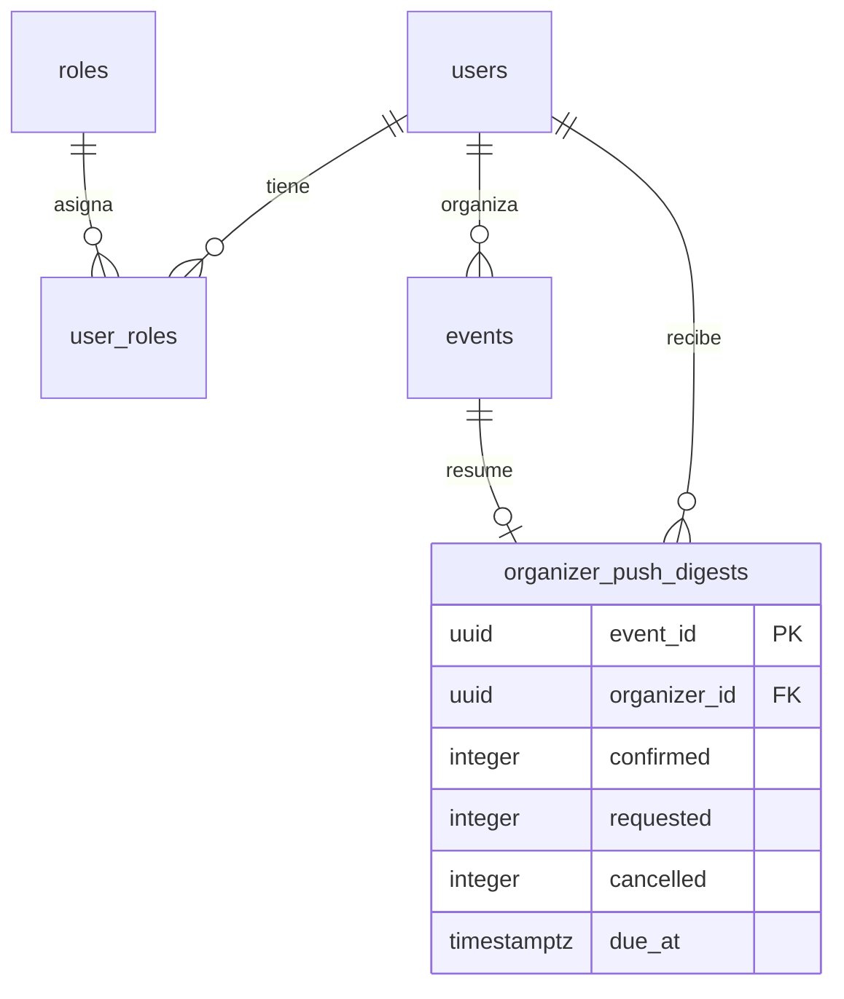

# Partners

Los organizadores (rol partner) publican y gestionan sus propios eventos: los crean,
los editan, cambian su estado, los cancelan y revisan las inscripciones. Reciben un
correo por cada inscripción y un push que resume la actividad de cada evento. La cuenta
de Mercado Pago para cobrar y las devoluciones están en [Pagos](../payments/README.md);
el rol lo asigna un administrador en [Administración](../admin/README.md).

- Código del módulo: `PAR`.
- Backend: paquete [`partner`](../../../../backend/src/main/java/com/vinnot/partner/), que reutiliza los casos de uso de [Eventos](../events/README.md).
- [Casos de uso](use-cases/README.md) · [Requisitos](requirements.md) ·
  [Arquitectura](architecture.md) · [Pruebas](testing.md)

## Actores

| Actor | Qué hace en este módulo |
|---|---|
| Organizador (partner o administrador) | Gestiona sus eventos y revisa sus inscripciones |
| Sistema (tareas programadas) | Agrupa la actividad de inscripción y envía el push de resumen |

## Reglas de negocio

| Regla | Detalle | Dónde |
|---|---|---|
| Rol asignado | No hay solicitud para ser partner; un administrador asigna el rol. La web y la app muestran «Mis eventos» a partners y administradores | [`PartnerEventController.java`](../../../../backend/src/main/java/com/vinnot/partner/infrastructure/web/controller/PartnerEventController.java) |
| Solo lo propio | El organizador sale de la sesión; editar o cancelar un evento ajeno da 422 | [`UpdateEventCommandHandler.java`](../../../../backend/src/main/java/com/vinnot/event/application/command/handler/UpdateEventCommandHandler.java) |
| Cobro online | Un evento pago necesita una cuenta de Mercado Pago vinculada para quedar publicado o agotado | [`OnlineEventPaymentAvailability.java`](../../../../backend/src/main/java/com/vinnot/payment/application/service/OnlineEventPaymentAvailability.java) |
| Estados | Un evento cancelado no cambia más; uno finalizado puede volver a publicado o borrador, pero no cancelarse ni posponerse; «agotado» lo pone el sistema | [`Event.java`](../../../../backend/src/main/java/com/vinnot/event/domain/model/Event.java) |
| Cancelar no borra | Cancelar deja el evento con estado cancelado y un motivo; la nota libre solo aparece con «Otro» y tiene hasta 280 caracteres | [`CancelEventCommandHandler.java`](../../../../backend/src/main/java/com/vinnot/event/application/command/handler/CancelEventCommandHandler.java) |
| Revisión | Aprobar, poner en espera o rechazar; una inscripción confirmada o terminada no se rechaza; el organizador no acredita pagos | [`ReviewEventRegistrationCommandHandler.java`](../../../../backend/src/main/java/com/vinnot/event/application/command/handler/ReviewEventRegistrationCommandHandler.java) |
| Avisos | Un correo por inscripción; los push se agrupan 15 minutos por evento y se descartan si el evento se cancela | [`SendOrganizerDigestsService.java`](../../../../backend/src/main/java/com/vinnot/event/application/service/SendOrganizerDigestsService.java) |
| Borrador local | El editor guarda lo escrito en el dispositivo durante 7 días | [`eventDraft.ts`](../../../../frontend-react/src/domain/event/eventDraft.ts) |

Los estados de un evento y de una inscripción están en [Eventos](../events/README.md).

## Dónde vive

| Parte | Ubicación |
|---|---|
| API | [`PartnerEventController`](../../../../backend/src/main/java/com/vinnot/partner/infrastructure/web/controller/PartnerEventController.java) en `/partner/events`, y la revisión de inscripciones en `/events/{eventId}/registrations` |
| Web | `/partner/events` en [`pages/partner`](../../../../frontend-react/src/presentation/pages/partner/) |
| App | `frontend-mobile/app/(app)/partner/`, con las pantallas en [`features/partner`](../../../../frontend-mobile/src/presentation/features/partner/) y el editor en [`features/event`](../../../../frontend-mobile/src/presentation/features/event/) |

## Datos

El módulo no tiene tablas de eventos propias: usa `events` y `event_registrations`
de [Eventos](../events/README.md), con `events.organizer_id` como dueño. `V49` crea
`organizer_push_digests`, una fila por evento con la actividad pendiente de avisar.

[Ver diagrama de «Partners · Datos» completo](https://images.vinnot.com/docs/diagrams/v1/es/modules-partner-readme-0351100e7c82.svg)

Cada fila se borra cuando se envía su push, y con su evento o con la cuenta del organizador.
