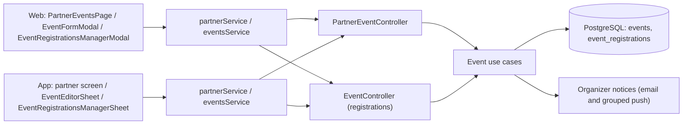

# Arquitectura

Cómo está construido el módulo en cada capa. El backend no tiene dominio propio: un adaptador
HTTP reutiliza los casos de uso de [Eventos](../events/README.md) con la identidad del
organizador. La web y la app siguen `pantalla → hook → servicio → cliente API → transporte
HTTP` y comparten con administración el mismo editor de eventos. La cuenta de cobro y las
devoluciones están en [Pagos](../payments/README.md).

[Ver diagrama de «Arquitectura» completo](https://images.vinnot.com/docs/diagrams/v1/es/modules-partner-architecture-c45a076a2c06.svg)

## Backend

### Listado propio

`GET /partner/events` deriva el `organizerId` exclusivamente del principal JWT.
No acepta un organizador arbitrario por query string. Esta propiedad es
fundamental para evitar enumeración horizontal. El `search` opcional se recorta y
se busca, sin distinguir mayúsculas, en título, lugar, ciudad, región y país, los
mismos campos que la búsqueda pública de eventos, pero sobre los eventos del
organizador en cualquier estado. Un `search` vacío o ausente lista todos los
eventos propios, del más nuevo al más viejo, como antes.

### Creación

`POST /partner/events` fuerza `organizerId` al usuario autenticado. El contrato
incluye:

- información básica y tipo;
- inicio y fin;
- ubicación textual, coordenadas y URL de mapa;
- precio, moneda y capacidad;
- deadline, cantidad máxima de entradas y modalidad de aprobación;
- confirmación de asistencia y duración del hold;
- alias, QR e instrucciones de pago;
- imagen y datos de contacto;
- estado inicial solicitado.

La request se valida en el borde, pero las reglas temporales, de capacidad y de
transición se aplican dentro del dominio.

### Actualización y cancelación

El update partner usa `PUT`; su command admite campos opcionales, conserva los
valores omitidos y aplica únicamente los presentes. `clearFields` (hasta 50 nombres de
hasta 64 caracteres) vacía campos opcionales, con la misma semántica que el
endpoint administrativo. Los editores envían el estado solo cuando cambia y nombran en
`clearFields` cada campo opcional vaciado; pedir `CANCELLED` responde 400
`USE_CANCEL_ENDPOINT`.

El delete partner no borra: ejecuta `CancelEventCommand` con `isAdmin=false` y
valida ownership. La respuesta `204` expresa que la operación terminó, no que la
fila física desapareció.

### Contrato y permisos

| Ruta | Permiso | Respuesta |
|---|---|---|
| `GET /partner/events?search=&page=&size=` | `EVENT_CREATE` | Página de eventos propios (20 por defecto), filtrable con `search` |
| `POST /partner/events` | `EVENT_CREATE` | `201` con el ID |
| `PUT /partner/events/{id}` | `EVENT_UPDATE` o `EVENT_UPDATE_OWN` | `200` |
| `DELETE /partner/events/{id}` | `EVENT_DELETE` o `EVENT_DELETE_OWN` | `204`; cancela con el motivo opcional |
| `GET /events/{eventId}/registrations` | `EVENT_UPDATE` o `EVENT_UPDATE_OWN` | Inscripciones del evento |
| `PATCH /events/{eventId}/registrations/{registrationId}` | `EVENT_UPDATE` o `EVENT_UPDATE_OWN` | Inscripción revisada |

El controller `PartnerEventController` es solo un adaptador HTTP: reutiliza los casos
de uso de [Eventos](../events/architecture.md#backend). El rol `PARTNER` lo
asigna un administrador; no hay solicitud ni alta propia. Editar o cancelar un evento
ajeno responde `422` `EVENT_OWNERSHIP`. Publicar un evento pago, o mantenerlo publicado o
agotado, exige la cuenta de Mercado Pago vinculada del organizador
([Pagos](../payments/README.md)).

### Estados

Un evento cancelado no cambia más de estado. Uno finalizado puede volver a publicado o
a borrador, pero no cancelarse ni posponerse. `SOLD_OUT` lo calcula el sistema según el
cupo y no se puede pedir; reenviar el estado actual, incluido `SOLD_OUT`, no es un
cambio de estado. El editor web muestra un evento agotado como publicado.

### Revisión de inscripciones

`ReviewEventRegistrationCommandHandler` aplica `APPROVE`, `WAITLIST` o `REJECT` con una nota
opcional. Aprobar una inscripción gratuita la deja esperando la confirmación de quien
asiste, si el evento la pide, o confirmada; en un evento pago la deja esperando el pago.
No se puede rechazar una inscripción confirmada ni una terminada. No hay cobro en puerta.

### Avisos al organizador

Cada inscripción nueva le envía un correo al organizador. Los push se agrupan: 
`NotifyEventRegistrationService` acumula confirmadas, solicitadas y canceladas en
`organizer_push_digests` durante 15 minutos, y `OrganizerDigestScheduler` (cada 60 s)
entrega un push por evento con los totales; los eventos cancelados se descartan.

## Web

### Estados recibidos y acciones de gestión

La inscripción y el pago son dos dimensiones distintas. `CONFIRMED` no es
el nombre de un estado de pago y `REPORTED` no confirma por sí solo asistencia.

| Estado de inscripción | Interpretación / gestión ofrecida |
|---|---|
| REQUESTED | Gratuito: aprobar/rechazar/espera. Pago legacy: el asistente retoma checkout; no se acredita manualmente |
| AWAITING_PAYMENT | Pendiente de pago; el asistente abre checkout. Organizador sólo puede rechazar, sin acreditar |
| AWAITING_ATTENDEE_CONFIRMATION | Espera confirmación del asistente; gestión permite rechazo |
| CONFIRMED | Inscripción confirmada |
| WAITLISTED | Lista de espera |
| REJECTED | Solicitud rechazada |
| CANCELLED | Solicitud cancelada |
| EXPIRED | Reserva/plazo vencido según backend |

El selector de gestión deriva acciones del estado recibido y precio del evento. Aprobar, enviar a espera y rechazar abren cada una una confirmación para esa persona, con una nota opcional del organizador solo para ella; no hay una nota compartida, así que nunca se arrastra al siguiente asistente. Solo la inscripción que se revisa queda pendiente. Cancelar un evento ofrece «Mantener evento» como opción para descartar el diálogo y avisa el éxito.
La respuesta verificada del servidor determina la transición. No hay cobro manual, alias ni QR en el editor. Los pagos sólo se confirman desde Mercado Pago; la devolución se solicita desde la inscripción cuando el servidor la habilita.

Los campos `expiresAt`, `approvedAt`, `confirmedAt` y demás timestamps se
mapean a fechas. Contadores y capacidad son una proyección informativa; el
backend vuelve a validar cupos al aceptar una operación concurrente.

### Recuperación local del editor de eventos

El editor admin/partner conserva campos incompletos mediante `useEventDraftRecovery`, un servicio de aplicación y el puerto `EventDraftStorage`. El adaptador usa LocalStorage en web y AsyncStorage en mobile. La clave separa cuenta y evento; un evento nuevo usa un borrador propio. Los datos tienen esquema versionado, límite de tamaño y validez de recuperación de siete días.

Cerrar, pulsar Escape o deslizar el sheet no descarta el borrador. Al volver se ofrece **Retomar borrador** o **Descartar borrador**, este último con confirmación. Se debe revisar la información recuperada antes de guardar: no reemplaza automáticamente cambios que otro editor haya publicado. Los errores de almacenamiento se muestran y permiten reintentar; un cierre voluntario espera el guardado. Las operaciones locales se serializan para que una escritura tardía no reviva datos descartados.

Un guardado remoto fallido mantiene el borrador; sólo el éxito confirmado lo elimina. Esto no publica ni modifica el estado DRAFT del servidor y no sincroniza entre dispositivos. Borrar datos del navegador/app o desinstalar puede eliminar la recuperación.

### Inscripción y vinculación de pagos online

El editor ofrece Gratis o Pago online con Mercado Pago. MANUAL/AUTOMATIC y confirmación adicional del asistente se configuran sólo en gratuitos. Los pagos reservan cupo automáticamente durante el plazo elegido, y el checkout debe confirmar el cobro. Moneda: selector ARS. Las reservas históricas REQUESTED/REPORTED pueden retomar checkout sin habilitar acreditación manual.

El organizador debe vincular su propia cuenta desde `/partner/payments` antes de publicar un evento pago. El backend verifica la vinculación y disponibilidad de cobro; guardar un borrador no requiere cuenta. El botón de vinculación está en la sección paga. En mobile inicia OAuth con la sesión de la app y abre directamente el destino oficial de Mercado Pago, sin tokens de Vinnot en enlaces. El callback se completa automáticamente mediante el estado de un solo uso y PKCE guardados en servidor, sin exigir otro login web. La pantalla muestra éxito o error y vuelve a la app mediante un enlace fijo; el editor consulta el estado al abrirse y al regresar a primer plano. La apertura de la app del proveedor depende del sistema y de Mercado Pago. El entorno de pagos define los límites de cobro ([Pagos](../payments/README.md)).

## App

### Estados recibidos y acciones de gestión

La inscripción y el pago son dos dimensiones distintas. `CONFIRMED` no es
el nombre de un estado de pago y `REPORTED` no confirma por sí solo asistencia.

| Estado de inscripción | Interpretación / gestión ofrecida |
|---|---|
| REQUESTED | Gratuito: aprobar/rechazar/espera. Pago legacy: el asistente retoma checkout; no se acredita manualmente |
| AWAITING_PAYMENT | Pendiente de pago; el asistente abre checkout. Organizador sólo puede rechazar, sin acreditar |
| AWAITING_ATTENDEE_CONFIRMATION | Espera confirmación del asistente; gestión permite rechazo |
| CONFIRMED | Inscripción confirmada |
| WAITLISTED | Lista de espera |
| REJECTED | Solicitud rechazada |
| CANCELLED | Solicitud cancelada |
| EXPIRED | Reserva/plazo vencido según backend |

El selector de gestión deriva acciones del estado recibido y precio del evento.
La respuesta verificada del servidor determina la transición. No hay cobro manual, alias ni QR en el editor. Los pagos sólo se confirman desde Mercado Pago; la devolución se solicita desde la inscripción cuando el servidor la habilita.

Cada acción de revisión pide confirmación dentro del diálogo (web) o la tarjeta
(app) de esa persona, con una nota opcional para ella; si falla, la nota se
conserva para reintentar. El diálogo de devolución cierra con "Volver". Si Mercado Pago rechazó
una devolución, la inscripción lo muestra y ofrece «Reintentar devolución»
([Pagos](../payments/architecture.md)).

Los campos `expiresAt`, `approvedAt`, `confirmedAt` y demás timestamps se
mapean a fechas. Contadores y capacidad son una proyección informativa; el
backend vuelve a validar cupos al aceptar una operación concurrente.

### Recuperación local del editor de eventos

El editor admin/partner conserva campos incompletos mediante `useEventDraftRecovery`, un servicio de aplicación y el puerto `EventDraftStorage`. El adaptador usa LocalStorage en web y AsyncStorage en mobile. La clave separa cuenta y evento; un evento nuevo usa un borrador propio. Los datos tienen esquema versionado, límite de tamaño y validez de recuperación de siete días.

Cerrar, pulsar Escape o deslizar el sheet no descarta el borrador. Al volver se ofrece **Retomar borrador** o **Descartar borrador**, este último con confirmación. Se debe revisar la información recuperada antes de guardar: no reemplaza automáticamente cambios que otro editor haya publicado. Los errores de almacenamiento se muestran y permiten reintentar; un cierre voluntario espera el guardado. Las operaciones locales se serializan para que una escritura tardía no reviva datos descartados.

Un guardado remoto fallido mantiene el borrador; sólo el éxito confirmado lo elimina. Esto no publica ni modifica el estado DRAFT del servidor y no sincroniza entre dispositivos. Borrar datos del navegador/app o desinstalar puede eliminar la recuperación.

### Inscripción y vinculación de pagos online

El editor ofrece Gratis o Pago online con Mercado Pago. MANUAL/AUTOMATIC y confirmación adicional del asistente se configuran sólo en gratuitos. Los pagos reservan cupo automáticamente durante el plazo elegido, y el checkout debe confirmar el cobro. Moneda: selector ARS. Las reservas históricas REQUESTED/REPORTED pueden retomar checkout sin habilitar acreditación manual.

El organizador debe vincular su propia cuenta de Mercado Pago antes de publicar un evento pago; no existe una ruta mobile `/partner/payments`. El backend verifica la vinculación y disponibilidad de cobro; guardar un borrador no requiere cuenta. El botón de vinculación está en la sección paga de `EventEditorFields.tsx`, mediante `usePaymentAccountSetup` y `paymentAccount.client.ts` (`/payments/mercadopago/account/connect` con `returnToApp: true`). En mobile inicia OAuth con la sesión de la app y abre directamente el destino oficial de Mercado Pago, sin tokens de Vinnot en enlaces. El callback se completa automáticamente mediante el estado de un solo uso y PKCE guardados en servidor, sin exigir otro login web. La pantalla muestra éxito o error y vuelve a la app mediante un enlace fijo; el editor consulta el estado al abrirse y al regresar a primer plano. La apertura de la app del proveedor depende del sistema y de Mercado Pago. Producción utiliza la política LIVE: importe positivo en ARS, organizador real distinto de la plataforma y comisión del 3%; la política de piloto sigue disponible únicamente para entornos restringidos.

## Editor de eventos

### Editor de eventos en web y mobile

El editor organiza información básica/portada, ubicación, contacto e inscripción en secciones plegables. Conserva el borrador al plegar y abre las secciones con errores. Admin y partner mobile comparten `EventEditorSheet`, `EventEditorFields` y `useEventEditor`, manteniendo sus respectivas mutaciones autorizadas. Web reutiliza `EventFormModal` para ambos roles y delega la coordinación a `useEventEditor`. El contrato mobile común `ManagedEvent`/`EventEditorInput` pertenece al dominio de eventos; los nombres partner existentes quedan como aliases de compatibilidad.

Las reglas puras `domain/event/eventEditor.ts` devuelven códigos tipados que se traducen en presentación, sin conocer namespaces de i18n. En ambos clientes validan fechas, cierre, coordenadas, precio, cupo, moneda, contacto y límites de inscripción. Cupo vacío se conserva como ilimitado; no se convierte a cero. Gratis envía precio null; pago requiere precio positivo. Al editar, ambos clientes nombran en `clearFields` cada campo opcional vaciado (`toPatchRequest`, como en administración) y envían el estado solo si cambió. El editor mobile no envía alias, QR ni instrucciones de pago, que no muestra, así que guardar desde la app nunca los borra. El pago usa checkout Mercado Pago y el split del 3% configurado en payment. Producción usa `LIVE`, sin el tope de importe ni el vendedor único del piloto; `LIVE_PILOT` queda para pruebas controladas.

La ubicación del editor incluye mapa sin búsqueda previa, selección mediante pin/clic y coordenadas cero válidas. En mobile el viewport permite desplazamiento y zoom; respuestas de geocodificación tardías no sobrescriben una selección manual ni otro borrador. Web conserva el consentimiento para mapas externos. El selector reutilizable también se aplica al editor de bodegas y a las paradas de rutas en web/mobile. Los mapas de paradas se despliegan a demanda; cambiar un punto reemplaza el borrador de esa parada, por lo que una búsqueda anterior no sobreescribe las coordenadas elegidas. La vista general de una ruta sigue siendo una previsualización.

La portada continúa utilizando los hooks y el pipeline de medios existentes; web permite elegir archivo o arrastrarlo al selector.
