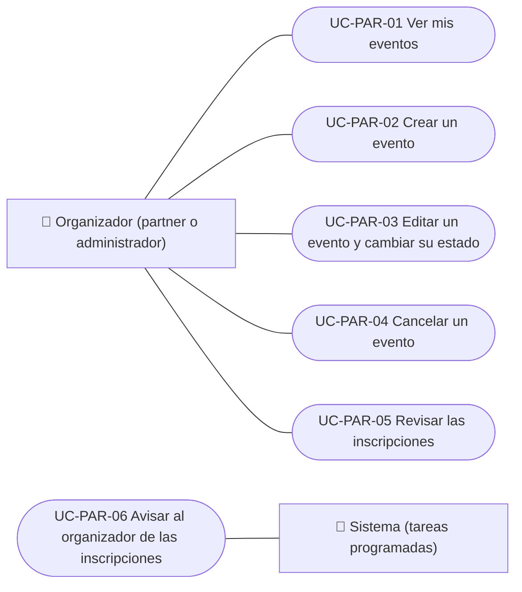

# Casos de uso

Casos de uso del organizador de eventos (rol partner): ver sus eventos, crearlos, editarlos y cambiar su estado, cancelarlos, revisar las inscripciones y recibir los avisos de inscripción. La cuenta de cobro y las devoluciones están en Pagos y la asignación del rol, en Administración. Cada caso vale para las plataformas indicadas.

| ID | Caso de uso | Plataformas | Actores |
|---|---|---|---|
| `UC-PAR-01` | [Ver mis eventos](uc-par-01-list-own-events.md) | Web, APK | Organizador (partner o administrador) |
| `UC-PAR-02` | [Crear un evento](uc-par-02-create-event.md) | Web, APK | Organizador (partner o administrador) |
| `UC-PAR-03` | [Editar un evento y cambiar su estado](uc-par-03-edit-event.md) | Web, APK | Organizador (partner o administrador) |
| `UC-PAR-04` | [Cancelar un evento](uc-par-04-cancel-event.md) | Web, APK | Organizador (partner o administrador) |
| `UC-PAR-05` | [Revisar las inscripciones](uc-par-05-review-registrations.md) | Web, APK | Organizador (partner o administrador) |
| `UC-PAR-06` | [Avisar al organizador de las inscripciones](uc-par-06-organizer-notices.md) | Solo backend | Sistema (tareas programadas) |

## Diagrama de casos de uso

[Ver diagrama de «Casos de uso · Diagrama de casos de uso» completo](https://images.vinnot.com/docs/diagrams/v1/es/modules-partner-use-cases-readme-2e943618f49a.svg)

## Equivalencia con Lucidchart

| ID | IDs en Lucidchart |
|---|---|
| `UC-PAR-01` | [WEB UC-PAR-01](https://lucid.app/lucidchart/9f11a16b-bb5a-42fc-a9e8-0852b17bd241/edit), [APK UC-ORG-01](https://lucid.app/lucidchart/e095dd25-e8ac-41ba-bf5b-396e1055f217/edit) |
| `UC-PAR-02` | [WEB UC-PAR-02](https://lucid.app/lucidchart/9f11a16b-bb5a-42fc-a9e8-0852b17bd241/edit), [APK UC-ORG-02](https://lucid.app/lucidchart/e095dd25-e8ac-41ba-bf5b-396e1055f217/edit) |
| `UC-PAR-03` | [WEB UC-PAR-03](https://lucid.app/lucidchart/9f11a16b-bb5a-42fc-a9e8-0852b17bd241/edit), [APK UC-ORG-02](https://lucid.app/lucidchart/e095dd25-e8ac-41ba-bf5b-396e1055f217/edit), [APK UC-ORG-04](https://lucid.app/lucidchart/e095dd25-e8ac-41ba-bf5b-396e1055f217/edit) |
| `UC-PAR-04` | [WEB UC-PAR-04](https://lucid.app/lucidchart/9f11a16b-bb5a-42fc-a9e8-0852b17bd241/edit), [APK UC-ORG-05](https://lucid.app/lucidchart/e095dd25-e8ac-41ba-bf5b-396e1055f217/edit) |
| `UC-PAR-05` | [WEB UC-PAR-05](https://lucid.app/lucidchart/9f11a16b-bb5a-42fc-a9e8-0852b17bd241/edit), [APK UC-ORG-06](https://lucid.app/lucidchart/e095dd25-e8ac-41ba-bf5b-396e1055f217/edit) |
| `UC-PAR-06` | Ninguno |
