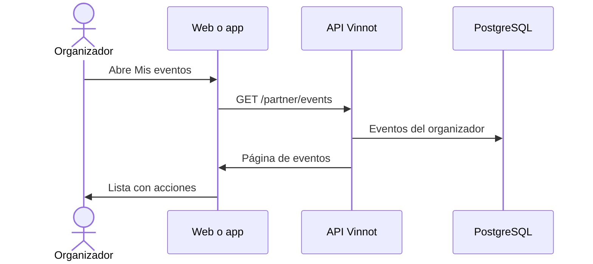

# UC-PAR-01 · Ver mis eventos

| Campo | Valor |
|---|---|
| ID | `UC-PAR-01` |
| Módulo | [Partners](../README.md) |
| Plataformas | Web, APK |
| Actores | Organizador (partner o administrador) |
| IDs en Lucidchart | [WEB UC-PAR-01](https://lucid.app/lucidchart/9f11a16b-bb5a-42fc-a9e8-0852b17bd241/edit), [APK UC-ORG-01](https://lucid.app/lucidchart/e095dd25-e8ac-41ba-bf5b-396e1055f217/edit) |
| Requisitos | [`RF-WEB-PAR-01`](../requirements.md), [`RF-APK-PAR-01`](../requirements.md) |
| Casos de prueba | [`CP-PAR-01`](../testing.md), [`CP-PAR-02`](../testing.md) |

## Precondiciones

- La persona tiene el rol partner, asignado por un administrador, o es administradora.

## Postcondiciones

- La persona ve sus eventos con su estado.

## Flujo principal

1. La persona abre «Mis eventos»: en la web, `/partner/events`; en la app, desde el perfil.
2. El cliente pide `GET /partner/events`, de a 20.
3. La API toma el organizador de la sesión y devuelve solo sus eventos.
4. El cliente muestra cada evento con fecha, estado e inscripciones, y las acciones de editar, cancelar y ver inscripciones.

## Flujos alternativos

- 1a. La persona no es partner ni administradora: el cliente no muestra la sección y la API responde 403.

## Reglas de negocio

- El organizador nunca se elige por parámetro: siempre es quien tiene la sesión.
- No hay solicitud para ser partner; el rol lo asigna un administrador ([Administración](../../admin/README.md)).

## Diagrama

[Ver diagrama de «UC-PAR-01 · Ver mis eventos» completo](https://images.vinnot.com/docs/diagrams/v1/es/modules-partner-use-cases-uc-par-01-list-own-events-abc4851900f7.svg)

Diagrama de componentes en Lucidchart: [WEB UC-PAR-01](https://lucid.app/lucidchart/9f11a16b-bb5a-42fc-a9e8-0852b17bd241/edit), [APK UC-ORG-01](https://lucid.app/lucidchart/e095dd25-e8ac-41ba-bf5b-396e1055f217/edit).

## Código

| Capa | Ubicación |
|---|---|
| Endpoints | `GET /partner/events` |
| Backend | [`PartnerEventController.java`](../../../../../backend/src/main/java/com/vinnot/partner/infrastructure/web/controller/PartnerEventController.java) |
| Web | [`PartnerEventsPage.tsx`](../../../../../frontend-react/src/presentation/pages/partner/PartnerEventsPage.tsx), [`usePartnerEventsViewModel.ts`](../../../../../frontend-react/src/presentation/pages/partner/usePartnerEventsViewModel.ts), [`usePartnerEvents.ts`](../../../../../frontend-react/src/presentation/hooks/queries/partner/usePartnerEvents.ts), [`partner.service.ts`](../../../../../frontend-react/src/application/services/partner.service.ts), [`partner.client.ts`](../../../../../frontend-react/src/infrastructure/api/clients/partner.client.ts) |
| App | `frontend-mobile/app/(app)/partner/index.tsx`, [`PartnerEventRow.tsx`](../../../../../frontend-mobile/src/presentation/features/partner/PartnerEventRow.tsx), [`PartnerEventSheet.tsx`](../../../../../frontend-mobile/src/presentation/features/partner/PartnerEventSheet.tsx), [`PartnerDashboardHero.tsx`](../../../../../frontend-mobile/src/presentation/features/partner/PartnerDashboardHero.tsx), [`partner.service.ts`](../../../../../frontend-mobile/src/application/services/partner.service.ts), [`partner.client.ts`](../../../../../frontend-mobile/src/infrastructure/api/clients/partner.client.ts) |

## Tests automáticos

- Backend: Ninguno
- Web: [`PartnerEventsPage.test.tsx`](../../../../../frontend-react/src/presentation/pages/partner/PartnerEventsPage.test.tsx), [`usePartnerEventsViewModel.test.tsx`](../../../../../frontend-react/src/presentation/pages/partner/usePartnerEventsViewModel.test.tsx), [`partner.service.test.ts`](../../../../../frontend-react/src/application/services/partner.service.test.ts), [`partner.client.test.ts`](../../../../../frontend-react/src/infrastructure/api/clients/partner.client.test.ts)
- App: [`PartnerEventRow.test.tsx`](../../../../../frontend-mobile/src/presentation/features/partner/PartnerEventRow.test.tsx), [`partnerRoute.test.tsx`](../../../../../frontend-mobile/src/presentation/features/partner/__tests__/partnerRoute.test.tsx), [`partner.service.test.ts`](../../../../../frontend-mobile/src/application/services/partner.service.test.ts), [`partner.client.test.ts`](../../../../../frontend-mobile/src/infrastructure/api/clients/partner.client.test.ts)
