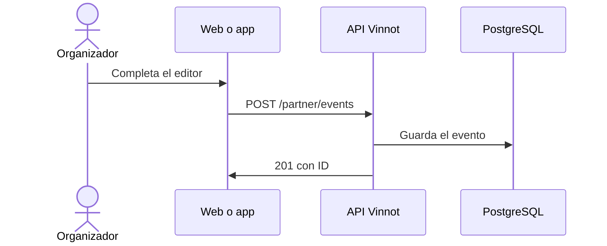

# UC-PAR-02 · Crear un evento

| Campo | Valor |
|---|---|
| ID | `UC-PAR-02` |
| Módulo | [Partners](../README.md) |
| Plataformas | Web, APK |
| Actores | Organizador (partner o administrador) |
| IDs en Lucidchart | [WEB UC-PAR-02](https://lucid.app/lucidchart/9f11a16b-bb5a-42fc-a9e8-0852b17bd241/edit), [APK UC-ORG-02](https://lucid.app/lucidchart/e095dd25-e8ac-41ba-bf5b-396e1055f217/edit) |
| Requisitos | [`RF-WEB-PAR-02`](../requirements.md), [`RF-APK-PAR-02`](../requirements.md) |
| Casos de prueba | [`CP-PAR-03`](../testing.md), [`CP-PAR-04`](../testing.md), [`CP-PAR-05`](../testing.md), [`CP-PAR-06`](../testing.md) |

## Precondiciones

- La persona es organizadora y está en «Mis eventos».

## Postcondiciones

- El evento quedó creado como borrador o publicado.

## Flujo principal

1. La persona elige «Crear evento».
2. Completa el editor por secciones: datos básicos y portada, ubicación en el mapa, contacto e inscripción.
3. En inscripción elige gratis o pago online con Mercado Pago, cupo, plazo y límite de entradas.
4. El cliente valida fechas, coordenadas, precio, cupo y contacto, y envía `POST /partner/events`.
5. La API usa a quien tiene la sesión como organizador, aplica las reglas del evento y devuelve `201` con el ID.

## Flujos alternativos

- 2a. La persona cierra el editor sin guardar: el borrador queda en el dispositivo durante 7 días y se ofrece retomarlo.
- 5a. El evento es pago y se pide publicarlo sin cuenta de Mercado Pago vinculada: la API lo rechaza; guardarlo como borrador sí se permite.
- 4a. Algún dato no es válido: el editor abre la sección con el error.

## Reglas de negocio

- Un cupo vacío significa ilimitado.
- Un evento gratis no tiene precio; uno pago necesita un precio positivo en ARS.
- La aprobación manual o automática y la confirmación de quien asiste solo se configuran en eventos gratis.
- Las coordenadas cero son válidas.

## Diagrama

[Ver diagrama de «UC-PAR-02 · Crear un evento» completo](https://images.vinnot.com/docs/diagrams/v1/es/modules-partner-use-cases-uc-par-02-create-event-4c7af97ed7c8.svg)

Diagrama de componentes en Lucidchart: [WEB UC-PAR-02](https://lucid.app/lucidchart/9f11a16b-bb5a-42fc-a9e8-0852b17bd241/edit), [APK UC-ORG-02](https://lucid.app/lucidchart/e095dd25-e8ac-41ba-bf5b-396e1055f217/edit).

## Código

| Capa | Ubicación |
|---|---|
| Endpoints | `POST /partner/events` |
| Backend | [`PartnerEventController.java`](../../../../../backend/src/main/java/com/vinnot/partner/infrastructure/web/controller/PartnerEventController.java), [`CreateEventCommandHandler.java`](../../../../../backend/src/main/java/com/vinnot/event/application/command/handler/CreateEventCommandHandler.java) |
| Web | [`PartnerEventsPage.tsx`](../../../../../frontend-react/src/presentation/pages/partner/PartnerEventsPage.tsx), [`usePartnerEventsViewModel.ts`](../../../../../frontend-react/src/presentation/pages/partner/usePartnerEventsViewModel.ts), [`EventFormModal.tsx`](../../../../../frontend-react/src/presentation/components/features/event/EventFormModal.tsx), [`useEventEditor.ts`](../../../../../frontend-react/src/presentation/components/features/event/useEventEditor.ts), [`usePartnerEventMutations.ts`](../../../../../frontend-react/src/presentation/hooks/queries/partner/usePartnerEventMutations.ts), [`partner.service.ts`](../../../../../frontend-react/src/application/services/partner.service.ts), [`partner.client.ts`](../../../../../frontend-react/src/infrastructure/api/clients/partner.client.ts) |
| App | `frontend-mobile/app/(app)/partner/index.tsx`, [`PartnerEventRow.tsx`](../../../../../frontend-mobile/src/presentation/features/partner/PartnerEventRow.tsx), [`PartnerEventSheet.tsx`](../../../../../frontend-mobile/src/presentation/features/partner/PartnerEventSheet.tsx), [`EventEditorSheet.tsx`](../../../../../frontend-mobile/src/presentation/features/event/EventEditorSheet.tsx), [`EventEditorFields.tsx`](../../../../../frontend-mobile/src/presentation/features/event/EventEditorFields.tsx), [`useEventEditor.ts`](../../../../../frontend-mobile/src/presentation/features/event/useEventEditor.ts), [`partner.service.ts`](../../../../../frontend-mobile/src/application/services/partner.service.ts), [`partner.client.ts`](../../../../../frontend-mobile/src/infrastructure/api/clients/partner.client.ts) |

## Tests automáticos

- Backend: [`EventOwnershipTest.java`](../../../../../backend/src/test/java/com/vinnot/event/application/command/handler/EventOwnershipTest.java)
- Web: [`usePartnerEventMutations.test.tsx`](../../../../../frontend-react/src/presentation/hooks/queries/partner/usePartnerEventMutations.test.tsx), [`partner.mappers.test.ts`](../../../../../frontend-react/src/domain/partner/partner.mappers.test.ts)
- App: [`EventEditorFields.test.tsx`](../../../../../frontend-mobile/src/presentation/features/event/EventEditorFields.test.tsx), [`useEventEditor.test.ts`](../../../../../frontend-mobile/src/presentation/features/event/useEventEditor.test.ts), [`partner.mappers.test.ts`](../../../../../frontend-mobile/src/domain/partner/partner.mappers.test.ts)
