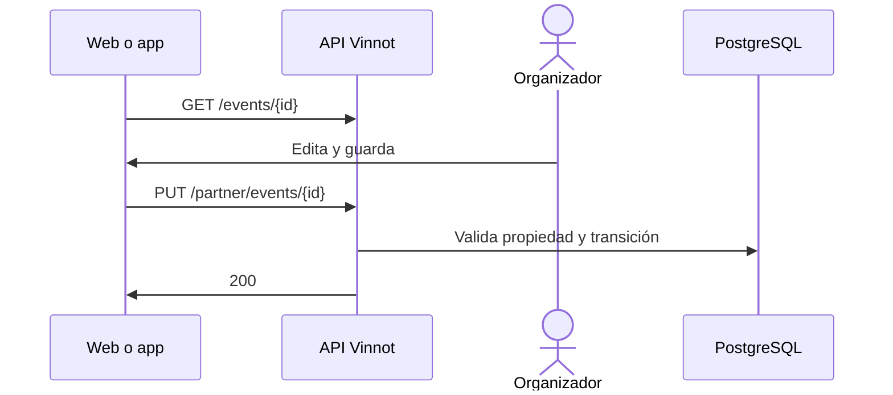

# UC-PAR-03 · Editar un evento y cambiar su estado

| Campo | Valor |
|---|---|
| ID | `UC-PAR-03` |
| Módulo | [Partners](../README.md) |
| Plataformas | Web, APK |
| Actores | Organizador (partner o administrador) |
| IDs en Lucidchart | [WEB UC-PAR-03](https://lucid.app/lucidchart/9f11a16b-bb5a-42fc-a9e8-0852b17bd241/edit), [APK UC-ORG-02](https://lucid.app/lucidchart/e095dd25-e8ac-41ba-bf5b-396e1055f217/edit), [APK UC-ORG-04](https://lucid.app/lucidchart/e095dd25-e8ac-41ba-bf5b-396e1055f217/edit) |
| Requisitos | [`RF-WEB-PAR-03`](../requirements.md), [`RF-WEB-PAR-04`](../requirements.md), [`RF-APK-PAR-03`](../requirements.md), [`RF-APK-PAR-04`](../requirements.md) |
| Casos de prueba | [`CP-PAR-07`](../testing.md), [`CP-PAR-21`](../testing.md), [`CP-PAR-23`](../testing.md), [`CP-PAR-08`](../testing.md), [`CP-PAR-09`](../testing.md), [`CP-PAR-10`](../testing.md), [`CP-PAR-22`](../testing.md) |

## Precondiciones

- La persona es organizadora del evento o administradora.

## Postcondiciones

- El evento quedó actualizado con su nuevo estado.

## Flujo principal

1. La persona elige editar un evento.
2. El cliente carga el detalle completo con `GET /events/{id}` y abre el editor.
3. La persona cambia datos o el estado: borrador, publicado o completado. El editor no ofrece «Cancelado»: para cancelar el evento se usa la acción «Cancelar evento» ([UC-PAR-04](uc-par-04-cancel-event.md)).
4. El cliente envía `PUT /partner/events/{id}`, con el estado solo si cambió y con `clearFields` nombrando cada campo opcional que la persona vació.
5. La API comprueba que el evento sea de la persona, aplica solo los campos enviados, vacía los campos opcionales indicados en `clearFields` y aplica la transición de estado.

## Flujos alternativos

- 4a. El estado no cambió, o el evento está agotado y el editor lo muestra como publicado: el cliente no envía el estado y la API conserva el actual.
- 4b. La persona vació un campo opcional, como el teléfono de contacto o el sitio web: el cliente lo nombra en `clearFields` y la API lo borra.
- 5a. El evento es de otra persona: la API responde 422.
- 5b. La transición no está permitida, como volver a borrador un evento cancelado: la API responde 400.
- 5c. El evento es pago, queda publicado o agotado y falta la cuenta de Mercado Pago: la API lo rechaza.
- 5d. La solicitud pide pasar el evento a cancelado: la API responde 400 `USE_CANCEL_ENDPOINT`.

## Reglas de negocio

- Un evento cancelado no cambia más de estado.
- Un evento completado puede volver a publicado o borrador, pero no cancelarse ni posponerse.
- Los editores de la web y la app no ofrecen el estado pospuesto; la API lo acepta en `PUT /partner/events/{id}`.
- «Agotado» lo calcula el sistema según el cupo; no se elige. Reenviar el estado actual, incluido agotado, no es un cambio de estado.
- Un evento solo se cancela con la acción «Cancelar evento», que pide el motivo y avisa a las personas inscriptas.
- Los campos que no se envían conservan su valor; vaciar un campo opcional en el editor y guardar lo borra, porque el cliente lo nombra en `clearFields`.
- El editor de la app no envía el alias, el QR ni las instrucciones de pago, que no muestra, así que guardar desde la app nunca los borra.

## Diagrama

[Ver diagrama de «UC-PAR-03 · Editar un evento y cambiar su estado» completo](https://images.vinnot.com/docs/diagrams/v1/es/modules-partner-use-cases-uc-par-03-edit-event-323ef35c8097.svg)

Diagrama de componentes en Lucidchart: [WEB UC-PAR-03](https://lucid.app/lucidchart/9f11a16b-bb5a-42fc-a9e8-0852b17bd241/edit), [APK UC-ORG-02](https://lucid.app/lucidchart/e095dd25-e8ac-41ba-bf5b-396e1055f217/edit), [APK UC-ORG-04](https://lucid.app/lucidchart/e095dd25-e8ac-41ba-bf5b-396e1055f217/edit).

## Código

| Capa | Ubicación |
|---|---|
| Endpoints | `GET /events/{id}`, `PUT /partner/events/{id}` |
| Backend | [`PartnerEventController.java`](../../../../../backend/src/main/java/com/vinnot/partner/infrastructure/web/controller/PartnerEventController.java), [`UpdateEventCommandHandler.java`](../../../../../backend/src/main/java/com/vinnot/event/application/command/handler/UpdateEventCommandHandler.java), [`Event.java`](../../../../../backend/src/main/java/com/vinnot/event/domain/model/Event.java) |
| Web | [`PartnerEventsPage.tsx`](../../../../../frontend-react/src/presentation/pages/partner/PartnerEventsPage.tsx), [`usePartnerEventsViewModel.ts`](../../../../../frontend-react/src/presentation/pages/partner/usePartnerEventsViewModel.ts), [`EventFormModal.tsx`](../../../../../frontend-react/src/presentation/components/features/event/EventFormModal.tsx), [`useEventEditor.ts`](../../../../../frontend-react/src/presentation/components/features/event/useEventEditor.ts), [`usePartnerEventMutations.ts`](../../../../../frontend-react/src/presentation/hooks/queries/partner/usePartnerEventMutations.ts), [`partner.service.ts`](../../../../../frontend-react/src/application/services/partner.service.ts), [`partner.client.ts`](../../../../../frontend-react/src/infrastructure/api/clients/partner.client.ts) |
| App | `frontend-mobile/app/(app)/partner/index.tsx`, [`PartnerEventRow.tsx`](../../../../../frontend-mobile/src/presentation/features/partner/PartnerEventRow.tsx), [`PartnerEventSheet.tsx`](../../../../../frontend-mobile/src/presentation/features/partner/PartnerEventSheet.tsx), [`EventEditorSheet.tsx`](../../../../../frontend-mobile/src/presentation/features/event/EventEditorSheet.tsx), [`EventEditorFields.tsx`](../../../../../frontend-mobile/src/presentation/features/event/EventEditorFields.tsx), [`useEventEditor.ts`](../../../../../frontend-mobile/src/presentation/features/event/useEventEditor.ts), [`partner.service.ts`](../../../../../frontend-mobile/src/application/services/partner.service.ts), [`partner.client.ts`](../../../../../frontend-mobile/src/infrastructure/api/clients/partner.client.ts) |

## Tests automáticos

- Backend: [`EventOwnershipTest.java`](../../../../../backend/src/test/java/com/vinnot/event/application/command/handler/EventOwnershipTest.java), [`EventStatusTransitionTest.java`](../../../../../backend/src/test/java/com/vinnot/event/domain/model/EventStatusTransitionTest.java), [`UpdateEventCommandHandlerTest.java`](../../../../../backend/src/test/java/com/vinnot/event/application/command/handler/UpdateEventCommandHandlerTest.java), [`PartnerEventControllerTest.java`](../../../../../backend/src/test/java/com/vinnot/partner/infrastructure/web/controller/PartnerEventControllerTest.java)
- Web: [`usePartnerEventMutations.test.tsx`](../../../../../frontend-react/src/presentation/hooks/queries/partner/usePartnerEventMutations.test.tsx), [`usePartnerEventsViewModel.status.test.tsx`](../../../../../frontend-react/src/presentation/pages/partner/usePartnerEventsViewModel.status.test.tsx), [`eventEditor.test.ts`](../../../../../frontend-react/src/domain/event/eventEditor.test.ts), [`partner.client.test.ts`](../../../../../frontend-react/src/infrastructure/api/clients/partner.client.test.ts)
- App: [`useEventEditor.test.ts`](../../../../../frontend-mobile/src/presentation/features/event/useEventEditor.test.ts), [`partner.client.test.ts`](../../../../../frontend-mobile/src/infrastructure/api/clients/partner.client.test.ts)
