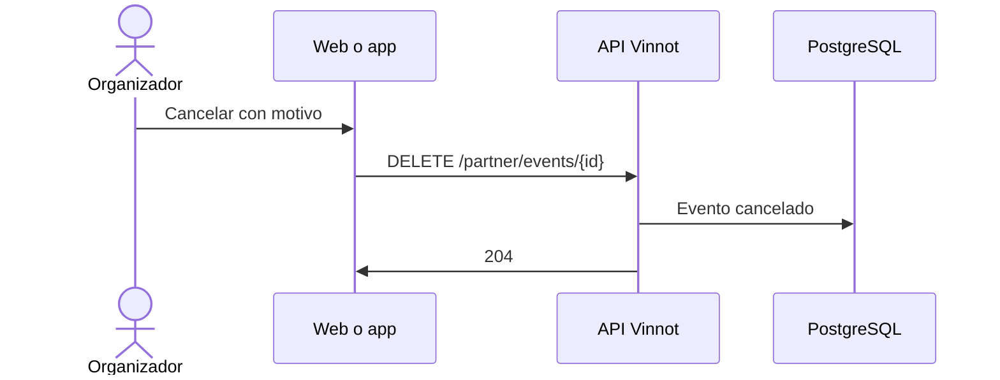

# UC-PAR-04 · Cancelar un evento

| Campo | Valor |
|---|---|
| ID | `UC-PAR-04` |
| Módulo | [Partners](../README.md) |
| Plataformas | Web, APK |
| Actores | Organizador (partner o administrador) |
| IDs en Lucidchart | [WEB UC-PAR-04](https://lucid.app/lucidchart/9f11a16b-bb5a-42fc-a9e8-0852b17bd241/edit), [APK UC-ORG-05](https://lucid.app/lucidchart/e095dd25-e8ac-41ba-bf5b-396e1055f217/edit) |
| Requisitos | [`RF-WEB-PAR-05`](../requirements.md), [`RF-APK-PAR-05`](../requirements.md) |
| Casos de prueba | [`CP-PAR-11`](../testing.md), [`CP-PAR-12`](../testing.md), [`CP-PAR-13`](../testing.md), [`CP-PAR-14`](../testing.md) |

## Precondiciones

- La persona organiza el evento o es administradora, y el evento no está finalizado.

## Postcondiciones

- El evento quedó cancelado; quienes se inscribieron reciben el aviso y los pagos online se devuelven.

## Flujo principal

1. La persona elige «Cancelar evento».
2. El cliente muestra el diálogo con el motivo preseleccionado «Circunstancias imprevistas» y avisa que cancelar es definitivo, que el evento no se puede volver a publicar y que los pagos online se devuelven automáticamente por Mercado Pago, sin posibilidad de deshacerlo.
3. La persona confirma, cambiando el motivo si quiere.
4. El cliente envía `DELETE /partner/events/{id}` con el motivo.
5. La API comprueba la propiedad, cancela el evento sin borrarlo y responde `204`.

## Flujos alternativos

- 3a. El motivo es «Otro»: aparece una nota opcional de hasta 280 caracteres.
- 3b. La persona elige «Mantener evento»: no se cancela.
- 5a. El evento está finalizado: la API responde 400.

## Reglas de negocio

- Cancelar no borra la fila: el evento queda con estado cancelado.
- Los avisos a quienes se inscribieron y las devoluciones se describen en [Eventos](../../events/README.md) y [Pagos](../../payments/README.md).

## Diagrama

[Ver diagrama de «UC-PAR-04 · Cancelar un evento» completo](https://images.vinnot.com/docs/diagrams/v1/es/modules-partner-use-cases-uc-par-04-cancel-event-e7835d181f87.svg)

Diagrama de componentes en Lucidchart: [WEB UC-PAR-04](https://lucid.app/lucidchart/9f11a16b-bb5a-42fc-a9e8-0852b17bd241/edit), [APK UC-ORG-05](https://lucid.app/lucidchart/e095dd25-e8ac-41ba-bf5b-396e1055f217/edit).

## Código

| Capa | Ubicación |
|---|---|
| Endpoints | `DELETE /partner/events/{id}` |
| Backend | [`PartnerEventController.java`](../../../../../backend/src/main/java/com/vinnot/partner/infrastructure/web/controller/PartnerEventController.java), [`CancelEventCommandHandler.java`](../../../../../backend/src/main/java/com/vinnot/event/application/command/handler/CancelEventCommandHandler.java) |
| Web | [`PartnerEventsPage.tsx`](../../../../../frontend-react/src/presentation/pages/partner/PartnerEventsPage.tsx), [`usePartnerEventsViewModel.ts`](../../../../../frontend-react/src/presentation/pages/partner/usePartnerEventsViewModel.ts), [`CancelEventDialog.tsx`](../../../../../frontend-react/src/presentation/components/features/event/CancelEventDialog.tsx), [`partner.service.ts`](../../../../../frontend-react/src/application/services/partner.service.ts), [`partner.client.ts`](../../../../../frontend-react/src/infrastructure/api/clients/partner.client.ts) |
| App | `frontend-mobile/app/(app)/partner/index.tsx`, [`PartnerEventRow.tsx`](../../../../../frontend-mobile/src/presentation/features/partner/PartnerEventRow.tsx), [`PartnerEventSheet.tsx`](../../../../../frontend-mobile/src/presentation/features/partner/PartnerEventSheet.tsx), [`CancelEventSheet.tsx`](../../../../../frontend-mobile/src/presentation/features/event/CancelEventSheet.tsx), [`partner.service.ts`](../../../../../frontend-mobile/src/application/services/partner.service.ts), [`partner.client.ts`](../../../../../frontend-mobile/src/infrastructure/api/clients/partner.client.ts) |

## Tests automáticos

- Backend: [`EventOwnershipTest.java`](../../../../../backend/src/test/java/com/vinnot/event/application/command/handler/EventOwnershipTest.java), [`EventCancellationTest.java`](../../../../../backend/src/test/java/com/vinnot/event/domain/valueobject/EventCancellationTest.java)
- Web: [`CancelEventDialog.test.tsx`](../../../../../frontend-react/src/presentation/components/features/event/CancelEventDialog.test.tsx), [`eventCancellation.test.ts`](../../../../../frontend-react/src/domain/event/eventCancellation.test.ts)
- App: [`CancelEventSheet.test.tsx`](../../../../../frontend-mobile/src/presentation/features/event/CancelEventSheet.test.tsx), [`eventCancellation.test.ts`](../../../../../frontend-mobile/src/domain/event/eventCancellation.test.ts), [`useEventCancellation.test.ts`](../../../../../frontend-mobile/src/presentation/features/event/useEventCancellation.test.ts)
