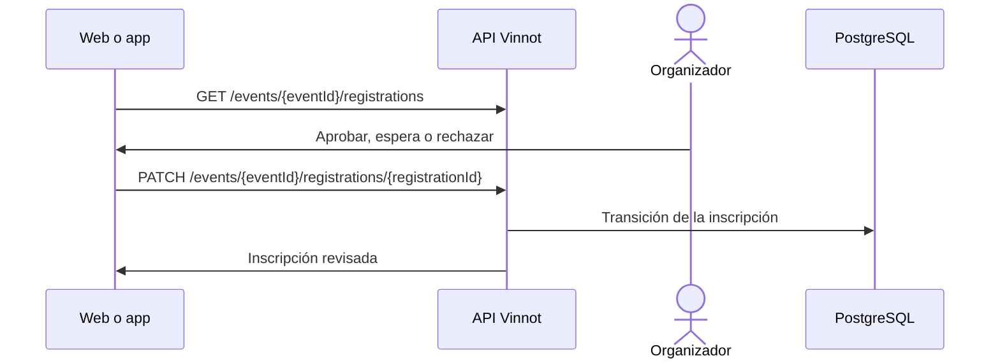

# UC-PAR-05 · Revisar las inscripciones

| Campo | Valor |
|---|---|
| ID | `UC-PAR-05` |
| Módulo | [Partners](../README.md) |
| Plataformas | Web, APK |
| Actores | Organizador (partner o administrador) |
| IDs en Lucidchart | [WEB UC-PAR-05](https://lucid.app/lucidchart/9f11a16b-bb5a-42fc-a9e8-0852b17bd241/edit), [APK UC-ORG-06](https://lucid.app/lucidchart/e095dd25-e8ac-41ba-bf5b-396e1055f217/edit) |
| Requisitos | [`RF-WEB-PAR-06`](../requirements.md), [`RF-WEB-PAR-07`](../requirements.md), [`RF-APK-PAR-06`](../requirements.md), [`RF-APK-PAR-07`](../requirements.md) |
| Casos de prueba | [`CP-PAR-15`](../testing.md), [`CP-PAR-16`](../testing.md), [`CP-PAR-17`](../testing.md), [`CP-PAR-18`](../testing.md) |

## Precondiciones

- La persona organiza el evento o es administradora.

## Postcondiciones

- Las inscripciones revisadas quedaron aprobadas, en espera o rechazadas.

## Flujo principal

1. La persona abre las inscripciones de un evento.
2. El cliente pide `GET /events/{eventId}/registrations` y muestra cada inscripción con su estado, de la solicitud más antigua a la más nueva.
3. El cliente ofrece solo las acciones posibles según el estado y si el evento es pago.
4. La persona aprueba, pone en espera o rechaza, con una nota opcional.
5. El cliente envía `PATCH /events/{eventId}/registrations/{registrationId}` y la API aplica la transición.

## Flujos alternativos

- 4a. Rechazar pide confirmación.
- 5a. El evento es de otra persona: la API lo rechaza aunque se conozca el ID.
- 5b. La inscripción ya está confirmada o terminada: no se puede rechazar.

## Reglas de negocio

- Aprobar una inscripción gratuita la confirma, o la deja esperando la confirmación de quien asiste si el evento la pide; en un evento pago la deja esperando el pago.
- El organizador no acredita pagos a mano: solo Mercado Pago confirma un pago.
- La nota que escribe el organizador al aprobar, poner en espera o rechazar queda guardada para quien asiste.
- Si al aprobar no alcanzan los lugares, la inscripción pasa a lista de espera con la nota del organizador, si escribió una.
- El campo de la nota se vacía después de cada revisión exitosa.
- Los pagos y devoluciones de cada inscripción se ven en el mismo gestor ([UC-PAY-04](../../payments/use-cases/uc-pay-04-refund-registration.md)).

## Diagrama

[Ver diagrama de «UC-PAR-05 · Revisar las inscripciones» completo](https://images.vinnot.com/docs/diagrams/v1/es/modules-partner-use-cases-uc-par-05-review-registrations-89e51a8f1b34.svg)

Diagrama de componentes en Lucidchart: [WEB UC-PAR-05](https://lucid.app/lucidchart/9f11a16b-bb5a-42fc-a9e8-0852b17bd241/edit), [APK UC-ORG-06](https://lucid.app/lucidchart/e095dd25-e8ac-41ba-bf5b-396e1055f217/edit).

## Código

| Capa | Ubicación |
|---|---|
| Endpoints | `GET /events/{eventId}/registrations`, `PATCH /events/{eventId}/registrations/{registrationId}` |
| Backend | [`EventController.java`](../../../../../backend/src/main/java/com/vinnot/event/infrastructure/web/controller/EventController.java), [`ReviewEventRegistrationCommandHandler.java`](../../../../../backend/src/main/java/com/vinnot/event/application/command/handler/ReviewEventRegistrationCommandHandler.java), [`EventRegistration.java`](../../../../../backend/src/main/java/com/vinnot/event/domain/model/EventRegistration.java) |
| Web | [`PartnerEventsPage.tsx`](../../../../../frontend-react/src/presentation/pages/partner/PartnerEventsPage.tsx), [`usePartnerEventsViewModel.ts`](../../../../../frontend-react/src/presentation/pages/partner/usePartnerEventsViewModel.ts), [`EventRegistrationsManagerModal.tsx`](../../../../../frontend-react/src/presentation/components/features/event/EventRegistrationsManagerModal.tsx) |
| App | `frontend-mobile/app/(app)/partner/index.tsx`, [`PartnerEventRow.tsx`](../../../../../frontend-mobile/src/presentation/features/partner/PartnerEventRow.tsx), [`PartnerEventSheet.tsx`](../../../../../frontend-mobile/src/presentation/features/partner/PartnerEventSheet.tsx), [`EventRegistrationsManagerSheet.tsx`](../../../../../frontend-mobile/src/presentation/features/event/EventRegistrationsManagerSheet.tsx) |

## Tests automáticos

- Backend: [`ReviewEventRegistrationCommandHandlerTest.java`](../../../../../backend/src/test/java/com/vinnot/event/application/command/handler/ReviewEventRegistrationCommandHandlerTest.java), [`EventRegistrationTest.java`](../../../../../backend/src/test/java/com/vinnot/event/domain/model/EventRegistrationTest.java)
- Web: Ninguno
- App: [`EventRegistrationsManagerSheet.test.tsx`](../../../../../frontend-mobile/src/presentation/features/event/EventRegistrationsManagerSheet.test.tsx), [`eventRegistrationActions.test.ts`](../../../../../frontend-mobile/src/domain/event/eventRegistrationActions.test.ts)
