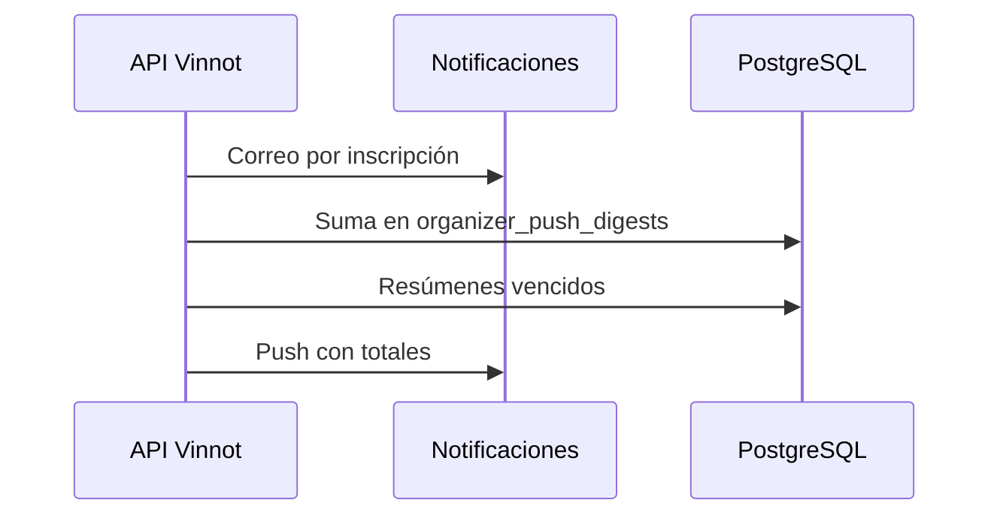

# UC-PAR-06 · Avisar al organizador de las inscripciones

| Campo | Valor |
|---|---|
| ID | `UC-PAR-06` |
| Módulo | [Partners](../README.md) |
| Plataformas | Solo backend |
| Actores | Sistema (tareas programadas) |
| IDs en Lucidchart | Ninguno |
| Requisitos | Ninguno |
| Casos de prueba | [`CP-PAR-19`](../testing.md), [`CP-PAR-20`](../testing.md) |

## Precondiciones

- Alguien se inscribió, pidió lugar o canceló en un evento.

## Postcondiciones

- El organizador recibió un correo por cada inscripción y un push con los totales.

## Flujo principal

1. El sistema envía un correo al organizador por cada inscripción nueva.
2. Suma confirmadas, solicitadas y canceladas del evento durante 15 minutos.
3. Una tarea revisa cada minuto los resúmenes vencidos.
4. Envía un push por evento con los totales, que abre los eventos del organizador.

## Flujos alternativos

- 4a. El evento se canceló: el resumen se descarta.

## Reglas de negocio

- El push sigue las reglas de [Notificaciones](../../notifications/README.md): preferencias, horario de descanso y topes.
- Cada resumen se envía una sola vez por evento y vencimiento.

## Diagrama

[Ver diagrama de «UC-PAR-06 · Avisar al organizador de las inscripciones» completo](https://images.vinnot.com/docs/diagrams/v1/es/modules-partner-use-cases-uc-par-06-organizer-notices-df7ff0e89611.svg)

## Código

| Capa | Ubicación |
|---|---|
| Backend | [`NotifyEventRegistrationService.java`](../../../../../backend/src/main/java/com/vinnot/event/application/service/NotifyEventRegistrationService.java), [`SendOrganizerDigestsService.java`](../../../../../backend/src/main/java/com/vinnot/event/application/service/SendOrganizerDigestsService.java), [`OrganizerDigestScheduler.java`](../../../../../backend/src/main/java/com/vinnot/event/infrastructure/scheduling/OrganizerDigestScheduler.java) |

## Tests automáticos

- Backend: [`SendOrganizerDigestsServiceTest.java`](../../../../../backend/src/test/java/com/vinnot/event/application/service/SendOrganizerDigestsServiceTest.java), [`OrganizerDigestSchedulerTest.java`](../../../../../backend/src/test/java/com/vinnot/event/infrastructure/scheduling/OrganizerDigestSchedulerTest.java), [`OrganizerDigestPostgresIntegrationTest.java`](../../../../../backend/src/test/java/com/vinnot/event/infrastructure/OrganizerDigestPostgresIntegrationTest.java)
- Web: Ninguno
- App: Ninguno
