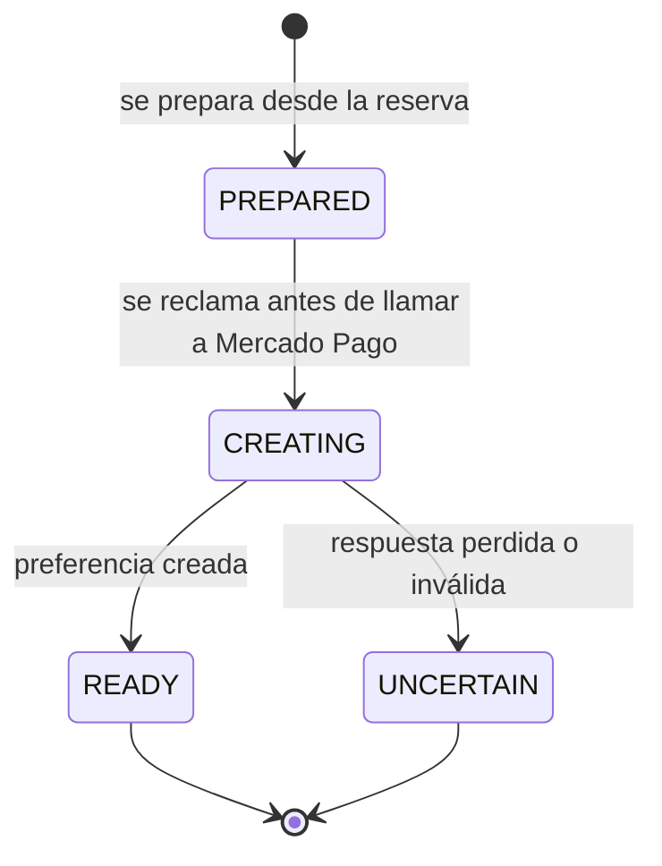
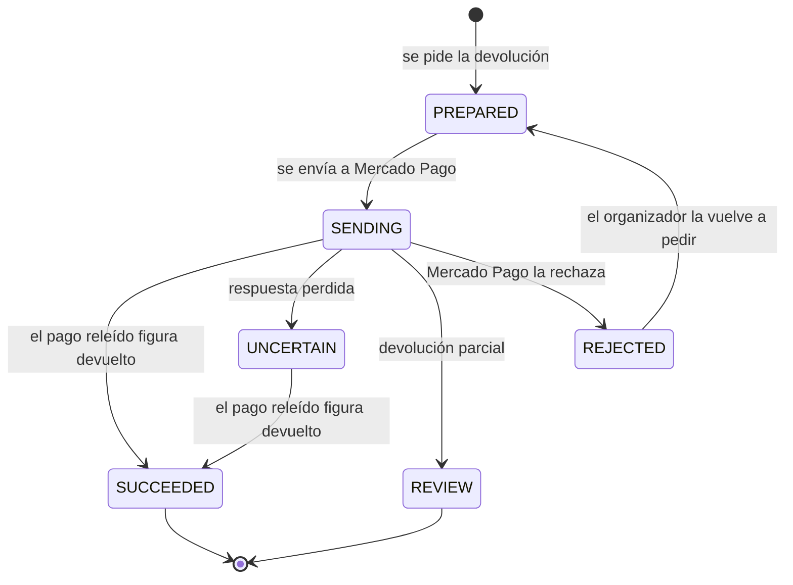
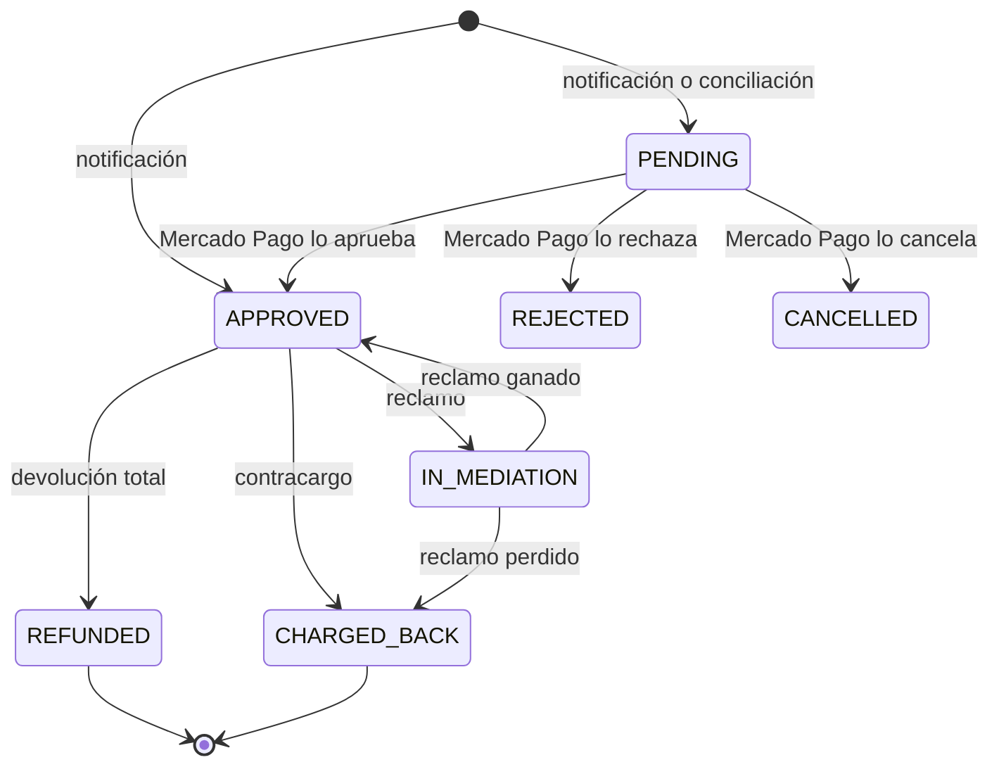
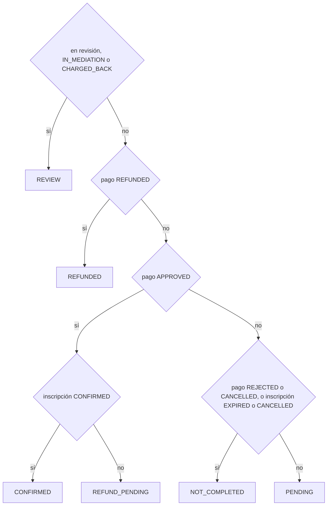
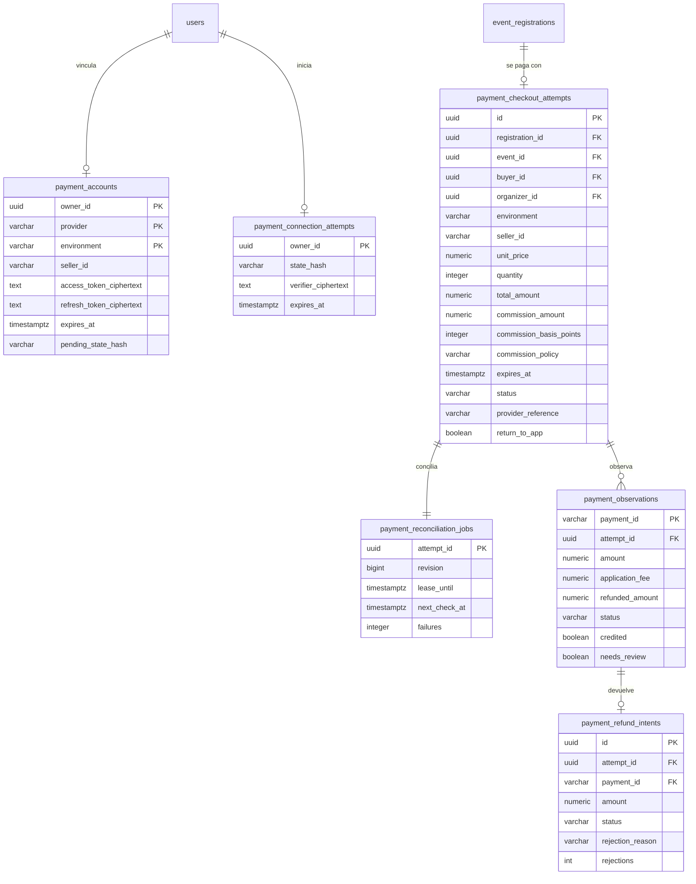

# Pagos

Cobro de inscripciones a eventos pagos con Mercado Pago: el checkout, el recibo que
ve quien pagó, la cuenta de cobro de cada organizador, las devoluciones y las tareas
que confirman cobros y renuevan credenciales. Vinnot cobra una comisión configurable
(hoy el 3 %, política `VINNOT_3_PERCENT_V1`) con el modelo de split de Mercado Pago; el dinero lo mueve Mercado Pago y Vinnot guarda la
decisión y el estado de cada inscripción ([Eventos](../events/README.md)).

- Código del módulo: `PAY`.
- Backend: paquete [`payment`](../../../../backend/src/main/java/com/vinnot/payment/).
- [Casos de uso](use-cases/README.md) · [Requisitos](requirements.md) ·
  [Arquitectura](architecture.md) · [Pruebas](testing.md)

## Actores

| Actor | Qué hace en este módulo |
|---|---|
| Usuario autenticado | Paga su inscripción y ve el recibo |
| Organizador o administrador | Vincula su cuenta de Mercado Pago y devuelve pagos de inscripciones |
| Mercado Pago | Cobra, avisa cambios y ejecuta devoluciones |
| Sistema (tareas programadas) | Concilia pagos, envía devoluciones y renueva credenciales |

## Reglas de negocio

| Regla | Detalle | Dónde |
|---|---|---|
| Confirmación | Solo el servidor confirma un pago, leyéndolo desde Mercado Pago; el regreso del checkout y el aviso no acreditan nada | [`ReconcilePaymentsService.java`](../../../../backend/src/main/java/com/vinnot/payment/application/service/ReconcilePaymentsService.java) |
| Comisión | Porcentaje de la política vigente (por defecto 300 puntos básicos, `VINNOT_3_PERCENT_V1`) sobre el total en ARS, redondeado una vez a centavos y descontado al vendedor. Cada intento guarda su política y se valida siempre con ella | [`TicketPaymentQuote.java`](../../../../backend/src/main/java/com/vinnot/payment/domain/valueobject/TicketPaymentQuote.java), [`CommissionPolicy.java`](../../../../backend/src/main/java/com/vinnot/payment/domain/valueobject/CommissionPolicy.java) |
| Entorno | `SANDBOX`, `LIVE_PILOT` (un vendedor, hasta ARS 50) o `LIVE` (vendedores reales distintos de la plataforma) | [`PaymentExecutionPolicy.java`](../../../../backend/src/main/java/com/vinnot/payment/application/service/PaymentExecutionPolicy.java) |
| Eventos pagos | Publicar un evento pago o inscribirse en uno exige cobros activos y la cuenta del organizador vigente | [`OnlineEventPaymentAvailability.java`](../../../../backend/src/main/java/com/vinnot/payment/application/service/OnlineEventPaymentAvailability.java) |
| Un intento por inscripción | Se congela importe, vendedor y vencimiento; reintentar lo reutiliza | [`EventCheckoutReservationService.java`](../../../../backend/src/main/java/com/vinnot/payment/application/service/EventCheckoutReservationService.java) |
| Un pago acreditado | Cada intento acredita como mucho un pago; los tardíos o duplicados se devuelven | [`ApplyProviderPaymentService.java`](../../../../backend/src/main/java/com/vinnot/payment/application/service/ApplyProviderPaymentService.java) |
| Cancelación | Si el evento se cancela, los pagos en línea acreditados se devuelven solos | [`ApplyProviderPaymentService.java`](../../../../backend/src/main/java/com/vinnot/payment/application/service/ApplyProviderPaymentService.java) |
| Devoluciones | Totales, pedidas por el organizador o un administrador, de pagos aprobados sin revisión; una devolución que Mercado Pago rechazó se puede volver a pedir | [`RequestPaymentRefundService.java`](../../../../backend/src/main/java/com/vinnot/payment/application/service/RequestPaymentRefundService.java) |
| Recibo | Cifrado, válido 7 días y sin datos de la persona | [`EncryptedPaymentReceiptAccess.java`](../../../../backend/src/main/java/com/vinnot/payment/infrastructure/security/EncryptedPaymentReceiptAccess.java) |
| Credenciales | Cifradas con AES-GCM; se renuevan un día antes de vencer | [`RenewPaymentCredentialsService.java`](../../../../backend/src/main/java/com/vinnot/payment/application/service/RenewPaymentCredentialsService.java) |
| Avisos firmados | HMAC-SHA256 con margen de 10 minutos | [`MercadoPagoWebhookSignature.java`](../../../../backend/src/main/java/com/vinnot/payment/infrastructure/security/MercadoPagoWebhookSignature.java) |

## Estados de un intento de checkout

[Ver diagrama de «Estados de un intento de checkout» completo](https://images.vinnot.com/docs/diagrams/v1/es/modules-payments-readme-6eda52ffd0aa.svg)

Un intento `UNCERTAIN` o detenido en `CREATING` no admite otro checkout; la conciliación
recupera lo que haya pasado en Mercado Pago.

## Estados de una devolución

[Ver diagrama de «Estados de una devolución» completo](https://images.vinnot.com/docs/diagrams/v1/es/modules-payments-readme-112ded119ce0.svg)

Una devolución `UNCERTAIN` nunca se vuelve a enviar: solo se verifica releyendo el pago.
Una `REJECTED` no movió dinero y tampoco se reenvía sola; el organizador recibe un correo
y puede pedirla otra vez. Mientras no se confirma, quien pagó la sigue viendo como
pendiente.

## Estado de un pago en Mercado Pago

[Ver diagrama de «Estado de un pago en Mercado Pago» completo](https://images.vinnot.com/docs/diagrams/v1/es/modules-payments-readme-d351fa7a308b.svg)

`ProviderPayment.Status` copia lo que informa Mercado Pago (pending, in_process y
authorized quedan como PENDING). Vinnot no fuerza cada flecha: descarta una
lectura más vieja que la guardada, una que baje el monto devuelto o una que
saque al pago de un estado revertido (devuelto del todo o contracargado). Un pago
aprobado confirma la inscripción si sigue siendo elegible; si no, se pide la
devolución. Un pago devuelto, contracargado o en mediación cancela la
inscripción.

## Estado del comprobante

[Ver diagrama de «Estado del comprobante» completo](https://images.vinnot.com/docs/diagrams/v1/es/modules-payments-readme-8ecec6ce2cee.svg)

`PaymentReceiptStatus` no se guarda: `PaymentReceiptStatus.from` lo calcula con
el estado del pago, el de la inscripción y la marca de revisión, en ese orden. Es
lo que ve quien pagó y no incluye montos, identidades ni datos del evento.

## Dónde vive

| Parte | Ubicación |
|---|---|
| API | Controllers en [`payment/infrastructure/web`](../../../../backend/src/main/java/com/vinnot/payment/infrastructure/web/), bajo `/payments` y `/events/{eventId}/registrations/{registrationId}/checkout` |
| Web | Pago en el detalle del evento, regreso en [`PaymentReturnPage`](../../../../frontend-react/src/presentation/pages/events/PaymentReturnPage.tsx) y cuenta de cobro en [`PaymentAccountPage`](../../../../frontend-react/src/presentation/pages/partner/PaymentAccountPage.tsx) |
| App | Pago en el detalle del evento, regreso en `frontend-mobile/app/payments/return.tsx` y vinculación en el editor de eventos |

## Datos

[Ver diagrama de «Pagos · Datos» completo](https://images.vinnot.com/docs/diagrams/v1/es/modules-payments-readme-6d551f1ed4b6.svg)

`payment_accounts` usa como clave dueño, proveedor y entorno. Los intentos de pago no se
borran en cascada con la cuenta, para conservar el registro de cada cobro. No se guardan
datos de tarjeta, del pagador ni cuerpos crudos de Mercado Pago.
