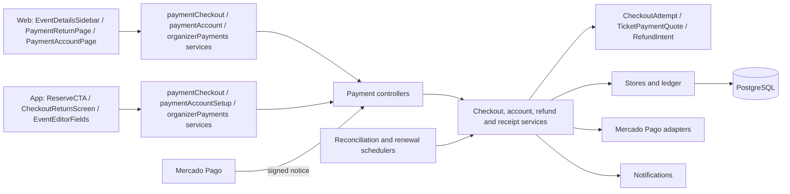

# Arquitectura

Cómo está construido el módulo en cada capa. El backend sigue el flujo hexagonal
`controller → puerto de entrada → servicio → dominio → puerto de salida → adaptador`;
la web y la app siguen `pantalla → hook → servicio → cliente API → transporte HTTP`.
Las inscripciones y los eventos son del módulo [Eventos](../events/README.md); pagos
solo los cobra, los confirma y los devuelve.

[Ver diagrama de «Arquitectura» completo](https://images.vinnot.com/docs/diagrams/v1/es/modules-payments-architecture-6032dc3f2f9d.svg)

## Backend

### Límites y activación

El paquete `payment` separa la autorización de cuentas, las reglas monetarias y el
transporte con Mercado Pago del flujo de eventos. Eventos usa el puerto de salida
`PaidEventAvailability`, implementado por `OnlineEventPaymentAvailability`: antes de
publicar un evento pago o de crear una inscripción paga comprueba que los cobros
estén activos, que el organizador tenga credenciales vigentes, que la moneda sea ARS
y que la política de importe y vendedor lo permita. Borradores y eventos gratuitos no
necesitan cuenta vinculada.

La integración está desactivada por defecto y se activa por partes:

| Variable | Habilita |
|---|---|
| `EVENT_PAYMENTS_ENABLED` | Vinculación de cuentas, renovación de credenciales y `GET /payments/mercadopago/account` |
| `EVENT_PAYMENTS_SETTLEMENT_ENABLED` + `EVENT_PAYMENTS_WEBHOOK_SECRET` | Avisos firmados, conciliación, recibos, lista del organizador y devoluciones |
| `EVENT_PAYMENTS_CHECKOUT_ENABLED` | Creación del checkout |

`EVENT_PAYMENTS_CLIENT_ID`, `EVENT_PAYMENTS_CLIENT_SECRET`, `EVENT_PAYMENTS_ENCRYPTION_KEY`
(AES de 32 bytes en Base64) y `EVENT_PAYMENTS_REDIRECT_URI` son obligatorias al activar
la vinculación; `EVENT_PAYMENTS_NOTIFICATION_URI` y `EVENT_PAYMENTS_CHECKOUT_RETURN_URI`
definen los avisos y el regreso del checkout. Los nombres `EVENT_PAYMENTS_SANDBOX_*` solo
se leen como respaldo heredado, salvo la clave de cifrado. Los valores viven en el
gestor de secretos del entorno ([Entornos y secretos](../../infra/architecture/environments-and-secrets.md)).

### Entornos de cobro

`PaymentExecutionPolicy` aplica `EVENT_PAYMENTS_ENVIRONMENT`:

| Entorno | Reglas |
|---|---|
| `SANDBOX` (por defecto) | Cuentas de prueba de Mercado Pago, verificadas con la etiqueta `test_user` |
| `LIVE_PILOT` | Un solo vendedor permitido y total de hasta ARS 50 (`PAYMENT_PILOT_RESTRICTED`) |
| `LIVE` | Organizadores reales de Argentina, distintos de la cuenta de la plataforma (`PAYMENT_SELLER_IS_PLATFORM`), con importe positivo en ARS (`PAYMENT_INVALID_AMOUNT`) |

`LIVE` guarda sus datos en el espacio de nombres `LIVE_PILOT` (`PaymentStorageEnvironment`)
para no invalidar cuentas, recibos ni intentos ya cifrados con ese contexto.

### Endpoints

Todas las respuestas usan `Cache-Control: no-store`.

| Endpoint | Acceso | Resultado |
|---|---|---|
| `POST /events/{eventId}/registrations/{registrationId}/checkout` | Comprador con sesión; cuerpo opcional `{returnToApp}` | 200 `{attemptId, checkoutUrl}`, o 202 con `checkoutUrl: null` si no pudo confirmar la creación |
| `GET /payments/receipt?token=` | Público | `{status}`: `PENDING`, `CONFIRMED`, `NOT_COMPLETED`, `REFUND_PENDING`, `REFUNDED` o `REVIEW`; recibo inválido → 404 |
| `GET /payments/mercadopago/account` | PARTNER o ADMIN | `{connected, environment, commissionBasisPoints, commissionPercent}`, sin tokens; la comisión es la que pagan las ventas nuevas |
| `POST /payments/mercadopago/account/connect` | PARTNER o ADMIN activo; cuerpo opcional `{returnToApp}` | `{authorizationUrl}` con estado aleatorio y PKCE S256 |
| `POST /payments/mercadopago/connection/callback` | Público, con límite de tasa | Completa la vinculación; devuelve `{returnToApp}` |
| `POST /payments/mercadopago/account/complete` | La misma cuenta que inició | Variante autenticada del regreso, conservada por compatibilidad; 204 |
| `GET /payments/events/{eventId}/registrations?registrationIds=` | PARTNER o ADMIN; de 1 a 50 inscripciones | Importe, moneda, `paymentStatus`, `refundStatus` y `canRefund` por inscripción |
| `POST /payments/checkouts/{attemptId}/refund` | ADMIN, o PARTNER organizador del evento | 202: devolución total pedida, no dinero ya devuelto; vuelve a pedir una devolución `REJECTED` |
| `POST /payments/mercadopago/webhooks/{attemptId}` | Firma HMAC-SHA256 de Mercado Pago | 200 después de guardar el trabajo; 401 si la firma no vale |
| `POST /payments/mercadopago/webhooks` | Misma firma | Solo despierta pagos ya observados en su entorno |

### Vinculación de la cuenta

`ConnectPaymentAccountService` genera un estado de 256 bits, guardado como SHA-256,
que vence a los diez minutos y se consume una sola vez antes de llamar al proveedor;
un intento nuevo invalida el anterior. El regreso público resuelve al titular solo
desde ese estado, revalida su rol y canjea el código con PKCE. `MercadoPagoSellerVerifier`
consulta `/users/me` (sitio MLA; etiqueta `test_user` solo en `SANDBOX`). Tokens y
verificador se guardan con AES-GCM y contexto de titular y campo (`PaymentCredentialCipher`).
Cambiar a otro vendedor cuando la cuenta ya tiene operaciones devuelve
`PAYMENT_ACCOUNT_HAS_OPERATIONS`; reconectar el mismo vendedor está permitido. Errores:
`PAYMENT_ACCOUNT_FORBIDDEN`, `PAYMENT_CONNECTION_EXPIRED` y `PAYMENT_PROVIDER_UNAVAILABLE` (503).

### Checkout

1. `EventCheckoutReservationService` bloquea evento e inscripción, en ese orden, y exige
   comprador dueño y activo, organizador PARTNER o ADMIN activo, evento `PUBLISHED` o
   `SOLD_OUT` sin empezar e inscripción `AWAITING_PAYMENT` con reserva vigente. Recupera
   también inscripciones antiguas `REQUESTED` o con pago informado.
2. La cotización (`TicketPaymentQuote`) sale del total y la cantidad guardados en la
   inscripción: total = precio × cantidad (1 a 20, solo ARS) y comisión = total × puntos
   básicos / 10000, redondeada una vez a centavos (HALF_UP). Los puntos básicos y la
   política salen de `CurrentCommissionPolicy` (ver «Cambiar la comisión»). Con la
   política por defecto (`VINNOT_3_PERCENT_V1`), para dos entradas de ARS 10.000 la
   comisión es ARS 600 y el vendedor recibe ARS 19.400 antes del costo del proveedor; con
   `VINNOT_8_PERCENT_V1` sería ARS 1.600.
3. `CheckoutSnapshot` congela inscripción, evento, comprador, vendedor, precio y
   vencimiento (el menor entre la reserva y el inicio del evento). Hay un solo intento por
   inscripción; reintentar lo reutiliza.
4. `DispatchTicketCheckoutService` pasa el intento de `PREPARED` a `CREATING` antes de
   llamar a Mercado Pago y a `READY` o `UNCERTAIN` después, sin mantener una transacción
   durante la llamada ni reintentar solo. `MercadoPagoCheckoutAdapter` crea la preferencia
   con `marketplace_fee`, la referencia del intento, la dirección de avisos y el regreso
   con el recibo cifrado, y solo acepta un enlace de `https://www.mercadopago.com.ar/checkout/v1/redirect`.

Iniciar un checkout marca la inscripción como gestionada por el proveedor
(`externally_managed_payment`): desde ahí el pago no se informa ni se aprueba a mano.

### Cambiar la comisión

La comisión es una política versionada (`CommissionPolicy`): puntos básicos entre 1 y
3000 y un id `VINNOT_<porcentaje>_PERCENT_V<versión>` que nombra el mismo porcentaje.
Por ejemplo, 300 es `VINNOT_3_PERCENT_V1`, 800 es `VINNOT_8_PERCENT_V1`, 1200 es
`VINNOT_12_PERCENT_V1` y 250 es `VINNOT_2_5_PERCENT_V1`. La versión cambia cuando
cambian las condiciones con el mismo porcentaje.

- **Dónde se configura.** `ConfiguredCommissionPolicy` lee
  `app.payments.commission.basis-points` (por defecto `300`) y
  `app.payments.commission.policy` (por defecto `VINNOT_3_PERCENT_V1`). Para cambiar la
  tasa, cambia los dos valores juntos y reinicia el backend.
- **Validación al arrancar.** Si los puntos básicos y el nombre no coinciden (por
  ejemplo, `800` con `VINNOT_3_PERCENT_V1`) o están fuera de rango, el backend no
  arranca: no cobra nunca con una tasa ambigua.
- **Intentos existentes.** Cada intento guarda `commission_amount`,
  `commission_basis_points` y `commission_policy`. `PostgresCheckoutAttemptStore`
  reconstruye la cotización con esos valores guardados, nunca con la política actual. Así
  un intento al 3 % sigue conciliando y comparando términos (`ProviderPayment`,
  `CheckoutSnapshot.hasSameTerms`) después de pasar al 8 %. Un reintento de la misma
  inscripción reutiliza el intento con su comisión original.
- **Base de datos.** `V74` reemplaza los CHECK de `V30`, que fijaban el 3 %, por reglas
  generales: puntos básicos entre 1 y 3000, `commission_amount = round(total_amount *
  commission_basis_points / 10000.0, 2)` y el formato del id.
- **Clientes.** `GET /payments/mercadopago/account` informa la comisión vigente
  (`commissionBasisPoints` y `commissionPercent`). La web (`/partner/payments` y el editor
  de eventos) y la app (editor de eventos) muestran ese valor y no tienen la tasa escrita;
  sin un valor válido no muestran ninguna.

### Confirmación y conciliación

El aviso de Mercado Pago no acredita nada: solo adelanta la conciliación del intento.
`ReconcilePaymentsService` lee los pagos del intento (hasta 20) desde la API del
proveedor con las credenciales del vendedor, y valida entorno, vendedor, moneda, importe
exacto y comisión. La cola (`PostgresPaymentReconciliationQueue`) usa
`FOR UPDATE SKIP LOCKED` con un lease de 15 minutos; el scheduler procesa hasta diez
trabajos por ciclo.

`ReconciliationSchedule`: cada 5 minutos hasta una hora después del vencimiento (ante
un error, al minuto); después, 30 minutos el primer día, 6 horas la primera semana y
luego una vez por día, hasta archivarse a los 180 días. Un intento con todos sus pagos
finales y sin devoluciones pendientes se archiva antes. Los triggers de `V38` despiertan
el trabajo cuando una inscripción pagada deja de estar confirmada o su evento se cancela.

`ApplyProviderPaymentService` bloquea evento, inscripción y trabajo y guarda todo en una
transacción:

| Situación | Efecto |
|---|---|
| Pago aprobado antes del vencimiento | Confirma la inscripción y envía `PAYMENT_RECEIPT` |
| Pago acreditado cuya inscripción ya no está confirmada, o cuyo evento se canceló | Pide la devolución total y envía `PAYMENT_REFUND_REQUESTED` |
| Pago tardío o segundo pago de la misma inscripción | Pide su devolución sin tomar cupo |
| Devolución parcial, contracargo o mediación | Cancela la inscripción, deja el caso en revisión y envía `PAYMENT_REFUNDED` o `PAYMENT_CHARGEBACK` |

Cada intento acredita como mucho un pago, y la evidencia más vieja o repetida no repite
efectos. Los avisos se encolan en la misma transacción, así una liquidación revertida
no envía nada.

### Devoluciones

`RequestPaymentRefundService` acepta solo devoluciones totales, de un pago aprobado, sin
devoluciones previas ni revisión (`RefundEligibility`). Cancela la inscripción, libera el
cupo y guarda la intención en `payment_refund_intents`; repetir el pedido reutiliza la
misma intención. La conciliación envía `POST /v1/payments/{id}/refunds` con una
`X-Idempotency-Key` guardada y solo marca `SUCCEEDED` después de volver a leer el pago.
Estados: `PREPARED`, `SENDING`, `UNCERTAIN`, `SUCCEEDED`, `REVIEW` y `REJECTED`.

`MercadoPagoPaymentAdapter` separa dos resultados. Un rechazo definitivo (un 4xx que no
sea 408, 409 ni 429, o un importe fuera del límite de `LIVE_PILOT`) lanza
`RefundRejectedException` con un código corto (`HTTP_<status>` más el código de Mercado
Pago, sin mensajes ni datos del pagador). Antes de registrarlo, la conciliación vuelve a
leer el pago: si ya figura devuelto (por ejemplo, desde el panel de Mercado Pago), la
intención queda `UNCERTAIN` y se verifica como cualquier otro resultado. Si no,
`RefundRejectionRecorder` pasa la intención de
`SENDING` a `REJECTED`, guarda `rejection_reason`, suma `rejections` y encola
`PAYMENT_REFUND_REJECTED` al organizador en la misma transacción; el rechazo queda en el
log y nunca se reenvía solo. Un 408, 409, 429, 5xx, fallo de red o cuerpo inválido deja la
intención `UNCERTAIN`: puede existir la devolución, así que solo se verifica y nunca se
reenvía. Pedir otra vez la devolución con `POST /payments/checkouts/{attemptId}/refund`
solo rearma una intención `REJECTED` (vuelve a `PREPARED`, sin otro
`PAYMENT_REFUND_REQUESTED`); una en envío, incierta o terminada no cambia. Cada reintento
usa su propia clave de idempotencia (`<intentId>-retry-<n>`), porque repetir la clave
rechazada devolvería el rechazo guardado por Mercado Pago. Según el modelo de
split de Mercado Pago, la devolución se descuenta en proporción del vendedor y de la
comisión de Vinnot.

### Diagrama de actividad: cobro y devolución

Muestra en notación de actividad UML el cobro de una inscripción paga, su confirmación por conciliación y la devolución, incluido el rechazo de Mercado Pago.

```mermaid
flowchart TD
    subgraph U["Asistente"]
        start((" ")) --> u1("Iniciar el pago de la inscripción")
        u2("Pagar en el checkout de Mercado Pago")
        u3("Volver con el recibo cifrado y ver el estado")
    end
    subgraph O["Organizador"]
        start2((" ")) --> o1("Cancelar el evento o pedir la devolución")
    end
    subgraph B["Backend"]
        b1("Validar AWAITING_PAYMENT, congelar el snapshot y crear la preferencia")
        b4("Conciliar el intento: aviso o scheduler")
        d1{" "}
        b6("Confirmar la inscripción y enviar PAYMENT_RECEIPT")
        b7("Pedir la devolución total y liberar el cupo")
        b8("POST /v1/payments/{id}/refunds con clave de idempotencia")
        d2{" "}
        b9("SUCCEEDED tras releer el pago")
        b10("REJECTED: avisar PAYMENT_REFUND_REJECTED")
        b11("UNCERTAIN: solo verificar, sin reenviar")
    end
    subgraph MP["Mercado Pago"]
        m1("Procesar el pago y enviar el aviso")
    end
    u1 --> b1 --> u2 --> m1 --> f1[" "]
    f1 --> u3
    f1 --> b4
    b4 --> d1
    d1 -->|"[aprobado antes del vencimiento]"| b6
    d1 -->|"[tardío, repetido o inscripción ya no confirmada]"| b7
    o1 --> b7
    b6 & u3 --> j1[" "] --> stop(((" ")))
    b7 --> b8 --> d2
    d2 -->|"[aceptada]"| b9
    d2 -->|"[rechazo definitivo]"| b10
    d2 -->|"[408, 409, 429, 5xx o red]"| b11
    b10 -->|"[el organizador reintenta]"| b8
    b9 & b10 & b11 --> stop
    classDef bar fill:#30262c,stroke:#30262c,color:#30262c
    style start fill:#30262c,stroke:#30262c
    style stop fill:#30262c,stroke:#30262c
    style start2 fill:#30262c,stroke:#30262c
    class f1,j1 bar
```

[Ver diagrama de «Diagrama de actividad: cobro y devolución» completo](https://images.vinnot.com/docs/diagrams/v1/es/modules-payments-architecture-d85a069839f5.svg)

### Recibos

`EncryptedPaymentReceiptAccess` cifra el recibo con AES-GCM y contexto
`public-payment-receipt:<entorno>`; vale siete días. `GetPaymentReceiptService` solo
devuelve el estado, sin datos de la persona.

### Renovación de credenciales

`RenewPaymentCredentialsService` renueva un día antes del vencimiento, en lotes de 20 con
un lease de 60 segundos, fuera de transacciones. Una autorización revocada o vencida deja
la cuenta para reconectar; `RenewalFailureRecorder` guarda el fallo y encola
`PAYMENT_ACCOUNT_RECONNECT_REQUIRED` (email y push) una sola vez por conexión (`V58`).
Los fallos temporales se reintentan a los cinco minutos.

### Datos

`V29` cuentas e intentos de conexión, `V30` intentos de checkout, `V31` la marca de
pago gestionado en `event_registrations`, `V32` trabajos de conciliación, observaciones
y devoluciones, `V33` el entorno `LIVE_PILOT`, `V34` la renovación, `V36` y `V37` el
regreso a la app, `V38` los triggers de conciliación, `V58` el aviso de reconexión y `V63`
el estado `REJECTED` de las devoluciones con `rejection_reason` y `rejections`, `V74` la
comisión configurable y `V77` el historial que sobrevive al borrado de cuentas.
No se guardan datos de tarjeta, del pagador ni cuerpos crudos del proveedor.

### Historial de pagos al borrar una cuenta

Borrar la cuenta de un comprador o de un organizador no borra sus pagos. `V77` deja en
`NULL` los vínculos del intento (`buyer_id`, `organizer_id`, `registration_id`,
`event_id`) y el intento, sus observaciones, devoluciones y su trabajo de conciliación se
conservan como historial financiero de la operación. Los términos comerciales (vendedor,
título, importes y comisión) están en el propio intento. La cuenta de cobro del
organizador (`payment_accounts`) sí se borra con la cuenta.

`CheckoutSnapshot.linked()` indica si el intento conserva los cuatro vínculos. Un intento
nuevo siempre los tiene: `PostgresCheckoutAttemptStore.prepare` rechaza uno sin vínculos.
Un intento sin vínculos se trata así:

- **Se borró el comprador** (con su inscripción): la conciliación sigue con la conexión
  del organizador. `ApplyProviderPaymentService` registra la evidencia del proveedor sin
  tocar entradas ni cupo. Un pago acreditado queda como está; un pago aprobado que nunca
  se acreditó se devuelve, porque ya no hay entrada que emitir. Las devoluciones,
  reversiones y contracargos solo se avisan al organizador.
- **Se borró el organizador** (con sus eventos y su conexión de pagos): no hay credenciales
  para leer ni devolver, así que `ReconcilePaymentsService` estaciona el trabajo en vez de
  reintentarlo para siempre.
- `RequestPaymentRefundService` rechaza la devolución con `PAYMENT_REFUND_UNAVAILABLE`,
  porque necesita la inscripción del comprador; se hace desde el panel de Mercado Pago.
  `DispatchTicketCheckoutService` no inicia un checkout sin vínculos.
- `PaymentNoticeService` nunca escribe a una cuenta borrada, y el aviso al comprador solo
  sale mientras exista la entrada a la que enlaza.

## Web

- **Pago.** `EventDetailsSidebar` ofrece «Pagar» cuando la inscripción admite pago
  (`canStartOnlinePayment`) y el flag de pagos está activo (`isEventPaymentsEnabled`:
  `VITE_EVENT_PAYMENTS_ENABLED`, o `VITE_EVENT_PAYMENTS_SANDBOX` fuera de producción).
  `useEventCheckout` → `paymentCheckoutService` → `eventsClient` pide el checkout y
  `paymentCheckoutNavigator` abre solo el destino de Mercado Pago validado en
  `eventCheckout.ts`. Al inscribirse en un evento pago, el checkout se abre enseguida.
- **Regreso.** `/payments/return` queda fuera del shell y sin guard. `PaymentReturnPage`
  usa `usePaymentReceipt`, que consulta `GET /payments/receipt` sin el interceptor de
  sesión y repite cada 5 segundos, hasta 24 veces, mientras está `PENDING`. Si el pago
  empezó en la app, `checkoutReturnService` arma `vinnot://payments/return` con el recibo
  y el ID de la entrada e intenta abrir la app; desde un teléfono solo lo ofrece. La
  página declara `no-referrer` y `noindex` y enlaza a `/my-tickets`.
- **Cuenta de cobro.** `/partner/payments` y `/partner/payments/callback` existen solo con
  el flag activo. `PaymentAccountPage` → `usePaymentAccountConnection` →
  `paymentAccountService`. El callback quita el código de la URL, lo guarda solo en
  memoria y completa la vinculación por el regreso público; un doble clic no repite el
  canje. `PaymentAccountStatus` muestra el estado en el editor de eventos.
- **Devoluciones.** `EventRegistrationsManagerModal` pide los pagos con
  `useOrganizerPayments` → `organizerPaymentsService` y ofrece «Devolver» cuando
  `canRefund` es verdadero, con una confirmación que muestra el total. Con una devolución
  `REJECTED` (`refundCanBeRetried`) muestra el aviso del rechazo y ofrece «Reintentar
  devolución», que confirma y envía el mismo pedido.

## App

- **Pago.** `ReserveCTA` ofrece «Pagar» con `canStartOnlinePayment` y el flag
  `EXPO_PUBLIC_EVENT_PAYMENTS_ENABLED` (o `EXPO_PUBLIC_EVENT_PAYMENTS_SANDBOX` fuera de
  producción). `useEventCheckout` → `paymentCheckoutService` pide el checkout con
  `returnToApp: true` y `paymentCheckoutNavigator` lo abre con `Linking`. Si la API
  responde 202, la app avisa que el pago está pendiente.
- **Regreso.** `vinnot://payments/return` llega por `app/+native-intent.tsx` y
  `navigation/paymentReturn.ts`, que solo aceptan un recibo opaco y un ID de entrada
  válido. `CheckoutReturnScreen` usa `useCheckoutReceipt` (cada 5 segundos, hasta 24
  veces) y ofrece ir a Mis entradas.
- **Cuenta de cobro.** No hay pantalla propia: la sección paga de `EventEditorFields`
  usa `usePaymentAccountSetup` → `paymentAccountSetupService` → `paymentAccountClient`
  con `returnToApp: true`. La vinculación vuelve por `vinnot://payments/connected`
  (`paymentReturnNavigation.ts`) y el editor consulta el estado al volver a primer plano.
- **Devoluciones.** `EventRegistrationsManagerSheet` usa `useOrganizerPayments` y pide
  confirmación antes de devolver. Con una devolución `REJECTED` (`refundCanBeRetried`)
  ofrece «Reintentar devolución» con su propia confirmación.
