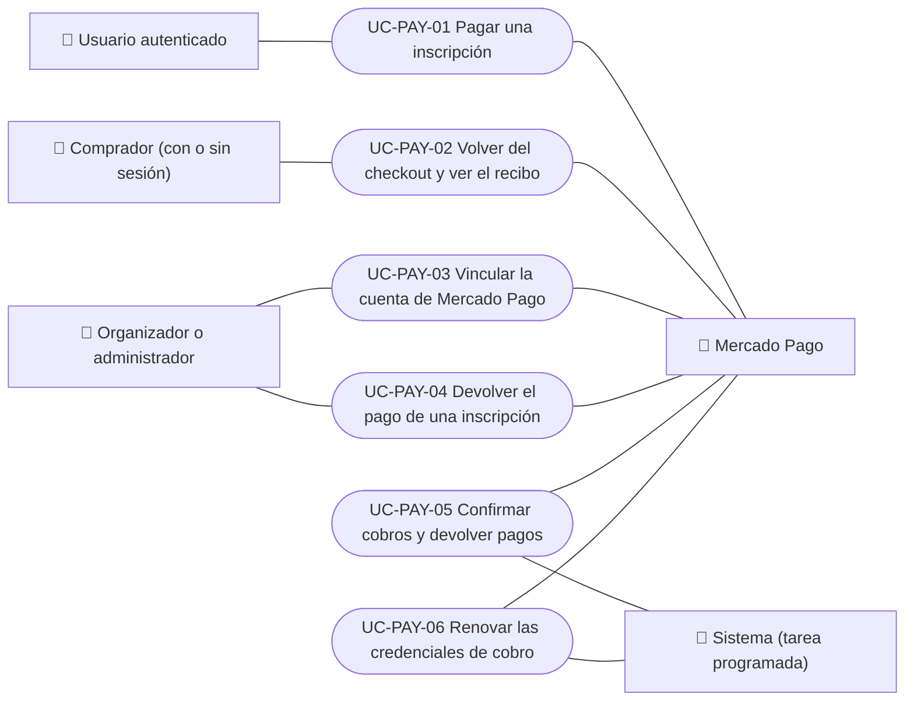

# Casos de uso

Casos de uso de pagos: pagar una inscripción con Mercado Pago, volver del checkout y ver el recibo, vincular la cuenta de cobro del organizador, devolver un pago y las tareas que confirman cobros, devuelven pagos y renuevan credenciales. Cada caso vale para las plataformas indicadas.

| ID | Caso de uso | Plataformas | Actores |
|---|---|---|---|
| `UC-PAY-01` | [Pagar una inscripción](uc-pay-01-pay-registration.md) | Web, APK | Usuario autenticado, Mercado Pago |
| `UC-PAY-02` | [Volver del checkout y ver el recibo](uc-pay-02-checkout-return.md) | Web, APK | Comprador (con o sin sesión), Mercado Pago |
| `UC-PAY-03` | [Vincular la cuenta de Mercado Pago](uc-pay-03-link-payment-account.md) | Web, APK | Organizador o administrador, Mercado Pago |
| `UC-PAY-04` | [Devolver el pago de una inscripción](uc-pay-04-refund-registration.md) | Web, APK | Organizador o administrador, Mercado Pago |
| `UC-PAY-05` | [Confirmar cobros y devolver pagos](uc-pay-05-confirm-and-reconcile.md) | Solo backend | Mercado Pago, Sistema (tarea programada) |
| `UC-PAY-06` | [Renovar las credenciales de cobro](uc-pay-06-renew-credentials.md) | Solo backend | Sistema (tarea programada), Mercado Pago |

## Diagrama de casos de uso

[Ver diagrama de «Casos de uso · Diagrama de casos de uso» completo](https://images.vinnot.com/docs/diagrams/v1/es/modules-payments-use-cases-readme-85f6154727cd.svg)

## Equivalencia con Lucidchart

| ID | IDs en Lucidchart |
|---|---|
| `UC-PAY-01` | [WEB UC-EVT-05](https://lucid.app/lucidchart/9f11a16b-bb5a-42fc-a9e8-0852b17bd241/edit), [APK UC-EVT-06](https://lucid.app/lucidchart/e095dd25-e8ac-41ba-bf5b-396e1055f217/edit) |
| `UC-PAY-02` | [WEB UC-EVT-06](https://lucid.app/lucidchart/9f11a16b-bb5a-42fc-a9e8-0852b17bd241/edit) |
| `UC-PAY-03` | [WEB UC-PAR-07](https://lucid.app/lucidchart/9f11a16b-bb5a-42fc-a9e8-0852b17bd241/edit), [APK UC-ORG-03](https://lucid.app/lucidchart/e095dd25-e8ac-41ba-bf5b-396e1055f217/edit) |
| `UC-PAY-04` | [WEB UC-PAR-06](https://lucid.app/lucidchart/9f11a16b-bb5a-42fc-a9e8-0852b17bd241/edit), [APK UC-ORG-07](https://lucid.app/lucidchart/e095dd25-e8ac-41ba-bf5b-396e1055f217/edit) |
| `UC-PAY-05` | Ninguno |
| `UC-PAY-06` | Ninguno |
