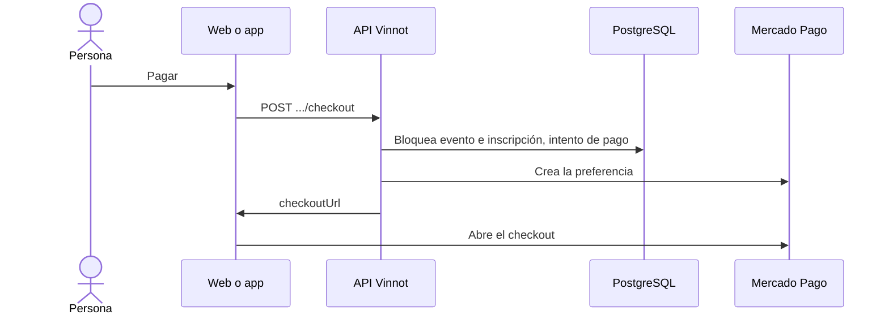

# UC-PAY-01 · Pagar una inscripción

| Campo | Valor |
|---|---|
| ID | `UC-PAY-01` |
| Módulo | [Pagos](../README.md) |
| Plataformas | Web, APK |
| Actores | Usuario autenticado, Mercado Pago |
| IDs en Lucidchart | [WEB UC-EVT-05](https://lucid.app/lucidchart/9f11a16b-bb5a-42fc-a9e8-0852b17bd241/edit), [APK UC-EVT-06](https://lucid.app/lucidchart/e095dd25-e8ac-41ba-bf5b-396e1055f217/edit) |
| Requisitos | [`RF-WEB-PAY-01`](../requirements.md), [`RF-APK-PAY-01`](../requirements.md) |
| Casos de prueba | [`CP-PAY-01`](../testing.md), [`CP-PAY-02`](../testing.md), [`CP-PAY-03`](../testing.md), [`CP-PAY-04`](../testing.md), [`CP-PAY-05`](../testing.md) |

## Precondiciones

- La persona tiene una inscripción `AWAITING_PAYMENT` en un evento pago, publicado o agotado, que todavía no empezó.
- El organizador tiene su cuenta de Mercado Pago vinculada ([UC-PAY-03](uc-pay-03-link-payment-account.md)).

## Postcondiciones

- La persona está en el checkout de Mercado Pago con su cupo reservado.

## Flujo principal

1. Al inscribirse en un evento pago, o con «Pagar» en el detalle del evento, el cliente pide el checkout.
2. El cliente envía `POST /events/{eventId}/registrations/{registrationId}/checkout`; la app pide además volver a la app.
3. La API bloquea el evento y la inscripción y comprueba que la inscripción sea de la persona, que comprador y organizador estén activos y que el evento siga disponible.
4. Calcula el total en pesos y la comisión de Vinnot con la política vigente (hoy el 3 %), y reutiliza el intento de pago de la inscripción si ya existía.
5. Crea la preferencia en Mercado Pago con la comisión, la referencia del intento, la dirección de avisos y un vencimiento que no pasa la reserva ni el inicio del evento.
6. La API devuelve la dirección del checkout y el cliente abre Mercado Pago.

## Flujos alternativos

- 6a. La API no pudo confirmar la creación de la preferencia: responde 202 sin dirección y el cliente avisa que el pago está pendiente.
- 3a. La reserva venció o el evento ya no admite pagos: la API responde `PAYMENT_RESERVATION_UNAVAILABLE` o `PAYMENT_CHECKOUT_EXPIRED`.
- 5a. La cuenta del organizador no está disponible: la API responde `PAYMENT_ACCOUNT_UNAVAILABLE`.
- 3b. Una inscripción antigua `REQUESTED` o con pago informado puede retomar el pago por este mismo camino.

## Reglas de negocio

- Volver del checkout no confirma el pago: lo confirma el servidor al verificarlo con Mercado Pago ([UC-PAY-05](uc-pay-05-confirm-and-reconcile.md)).
- Solo pesos argentinos, de 1 a 20 entradas; la comisión se descuenta al vendedor. Un intento conserva la política con la que se creó aunque después cambie la tasa.
- En producción el vendedor no puede ser la cuenta de la plataforma; en piloto el total no supera ARS 50 y hay un solo vendedor habilitado.
- Los clientes muestran el pago solo con el flag de pagos activo.

## Diagrama

[Ver diagrama de «UC-PAY-01 · Pagar una inscripción» completo](https://images.vinnot.com/docs/diagrams/v1/es/modules-payments-use-cases-uc-pay-01-pay-registration-129355a4e8b3.svg)

Diagrama de componentes en Lucidchart: [WEB UC-EVT-05](https://lucid.app/lucidchart/9f11a16b-bb5a-42fc-a9e8-0852b17bd241/edit), [APK UC-EVT-06](https://lucid.app/lucidchart/e095dd25-e8ac-41ba-bf5b-396e1055f217/edit).

## Código

| Capa | Ubicación |
|---|---|
| Endpoints | `POST /events/{eventId}/registrations/{registrationId}/checkout` |
| Backend | [`EventCheckoutController.java`](../../../../../backend/src/main/java/com/vinnot/payment/infrastructure/web/EventCheckoutController.java), [`StartEventCheckoutService.java`](../../../../../backend/src/main/java/com/vinnot/payment/application/service/StartEventCheckoutService.java), [`EventCheckoutReservationService.java`](../../../../../backend/src/main/java/com/vinnot/payment/application/service/EventCheckoutReservationService.java), [`DispatchTicketCheckoutService.java`](../../../../../backend/src/main/java/com/vinnot/payment/application/service/DispatchTicketCheckoutService.java), [`TicketPaymentQuote.java`](../../../../../backend/src/main/java/com/vinnot/payment/domain/valueobject/TicketPaymentQuote.java), [`PaymentExecutionPolicy.java`](../../../../../backend/src/main/java/com/vinnot/payment/application/service/PaymentExecutionPolicy.java), [`MercadoPagoCheckoutAdapter.java`](../../../../../backend/src/main/java/com/vinnot/payment/infrastructure/gateway/MercadoPagoCheckoutAdapter.java) |
| Web | [`EventDetailsSidebar.tsx`](../../../../../frontend-react/src/presentation/pages/events/EventDetailsSidebar.tsx), [`useEventCheckout.ts`](../../../../../frontend-react/src/presentation/hooks/useEventCheckout.ts), [`paymentCheckout.service.ts`](../../../../../frontend-react/src/application/services/paymentCheckout.service.ts), [`eventCheckout.ts`](../../../../../frontend-react/src/application/services/eventCheckout.ts), [`paymentCheckoutNavigator.ts`](../../../../../frontend-react/src/infrastructure/payments/paymentCheckoutNavigator.ts), [`events.client.ts`](../../../../../frontend-react/src/infrastructure/api/clients/events.client.ts) |
| App | [`ReserveCTA.tsx`](../../../../../frontend-mobile/src/presentation/features/event/ReserveCTA.tsx), [`useEventCheckout.ts`](../../../../../frontend-mobile/src/presentation/hooks/useEventCheckout.ts), [`paymentCheckout.service.ts`](../../../../../frontend-mobile/src/application/services/paymentCheckout.service.ts), [`eventCheckout.ts`](../../../../../frontend-mobile/src/application/services/eventCheckout.ts), [`paymentCheckoutNavigator.ts`](../../../../../frontend-mobile/src/infrastructure/payments/paymentCheckoutNavigator.ts), [`events.client.ts`](../../../../../frontend-mobile/src/infrastructure/api/clients/events.client.ts) |

## Tests automáticos

- Backend: [`StartEventCheckoutServiceTest.java`](../../../../../backend/src/test/java/com/vinnot/payment/application/service/StartEventCheckoutServiceTest.java), [`EventCheckoutReservationServiceTest.java`](../../../../../backend/src/test/java/com/vinnot/payment/application/service/EventCheckoutReservationServiceTest.java), [`EventCheckoutReservationPostgresIntegrationTest.java`](../../../../../backend/src/test/java/com/vinnot/payment/infrastructure/persistence/EventCheckoutReservationPostgresIntegrationTest.java), [`DispatchTicketCheckoutServiceTest.java`](../../../../../backend/src/test/java/com/vinnot/payment/application/service/DispatchTicketCheckoutServiceTest.java), [`TicketPaymentQuoteTest.java`](../../../../../backend/src/test/java/com/vinnot/payment/domain/valueobject/TicketPaymentQuoteTest.java), [`PaymentExecutionPolicyTest.java`](../../../../../backend/src/test/java/com/vinnot/payment/application/service/PaymentExecutionPolicyTest.java), [`MercadoPagoCheckoutAdapterTest.java`](../../../../../backend/src/test/java/com/vinnot/payment/infrastructure/gateway/MercadoPagoCheckoutAdapterTest.java), [`EventCheckoutControllerTest.java`](../../../../../backend/src/test/java/com/vinnot/payment/infrastructure/web/EventCheckoutControllerTest.java)
- Web: [`paymentCheckout.service.test.ts`](../../../../../frontend-react/src/application/services/paymentCheckout.service.test.ts), [`eventCheckout.test.ts`](../../../../../frontend-react/src/application/services/eventCheckout.test.ts), [`useEventCheckout.test.ts`](../../../../../frontend-react/src/presentation/hooks/useEventCheckout.test.ts)
- App: [`paymentCheckout.service.test.ts`](../../../../../frontend-mobile/src/application/services/paymentCheckout.service.test.ts), [`useEventCheckout.test.ts`](../../../../../frontend-mobile/src/presentation/hooks/useEventCheckout.test.ts), [`ReserveCTA.test.tsx`](../../../../../frontend-mobile/src/presentation/features/event/ReserveCTA.test.tsx)
