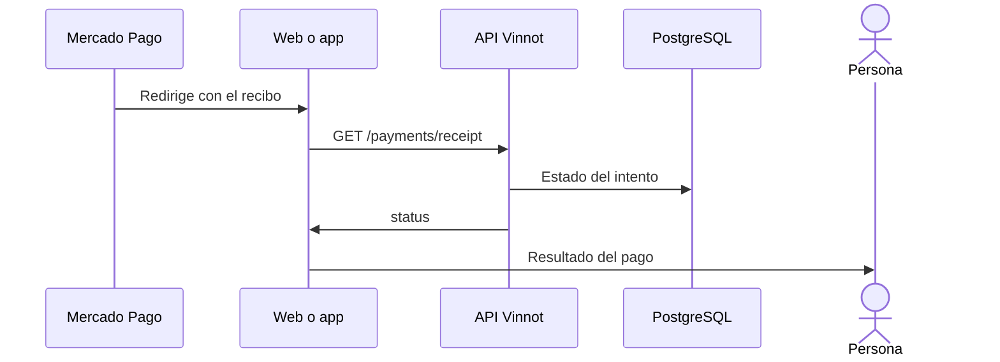

# UC-PAY-02 · Volver del checkout y ver el recibo

| Campo | Valor |
|---|---|
| ID | `UC-PAY-02` |
| Módulo | [Pagos](../README.md) |
| Plataformas | Web, APK |
| Actores | Comprador (con o sin sesión), Mercado Pago |
| IDs en Lucidchart | [WEB UC-EVT-06](https://lucid.app/lucidchart/9f11a16b-bb5a-42fc-a9e8-0852b17bd241/edit) |
| Requisitos | [`RF-WEB-PAY-02`](../requirements.md) |
| Casos de prueba | [`CP-PAY-06`](../testing.md), [`CP-PAY-07`](../testing.md), [`CP-PAY-08`](../testing.md), [`CP-PAY-09`](../testing.md) |

## Precondiciones

- La persona terminó, canceló o dejó pendiente el pago en Mercado Pago.

## Postcondiciones

- La persona ve el estado verificado de su pago.

## Flujo principal

1. Mercado Pago redirige a `/payments/return` con un recibo opaco.
2. La página pide `GET /payments/receipt?token=` sin necesitar sesión.
3. La API descifra el recibo y devuelve el estado: pendiente, confirmado, no completado, devolución pendiente, devuelto o en revisión.
4. Mientras está pendiente, la página vuelve a consultar cada 5 segundos, hasta 24 veces, y ofrece refrescar.
5. La página muestra el resultado y enlaza a «Mis entradas».

## Flujos alternativos

- 1a. El pago empezó en la app: la página intenta abrir `vinnot://payments/return` y la app muestra el mismo recibo en su pantalla de regreso.
- 1b. El pago empezó en la web pero la página se abre en un teléfono: ofrece abrir la app sin hacerlo sola.
- 3a. El recibo es inválido o venció: la API responde 404.

## Reglas de negocio

- Los parámetros de la URL solo orientan la navegación; el estado sale siempre del recibo.
- El recibo vale 7 días y no expone datos de la persona.
- La página no envía el recibo a otros sitios (`no-referrer`) ni se indexa.
- Ver la entrada sigue exigiendo sesión ([Eventos](../../events/README.md)).

## Diagrama

[Ver diagrama de «UC-PAY-02 · Volver del checkout y ver el recibo» completo](https://images.vinnot.com/docs/diagrams/v1/es/modules-payments-use-cases-uc-pay-02-checkout-return-5fc27782783c.svg)

Diagrama de componentes en Lucidchart: [WEB UC-EVT-06](https://lucid.app/lucidchart/9f11a16b-bb5a-42fc-a9e8-0852b17bd241/edit).

## Código

| Capa | Ubicación |
|---|---|
| Endpoints | `GET /payments/receipt` |
| Backend | [`PaymentReceiptController.java`](../../../../../backend/src/main/java/com/vinnot/payment/infrastructure/web/PaymentReceiptController.java), [`GetPaymentReceiptService.java`](../../../../../backend/src/main/java/com/vinnot/payment/application/service/GetPaymentReceiptService.java), [`EncryptedPaymentReceiptAccess.java`](../../../../../backend/src/main/java/com/vinnot/payment/infrastructure/security/EncryptedPaymentReceiptAccess.java) |
| Web | [`PaymentReturnPage.tsx`](../../../../../frontend-react/src/presentation/pages/events/PaymentReturnPage.tsx), [`useMyTickets.ts`](../../../../../frontend-react/src/presentation/hooks/queries/event/useMyTickets.ts), [`useCheckoutReturn.ts`](../../../../../frontend-react/src/presentation/hooks/useCheckoutReturn.ts), [`checkoutReturn.service.ts`](../../../../../frontend-react/src/application/services/checkoutReturn.service.ts) |
| App | [`CheckoutReturnScreen.tsx`](../../../../../frontend-mobile/src/presentation/features/event/CheckoutReturnScreen.tsx), [`useCheckoutReceipt.ts`](../../../../../frontend-mobile/src/presentation/hooks/useCheckoutReceipt.ts), [`paymentReturn.ts`](../../../../../frontend-mobile/src/presentation/navigation/paymentReturn.ts) |

## Tests automáticos

- Backend: [`GetPaymentReceiptServiceTest.java`](../../../../../backend/src/test/java/com/vinnot/payment/application/service/GetPaymentReceiptServiceTest.java), [`EncryptedPaymentReceiptAccessTest.java`](../../../../../backend/src/test/java/com/vinnot/payment/infrastructure/security/EncryptedPaymentReceiptAccessTest.java)
- Web: [`PaymentReturnPage.test.tsx`](../../../../../frontend-react/src/presentation/pages/events/PaymentReturnPage.test.tsx), [`useCheckoutReturn.test.tsx`](../../../../../frontend-react/src/presentation/hooks/useCheckoutReturn.test.tsx), [`checkoutReturn.service.test.ts`](../../../../../frontend-react/src/application/services/checkoutReturn.service.test.ts)
- App: [`CheckoutReturnScreen.test.tsx`](../../../../../frontend-mobile/src/presentation/features/event/CheckoutReturnScreen.test.tsx), [`useCheckoutReceipt.test.ts`](../../../../../frontend-mobile/src/presentation/hooks/useCheckoutReceipt.test.ts), [`paymentReturn.test.ts`](../../../../../frontend-mobile/src/presentation/navigation/paymentReturn.test.ts)
