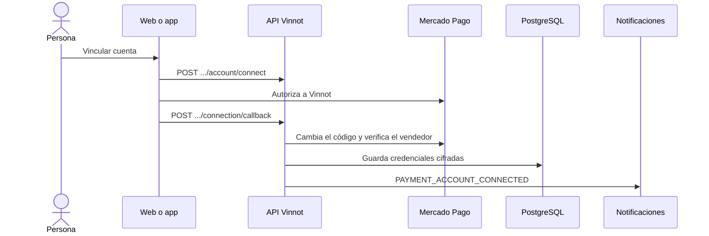

# UC-PAY-03 · Vincular la cuenta de Mercado Pago

| Campo | Valor |
|---|---|
| ID | `UC-PAY-03` |
| Módulo | [Pagos](../README.md) |
| Plataformas | Web, APK |
| Actores | Organizador o administrador, Mercado Pago |
| IDs en Lucidchart | [WEB UC-PAR-07](https://lucid.app/lucidchart/9f11a16b-bb5a-42fc-a9e8-0852b17bd241/edit), [APK UC-ORG-03](https://lucid.app/lucidchart/e095dd25-e8ac-41ba-bf5b-396e1055f217/edit) |
| Requisitos | Ninguno |
| Casos de prueba | [`CP-PAY-10`](../testing.md), [`CP-PAY-11`](../testing.md), [`CP-PAY-12`](../testing.md), [`CP-PAY-13`](../testing.md), [`CP-PAY-14`](../testing.md) |

## Precondiciones

- Quien cobra es partner o administrador y tiene sesión iniciada.

## Postcondiciones

- La cuenta de Mercado Pago queda vinculada y se pueden publicar eventos pagos.

## Flujo principal

1. En la web, el organizador abre `/partner/payments` desde «Mis eventos»; en la app, usa el botón de vinculación de la sección paga del editor de eventos.
2. El cliente envía `POST /payments/mercadopago/account/connect` y recibe la dirección de autorización.
3. El organizador autoriza a Vinnot en Mercado Pago.
4. Mercado Pago vuelve a `/partner/payments/callback`, que envía el código a `POST /payments/mercadopago/connection/callback`.
5. La API comprueba el estado de un solo uso, cambia el código por credenciales, verifica la cuenta del vendedor y guarda las credenciales cifradas.
6. El organizador recibe `PAYMENT_ACCOUNT_CONNECTED` y el cliente muestra la cuenta conectada (`GET /payments/mercadopago/account`).

## Flujos alternativos

- 4a. La vinculación empezó en la app: la página de regreso vuelve a la app por `vinnot://payments/connected` y el editor consulta el estado otra vez.
- 5a. Pasaron más de 10 minutos o el estado ya se usó: la API responde `PAYMENT_CONNECTION_EXPIRED`.
- 5b. Se intenta cambiar a otro vendedor y la cuenta ya tiene operaciones: la API responde `PAYMENT_ACCOUNT_HAS_OPERATIONS`; reconectar el mismo vendedor está permitido.
- 5c. Mercado Pago no responde: la API responde 503 `PAYMENT_PROVIDER_UNAVAILABLE`.

## Reglas de negocio

- La autorización usa PKCE y un estado de un solo uso válido 10 minutos, guardado como hash.
- Las credenciales se guardan cifradas y nunca viajan en enlaces.
- Guardar un borrador no exige cuenta; publicar un evento pago sí.
- No hay desvinculación: solo se reconecta.
- La página web de cuenta de cobro solo existe con el flag de pagos activo; en la app la vinculación vive en el editor.

## Diagrama

[Ver diagrama de «UC-PAY-03 · Vincular la cuenta de Mercado Pago» completo](https://images.vinnot.com/docs/diagrams/v1/es/modules-payments-use-cases-uc-pay-03-link-payment-account-0279f5fa0219.svg)

Diagrama de componentes en Lucidchart: [WEB UC-PAR-07](https://lucid.app/lucidchart/9f11a16b-bb5a-42fc-a9e8-0852b17bd241/edit), [APK UC-ORG-03](https://lucid.app/lucidchart/e095dd25-e8ac-41ba-bf5b-396e1055f217/edit).

## Código

| Capa | Ubicación |
|---|---|
| Endpoints | `GET /payments/mercadopago/account`, `POST /payments/mercadopago/account/connect`, `POST /payments/mercadopago/connection/callback` |
| Backend | [`PaymentAccountController.java`](../../../../../backend/src/main/java/com/vinnot/payment/infrastructure/web/PaymentAccountController.java), [`PaymentConnectionCallbackController.java`](../../../../../backend/src/main/java/com/vinnot/payment/infrastructure/web/PaymentConnectionCallbackController.java), [`ConnectPaymentAccountService.java`](../../../../../backend/src/main/java/com/vinnot/payment/application/service/ConnectPaymentAccountService.java), [`MercadoPagoAuthorizationAdapter.java`](../../../../../backend/src/main/java/com/vinnot/payment/infrastructure/gateway/MercadoPagoAuthorizationAdapter.java), [`MercadoPagoSellerVerifier.java`](../../../../../backend/src/main/java/com/vinnot/payment/infrastructure/gateway/MercadoPagoSellerVerifier.java), [`PaymentCredentialCipher.java`](../../../../../backend/src/main/java/com/vinnot/payment/infrastructure/security/PaymentCredentialCipher.java) |
| Web | [`PaymentAccountPage.tsx`](../../../../../frontend-react/src/presentation/pages/partner/PaymentAccountPage.tsx), [`usePaymentAccountConnection.ts`](../../../../../frontend-react/src/presentation/hooks/usePaymentAccountConnection.ts), [`paymentAccount.service.ts`](../../../../../frontend-react/src/application/services/paymentAccount.service.ts), [`PaymentAccountStatus.tsx`](../../../../../frontend-react/src/presentation/components/features/event/PaymentAccountStatus.tsx), [`paymentAccount.client.ts`](../../../../../frontend-react/src/infrastructure/api/clients/paymentAccount.client.ts) |
| App | [`EventEditorFields.tsx`](../../../../../frontend-mobile/src/presentation/features/event/EventEditorFields.tsx), [`usePaymentAccountSetup.ts`](../../../../../frontend-mobile/src/presentation/hooks/usePaymentAccountSetup.ts), [`paymentAccountSetup.service.ts`](../../../../../frontend-mobile/src/application/services/paymentAccountSetup.service.ts), [`paymentReturnNavigation.ts`](../../../../../frontend-mobile/src/application/services/paymentReturnNavigation.ts), [`paymentAccount.client.ts`](../../../../../frontend-mobile/src/infrastructure/api/clients/paymentAccount.client.ts) |

## Tests automáticos

- Backend: [`ConnectPaymentAccountServiceTest.java`](../../../../../backend/src/test/java/com/vinnot/payment/application/service/ConnectPaymentAccountServiceTest.java), [`MercadoPagoAuthorizationAdapterTest.java`](../../../../../backend/src/test/java/com/vinnot/payment/infrastructure/gateway/MercadoPagoAuthorizationAdapterTest.java), [`PaymentCredentialCipherTest.java`](../../../../../backend/src/test/java/com/vinnot/payment/infrastructure/security/PaymentCredentialCipherTest.java), [`PaymentAccountControllerTest.java`](../../../../../backend/src/test/java/com/vinnot/payment/infrastructure/web/PaymentAccountControllerTest.java), [`PostgresPaymentAccountStoreTest.java`](../../../../../backend/src/test/java/com/vinnot/payment/infrastructure/persistence/PostgresPaymentAccountStoreTest.java)
- Web: [`usePaymentAccountConnection.test.tsx`](../../../../../frontend-react/src/presentation/hooks/usePaymentAccountConnection.test.tsx), [`paymentAccount.service.test.ts`](../../../../../frontend-react/src/application/services/paymentAccount.service.test.ts), [`PaymentAccountStatus.test.tsx`](../../../../../frontend-react/src/presentation/components/features/event/PaymentAccountStatus.test.tsx), [`paymentAuthorization.browser.test.ts`](../../../../../frontend-react/src/infrastructure/payments/paymentAuthorization.browser.test.ts)
- App: [`usePaymentAccountSetup.test.ts`](../../../../../frontend-mobile/src/presentation/hooks/usePaymentAccountSetup.test.ts), [`paymentAccountSetup.service.test.ts`](../../../../../frontend-mobile/src/application/services/paymentAccountSetup.service.test.ts), [`paymentReturnNavigation.test.ts`](../../../../../frontend-mobile/src/application/services/paymentReturnNavigation.test.ts), [`EventEditorFields.test.tsx`](../../../../../frontend-mobile/src/presentation/features/event/EventEditorFields.test.tsx)
