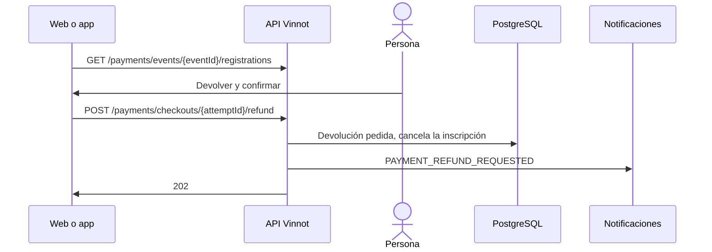

# UC-PAY-04 · Devolver el pago de una inscripción

| Campo | Valor |
|---|---|
| ID | `UC-PAY-04` |
| Módulo | [Pagos](../README.md) |
| Plataformas | Web, APK |
| Actores | Organizador o administrador, Mercado Pago |
| IDs en Lucidchart | [WEB UC-PAR-06](https://lucid.app/lucidchart/9f11a16b-bb5a-42fc-a9e8-0852b17bd241/edit), [APK UC-ORG-07](https://lucid.app/lucidchart/e095dd25-e8ac-41ba-bf5b-396e1055f217/edit) |
| Requisitos | [`RF-WEB-PAY-03`](../requirements.md), [`RF-APK-PAY-02`](../requirements.md) |
| Casos de prueba | [`CP-PAY-15`](../testing.md), [`CP-PAY-16`](../testing.md), [`CP-PAY-17`](../testing.md), [`CP-PAY-18`](../testing.md), [`CP-PAY-28`](../testing.md) |

## Precondiciones

- El organizador del evento, o un administrador, abre las inscripciones de un evento pago.

## Postcondiciones

- La inscripción queda cancelada y la devolución total queda pedida a Mercado Pago.

## Flujo principal

1. El cliente pide `GET /payments/events/{eventId}/registrations` con hasta 50 inscripciones.
2. La API devuelve, por inscripción, el importe, el estado del pago, el de la devolución y si se puede devolver.
3. El organizador elige «Devolver» y confirma el total y la cancelación de la inscripción.
4. El cliente envía `POST /payments/checkouts/{attemptId}/refund`.
5. La API comprueba el rol y que sea el organizador, y que el pago esté acreditado, sin devoluciones ni revisión.
6. Registra la devolución, libera el cupo, cancela la inscripción, avisa `PAYMENT_REFUND_REQUESTED` y responde 202.
7. La conciliación envía la devolución a Mercado Pago y avisa `PAYMENT_REFUNDED` cuando se confirma ([UC-PAY-05](uc-pay-05-confirm-and-reconcile.md)).

## Flujos alternativos

- 5a. El pago no admite devolución: la API responde `PAYMENT_REFUND_UNAVAILABLE`.
- 6a. La devolución ya estaba pedida: la API reutiliza la misma y no envía otro aviso.
- 3a. El organizador vuelve atrás: no se devuelve nada.
- 3b. Mercado Pago rechazó la devolución anterior: el cliente muestra el aviso del rechazo y ofrece «Reintentar devolución»; al confirmar envía el mismo pedido, la API vuelve a preparar esa devolución, sin otro aviso `PAYMENT_REFUND_REQUESTED`, y la conciliación la envía con una clave de idempotencia nueva.

## Reglas de negocio

- Solo devoluciones totales.
- Solo una devolución rechazada se puede volver a pedir; una en envío, incierta o terminada no cambia.
- El organizador no confirma pagos ni acredita a mano: solo aprueba, rechaza o pone en espera según el estado ([Partners](../../partner/README.md)).
- Cancelar el evento devuelve los pagos en línea sin que nadie lo pida ([UC-PAY-05](uc-pay-05-confirm-and-reconcile.md)).

## Diagrama

[Ver diagrama de «UC-PAY-04 · Devolver el pago de una inscripción» completo](https://images.vinnot.com/docs/diagrams/v1/es/modules-payments-use-cases-uc-pay-04-refund-registration-39e958d5efea.svg)

Diagrama de componentes en Lucidchart: [WEB UC-PAR-06](https://lucid.app/lucidchart/9f11a16b-bb5a-42fc-a9e8-0852b17bd241/edit), [APK UC-ORG-07](https://lucid.app/lucidchart/e095dd25-e8ac-41ba-bf5b-396e1055f217/edit).

## Código

| Capa | Ubicación |
|---|---|
| Endpoints | `GET /payments/events/{eventId}/registrations`, `POST /payments/checkouts/{attemptId}/refund` |
| Backend | [`OrganizerPaymentsController.java`](../../../../../backend/src/main/java/com/vinnot/payment/infrastructure/web/OrganizerPaymentsController.java), [`GetOrganizerPaymentsService.java`](../../../../../backend/src/main/java/com/vinnot/payment/application/service/GetOrganizerPaymentsService.java), [`PaymentRefundController.java`](../../../../../backend/src/main/java/com/vinnot/payment/infrastructure/web/PaymentRefundController.java), [`RequestPaymentRefundService.java`](../../../../../backend/src/main/java/com/vinnot/payment/application/service/RequestPaymentRefundService.java), [`RefundEligibility.java`](../../../../../backend/src/main/java/com/vinnot/payment/domain/model/RefundEligibility.java) |
| Web | [`EventRegistrationsManagerModal.tsx`](../../../../../frontend-react/src/presentation/components/features/event/EventRegistrationsManagerModal.tsx), [`useOrganizerPayments.ts`](../../../../../frontend-react/src/presentation/hooks/queries/event/useOrganizerPayments.ts), [`organizerPayments.service.ts`](../../../../../frontend-react/src/application/services/organizerPayments.service.ts), [`organizerPayments.client.ts`](../../../../../frontend-react/src/infrastructure/api/clients/organizerPayments.client.ts) |
| App | [`EventRegistrationsManagerSheet.tsx`](../../../../../frontend-mobile/src/presentation/features/event/EventRegistrationsManagerSheet.tsx), [`useOrganizerPayments.ts`](../../../../../frontend-mobile/src/presentation/hooks/queries/event/useOrganizerPayments.ts), [`organizerPayments.service.ts`](../../../../../frontend-mobile/src/application/services/organizerPayments.service.ts), [`organizerPayments.client.ts`](../../../../../frontend-mobile/src/infrastructure/api/clients/organizerPayments.client.ts) |

## Tests automáticos

- Backend: [`GetOrganizerPaymentsServiceTest.java`](../../../../../backend/src/test/java/com/vinnot/payment/application/service/GetOrganizerPaymentsServiceTest.java), [`RequestPaymentRefundServiceTest.java`](../../../../../backend/src/test/java/com/vinnot/payment/application/service/RequestPaymentRefundServiceTest.java), [`OrganizerPaymentTest.java`](../../../../../backend/src/test/java/com/vinnot/payment/domain/model/OrganizerPaymentTest.java), [`PaymentSettlementPostgresIntegrationTest.java`](../../../../../backend/src/test/java/com/vinnot/payment/infrastructure/persistence/PaymentSettlementPostgresIntegrationTest.java), [`CancellationRefundTest.java`](../../../../../backend/src/test/java/com/vinnot/event/domain/valueobject/CancellationRefundTest.java)
- Web: [`EventRegistrationsManagerModal.test.tsx`](../../../../../frontend-react/src/presentation/components/features/event/EventRegistrationsManagerModal.test.tsx), [`organizerPayments.service.test.ts`](../../../../../frontend-react/src/application/services/organizerPayments.service.test.ts)
- App: [`EventRegistrationsManagerSheet.test.tsx`](../../../../../frontend-mobile/src/presentation/features/event/EventRegistrationsManagerSheet.test.tsx), [`organizerPayments.service.test.ts`](../../../../../frontend-mobile/src/application/services/organizerPayments.service.test.ts)
