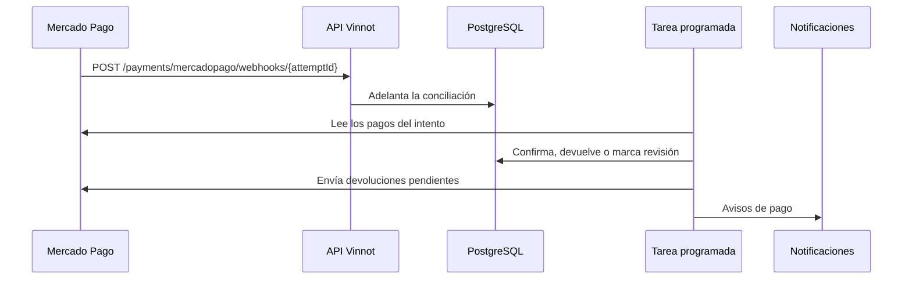

# UC-PAY-05 · Confirmar cobros y devolver pagos

| Campo | Valor |
|---|---|
| ID | `UC-PAY-05` |
| Módulo | [Pagos](../README.md) |
| Plataformas | Solo backend |
| Actores | Mercado Pago, Sistema (tarea programada) |
| IDs en Lucidchart | Ninguno |
| Requisitos | Ninguno |
| Casos de prueba | [`CP-PAY-19`](../testing.md), [`CP-PAY-20`](../testing.md), [`CP-PAY-21`](../testing.md), [`CP-PAY-22`](../testing.md), [`CP-PAY-23`](../testing.md), [`CP-PAY-24`](../testing.md), [`CP-PAY-29`](../testing.md), [`CP-PAY-30`](../testing.md) |

## Precondiciones

- Hay intentos de pago enviados a Mercado Pago, o un evento pago se canceló.

## Postcondiciones

- Cada inscripción refleja el estado real de su pago y las devoluciones pendientes se envían.

## Flujo principal

1. Mercado Pago avisa un cambio con `POST /payments/mercadopago/webhooks/{attemptId}`.
2. La API verifica la firma del aviso y adelanta la conciliación de ese intento.
3. La tarea de conciliación toma intentos pendientes y lee sus pagos (hasta 20) desde la API de Mercado Pago con las credenciales del vendedor.
4. Un pago aprobado antes del vencimiento confirma la inscripción y envía `PAYMENT_RECEIPT`.
5. Si hay devoluciones pendientes, las envía a Mercado Pago con una clave de idempotencia y vuelve a leer el pago.
6. Programa la próxima revisión del intento.

## Flujos alternativos

- 2a. La firma no es válida: la API responde 401 y no hace nada.
- 4a. El pago llega tarde o es un segundo pago de la misma inscripción: se pide su devolución.
- 4b. Un pago acreditado cuya inscripción dejó de estar confirmada, o cuyo evento se canceló, se devuelve automáticamente y se avisa `PAYMENT_REFUND_REQUESTED`.
- 4c. Hay una devolución parcial, un contracargo o una mediación: la inscripción se cancela, el caso queda en revisión y se avisa `PAYMENT_REFUNDED` o `PAYMENT_CHARGEBACK`.
- 1a. No llega ningún aviso: la conciliación revisa igual el intento según su calendario.
- 5a. Mercado Pago rechaza la devolución en forma definitiva (un error 4xx que no sea 408, 409 ni 429, o el límite de `LIVE_PILOT`): la devolución queda `REJECTED` con un código de motivo, se registra en el log y el organizador recibe `PAYMENT_REFUND_REJECTED` una vez por rechazo; no se reenvía sola.
- 5b. El resultado es incierto (408, 409, 429, 5xx, red o respuesta inválida): la devolución queda `UNCERTAIN` y nunca se reenvía; solo se verifica releyendo el pago.

## Reglas de negocio

- Cada 5 minutos hasta una hora después del vencimiento; ante un error, al minuto; luego cada 30 minutos, 6 horas y 24 horas; se archiva a los 180 días.
- Cada intento acredita como mucho un pago.
- Mientras una devolución no se confirma, quien pagó la sigue viendo como pendiente.
- La firma del aviso es HMAC-SHA256 con un margen de 10 minutos.
- Los avisos de pago llegan por email y push ([Notificaciones](../../notifications/README.md)).

## Diagrama

[Ver diagrama de «UC-PAY-05 · Confirmar cobros y devolver pagos» completo](https://images.vinnot.com/docs/diagrams/v1/es/modules-payments-use-cases-uc-pay-05-confirm-and-reconcile-05f7cc907788.svg)

## Código

| Capa | Ubicación |
|---|---|
| Endpoints | `POST /payments/mercadopago/webhooks/{attemptId}`, `POST /payments/mercadopago/webhooks` |
| Backend | [`PaymentWebhookController.java`](../../../../../backend/src/main/java/com/vinnot/payment/infrastructure/web/PaymentWebhookController.java), [`MercadoPagoWebhookSignature.java`](../../../../../backend/src/main/java/com/vinnot/payment/infrastructure/security/MercadoPagoWebhookSignature.java), [`RecordPaymentNotificationService.java`](../../../../../backend/src/main/java/com/vinnot/payment/application/service/RecordPaymentNotificationService.java), [`PaymentReconciliationScheduler.java`](../../../../../backend/src/main/java/com/vinnot/payment/infrastructure/scheduling/PaymentReconciliationScheduler.java), [`ReconcilePaymentsService.java`](../../../../../backend/src/main/java/com/vinnot/payment/application/service/ReconcilePaymentsService.java), [`ReconciliationSchedule.java`](../../../../../backend/src/main/java/com/vinnot/payment/application/service/ReconciliationSchedule.java), [`ApplyProviderPaymentService.java`](../../../../../backend/src/main/java/com/vinnot/payment/application/service/ApplyProviderPaymentService.java), [`PaymentNoticeService.java`](../../../../../backend/src/main/java/com/vinnot/payment/application/service/PaymentNoticeService.java) |

## Tests automáticos

- Backend: [`MercadoPagoWebhookSignatureTest.java`](../../../../../backend/src/test/java/com/vinnot/payment/infrastructure/security/MercadoPagoWebhookSignatureTest.java), [`RecordPaymentNotificationServiceTest.java`](../../../../../backend/src/test/java/com/vinnot/payment/application/service/RecordPaymentNotificationServiceTest.java), [`ReconcilePaymentsServiceTest.java`](../../../../../backend/src/test/java/com/vinnot/payment/application/service/ReconcilePaymentsServiceTest.java), [`ReconciliationScheduleTest.java`](../../../../../backend/src/test/java/com/vinnot/payment/application/service/ReconciliationScheduleTest.java), [`ApplyProviderPaymentServiceTest.java`](../../../../../backend/src/test/java/com/vinnot/payment/application/service/ApplyProviderPaymentServiceTest.java), [`PaymentSettlementPostgresIntegrationTest.java`](../../../../../backend/src/test/java/com/vinnot/payment/infrastructure/persistence/PaymentSettlementPostgresIntegrationTest.java), [`PaymentNoticeServiceTest.java`](../../../../../backend/src/test/java/com/vinnot/payment/application/service/PaymentNoticeServiceTest.java), [`MercadoPagoPaymentAdapterTest.java`](../../../../../backend/src/test/java/com/vinnot/payment/infrastructure/gateway/MercadoPagoPaymentAdapterTest.java), [`RefundRejectionRecorderTest.java`](../../../../../backend/src/test/java/com/vinnot/payment/application/service/RefundRejectionRecorderTest.java)
- Web: Ninguno
- App: Ninguno
