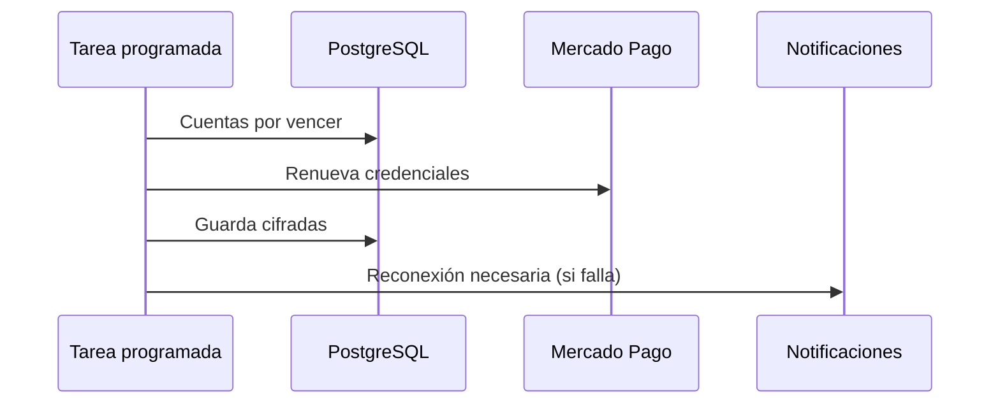

# UC-PAY-06 · Renovar las credenciales de cobro

| Campo | Valor |
|---|---|
| ID | `UC-PAY-06` |
| Módulo | [Pagos](../README.md) |
| Plataformas | Solo backend |
| Actores | Sistema (tarea programada), Mercado Pago |
| IDs en Lucidchart | Ninguno |
| Requisitos | Ninguno |
| Casos de prueba | [`CP-PAY-25`](../testing.md), [`CP-PAY-26`](../testing.md), [`CP-PAY-27`](../testing.md) |

## Precondiciones

- Hay cuentas de cobro vinculadas cuyas credenciales vencen.

## Postcondiciones

- Las credenciales siguen vigentes o el organizador sabe que tiene que reconectar.

## Flujo principal

1. La tarea toma hasta 20 cuentas cuyas credenciales vencen en menos de un día.
2. Pide credenciales nuevas a Mercado Pago.
3. Guarda las credenciales nuevas cifradas.

## Flujos alternativos

- 2a. Mercado Pago revocó la autorización o venció: la cuenta queda para reconectar y el organizador recibe `PAYMENT_ACCOUNT_RECONNECT_REQUIRED` una sola vez.
- 2b. Falla temporal: se reintenta a los 5 minutos.

## Reglas de negocio

- Las credenciales de un vendedor con operaciones se conservan para conciliar y devolver.
- Reconectar se hace igual que vincular ([UC-PAY-03](uc-pay-03-link-payment-account.md)).

## Diagrama

[Ver diagrama de «UC-PAY-06 · Renovar las credenciales de cobro» completo](https://images.vinnot.com/docs/diagrams/v1/es/modules-payments-use-cases-uc-pay-06-renew-credentials-57a522b2ec72.svg)

## Código

| Capa | Ubicación |
|---|---|
| Backend | [`PaymentCredentialRenewalScheduler.java`](../../../../../backend/src/main/java/com/vinnot/payment/infrastructure/scheduling/PaymentCredentialRenewalScheduler.java), [`RenewPaymentCredentialsService.java`](../../../../../backend/src/main/java/com/vinnot/payment/application/service/RenewPaymentCredentialsService.java), [`RenewalFailureRecorder.java`](../../../../../backend/src/main/java/com/vinnot/payment/application/service/RenewalFailureRecorder.java), [`PaymentAccountNoticeService.java`](../../../../../backend/src/main/java/com/vinnot/payment/application/service/PaymentAccountNoticeService.java) |

## Tests automáticos

- Backend: [`RenewPaymentCredentialsServiceTest.java`](../../../../../backend/src/test/java/com/vinnot/payment/application/service/RenewPaymentCredentialsServiceTest.java), [`RenewalFailureRecorderTest.java`](../../../../../backend/src/test/java/com/vinnot/payment/application/service/RenewalFailureRecorderTest.java), [`PaymentAccountNoticeServiceTest.java`](../../../../../backend/src/test/java/com/vinnot/payment/application/service/PaymentAccountNoticeServiceTest.java)
- Web: Ninguno
- App: Ninguno
