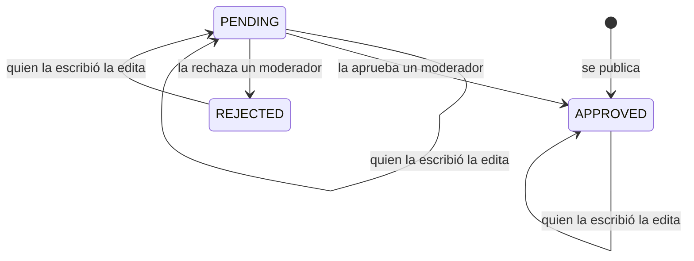
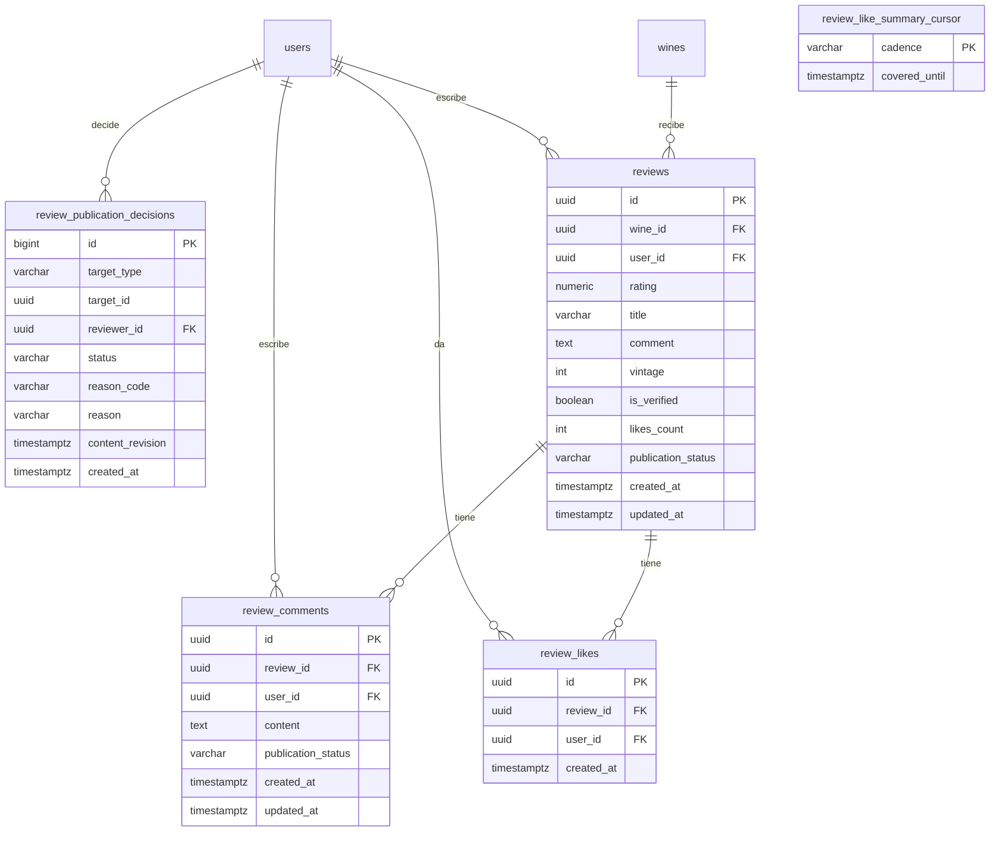

# Reseñas

Las opiniones de las personas sobre los vinos: un puntaje de 0.1 a 5.0 en
copas que se llenan según la fracción con título y comentario opcionales, likes y comentarios
sobre cada reseña. Las reseñas alimentan el promedio de cada vino y su autor recibe avisos de la actividad.
Las denuncias y los bloqueos están en [Comunidad](../community/README.md); la
moderación y el listado de reseñas para el equipo, en
[Administración](../admin/README.md); publicar una nota de la cava como reseña, en
[Cava](../cellar/README.md).

- Código del módulo: `REV`.
- Backend: paquete [`review`](../../../../backend/src/main/java/com/vinnot/review/).
- [Casos de uso](use-cases/README.md) · [Requisitos](requirements.md) ·
  [Arquitectura](architecture.md) · [Pruebas](testing.md)

## Actores

| Actor | Qué hace en este módulo |
|---|---|
| Usuario autenticado | Lee reseñas, publica la suya, da likes y comenta |
| Autor de la reseña | Edita o elimina su reseña y recibe avisos de comentarios y likes |
| Moderador | Elimina reseñas y comentarios ajenos |
| Administrador | Además puede editar reseñas ajenas |
| Servicio de email y de push | Entregan los avisos de actividad |

## Reglas de negocio

| Regla | Detalle | Dónde |
|---|---|---|
| Acceso | Leer y escribir reseñas requiere sesión | [`SecurityConfig.java`](../../../../backend/src/main/java/com/vinnot/shared/infrastructure/config/SecurityConfig.java) |
| Una por vino | Cada persona puede tener una sola reseña de cada vino | [`CreateReviewCommandHandler.java`](../../../../backend/src/main/java/com/vinnot/review/application/command/handler/CreateReviewCommandHandler.java) |
| Puntaje | De 0.1 a 5.0 con un decimal como máximo (2.15 se ingresa como 2.2); la API rechaza otra escala o valores fuera de rango (los ceros finales como `3.60` son el mismo puntaje; reseñas y cava comparten una misma validación de la solicitud, `OneDecimalRating`). Web y app lo eligen con el control de la botella que llena las copas y muestran cada copa llena según su fracción, con copa, vino y botella según el tipo de vino ([Puntos y sellos](../../manuals/points-and-seals.mdx#puntuar-con-copas)) | [`Review.java`](../../../../backend/src/main/java/com/vinnot/review/domain/model/Review.java) |
| Añada probada | Opcional, de 1800 al año siguiente e independiente de la añada del catálogo; editar sin enviarla la conserva, `clearVintage` la elimina | [`Review.java`](../../../../backend/src/main/java/com/vinnot/review/domain/model/Review.java) |
| Publicación | Reseñas y comentarios nuevos se publican al instante; editar una reseña pendiente o rechazada la devuelve a `PENDING` | [`Review.java`](../../../../backend/src/main/java/com/vinnot/review/domain/model/Review.java) |
| Edición | Quien la escribió o un administrador; un moderador no puede editar contenido ajeno | [`UpdateReviewCommandHandler.java`](../../../../backend/src/main/java/com/vinnot/review/application/command/handler/UpdateReviewCommandHandler.java) |
| Eliminación | Quien la escribió o quien tenga `REVIEW_DELETE`; borrar contenido ajeno le avisa por email a su autor | [`DeleteReviewCommandHandler.java`](../../../../backend/src/main/java/com/vinnot/review/application/command/handler/DeleteReviewCommandHandler.java) |
| Promedio del vino | Solo cuentan las reseñas aprobadas; se recalcula en la misma transacción y se redondea a dos decimales | [`ReviewPersistenceAdapter.java`](../../../../backend/src/main/java/com/vinnot/review/infrastructure/persistence/adapter/ReviewPersistenceAdapter.java) |
| Likes | Uno por persona y reseña, también en la propia; solo en reseñas aprobadas | [`LikeReviewCommandHandler.java`](../../../../backend/src/main/java/com/vinnot/review/application/command/handler/LikeReviewCommandHandler.java) |
| Comentarios | De 1 a 2000 caracteres, sin edición, solo en reseñas aprobadas | [`AddReviewCommentCommandHandler.java`](../../../../backend/src/main/java/com/vinnot/review/application/command/handler/AddReviewCommentCommandHandler.java) |
| Sello y puntos | Cada autor muestra su sello (`badgeTier`, cargado en lote por página; `null` si la cuenta está bloqueada o inactiva). La reseña aprobada, el comentario de 80 caracteres o más, los likes recibidos y los comentarios en reseñas ajenas suman puntos | [Puntos y sellos](../gamification/README.md) |
| Bloqueos | Un bloqueo oculta reseñas y comentarios y corta likes y comentarios en ambos sentidos | [Comunidad](../community/README.md) |
| Cava | Publicar una reseña agrega el vino a la cava con su puntaje; el comentario reemplaza las notas solo si existe, así que una reseña sin comentario conserva las notas privadas; la añada de la reseña se copia a la cava y una reseña sin añada conserva la de la cava; eliminarla no toca la cava | [`CellarCommandAdapter.java`](../../../../backend/src/main/java/com/vinnot/review/infrastructure/persistence/adapter/CellarCommandAdapter.java) |
| Avisos | Aviso por cada comentario; resumen de likes por push a las 19:00 y por email los domingos a las 10:00 (hora de Argentina) | [`ReviewLikeSummaryScheduler.java`](../../../../backend/src/main/java/com/vinnot/review/infrastructure/scheduling/ReviewLikeSummaryScheduler.java) |
| Límites de uso | 60 lecturas por minuto y 300 escrituras por minuto | [`RateLimitPolicyResolver.java`](../../../../backend/src/main/java/com/vinnot/shared/infrastructure/security/RateLimitPolicyResolver.java) |

## Estados de publicación

[Ver diagrama de «Estados de publicación» completo](https://images.vinnot.com/docs/diagrams/v1/es/modules-reviews-readme-013b90e31cba.svg)

`PENDING` y `REJECTED` solo aparecen en contenido anterior a la publicación
inmediata; la cola de decisión está en [Administración](../admin/README.md).

## Dónde vive

| Parte | Ubicación |
|---|---|
| API | [`ReviewController`](../../../../backend/src/main/java/com/vinnot/review/infrastructure/web/controller/ReviewController.java), bajo `/wines/{wineId}/reviews` |
| Web | Sección de reseñas de la ficha del vino, en [`features/wine`](../../../../frontend-react/src/presentation/components/features/wine/) |
| App | Ficha del vino en `frontend-mobile/app/(app)/(tabs)/wines/[id].tsx` y componentes en [`features/wine`](../../../../frontend-mobile/src/presentation/features/wine/) |

## Datos

Tablas creadas en `V1__baseline_schema.sql` y ampliadas por los estados de
publicación (`V26`), los motivos de decisión (`V53`) y el cursor de los resúmenes
de likes (`V55`).

[Ver diagrama de «Reseñas · Datos» completo](https://images.vinnot.com/docs/diagrams/v1/es/modules-reviews-readme-768314afa2de.svg)

`reviews` es única por vino y persona, y `review_likes` por reseña y persona.
El promedio y la cantidad de reseñas aprobadas se guardan en
`wines.rating_average` y `wines.rating_count`.
