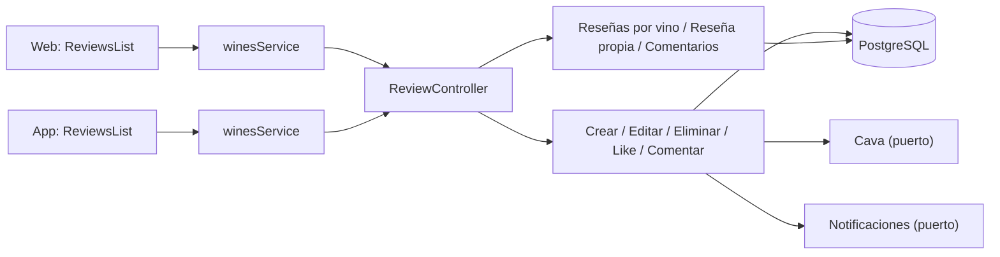
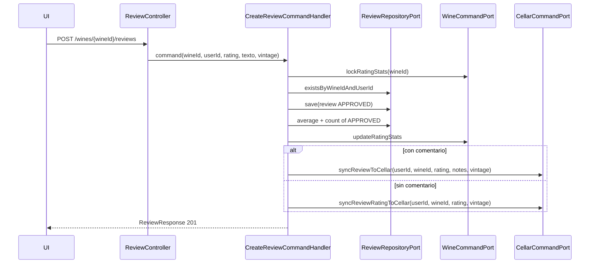
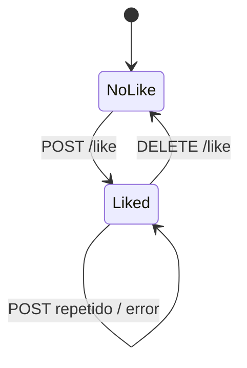

# Arquitectura

Cómo está construido el módulo en cada capa. El backend sigue el flujo hexagonal
`controller → puerto de entrada → handler → dominio → puerto de salida → adaptador`;
la web y la app siguen `pantalla → hook → servicio → cliente API → transporte HTTP`.



[Ver diagrama de «Arquitectura» completo](https://images.vinnot.com/docs/diagrams/v1/es/modules-reviews-architecture-1375c483550c.svg)

## Backend

### Alcance

El módulo `review` administra opinión estructurada sobre vinos y participación
alrededor de esa opinión. Separa la reseña —agregado con rating y contenido— de
likes y comentarios, que necesitan unicidad, autoría y consultas propias.

### Arquitectura

| Responsabilidad | Implementación |
|---|---|
| Invariantes de reseña | `Review` |
| Escrituras | command handlers para crear/editar/borrar/like/comment |
| Lecturas | reseñas por vino, reseña propia y comentarios |
| Puertos propios | repositories de review, like y comment |
| Puertos cruzados | usuario, vino y cava |
| HTTP | `ReviewController` bajo `/wines/{wineId}/reviews` |

### Reglas de reseña

- Rating obligatorio entre `0.1` y `5.0`, con un decimal como máximo.
- Añada probada opcional entre `1800` y el año siguiente (`INVALID_VINTAGE`); es
  independiente de la añada del vino en el catálogo.
- Un usuario puede crear como máximo una reseña por vino.
- El `userId` proviene del principal autenticado.
- Sólo el autor o `ADMIN` puede editar; el borrado admite autoría o `REVIEW_DELETE`.
- Crear una reseña la publica como `APPROVED`. Editar mantiene pública una reseña
  `APPROVED`; una reseña `REJECTED` o `PENDING` editada vuelve a la cola de
  moderación como `PENDING` en lugar de hacerse pública. Los comentarios nuevos se
  publican al instante como `APPROVED` y se le avisa al autor de la reseña.
- Sólo reseñas `APPROVED` aportan al promedio y cantidad públicos del vino.
- Crear/editar recalcula esas proyecciones dentro de la misma transacción. La
  creación siempre sincroniza la cava (las notas solo si la reseña tiene comentario); una edición sólo la sincroniza cuando el
  autor edita su propia reseña (ver [Edición y eliminación](#edición-y-eliminación)).
  Una falla se propaga y revierte la operación. Borrar recalcula el vino, sin
  eliminar ni sobrescribir la valoración personal guardada en cava.
- `verified`, `helpfulCount` y `likesCount` no son editables libremente por el
  request público.

### Crear y propagar métricas



[Ver diagrama de «Crear y propagar métricas» completo](https://images.vinnot.com/docs/diagrams/v1/es/modules-reviews-architecture-384eb61bd47f.svg)

La actualización de vino y la conveniencia de cava se realizan mediante puertos;
`review` no importa repositorios JPA de esos módulos.

### Publicación y visibilidad

La creación responde 201 con `APPROVED`; editar una reseña aprobada la mantiene
publicada y recalcula las valoraciones sin ocultarla ni ocultar sus comentarios
aprobados. Editar una reseña rechazada no la vuelve a publicar: regresa a
`PENDING` para que un moderador decida de nuevo.
El cambio no aprueba filas pendientes/rechazadas existentes por sí solo.
El autor puede consultar esos estados; los demás sólo ven `APPROVED`.
Los comentarios nuevos se publican al instante y no tienen endpoint de edición.
Se moderan mediante denuncias, bloqueos y retirada administrativa. La cola manual
conserva solo las reseñas y los comentarios que quedaron pendientes antes, con
revisión independiente y control de versión exacta; véase [comunidad](../community/architecture.md#publicación-de-reseñas-y-comentarios).

La sincronización personal copia el rating de la reseña a la cava con su decimal, sin
redondear: ambos usan la misma escala de 0.1 a 5.0.

### Consulta y orden

`GET /wines/{wineId}/reviews` construye PageQuery y traduce el filtro de orden a las propiedades previstas por el handler. ReviewerInfoResolver obtiene proyección pública de autores; likes y conteos de comentarios se enriquecen para la página.

El filtro `mine` de `GET /wines/{wineId}/reviews?filter=mine` devuelve la reseña
del principal autenticado para ese vino con el mismo DTO enriquecido. No recibe
un autor desde el cliente ni depende de la página reciente; la página cero
contiene como máximo una reseña, las siguientes quedan vacías y conservan el
total. Sin reseña el resultado es vacío. El handler también devuelve vacío sin usuario, pero esa rama no es alcanzable por HTTP porque `SecurityConfig` exige sesión para `GET /wines/**`. Conserva el estado de
publicación existente; este filtro no publica ni reemplaza contenido.

`GET .../mine` devuelve únicamente `{ "hasReview": boolean }`. El controller admite identidad opcional: sin usuario devuelve false (no alcanzable por HTTP, porque `GET /wines/**` exige autenticación); con usuario ejecuta la consulta de existencia. No devuelve ID ni contenido de la reseña. La comprobación de duplicado al crear y la constraint usuario/vino son independientes de esta consulta.

### Edición y eliminación

UpdateReviewCommand identifica reviewId y requestingUserId, además del flag administrativo. El handler carga por ID, comprueba autor o administrador y aplica updateContent; usa el wineId guardado en la reseña para recalcular rating/count y sincronizar cava. El wineId exterior de la URL no es un campo del command de edición.

`PATCH` es una actualización parcial: un `rating`, `title` o `comment` omitido
(`null`) conserva su valor guardado, por lo que una edición puede omitir el rating. La
`vintage` probada sigue la misma regla: omitida o `null` se conserva, un valor la
reemplaza y sólo `clearVintage: true` la elimina (prevalece sobre una `vintage`
enviada), así las versiones de la app que no envían el campo nunca la borran.
Rating, título y comentario no tienen marcador para borrarse.

La cava es el registro privado del autor. Crear una reseña con comentario reemplaza
las notas de cava; crear una sin comentario solo actualiza el rating de cava
(`syncReviewRatingToCellar`) y nunca borra las notas. Sólo la edición del propio autor la
sincroniza, y sólo con lo que esa edición envió: un `comment` enviado reemplaza
las notas de cava junto con el rating, una edición sólo de rating
actualiza únicamente el rating de cava (`syncReviewRatingToCellar`) y conserva
las notas, y una edición sólo de título no toca la cava. Una añada enviada viaja en
la misma sincronización y reemplaza la añada de cava (una edición sólo de añada la
sincroniza con el rating actual); una añada omitida o eliminada en la
reseña deja la añada de cava como está. Un administrador que
edita la reseña de otro usuario nunca modifica la cava de ese usuario.

Delete elimina la reseña y recalcula estadísticas; FK controla comentarios/likes
asociados. No borra ni reinicia la entrada personal de cava. En la creación o en
la edición del autor, la sincronización crea entrada si falta o actualiza la existente.
Una falla de sincronización o de rating se propaga y revierte la transacción.

### Likes

- una fila por `reviewId` y `userId`;
- un segundo like se rechaza aunque dos taps lleguen en paralelo;
- like incrementa contador y unlike lo decrementa sin permitir negativo;
- el contador materializado mejora lectura, la tabla de relaciones conserva la
  verdad para reconstrucción;
- el endpoint de unlike sólo elimina la relación del principal;
- nuevos likes requieren reseña aprobada y ausencia de bloqueo entre cuentas.
  Quitar un like propio existente sigue permitido.



[Ver diagrama de «Likes» completo](https://images.vinnot.com/docs/diagrams/v1/es/modules-reviews-architecture-f48c977ac0bf.svg)

### Comentarios

AddReviewCommentCommand contiene reviewId, userId y contenido. El handler exige una reseña aprobada y sin bloqueo de interacción; normaliza el contenido a 1–2000 caracteres, lo guarda `APPROVED` y le pide a `CommentActivityAnnouncer` que avise al autor de la reseña. Las queries completan autor/timestamps. DeleteReviewCommentCommand contiene commentId, requestingUserId y flag de permiso global: el handler resuelve el comentario y comprueba autoría o ese permiso. Los IDs de vino/reseña del path no se transmiten a este command.

La lectura de comentarios exige que la reseña padre esté aprobada o pertenezca
al lector, y que cada comentario esté aprobado o pertenezca al lector. El bloqueo
se verifica en ambas identidades antes de devolver resultados.

### Contratos de respuesta

`ReviewResponse` contiene rating, título, comentario, `vintage` probada, flags, contadores, autor,
timestamps, `publicationStatus` y el booleano `likedByCurrentUser`. Para una consulta autenticada el
handler lo calcula con los IDs liked del usuario; sin usuario actual queda en
`false`. `ReviewCommentResponse`
incluye `publicationStatus` y limita la identidad del autor a datos públicos. La UI no recibe email, roles
internos ni tokens.

El autor de una reseña o de un comentario llega como `reviewer` con `id`,
`username`, `displayName`, `avatarUrl` y `badgeTier` (la reseña suma
`totalReviews`, que hoy siempre se envía en 0). `ReviewerInfoResolver` lo arma con `UserQueryPort`,
`ReviewerBadgePort` y `AvatarUrlResolver`, así `avatarUrl` siempre es una URL
absoluta o `null` (ver [Valor guardado y URL que recibe el cliente](../users/architecture.md#valor-guardado-y-url-que-recibe-el-cliente)).
Los clientes web y app vuelven a resolver la foto del autor al mapear reseñas y
comentarios; con una URL absoluta no cambia nada.

### Frontends

Web y mobile acceden mediante presentación → servicio de aplicación → cliente HTTP. El backend no controla query keys ni su invalidación. La respuesta de creación/edición y las lecturas de reseñas se transforman a modelos de frontend antes de renderizar.

### Errores esperables

EntityNotFoundException de reseña/comentario se mapea a 404; Bean Validation/DomainException normalmente a 400. Duplicado detectado por handler y REVIEW_OWNERSHIP/REVIEW_COMMENT_OWNERSHIP son BusinessRuleViolationException (422 salvo códigos especiales del mapper). La constraint concurrente produce DataIntegrityViolationException (409 DUPLICATE_ENTRY). Referencias de vino/usuario se protegen también por FK; no se debe describir cualquier FK inválida como 404.

### Pruebas

- dominio: `ReviewTest` (límites de puntaje y añada, edición y contadores) y `ReviewPublicationTest`;
- handlers: `ReviewInteractionHandlersTest`, `UpdateReviewCommandHandlerTest`, `ReviewOwnershipTest` y `CommentActivityAnnouncerTest`;
- consultas: `GetReviewsByWineQueryHandlerTest`, `CheckUserReviewQueryHandlerTest`, `GetReviewCommentsQueryHandlerTest` y `ReviewerInfoResolverTest`;
- persistencia: `ReviewPersistenceAdapterTest`, `ReviewPersistenceMapperTest`, `CellarCommandAdapterTest` y `JdbcReviewLikeSummaryAdapterPostgresIntegrationTest`;
- resúmenes de likes: `SummarizeReviewLikesCommandHandlerTest` y `ReviewLikeSummarySchedulerTest`;
- HTTP: `ReviewControllerTest`.

### Referencias

- `backend/src/main/java/com/vinnot/review`
- `frontend-react/src/infrastructure/api/clients/wines.reviews.client.ts`
- `frontend-mobile/src/infrastructure/api/clients/wines.client.ts`
- [Cava personal](../cellar/architecture.md)
- [Errores y consistencia](../../backend/architecture/errors-transactions-and-consistency.md)

### Contrato de consistencia y acceso

Las escrituras bloquean vino antes de reseña; like/unlike bloquean reseña. Rating se actualiza por SQL de columnas específicas y no se sobrescribe en ediciones ORM del catálogo. El borrado de usuario recalcula proyecciones tras cascadas.

[Detalle de coordinación](../../backend/architecture/session-and-data-integrity.md).

### Denuncias y bloqueo

Las lecturas públicas y nuevas interacciones aplican el bloqueo entre cuentas. El retiro desde una denuncia reutiliza los casos de uso de eliminación y conserva la trazabilidad del caso. Ver [Denuncias, bloqueo y revisión de comunidad](../community/architecture.md).

## Web

```text
ReviewsList → useReviews / useCreateReview / … → winesService → winesReviewsClient → http
```

Las reseñas viven en la ficha del vino
([`WineDetailsPage.tsx`](../../../../frontend-react/src/presentation/pages/wines/WineDetailsPage.tsx)). La cava
también permite publicar una nota como reseña ([Cava](../cellar/README.md)); las
pantallas de moderación están en [Administración](../admin/README.md).

| Pieza | Qué hace |
|---|---|
| [`ReviewsList.tsx`](../../../../frontend-react/src/presentation/components/features/wine/ReviewsList.tsx) | Páginas de 20 con orden reciente o popular, la reseña propia primero, alta y edición, confirmación al eliminar y like optimista que se revierte si falla |
| [`ReviewCard.tsx`](../../../../frontend-react/src/presentation/components/features/wine/ReviewCard.tsx) | Autor con foto (o un ícono de persona si falta o no carga), nombre y sello, y su `@usuario` debajo en gris; la foto y el nombre abren su perfil público (`/users/{id}`). Estrellas, texto, fecha, contadores y etiqueta de estado; like y comentarios deshabilitados si la reseña no está aprobada |
| [`ReviewForm.tsx`](../../../../frontend-react/src/presentation/components/features/wine/ReviewForm.tsx) | Control de la botella de 0.1 a 5.0, título de hasta 255 caracteres, comentario y aviso de publicación inmediata |
| [`ReviewComments.tsx`](../../../../frontend-react/src/presentation/components/features/wine/ReviewComments.tsx) | Lista de comentarios con foto del autor (o un ícono de persona), nombre, sello y `@usuario` debajo en gris; alta de hasta 2000 caracteres y eliminación con confirmación |
| [`hooks/queries/wine`](../../../../frontend-react/src/presentation/hooks/queries/wine/) | Consultas y mutaciones; al crear o eliminar se recargan la ficha, el catálogo, la cava y los datos de comunidad |
| [`wines.service.ts`](../../../../frontend-react/src/application/services/wines.service.ts) | Mapea los DTO; un 409 o 422 al crear o editar se trata como conflicto de estado y recarga la lista |
| [`wines.reviews.client.ts`](../../../../frontend-react/src/infrastructure/api/clients/wines.reviews.client.ts) | Endpoints de `/wines/{wineId}/reviews` |

## App

Las reseñas cierran la pestaña «Info» de la ficha del vino,
`frontend-mobile/app/(app)/(tabs)/wines/[id].tsx`. Con `?tab=reviews` (el contador
de las tarjetas) la ficha baja hasta ellas y con `?review=mine` lleva a la reseña
propia; [`useWineReviewFocus.ts`](../../../../frontend-mobile/src/presentation/hooks/ui/useWineReviewFocus.ts)
hace ese desplazamiento. La cava también permite publicar una nota como reseña
([Cava](../cellar/README.md)).

| Pieza | Qué hace |
|---|---|
| [`ReviewsList.tsx`](../../../../frontend-mobile/src/presentation/features/wine/ReviewsList.tsx) | Páginas de 10 con «Anterior» y «Siguiente», orden «Más recientes» o «Más valoradas» cuando hay más de una reseña, la reseña propia primero en la primera página y el formulario cuando todavía no hay reseña propia |
| [`ReviewItem.tsx`](../../../../frontend-mobile/src/presentation/features/wine/ReviewItem.tsx) | Autor con foto (sus iniciales si falta o no carga), nombre, sello y `@usuario` debajo en gris; tocar el autor abre su perfil público. Puntaje en copas llenas según la fracción, texto, etiqueta de estado, like, edición y eliminación con confirmación |
| [`ReviewForm.tsx`](../../../../frontend-mobile/src/presentation/features/wine/ReviewForm.tsx) y [`ReviewFormFields.tsx`](../../../../frontend-mobile/src/presentation/features/wine/ReviewFormFields.tsx) | Control de la botella sobre las copas, de 0.1 a 5.0 (también se toca una copa), título de hasta 255 caracteres, comentario y aviso de publicación inmediata |
| [`ReviewComments.tsx`](../../../../frontend-mobile/src/presentation/features/wine/ReviewComments.tsx) | Lista de comentarios con foto del autor (o sus iniciales), nombre, sello y `@usuario` debajo en gris; alta de hasta 2000 caracteres y eliminación con confirmación |
| [`useWines.ts`](../../../../frontend-mobile/src/presentation/hooks/queries/wine/useWines.ts) | Consultas y mutaciones de reseñas, likes y comentarios |
| [`wines.service.ts`](../../../../frontend-mobile/src/application/services/wines.service.ts) | Mapea los DTO a modelos de la app |
| [`wines.client.ts`](../../../../frontend-mobile/src/infrastructure/api/clients/wines.client.ts) | Endpoints de `/wines/{wineId}/reviews` |

Bloquear a una cuenta borra de la caché las reseñas y comentarios guardados
([Comunidad](../community/README.md)).
