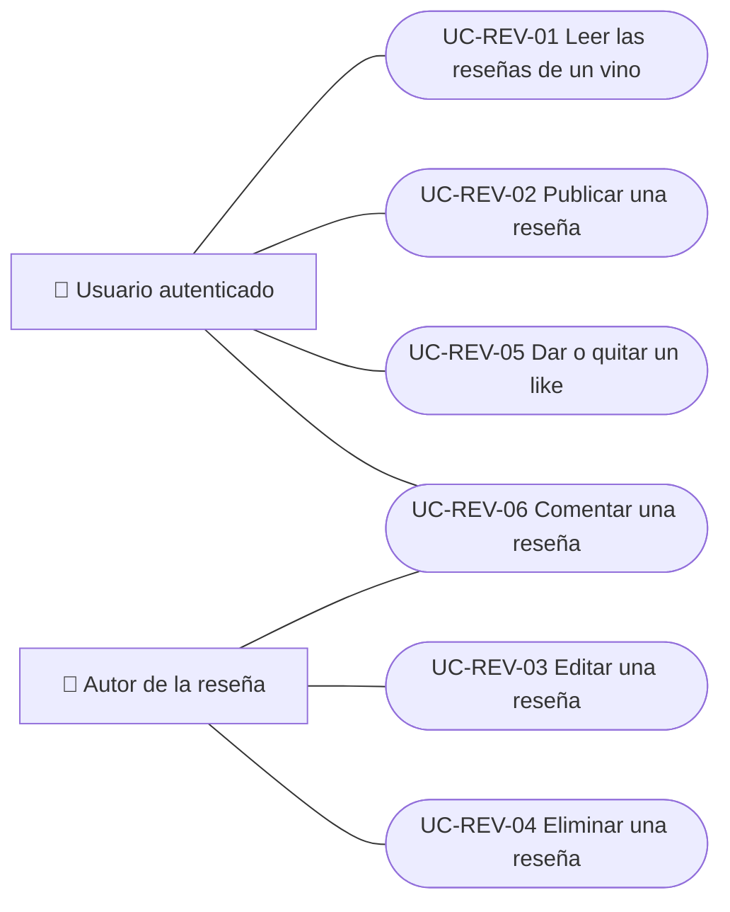
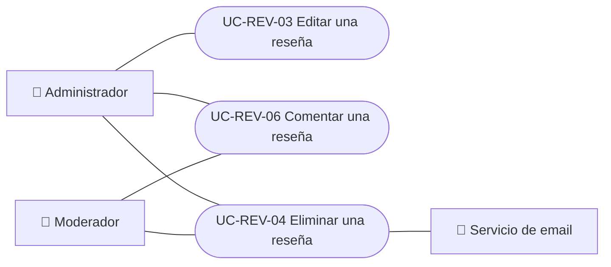
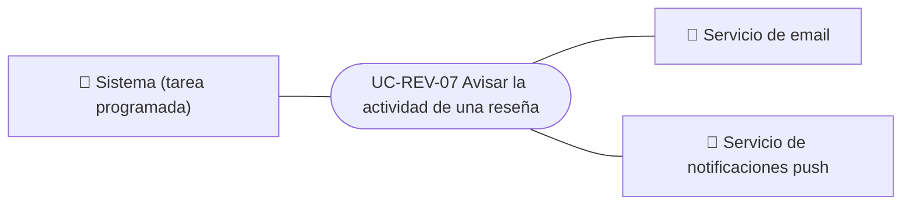

# Casos de uso

Casos de uso del módulo de reseñas: leer, publicar, editar y eliminar reseñas, dar likes, comentar y avisar la actividad a quien escribió la reseña. Cada caso vale para las plataformas indicadas.

| ID | Caso de uso | Plataformas | Actores |
|---|---|---|---|
| `UC-REV-01` | [Leer las reseñas de un vino](uc-rev-01-read-reviews.md) | Web, APK | Usuario autenticado |
| `UC-REV-02` | [Publicar una reseña](uc-rev-02-publish-review.md) | Web, APK | Usuario autenticado |
| `UC-REV-03` | [Editar una reseña](uc-rev-03-edit-review.md) | Web, APK | Autor de la reseña, Administrador |
| `UC-REV-04` | [Eliminar una reseña](uc-rev-04-delete-review.md) | Web, APK | Autor de la reseña, Moderador, Administrador, Servicio de email |
| `UC-REV-05` | [Dar o quitar un like](uc-rev-05-like-review.md) | Web, APK | Usuario autenticado |
| `UC-REV-06` | [Comentar una reseña](uc-rev-06-review-comments.md) | Web, APK | Usuario autenticado, Autor de la reseña, Moderador, Administrador |
| `UC-REV-07` | [Avisar la actividad de una reseña](uc-rev-07-activity-notices.md) | Solo backend | Sistema (tarea programada), Servicio de email, Servicio de notificaciones push |

## Diagrama de casos de uso

### Lectores y autores

[Ver diagrama de «Lectores y autores» completo](https://images.vinnot.com/docs/diagrams/v1/es/modules-reviews-use-cases-readme-4e34fe6b719d.svg)

### Moderación

[Ver diagrama de «Moderación» completo](https://images.vinnot.com/docs/diagrams/v1/es/modules-reviews-use-cases-readme-b62b2d811249.svg)

### Avisos de actividad

[Ver diagrama de «Avisos de actividad» completo](https://images.vinnot.com/docs/diagrams/v1/es/modules-reviews-use-cases-readme-2ffadd3c1bf6.svg)

## Equivalencia con Lucidchart

| ID | IDs en Lucidchart |
|---|---|
| `UC-REV-01` | [WEB UC-REV-01](https://lucid.app/lucidchart/9f11a16b-bb5a-42fc-a9e8-0852b17bd241/edit), [APK UC-REV-01](https://lucid.app/lucidchart/e095dd25-e8ac-41ba-bf5b-396e1055f217/edit) |
| `UC-REV-02` | [WEB UC-REV-02](https://lucid.app/lucidchart/9f11a16b-bb5a-42fc-a9e8-0852b17bd241/edit), [APK UC-REV-02](https://lucid.app/lucidchart/e095dd25-e8ac-41ba-bf5b-396e1055f217/edit) |
| `UC-REV-03` | [WEB UC-REV-03](https://lucid.app/lucidchart/9f11a16b-bb5a-42fc-a9e8-0852b17bd241/edit), [APK UC-REV-02](https://lucid.app/lucidchart/e095dd25-e8ac-41ba-bf5b-396e1055f217/edit) |
| `UC-REV-04` | [WEB UC-REV-04](https://lucid.app/lucidchart/9f11a16b-bb5a-42fc-a9e8-0852b17bd241/edit), [APK UC-REV-03](https://lucid.app/lucidchart/e095dd25-e8ac-41ba-bf5b-396e1055f217/edit) |
| `UC-REV-05` | [WEB UC-REV-05](https://lucid.app/lucidchart/9f11a16b-bb5a-42fc-a9e8-0852b17bd241/edit), [APK UC-REV-04](https://lucid.app/lucidchart/e095dd25-e8ac-41ba-bf5b-396e1055f217/edit) |
| `UC-REV-06` | [WEB UC-REV-06](https://lucid.app/lucidchart/9f11a16b-bb5a-42fc-a9e8-0852b17bd241/edit), [APK UC-REV-05](https://lucid.app/lucidchart/e095dd25-e8ac-41ba-bf5b-396e1055f217/edit) |
| `UC-REV-07` | Ninguno |
