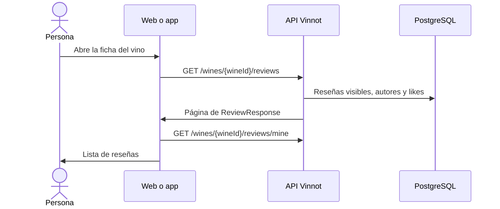

# UC-REV-01 · Leer las reseñas de un vino

| Campo | Valor |
|---|---|
| ID | `UC-REV-01` |
| Módulo | [Reseñas](../README.md) |
| Plataformas | Web, APK |
| Actores | Usuario autenticado |
| IDs en Lucidchart | [WEB UC-REV-01](https://lucid.app/lucidchart/9f11a16b-bb5a-42fc-a9e8-0852b17bd241/edit), [APK UC-REV-01](https://lucid.app/lucidchart/e095dd25-e8ac-41ba-bf5b-396e1055f217/edit) |
| Requisitos | [`RF-WEB-REV-01`](../requirements.md), [`RF-WEB-REV-02`](../requirements.md), [`RF-APK-REV-01`](../requirements.md), [`RF-APK-REV-02`](../requirements.md) |
| Casos de prueba | [`CP-REV-01`](../testing.md), [`CP-REV-02`](../testing.md), [`CP-REV-03`](../testing.md), [`CP-REV-04`](../testing.md), [`CP-REV-33`](../testing.md) |

## Precondiciones

- La persona tiene sesión iniciada y abrió la ficha de un vino.

## Postcondiciones

- Se muestran las reseñas visibles del vino con su autor, puntaje, texto, fecha y contadores.

## Flujo principal

1. El cliente pide `GET /wines/{wineId}/reviews` con orden reciente.
2. La API devuelve las reseñas aprobadas y las propias de quien consulta, sin las de cuentas bloqueadas.
3. El cliente pide `GET /wines/{wineId}/reviews/mine` para saber si la persona ya escribió una reseña.
4. La web muestra páginas de 20 y deja ordenar por recientes o populares; la app muestra páginas de 10 con «Anterior» y «Siguiente» y, con más de una reseña, deja elegir «Más recientes» o «Más valoradas».

## Flujos alternativos

- 1a. La ficha se abre con `?review=mine`: el cliente pide la reseña propia con `filter=mine` y la muestra primero.
- 2a. El vino no tiene reseñas visibles: se muestra el estado vacío.
- 4a. La persona cambia el orden: se vuelve a la primera página con el orden elegido.
- 4b. En la app, la persona pasa a otra página: la reseña propia queda fija solo al principio de la primera página y las siguientes siguen el orden de la API.

## Reglas de negocio

- Órdenes de la API: `recent`, `likes` o `popular`, `rating_high`, `rating_low` y `mine`; páginas de 20 por defecto y de hasta 200.
- Las reseñas pendientes o rechazadas solo las ve su autor, con una etiqueta de estado.
- Un bloqueo entre cuentas oculta las reseñas en ambos sentidos.
- `/mine` solo dice si existe una reseña propia, en cualquier estado; no devuelve su contenido.

## Diagrama

[Ver diagrama de «UC-REV-01 · Leer las reseñas de un vino» completo](https://images.vinnot.com/docs/diagrams/v1/es/modules-reviews-use-cases-uc-rev-01-read-reviews-cebed2519fca.svg)

Diagrama de componentes en Lucidchart: [WEB UC-REV-01](https://lucid.app/lucidchart/9f11a16b-bb5a-42fc-a9e8-0852b17bd241/edit), [APK UC-REV-01](https://lucid.app/lucidchart/e095dd25-e8ac-41ba-bf5b-396e1055f217/edit).

## Código

| Capa | Ubicación |
|---|---|
| Endpoints | `GET /wines/{wineId}/reviews?page=&size=&filter=`, `GET /wines/{wineId}/reviews/mine` |
| Backend | [`ReviewController.java`](../../../../../backend/src/main/java/com/vinnot/review/infrastructure/web/controller/ReviewController.java), [`GetReviewsByWineQueryHandler.java`](../../../../../backend/src/main/java/com/vinnot/review/application/query/handler/GetReviewsByWineQueryHandler.java), [`CheckUserReviewQueryHandler.java`](../../../../../backend/src/main/java/com/vinnot/review/application/query/handler/CheckUserReviewQueryHandler.java), [`ReviewerInfoResolver.java`](../../../../../backend/src/main/java/com/vinnot/review/application/query/handler/ReviewerInfoResolver.java) |
| Web | [`ReviewsList.tsx`](../../../../../frontend-react/src/presentation/components/features/wine/ReviewsList.tsx), [`ReviewCard.tsx`](../../../../../frontend-react/src/presentation/components/features/wine/ReviewCard.tsx), [`useReviews.ts`](../../../../../frontend-react/src/presentation/hooks/queries/wine/useReviews.ts), [`wines.reviews.client.ts`](../../../../../frontend-react/src/infrastructure/api/clients/wines.reviews.client.ts), [`wine.mappers.review.ts`](../../../../../frontend-react/src/domain/wine/wine.mappers.review.ts) |
| App | [`ReviewsList.tsx`](../../../../../frontend-mobile/src/presentation/features/wine/ReviewsList.tsx), [`ReviewItem.tsx`](../../../../../frontend-mobile/src/presentation/features/wine/ReviewItem.tsx), [`useWines.ts`](../../../../../frontend-mobile/src/presentation/hooks/queries/wine/useWines.ts), [`wines.client.ts`](../../../../../frontend-mobile/src/infrastructure/api/clients/wines.client.ts) |

## Tests automáticos

- Backend: [`GetReviewsByWineQueryHandlerTest.java`](../../../../../backend/src/test/java/com/vinnot/review/application/query/handler/GetReviewsByWineQueryHandlerTest.java), [`CheckUserReviewQueryHandlerTest.java`](../../../../../backend/src/test/java/com/vinnot/review/application/query/handler/CheckUserReviewQueryHandlerTest.java), [`ReviewerInfoResolverTest.java`](../../../../../backend/src/test/java/com/vinnot/review/application/query/handler/ReviewerInfoResolverTest.java), [`ReviewControllerTest.java`](../../../../../backend/src/test/java/com/vinnot/review/infrastructure/web/controller/ReviewControllerTest.java)
- Web: [`ReviewsList.test.tsx`](../../../../../frontend-react/src/presentation/components/features/wine/ReviewsList.test.tsx), [`useOwnReviewFocus.test.tsx`](../../../../../frontend-react/src/presentation/hooks/ui/useOwnReviewFocus.test.tsx), [`wine.mappers.test.ts`](../../../../../frontend-react/src/domain/wine/wine.mappers.test.ts), [`useWineQueries.spec.tsx`](../../../../../frontend-react/tests/unit/hooks/useWineQueries.spec.tsx)
- App: [`ReviewsList.test.tsx`](../../../../../frontend-mobile/src/presentation/features/wine/ReviewsList.test.tsx), [`useWineReviewFocus.test.tsx`](../../../../../frontend-mobile/src/presentation/hooks/ui/useWineReviewFocus.test.tsx), [`wine.mappers.test.ts`](../../../../../frontend-mobile/src/domain/wine/wine.mappers.test.ts)
