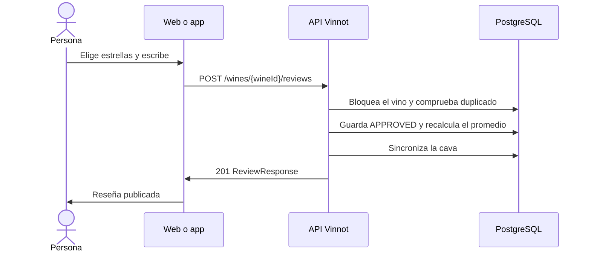

# UC-REV-02 · Publicar una reseña

| Campo | Valor |
|---|---|
| ID | `UC-REV-02` |
| Módulo | [Reseñas](../README.md) |
| Plataformas | Web, APK |
| Actores | Usuario autenticado |
| IDs en Lucidchart | [WEB UC-REV-02](https://lucid.app/lucidchart/9f11a16b-bb5a-42fc-a9e8-0852b17bd241/edit), [APK UC-REV-02](https://lucid.app/lucidchart/e095dd25-e8ac-41ba-bf5b-396e1055f217/edit) |
| Requisitos | [`RF-WEB-REV-03`](../requirements.md), [`RF-WEB-REV-04`](../requirements.md), [`RF-APK-REV-03`](../requirements.md), [`RF-APK-REV-04`](../requirements.md) |
| Casos de prueba | [`CP-REV-05`](../testing.md), [`CP-REV-06`](../testing.md), [`CP-REV-07`](../testing.md), [`CP-REV-08`](../testing.md), [`CP-REV-32`](../testing.md) |

## Precondiciones

- La persona tiene sesión iniciada, el permiso `REVIEW_CREATE` y todavía no escribió una reseña de ese vino.

## Postcondiciones

- La reseña queda publicada, el promedio del vino se actualiza y el vino queda en la cava de la persona.

## Flujo principal

1. La persona abre el formulario de reseña en la ficha del vino.
2. Elige de 0.1 a 5.0 con la botella que llena las copas y puede sumar un título de hasta 255 caracteres, un comentario y la añada que probó; el formulario avisa que la reseña se publica al instante.
3. El cliente envía `POST /wines/{wineId}/reviews`.
4. La API comprueba que no exista otra reseña de la persona para ese vino y la guarda como `APPROVED`.
5. Recalcula el promedio y la cantidad de reseñas aprobadas del vino en la misma transacción.
6. Agrega el vino a la cava si no estaba y guarda ahí el puntaje con su decimal y, si la reseña tiene comentario, lo guarda como notas; la añada de la reseña pasa a ser la añada de la cava.
7. La API responde 201 y el cliente confirma la publicación y recarga la lista y el promedio.

## Flujos alternativos

- 1a. La persona ya tiene una reseña de ese vino: no se ofrece el formulario.
- 4a. Ya existe una reseña de la persona para ese vino: la API responde 422, o 409 si llegaron dos al mismo tiempo; la web cierra el formulario y recarga la lista.
- 3a. El puntaje falta, está fuera de 0.1 a 5.0 o tiene más de un decimal, o la añada está fuera de 1800 a 2100: la API responde 400; una añada posterior al año siguiente se rechaza con `INVALID_VINTAGE`.
- 6a. La reseña no tiene comentario: la cava guarda solo el puntaje y conserva las notas que ya tenía.
- 6b. La reseña no tiene añada: la cava conserva la añada que ya tenía.

## Reglas de negocio

- Una reseña por persona y vino.
- La añada probada es opcional e independiente de la añada del vino en el catálogo.
- La API acepta puntajes de 0.1 a 5.0 con un decimal; web y app los eligen con el control de la botella sobre cinco copas.
- Una reseña aprobada suma puntos para el sello de su autor ([Puntos y sellos](../../gamification/README.md)).
- Las reseñas nuevas se publican sin aprobación previa; la moderación actúa después, por denuncias, bloqueos y retiro ([Comunidad](../../community/README.md)).
- Solo las reseñas aprobadas cuentan para el promedio, redondeado a dos decimales.
- Una nota de la cava también se puede publicar como reseña ([Cava](../../cellar/README.md)).

## Diagrama

[Ver diagrama de «UC-REV-02 · Publicar una reseña» completo](https://images.vinnot.com/docs/diagrams/v1/es/modules-reviews-use-cases-uc-rev-02-publish-review-dfdbebdd2b5c.svg)

Diagrama de componentes en Lucidchart: [WEB UC-REV-02](https://lucid.app/lucidchart/9f11a16b-bb5a-42fc-a9e8-0852b17bd241/edit), [APK UC-REV-02](https://lucid.app/lucidchart/e095dd25-e8ac-41ba-bf5b-396e1055f217/edit).

## Código

| Capa | Ubicación |
|---|---|
| Endpoints | `POST /wines/{wineId}/reviews` |
| Backend | [`ReviewController.java`](../../../../../backend/src/main/java/com/vinnot/review/infrastructure/web/controller/ReviewController.java), [`CreateReviewCommandHandler.java`](../../../../../backend/src/main/java/com/vinnot/review/application/command/handler/CreateReviewCommandHandler.java), [`Review.java`](../../../../../backend/src/main/java/com/vinnot/review/domain/model/Review.java), [`CellarCommandAdapter.java`](../../../../../backend/src/main/java/com/vinnot/review/infrastructure/persistence/adapter/CellarCommandAdapter.java) |
| Web | [`ReviewForm.tsx`](../../../../../frontend-react/src/presentation/components/features/wine/ReviewForm.tsx), [`RatingStars.tsx`](../../../../../frontend-react/src/presentation/components/ui/RatingStars.tsx), [`useCreateReview.ts`](../../../../../frontend-react/src/presentation/hooks/queries/wine/useCreateReview.ts), [`wines.reviews.client.ts`](../../../../../frontend-react/src/infrastructure/api/clients/wines.reviews.client.ts) |
| App | [`ReviewForm.tsx`](../../../../../frontend-mobile/src/presentation/features/wine/ReviewForm.tsx), [`ReviewFormFields.tsx`](../../../../../frontend-mobile/src/presentation/features/wine/ReviewFormFields.tsx), [`WineGlassIcon.tsx`](../../../../../frontend-mobile/src/presentation/components/ui/WineGlassIcon.tsx), [`useWineReviewSubmission.ts`](../../../../../frontend-mobile/src/presentation/hooks/useWineReviewSubmission.ts), [`wines.client.ts`](../../../../../frontend-mobile/src/infrastructure/api/clients/wines.client.ts) |

## Tests automáticos

- Backend: [`ReviewTest.java`](../../../../../backend/src/test/java/com/vinnot/review/domain/model/ReviewTest.java), [`ReviewInteractionHandlersTest.java`](../../../../../backend/src/test/java/com/vinnot/review/application/command/handler/ReviewInteractionHandlersTest.java), [`CellarCommandAdapterTest.java`](../../../../../backend/src/test/java/com/vinnot/review/infrastructure/persistence/adapter/CellarCommandAdapterTest.java), [`ReviewPersistenceAdapterTest.java`](../../../../../backend/src/test/java/com/vinnot/review/infrastructure/persistence/adapter/ReviewPersistenceAdapterTest.java), [`ReviewControllerTest.java`](../../../../../backend/src/test/java/com/vinnot/review/infrastructure/web/controller/ReviewControllerTest.java)
- Web: [`useCreateReview.test.tsx`](../../../../../frontend-react/src/presentation/hooks/queries/wine/useCreateReview.test.tsx), [`wines.service.test.ts`](../../../../../frontend-react/src/application/services/wines.service.test.ts)
- App: [`wine.validators.test.ts`](../../../../../frontend-mobile/src/domain/wine/wine.validators.test.ts), [`wines.service.test.ts`](../../../../../frontend-mobile/src/application/services/wines.service.test.ts), [`wines.client.test.ts`](../../../../../frontend-mobile/src/infrastructure/api/clients/wines.client.test.ts)
