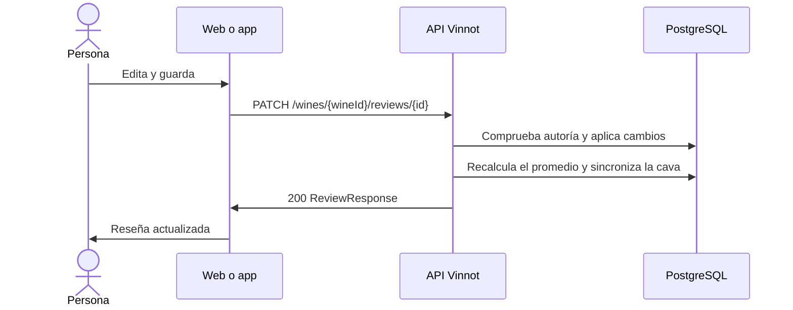

# UC-REV-03 · Editar una reseña

| Campo | Valor |
|---|---|
| ID | `UC-REV-03` |
| Módulo | [Reseñas](../README.md) |
| Plataformas | Web, APK |
| Actores | Autor de la reseña, Administrador |
| IDs en Lucidchart | [WEB UC-REV-03](https://lucid.app/lucidchart/9f11a16b-bb5a-42fc-a9e8-0852b17bd241/edit), [APK UC-REV-02](https://lucid.app/lucidchart/e095dd25-e8ac-41ba-bf5b-396e1055f217/edit) |
| Requisitos | [`RF-WEB-REV-05`](../requirements.md), [`RF-APK-REV-05`](../requirements.md) |
| Casos de prueba | [`CP-REV-09`](../testing.md), [`CP-REV-10`](../testing.md), [`CP-REV-11`](../testing.md), [`CP-REV-12`](../testing.md), [`CP-REV-13`](../testing.md) |

## Precondiciones

- La persona es la autora de la reseña o tiene el rol `ADMIN`.

## Postcondiciones

- La reseña queda con los cambios y el promedio del vino actualizado.

## Flujo principal

1. La persona elige editar su reseña y el formulario se abre con los datos actuales.
2. Cambia el puntaje, el título, el comentario o la añada probada y guarda.
3. El cliente envía `PATCH /wines/{wineId}/reviews/{id}`; un campo omitido conserva su valor; `clearVintage: true` elimina la añada.
4. La API comprueba la autoría o el rol, aplica los cambios y recalcula el promedio del vino.
5. Si edita su autor, actualiza la cava con lo que cambió: el comentario reemplaza las notas, una añada reemplaza la añada de la cava y el puntaje se redondea de 1 a 5.
6. La API responde 200 y el cliente muestra la reseña actualizada.

## Flujos alternativos

- 4a. Quien edita no es autor ni `ADMIN`: la API responde 422 `REVIEW_OWNERSHIP`.
- 4b. La reseña ya no existe: la API responde 404.
- 4c. La reseña estaba pendiente o rechazada: vuelve a `PENDING` para que la decida un moderador.
- 2a. La persona cancela: no se envía nada.

## Reglas de negocio

- Una reseña aprobada sigue publicada después de editarla.
- Un moderador puede eliminar reseñas ajenas pero no editarlas.
- Un administrador que edita la reseña de otra persona no toca la cava de esa persona.
- Editar solo el título no modifica la cava; editar solo el puntaje conserva las notas.
- Quitar la añada de la reseña no quita la añada de la cava.

## Diagrama

[Ver diagrama de «UC-REV-03 · Editar una reseña» completo](https://images.vinnot.com/docs/diagrams/v1/es/modules-reviews-use-cases-uc-rev-03-edit-review-22f6abd294d3.svg)

Diagrama de componentes en Lucidchart: [WEB UC-REV-03](https://lucid.app/lucidchart/9f11a16b-bb5a-42fc-a9e8-0852b17bd241/edit), [APK UC-REV-02](https://lucid.app/lucidchart/e095dd25-e8ac-41ba-bf5b-396e1055f217/edit).

## Código

| Capa | Ubicación |
|---|---|
| Endpoints | `PATCH /wines/{wineId}/reviews/{id}` |
| Backend | [`ReviewController.java`](../../../../../backend/src/main/java/com/vinnot/review/infrastructure/web/controller/ReviewController.java), [`UpdateReviewCommandHandler.java`](../../../../../backend/src/main/java/com/vinnot/review/application/command/handler/UpdateReviewCommandHandler.java), [`Review.java`](../../../../../backend/src/main/java/com/vinnot/review/domain/model/Review.java) |
| Web | [`ReviewForm.tsx`](../../../../../frontend-react/src/presentation/components/features/wine/ReviewForm.tsx), [`useUpdateReview.ts`](../../../../../frontend-react/src/presentation/hooks/queries/wine/useUpdateReview.ts), [`wines.reviews.client.ts`](../../../../../frontend-react/src/infrastructure/api/clients/wines.reviews.client.ts) |
| App | [`ReviewForm.tsx`](../../../../../frontend-mobile/src/presentation/features/wine/ReviewForm.tsx), [`useWineReviewSubmission.ts`](../../../../../frontend-mobile/src/presentation/hooks/useWineReviewSubmission.ts), [`wines.client.ts`](../../../../../frontend-mobile/src/infrastructure/api/clients/wines.client.ts) |

## Tests automáticos

- Backend: [`UpdateReviewCommandHandlerTest.java`](../../../../../backend/src/test/java/com/vinnot/review/application/command/handler/UpdateReviewCommandHandlerTest.java), [`ReviewOwnershipTest.java`](../../../../../backend/src/test/java/com/vinnot/review/application/command/handler/ReviewOwnershipTest.java), [`ReviewTest.java`](../../../../../backend/src/test/java/com/vinnot/review/domain/model/ReviewTest.java)
- Web: [`useUpdateReview.test.tsx`](../../../../../frontend-react/src/presentation/hooks/queries/wine/useUpdateReview.test.tsx)
- App: [`ReviewItem.test.tsx`](../../../../../frontend-mobile/src/presentation/features/wine/ReviewItem.test.tsx)
