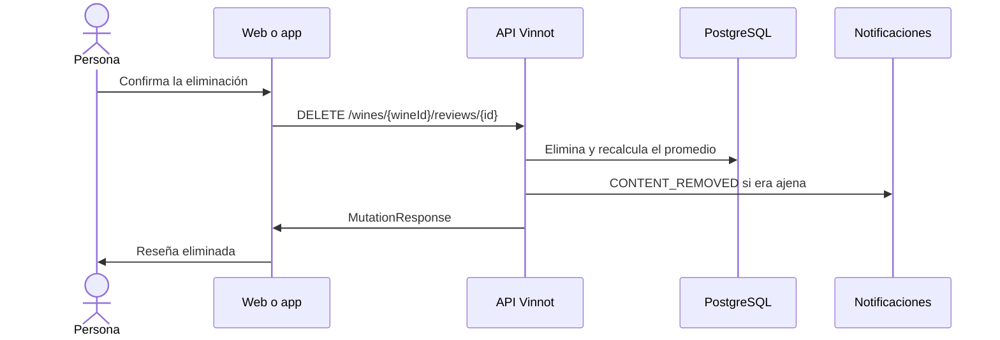

# UC-REV-04 · Eliminar una reseña

| Campo | Valor |
|---|---|
| ID | `UC-REV-04` |
| Módulo | [Reseñas](../README.md) |
| Plataformas | Web, APK |
| Actores | Autor de la reseña, Moderador, Administrador, Servicio de email |
| IDs en Lucidchart | [WEB UC-REV-04](https://lucid.app/lucidchart/9f11a16b-bb5a-42fc-a9e8-0852b17bd241/edit), [APK UC-REV-03](https://lucid.app/lucidchart/e095dd25-e8ac-41ba-bf5b-396e1055f217/edit) |
| Requisitos | [`RF-WEB-REV-06`](../requirements.md), [`RF-APK-REV-06`](../requirements.md) |
| Casos de prueba | [`CP-REV-14`](../testing.md), [`CP-REV-15`](../testing.md), [`CP-REV-16`](../testing.md), [`CP-REV-17`](../testing.md), [`CP-REV-18`](../testing.md) |

## Precondiciones

- La persona es la autora de la reseña o tiene el permiso `REVIEW_DELETE` (moderadores y administradores).

## Postcondiciones

- La reseña, sus comentarios y sus likes se eliminan y el promedio del vino se actualiza.

## Flujo principal

1. La persona elige eliminar la reseña.
2. El cliente pide confirmación.
3. El cliente envía `DELETE /wines/{wineId}/reviews/{id}`.
4. La API comprueba la autoría o el permiso, elimina la reseña y recalcula el promedio del vino.
5. El cliente quita la reseña de la lista y actualiza el promedio.

## Flujos alternativos

- 2a. La persona cancela: no se elimina nada.
- 4a. Quien elimina no es autor ni tiene el permiso: la API responde 422 `REVIEW_OWNERSHIP`.
- 4b. La reseña ya no existe: la API responde 404.
- 4c. La reseña era de otra persona: se le envía un email `CONTENT_REMOVED` a su autor.

## Reglas de negocio

- Eliminar una reseña no borra ni cambia la entrada de la cava.
- Los comentarios y likes de la reseña se eliminan en cascada.
- El retiro de contenido denunciado reutiliza este caso de uso ([Comunidad](../../community/README.md)).

## Diagrama

[Ver diagrama de «UC-REV-04 · Eliminar una reseña» completo](https://images.vinnot.com/docs/diagrams/v1/es/modules-reviews-use-cases-uc-rev-04-delete-review-a48f36281086.svg)

Diagrama de componentes en Lucidchart: [WEB UC-REV-04](https://lucid.app/lucidchart/9f11a16b-bb5a-42fc-a9e8-0852b17bd241/edit), [APK UC-REV-03](https://lucid.app/lucidchart/e095dd25-e8ac-41ba-bf5b-396e1055f217/edit).

## Código

| Capa | Ubicación |
|---|---|
| Endpoints | `DELETE /wines/{wineId}/reviews/{id}` |
| Backend | [`ReviewController.java`](../../../../../backend/src/main/java/com/vinnot/review/infrastructure/web/controller/ReviewController.java), [`DeleteReviewCommandHandler.java`](../../../../../backend/src/main/java/com/vinnot/review/application/command/handler/DeleteReviewCommandHandler.java) |
| Web | [`ReviewsList.tsx`](../../../../../frontend-react/src/presentation/components/features/wine/ReviewsList.tsx), [`useDeleteReview.ts`](../../../../../frontend-react/src/presentation/hooks/queries/wine/useDeleteReview.ts), [`wines.reviews.client.ts`](../../../../../frontend-react/src/infrastructure/api/clients/wines.reviews.client.ts) |
| App | [`ReviewItem.tsx`](../../../../../frontend-mobile/src/presentation/features/wine/ReviewItem.tsx), [`useWines.ts`](../../../../../frontend-mobile/src/presentation/hooks/queries/wine/useWines.ts), [`wines.client.ts`](../../../../../frontend-mobile/src/infrastructure/api/clients/wines.client.ts) |

## Tests automáticos

- Backend: [`ReviewOwnershipTest.java`](../../../../../backend/src/test/java/com/vinnot/review/application/command/handler/ReviewOwnershipTest.java), [`EmailReviewModerationNotifierTest.java`](../../../../../backend/src/test/java/com/vinnot/review/infrastructure/notification/EmailReviewModerationNotifierTest.java)
- Web: [`useDeleteReview.test.tsx`](../../../../../frontend-react/src/presentation/hooks/queries/wine/useDeleteReview.test.tsx)
- App: [`ReviewItem.test.tsx`](../../../../../frontend-mobile/src/presentation/features/wine/ReviewItem.test.tsx)
