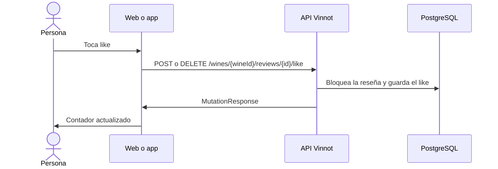

# UC-REV-05 · Dar o quitar un like

| Campo | Valor |
|---|---|
| ID | `UC-REV-05` |
| Módulo | [Reseñas](../README.md) |
| Plataformas | Web, APK |
| Actores | Usuario autenticado |
| IDs en Lucidchart | [WEB UC-REV-05](https://lucid.app/lucidchart/9f11a16b-bb5a-42fc-a9e8-0852b17bd241/edit), [APK UC-REV-04](https://lucid.app/lucidchart/e095dd25-e8ac-41ba-bf5b-396e1055f217/edit) |
| Requisitos | [`RF-WEB-REV-07`](../requirements.md), [`RF-APK-REV-07`](../requirements.md) |
| Casos de prueba | [`CP-REV-19`](../testing.md), [`CP-REV-20`](../testing.md), [`CP-REV-21`](../testing.md), [`CP-REV-22`](../testing.md) |

## Precondiciones

- La persona tiene sesión iniciada y la reseña está aprobada.

## Postcondiciones

- La reseña queda con o sin el like de la persona y el contador actualizado.

## Flujo principal

1. La persona toca el like de una reseña.
2. El cliente muestra el cambio al instante.
3. El cliente envía `POST /wines/{wineId}/reviews/{id}/like`, o `DELETE` si ya tenía like.
4. La API bloquea la reseña, guarda o quita el like y actualiza el contador.

## Flujos alternativos

- 4a. La persona ya dio like, o lo quita sin haberlo dado: la API responde 422 y el cliente revierte el cambio con un aviso de error.
- 4b. La reseña no está aprobada o hay un bloqueo entre las cuentas: la API responde 404.
- 1a. La reseña está pendiente o rechazada: el like aparece deshabilitado.

## Reglas de negocio

- Un like por persona y reseña.
- Se puede dar like a la reseña propia.
- El contador nunca baja de cero.
- Quien escribió la reseña recibe los likes en un resumen, no uno por uno ([UC-REV-07](uc-rev-07-activity-notices.md)).

## Diagrama

[Ver diagrama de «UC-REV-05 · Dar o quitar un like» completo](https://images.vinnot.com/docs/diagrams/v1/es/modules-reviews-use-cases-uc-rev-05-like-review-4276f2ee0da2.svg)

Diagrama de componentes en Lucidchart: [WEB UC-REV-05](https://lucid.app/lucidchart/9f11a16b-bb5a-42fc-a9e8-0852b17bd241/edit), [APK UC-REV-04](https://lucid.app/lucidchart/e095dd25-e8ac-41ba-bf5b-396e1055f217/edit).

## Código

| Capa | Ubicación |
|---|---|
| Endpoints | `POST /wines/{wineId}/reviews/{id}/like`, `DELETE /wines/{wineId}/reviews/{id}/like` |
| Backend | [`ReviewController.java`](../../../../../backend/src/main/java/com/vinnot/review/infrastructure/web/controller/ReviewController.java), [`LikeReviewCommandHandler.java`](../../../../../backend/src/main/java/com/vinnot/review/application/command/handler/LikeReviewCommandHandler.java), [`UnlikeReviewCommandHandler.java`](../../../../../backend/src/main/java/com/vinnot/review/application/command/handler/UnlikeReviewCommandHandler.java), [`Review.java`](../../../../../backend/src/main/java/com/vinnot/review/domain/model/Review.java) |
| Web | [`ReviewCard.tsx`](../../../../../frontend-react/src/presentation/components/features/wine/ReviewCard.tsx), [`useToggleReviewLike.ts`](../../../../../frontend-react/src/presentation/hooks/queries/wine/useToggleReviewLike.ts), [`wines.reviews.client.ts`](../../../../../frontend-react/src/infrastructure/api/clients/wines.reviews.client.ts) |
| App | [`ReviewItem.tsx`](../../../../../frontend-mobile/src/presentation/features/wine/ReviewItem.tsx), [`useWines.ts`](../../../../../frontend-mobile/src/presentation/hooks/queries/wine/useWines.ts), [`wines.client.ts`](../../../../../frontend-mobile/src/infrastructure/api/clients/wines.client.ts) |

## Tests automáticos

- Backend: [`ReviewInteractionHandlersTest.java`](../../../../../backend/src/test/java/com/vinnot/review/application/command/handler/ReviewInteractionHandlersTest.java), [`ReviewTest.java`](../../../../../backend/src/test/java/com/vinnot/review/domain/model/ReviewTest.java)
- Web: [`ReviewsList.test.tsx`](../../../../../frontend-react/src/presentation/components/features/wine/ReviewsList.test.tsx)
- App: [`ReviewItem.test.tsx`](../../../../../frontend-mobile/src/presentation/features/wine/ReviewItem.test.tsx)
