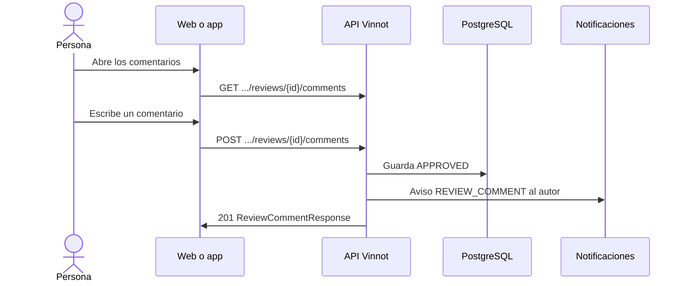

# UC-REV-06 · Comentar una reseña

| Campo | Valor |
|---|---|
| ID | `UC-REV-06` |
| Módulo | [Reseñas](../README.md) |
| Plataformas | Web, APK |
| Actores | Usuario autenticado, Autor de la reseña, Moderador, Administrador |
| IDs en Lucidchart | [WEB UC-REV-06](https://lucid.app/lucidchart/9f11a16b-bb5a-42fc-a9e8-0852b17bd241/edit), [APK UC-REV-05](https://lucid.app/lucidchart/e095dd25-e8ac-41ba-bf5b-396e1055f217/edit) |
| Requisitos | [`RF-WEB-REV-08`](../requirements.md), [`RF-WEB-REV-09`](../requirements.md), [`RF-WEB-REV-10`](../requirements.md), [`RF-APK-REV-08`](../requirements.md), [`RF-APK-REV-09`](../requirements.md), [`RF-APK-REV-10`](../requirements.md) |
| Casos de prueba | [`CP-REV-23`](../testing.md), [`CP-REV-24`](../testing.md), [`CP-REV-25`](../testing.md), [`CP-REV-26`](../testing.md), [`CP-REV-27`](../testing.md) |

## Precondiciones

- La persona tiene sesión iniciada y la reseña está aprobada.

## Postcondiciones

- El comentario queda publicado en la reseña, o eliminado si se pidió eso.

## Flujo principal

1. La persona abre los comentarios de una reseña.
2. El cliente pide `GET /wines/{wineId}/reviews/{id}/comments` y muestra los comentarios aprobados y los propios.
3. La persona escribe un comentario de hasta 2000 caracteres y lo envía.
4. El cliente envía `POST /wines/{wineId}/reviews/{id}/comments`.
5. La API recorta el texto, lo guarda como `APPROVED` y avisa al autor de la reseña ([UC-REV-07](uc-rev-07-activity-notices.md)).
6. La API responde 201 y el cliente muestra el comentario y actualiza el contador.

## Flujos alternativos

- 2a. No hay comentarios: se muestra el estado vacío.
- 4a. El texto queda vacío o supera 2000 caracteres al recortarlo: la API lo rechaza (400 o 422).
- 4b. La reseña no está aprobada o hay un bloqueo entre las cuentas: la API responde 404.
- 6a. La persona elimina un comentario propio, o un moderador o administrador uno ajeno: el cliente pide confirmación y envía `DELETE .../comments/{commentId}`; sin autoría ni permiso la API responde 422 `REVIEW_COMMENT_OWNERSHIP`.

## Reglas de negocio

- Los comentarios se publican al instante y no se pueden editar.
- La lista de comentarios no se pagina.
- El contador de comentarios solo cuenta los aprobados.
- Eliminar un comentario ajeno le envía un email `CONTENT_REMOVED` a su autor.

## Diagrama

[Ver diagrama de «UC-REV-06 · Comentar una reseña» completo](https://images.vinnot.com/docs/diagrams/v1/es/modules-reviews-use-cases-uc-rev-06-review-comments-c6ae672fc04b.svg)

Diagrama de componentes en Lucidchart: [WEB UC-REV-06](https://lucid.app/lucidchart/9f11a16b-bb5a-42fc-a9e8-0852b17bd241/edit), [APK UC-REV-05](https://lucid.app/lucidchart/e095dd25-e8ac-41ba-bf5b-396e1055f217/edit).

## Código

| Capa | Ubicación |
|---|---|
| Endpoints | `GET /wines/{wineId}/reviews/{id}/comments`, `POST /wines/{wineId}/reviews/{id}/comments`, `DELETE /wines/{wineId}/reviews/{id}/comments/{commentId}` |
| Backend | [`ReviewController.java`](../../../../../backend/src/main/java/com/vinnot/review/infrastructure/web/controller/ReviewController.java), [`GetReviewCommentsQueryHandler.java`](../../../../../backend/src/main/java/com/vinnot/review/application/query/handler/GetReviewCommentsQueryHandler.java), [`AddReviewCommentCommandHandler.java`](../../../../../backend/src/main/java/com/vinnot/review/application/command/handler/AddReviewCommentCommandHandler.java), [`DeleteReviewCommentCommandHandler.java`](../../../../../backend/src/main/java/com/vinnot/review/application/command/handler/DeleteReviewCommentCommandHandler.java) |
| Web | [`ReviewComments.tsx`](../../../../../frontend-react/src/presentation/components/features/wine/ReviewComments.tsx), [`useReviewComments.ts`](../../../../../frontend-react/src/presentation/hooks/queries/wine/useReviewComments.ts), [`useCreateReviewComment.ts`](../../../../../frontend-react/src/presentation/hooks/queries/wine/useCreateReviewComment.ts), [`useDeleteReviewComment.ts`](../../../../../frontend-react/src/presentation/hooks/queries/wine/useDeleteReviewComment.ts), [`wines.reviews.client.ts`](../../../../../frontend-react/src/infrastructure/api/clients/wines.reviews.client.ts) |
| App | [`ReviewComments.tsx`](../../../../../frontend-mobile/src/presentation/features/wine/ReviewComments.tsx), [`useWines.ts`](../../../../../frontend-mobile/src/presentation/hooks/queries/wine/useWines.ts), [`wines.client.ts`](../../../../../frontend-mobile/src/infrastructure/api/clients/wines.client.ts) |

## Tests automáticos

- Backend: [`GetReviewCommentsQueryHandlerTest.java`](../../../../../backend/src/test/java/com/vinnot/review/application/query/handler/GetReviewCommentsQueryHandlerTest.java), [`ReviewInteractionHandlersTest.java`](../../../../../backend/src/test/java/com/vinnot/review/application/command/handler/ReviewInteractionHandlersTest.java), [`ReviewOwnershipTest.java`](../../../../../backend/src/test/java/com/vinnot/review/application/command/handler/ReviewOwnershipTest.java)
- Web: [`ReviewComments.test.tsx`](../../../../../frontend-react/src/presentation/components/features/wine/ReviewComments.test.tsx)
- App: [`ReviewComments.test.tsx`](../../../../../frontend-mobile/src/presentation/features/wine/__tests__/ReviewComments.test.tsx)
