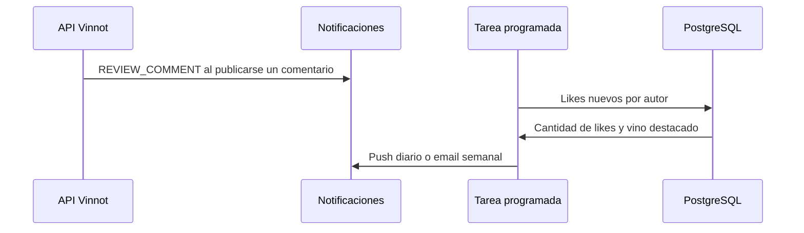

# UC-REV-07 · Avisar la actividad de una reseña

| Campo | Valor |
|---|---|
| ID | `UC-REV-07` |
| Módulo | [Reseñas](../README.md) |
| Plataformas | Solo backend |
| Actores | Sistema (tarea programada), Servicio de email, Servicio de notificaciones push |
| IDs en Lucidchart | Ninguno |
| Requisitos | Ninguno |
| Casos de prueba | [`CP-REV-28`](../testing.md), [`CP-REV-29`](../testing.md), [`CP-REV-30`](../testing.md), [`CP-REV-31`](../testing.md) |

## Precondiciones

- Alguien comentó o dio like a una reseña.

## Postcondiciones

- El autor de la reseña recibe el aviso del comentario y un resumen de los likes.

## Flujo principal

1. Al publicarse un comentario, la API encola un email y un push `REVIEW_COMMENT` para el autor de la reseña.
2. Todos los días a las 19:00 (hora de Argentina) la tarea programada junta los likes nuevos de cada autor.
3. Envía un push `REVIEW_LIKES_DAILY` con la cantidad de likes, de reseñas y el vino con más likes.
4. Los domingos a las 10:00 envía el resumen de la semana por email (`REVIEW_LIKES_WEEKLY`).

## Flujos alternativos

- 1a. Quien comenta es el autor de la reseña o hay un bloqueo entre las cuentas: no se envía aviso.
- 2a. Nadie dio likes nuevos: no se envía resumen.
- 3a. El push diario no se puede mostrar dentro del día: se descarta.

## Reglas de negocio

- Los likes propios y los de cuentas bloqueadas no cuentan para el resumen.
- Cada resumen cubre desde el anterior y deja 5 minutos de margen para los likes que se están guardando.
- Los horarios y la zona se configuran con `app.community.likes.*`.
- El envío usa el módulo de [Notificaciones](../../notifications/README.md).

## Diagrama

[Ver diagrama de «UC-REV-07 · Avisar la actividad de una reseña» completo](https://images.vinnot.com/docs/diagrams/v1/es/modules-reviews-use-cases-uc-rev-07-activity-notices-7baf52d00556.svg)

## Código

| Capa | Ubicación |
|---|---|
| Backend | [`CommentActivityAnnouncer.java`](../../../../../backend/src/main/java/com/vinnot/review/application/command/handler/CommentActivityAnnouncer.java), [`NotificationCommunityActivityNotifier.java`](../../../../../backend/src/main/java/com/vinnot/review/infrastructure/notification/NotificationCommunityActivityNotifier.java), [`ReviewLikeSummaryScheduler.java`](../../../../../backend/src/main/java/com/vinnot/review/infrastructure/scheduling/ReviewLikeSummaryScheduler.java), [`SummarizeReviewLikesCommandHandler.java`](../../../../../backend/src/main/java/com/vinnot/review/application/command/handler/SummarizeReviewLikesCommandHandler.java), [`JdbcReviewLikeSummaryAdapter.java`](../../../../../backend/src/main/java/com/vinnot/review/infrastructure/persistence/adapter/JdbcReviewLikeSummaryAdapter.java) |

## Tests automáticos

- Backend: [`CommentActivityAnnouncerTest.java`](../../../../../backend/src/test/java/com/vinnot/review/application/command/handler/CommentActivityAnnouncerTest.java), [`NotificationCommunityActivityNotifierTest.java`](../../../../../backend/src/test/java/com/vinnot/review/infrastructure/notification/NotificationCommunityActivityNotifierTest.java), [`SummarizeReviewLikesCommandHandlerTest.java`](../../../../../backend/src/test/java/com/vinnot/review/application/command/handler/SummarizeReviewLikesCommandHandlerTest.java), [`ReviewLikeSummarySchedulerTest.java`](../../../../../backend/src/test/java/com/vinnot/review/infrastructure/scheduling/ReviewLikeSummarySchedulerTest.java), [`JdbcReviewLikeSummaryAdapterPostgresIntegrationTest.java`](../../../../../backend/src/test/java/com/vinnot/review/infrastructure/persistence/adapter/JdbcReviewLikeSummaryAdapterPostgresIntegrationTest.java)
- Web: Ninguno
- App: Ninguno
