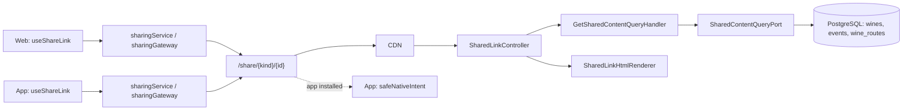

# Arquitectura

Cómo está construido el módulo en cada capa. El backend sigue el flujo hexagonal
`controller → puerto de entrada → handler → dominio → puerto de salida → adaptador`;
la web y la app siguen `pantalla → hook → servicio → gateway del dispositivo`.

[Ver diagrama de «Arquitectura» completo](https://images.vinnot.com/docs/diagrams/v1/es/modules-sharing-architecture-f7ef70c67588.svg)

## Backend

### Página de vista previa

`SharedLinkController` → `GetSharedContentUseCase` → `GetSharedContentQueryHandler` →
`SharedContentQueryPort` → `JdbcSharedContentQueryAdapter`. El módulo no tiene tablas
propias: el adaptador lee por clave primaria el vino, el evento o la ruta y proyecta
solo título, descripción (cortada a 240 caracteres) e imagen; no carga paradas,
perfiles IA, cuentas, contactos ni inscripciones. El dominio (`SharedContent`,
`SharedContentKind`) no depende de Spring, HTTP ni JDBC.

| Ruta | Respuesta |
|---|---|
| `GET /share`, `GET /share/en` | Página general de descarga de la app |
| `GET /share/{tipo}/{id}`, `GET /share/{tipo}/{id}/en` | Vista previa del contenido; `tipo` es `wines`, `events` o `wine-routes` |

Todas aceptan `HEAD` y responden HTML. El español es el idioma inicial; `?lang=en`
también elige inglés. Un tipo desconocido o un ID que no es UUID devuelve 404 sin
consultar la base. Se muestran vinos activos, rutas `PUBLISHED` y eventos publicados
alguna vez que no estén en `DRAFT`, aunque luego se hayan cancelado; lo demás devuelve
404 con una página neutra.

### Contenido de la página

`SharedLinkHtmlRenderer` completa la plantilla `resources/sharing/landing.html` en una
sola pasada y escapa todo el texto. El título se corta a 120 caracteres. La imagen del
contenido solo se acepta desde `images.vinnot.com` o desde los uploads del origen de la
API configurado; si no, se usa la marca. Open Graph y Twitter usan esa misma foto, así
la vista previa del enlace muestra el vino, el evento o la ruta; no lleva etiquetas de
tamaño ni tipo porque el tamaño de la foto no se conoce. Sin foto usan la vista previa
de marca en PNG de 1200 × 630 con sus etiquetas de tamaño. Las fotos son WebP: WhatsApp,
Messenger, iMessage y Telegram las muestran; un cliente que no procese WebP puede
mostrar la vista previa sin imagen. La página ofrece
«Abrir en Vinnot» (`vinnot://{tipo}/{id}`), «Continuar en la web» (`/{tipo}/{id}`) y
las tiendas. Google Play está activo desde el lanzamiento público de Android
(`app.sharing.android-available`, `true` por defecto y en los compose de dev y producción);
con `false` se vuelve a mostrar «Próximamente en Google Play». Un origen de API inválido impide el arranque.

### Seguridad

Solo `GET` y `HEAD` de estas rutas son anónimos (`SecurityConfig`); usan el límite del
catálogo público (180 por minuto). Cada respuesta lleva `Cache-Control: no-store`, una
CSP estricta, `nosniff`, `Referrer-Policy: no-referrer` y `X-Robots-Tag: noindex,
nofollow`. En producción el CDN envía `/share` a la API sin query strings, cookies ni
sesión; la [activación de enlaces públicos](../../infra/guides/public-sharing.md)
detalla el CDN, los archivos de asociación y los builds.

### Pruebas

- `SharedLinkControllerTest` y `SharedLinkHtmlRendererTest`: metadatos, enlaces, escape, imágenes, cabeceras y página general.
- `GetSharedContentQueryHandlerTest`: delega solo la proyección pública y conserva la ausencia de contenido.
- `SharedContentHttpPostgresIntegrationTest`: visibilidad con PostgreSQL migrado, `HEAD`, ausencia de datos privados y `POST` rechazado.

## Web

### Compartir

`useShareLink` → `sharingService` → `domain/sharing/contentLink` → `sharingGateway`. La
política de URL es pura: solo arma enlaces para tipos conocidos e IDs UUID, con el
dominio `vinnot.com` o `dev.vinnot.com`. Solo el gateway conoce `navigator.share` y el
portapapeles. Si el navegador no comparte, se copia el enlace y se avisa; cancelar no
muestra éxito; un fallo muestra un aviso de error. Lo usan los detalles de vino, evento
y ruta. `domain/sharing/publicContent` replica las reglas de la vista previa: el evento y
la ruta solo muestran «Compartir» cuando tienen página pública. Para el evento usa
`publiclyVisible` del detalle y, si falta, un estado distinto de `DRAFT`; para la ruta,
`isPublished`.

### Página de vista previa

La SPA no tiene ruta `/share`: la página la sirve la API. La web aporta los recursos
estáticos de `public/share-assets/` (estilos, elección de idioma según el dispositivo y
botón de descarga según iOS o Android) y genera por entorno
`/.well-known/apple-app-site-association` y `/.well-known/assetlinks.json` desde
`config/link-associations.mjs`. «Continuar en la web» abre el detalle, que exige sesión:
`ProtectedRoute` lleva a `/login?returnUrl=…` y después vuelve al contenido.

## App

### Compartir

`useShareLink` → `sharingService` → `domain/sharing/contentLink` → `sharingGateway`, que
usa `Share` de React Native: iOS recibe el enlace como URL, para su vista previa, y
Android como texto. Cancelar no muestra éxito; un fallo muestra un aviso de error. Lo
usan los detalles de vino, evento y ruta. `domain/sharing/shareability` replica las reglas
de la vista previa: el evento y la ruta solo muestran «Compartir» cuando tienen página
pública (`canShareEvent` usa `publiclyVisible` y, si falta, un estado distinto de
`DRAFT`; `canShareRoute` usa `isPublished`).

### Abrir enlaces

`app.config.ts` declara el esquema `vinnot`, los dominios asociados de iOS y los filtros
de Android con verificación automática para `/share`, `/share/` y los prefijos de cada
tipo. `app/+native-intent.tsx` atiende primero el regreso de pagos y luego
`safeNativeIntent` (`domain/navigation/nativeIntent.ts`): descarta enlaces de más de
4096 caracteres o con caracteres de control, acepta `vinnot://{tipo}/{id}` y HTTPS solo
de `vinnot.com` y `dev.vinnot.com` sin credenciales ni puerto, lleva `/share` al inicio
y `/share/{tipo}/{id}` a `/wines/{id}`, `/events/{id}` o `/routes/{id}`; cualquier otro
enlace abre el inicio. Sin sesión, `AuthGuard` recuerda el destino y vuelve a él después
del login. La asociación de dominio es nativa: requiere un build de tienda y una OTA no
la agrega.
