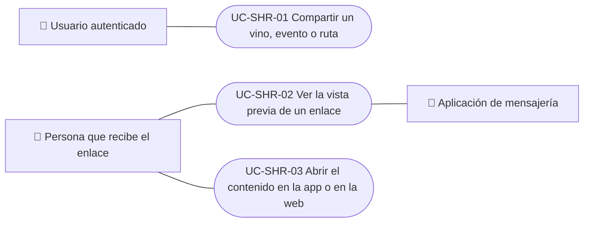

# Casos de uso

Casos de uso para compartir: generar el enlace público de un vino, evento o ruta, abrir la página de vista previa que ve quien recibe el enlace, y abrir el contenido en la app o en la web. Cada caso vale para las plataformas indicadas.

| ID | Caso de uso | Plataformas | Actores |
|---|---|---|---|
| `UC-SHR-01` | [Compartir un vino, evento o ruta](uc-shr-01-share-content.md) | Web, APK | Usuario autenticado |
| `UC-SHR-02` | [Ver la vista previa de un enlace](uc-shr-02-open-shared-link.md) | Web, APK | Persona que recibe el enlace, Aplicación de mensajería |
| `UC-SHR-03` | [Abrir el contenido en la app o en la web](uc-shr-03-open-in-app-or-web.md) | Web, APK | Persona que recibe el enlace |

## Diagrama de casos de uso

[Ver diagrama de «Casos de uso · Diagrama de casos de uso» completo](https://images.vinnot.com/docs/diagrams/v1/es/modules-sharing-use-cases-readme-6faa0ab0caf6.svg)

## Equivalencia con Lucidchart

| ID | IDs en Lucidchart |
|---|---|
| `UC-SHR-01` | [WEB UC-SHR-01](https://lucid.app/lucidchart/9f11a16b-bb5a-42fc-a9e8-0852b17bd241/edit), [APK UC-SHR-01](https://lucid.app/lucidchart/e095dd25-e8ac-41ba-bf5b-396e1055f217/edit) |
| `UC-SHR-02` | Ninguno |
| `UC-SHR-03` | [APK UC-SHR-02](https://lucid.app/lucidchart/e095dd25-e8ac-41ba-bf5b-396e1055f217/edit) |
