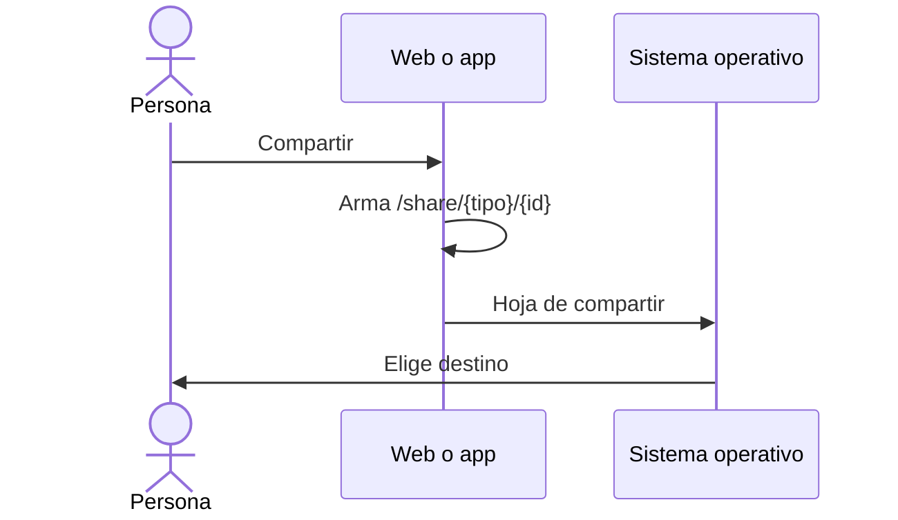

# UC-SHR-01 · Compartir un vino, evento o ruta

| Campo | Valor |
|---|---|
| ID | `UC-SHR-01` |
| Módulo | [Compartir](../README.md) |
| Plataformas | Web, APK |
| Actores | Usuario autenticado |
| IDs en Lucidchart | [WEB UC-SHR-01](https://lucid.app/lucidchart/9f11a16b-bb5a-42fc-a9e8-0852b17bd241/edit), [APK UC-SHR-01](https://lucid.app/lucidchart/e095dd25-e8ac-41ba-bf5b-396e1055f217/edit) |
| Requisitos | [`RF-WEB-SHR-01`](../requirements.md), [`RF-WEB-SHR-02`](../requirements.md), [`RF-APK-SHR-01`](../requirements.md), [`RF-APK-SHR-02`](../requirements.md) |
| Casos de prueba | [`CP-SHR-01`](../testing.md), [`CP-SHR-15`](../testing.md), [`CP-SHR-02`](../testing.md), [`CP-SHR-03`](../testing.md), [`CP-SHR-04`](../testing.md) |

## Precondiciones

- La persona está en el detalle de un vino, un evento o una ruta.

## Postcondiciones

- El enlace público quedó compartido o copiado.

## Flujo principal

1. La persona elige «Compartir».
2. El cliente arma el enlace público `/share/{tipo}/{id}` con el dominio de Vinnot; el tipo es `wines`, `events` o `wine-routes`.
3. El cliente abre la hoja de compartir: la del navegador en la web y la del sistema en la app.
4. La persona elige dónde compartir el enlace.

## Flujos alternativos

- 1a. El evento o la ruta todavía no tiene página pública (un evento en borrador o cancelado sin haberse publicado, una ruta sin publicar): el cliente no ofrece «Compartir».
- 3a. El navegador no permite compartir: la web copia el enlace y avisa que se copió.
- 4a. La persona cancela: no se muestra ningún aviso de éxito.
- 3b. Compartir falla: el cliente muestra un aviso de error.

## Reglas de negocio

- El enlace solo lleva el tipo y el ID del contenido, sin tokens ni datos de la persona.
- El cliente solo arma enlaces para tipos conocidos e IDs con formato UUID.
- Los clientes solo ofrecen «Compartir» en eventos y rutas que tienen página pública, con las mismas reglas que la vista previa.
- En Android el enlace se entrega como texto y en iOS como URL.

## Diagrama

[Ver diagrama de «UC-SHR-01 · Compartir un vino, evento o ruta» completo](https://images.vinnot.com/docs/diagrams/v1/es/modules-sharing-use-cases-uc-shr-01-share-content-17816ba05661.svg)

Diagrama de componentes en Lucidchart: [WEB UC-SHR-01](https://lucid.app/lucidchart/9f11a16b-bb5a-42fc-a9e8-0852b17bd241/edit), [APK UC-SHR-01](https://lucid.app/lucidchart/e095dd25-e8ac-41ba-bf5b-396e1055f217/edit).

## Código

| Capa | Ubicación |
|---|---|
| Web | [`useShareLink.ts`](../../../../../frontend-react/src/presentation/hooks/useShareLink.ts), [`sharing.service.ts`](../../../../../frontend-react/src/application/services/sharing.service.ts), [`sharing.gateway.ts`](../../../../../frontend-react/src/infrastructure/device/sharing.gateway.ts), [`contentLink.ts`](../../../../../frontend-react/src/domain/sharing/contentLink.ts) |
| App | [`useShareLink.ts`](../../../../../frontend-mobile/src/presentation/hooks/useShareLink.ts), [`sharing.service.ts`](../../../../../frontend-mobile/src/application/services/sharing.service.ts), [`sharing.gateway.ts`](../../../../../frontend-mobile/src/infrastructure/device/sharing.gateway.ts), [`contentLink.ts`](../../../../../frontend-mobile/src/domain/sharing/contentLink.ts) |

## Tests automáticos

- Backend: Ninguno
- Web: [`sharing.service.test.ts`](../../../../../frontend-react/src/application/services/sharing.service.test.ts), [`contentLink.test.ts`](../../../../../frontend-react/src/domain/sharing/contentLink.test.ts), [`publicContent.test.ts`](../../../../../frontend-react/src/domain/sharing/publicContent.test.ts)
- App: [`sharing.service.test.ts`](../../../../../frontend-mobile/src/application/services/sharing.service.test.ts), [`sharing.gateway.test.ts`](../../../../../frontend-mobile/src/infrastructure/device/sharing.gateway.test.ts), [`contentLink.test.ts`](../../../../../frontend-mobile/src/domain/sharing/contentLink.test.ts), [`shareability.test.ts`](../../../../../frontend-mobile/src/domain/sharing/shareability.test.ts)
