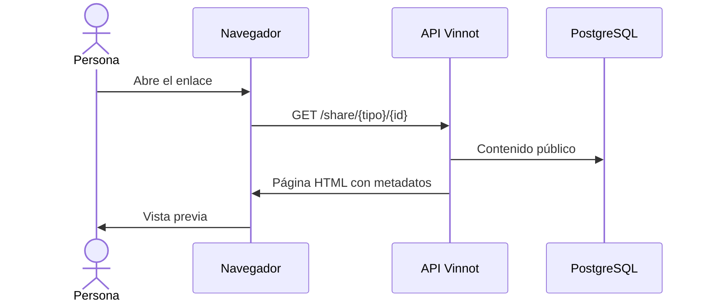

# UC-SHR-02 · Ver la vista previa de un enlace

| Campo | Valor |
|---|---|
| ID | `UC-SHR-02` |
| Módulo | [Compartir](../README.md) |
| Plataformas | Web, APK |
| Actores | Persona que recibe el enlace, Aplicación de mensajería |
| IDs en Lucidchart | Ninguno |
| Requisitos | [`RF-WEB-SHR-03`](../requirements.md), [`RF-WEB-SHR-04`](../requirements.md), [`RF-WEB-SHR-05`](../requirements.md), [`RF-APK-SHR-03`](../requirements.md), [`RF-APK-SHR-04`](../requirements.md), [`RF-APK-SHR-05`](../requirements.md) |
| Casos de prueba | [`CP-SHR-05`](../testing.md), [`CP-SHR-06`](../testing.md), [`CP-SHR-07`](../testing.md), [`CP-SHR-08`](../testing.md), [`CP-SHR-09`](../testing.md) |

## Precondiciones

- Alguien compartió un enlace `/share/...` de Vinnot.

## Postcondiciones

- Quien recibe el enlace ve una vista previa del contenido sin iniciar sesión.

## Flujo principal

1. La persona abre el enlace en el navegador, o la aplicación de mensajería lo consulta para armar su vista previa.
2. La API recibe `GET /share/{tipo}/{id}` sin sesión y valida el tipo y el formato del ID.
3. La API busca el contenido público: un vino activo, una ruta publicada o un evento publicado alguna vez que no esté en borrador.
4. La API devuelve una página con título, descripción corta, imagen, metadatos Open Graph y Twitter, y los botones «Ya tengo la app · Abrir en Vinnot», «Continuar en la web» y de descarga.

## Flujos alternativos

- 2a. El tipo no existe o el ID no es un UUID: la API responde 404 sin consultar la base.
- 3a. El contenido no existe o no es público: la API responde 404 con una página neutra que dice que el enlace ya no está disponible.
- 1a. El dispositivo está en inglés o el enlace termina en `/en`: la página se muestra en inglés.
- 1b. El enlace es solo `/share`: se muestra la página general de la app con sus descargas.

## Reglas de negocio

- La página no expone contactos, inscripciones ni datos privados.
- El título se corta a 120 caracteres y la descripción a 240.
- La imagen solo se toma del dominio de imágenes de Vinnot; si no, se usa el logo.
- La vista previa del enlace en las apps de mensajería muestra esa misma foto; sin foto muestra la imagen de vista previa de Vinnot.
- Los eventos cancelados o finalizados siguen visibles.
- La página no se guarda en caché ni la indexan los buscadores.
- La descarga para Android aparece solo cuando la app está disponible en Google Play; si no, dice «Próximamente».

## Diagrama

[Ver diagrama de «UC-SHR-02 · Ver la vista previa de un enlace» completo](https://images.vinnot.com/docs/diagrams/v1/es/modules-sharing-use-cases-uc-shr-02-open-shared-link-e69856d0d3d9.svg)

## Código

| Capa | Ubicación |
|---|---|
| Endpoints | `GET /share/{kind}/{id}`, `GET /share` |
| Backend | [`SharedLinkController.java`](../../../../../backend/src/main/java/com/vinnot/sharing/infrastructure/web/SharedLinkController.java), [`GetSharedContentQueryHandler.java`](../../../../../backend/src/main/java/com/vinnot/sharing/application/query/GetSharedContentQueryHandler.java), [`JdbcSharedContentQueryAdapter.java`](../../../../../backend/src/main/java/com/vinnot/sharing/infrastructure/persistence/JdbcSharedContentQueryAdapter.java), [`SharedLinkHtmlRenderer.java`](../../../../../backend/src/main/java/com/vinnot/sharing/infrastructure/web/SharedLinkHtmlRenderer.java) |

## Tests automáticos

- Backend: [`SharedLinkControllerTest.java`](../../../../../backend/src/test/java/com/vinnot/sharing/infrastructure/web/SharedLinkControllerTest.java), [`SharedLinkHtmlRendererTest.java`](../../../../../backend/src/test/java/com/vinnot/sharing/infrastructure/web/SharedLinkHtmlRendererTest.java), [`GetSharedContentQueryHandlerTest.java`](../../../../../backend/src/test/java/com/vinnot/sharing/application/query/GetSharedContentQueryHandlerTest.java), [`SharedContentHttpPostgresIntegrationTest.java`](../../../../../backend/src/test/java/com/vinnot/sharing/infrastructure/SharedContentHttpPostgresIntegrationTest.java)
- Web: [`sharing-language.test.ts`](../../../../../frontend-react/tests/unit/sharing-language.test.ts), [`sharing-downloads.test.ts`](../../../../../frontend-react/tests/unit/sharing-downloads.test.ts)
- App: Ninguno
