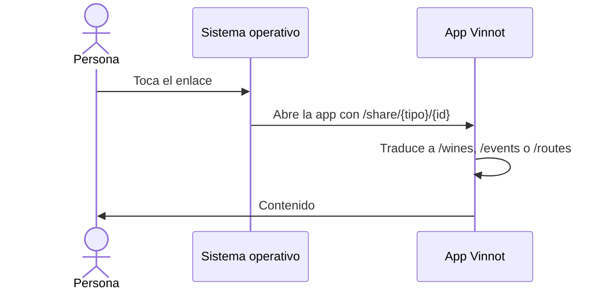

# UC-SHR-03 · Abrir el contenido en la app o en la web

| Campo | Valor |
|---|---|
| ID | `UC-SHR-03` |
| Módulo | [Compartir](../README.md) |
| Plataformas | Web, APK |
| Actores | Persona que recibe el enlace |
| IDs en Lucidchart | [APK UC-SHR-02](https://lucid.app/lucidchart/e095dd25-e8ac-41ba-bf5b-396e1055f217/edit) |
| Requisitos | [`RF-WEB-SHR-06`](../requirements.md), [`RF-WEB-SHR-07`](../requirements.md), [`RF-APK-SHR-06`](../requirements.md), [`RF-APK-SHR-07`](../requirements.md), [`RF-APK-SHR-08`](../requirements.md) |
| Casos de prueba | [`CP-SHR-10`](../testing.md), [`CP-SHR-11`](../testing.md), [`CP-SHR-12`](../testing.md), [`CP-SHR-13`](../testing.md), [`CP-SHR-14`](../testing.md) |

## Precondiciones

- La persona tiene un enlace `/share/...` de Vinnot.

## Postcondiciones

- La persona ve el vino, el evento o la ruta en la app o en la web.

## Flujo principal

1. La persona toca el enlace con la app instalada.
2. El sistema reconoce el dominio asociado y abre la app.
3. La app traduce `/share/{tipo}/{id}` a su pantalla: `/wines/{id}`, `/events/{id}` o `/routes/{id}`.
4. La app muestra el contenido.

## Flujos alternativos

- 2a. No hay app o el sistema no reconoce el dominio: se abre la vista previa, que ofrece «Abrir en Vinnot» (`vinnot://{tipo}/{id}`) y las descargas.
- 2b. La persona elige «Continuar en la web»: la web abre `/{tipo}/{id}`.
- 4a. No hay sesión: la app o la web pide iniciar sesión y después vuelve al contenido.
- 3a. El enlace es inválido, demasiado largo o de otro dominio: la app abre Inicio.

## Reglas de negocio

- La app solo acepta enlaces de `vinnot.com` y `dev.vinnot.com`, sin credenciales ni puerto.
- Después de instalar la app hay que abrir otra vez el enlace; no se recuerda el destino durante la instalación.
- La asociación del dominio viaja en la versión de tienda; una actualización por OTA no la agrega.

## Diagrama

[Ver diagrama de «UC-SHR-03 · Abrir el contenido en la app o en la web» completo](https://images.vinnot.com/docs/diagrams/v1/es/modules-sharing-use-cases-uc-shr-03-open-in-app-or-web-51e471eb9c51.svg)

Diagrama de componentes en Lucidchart: [APK UC-SHR-02](https://lucid.app/lucidchart/e095dd25-e8ac-41ba-bf5b-396e1055f217/edit).

## Código

| Capa | Ubicación |
|---|---|
| Web | [`ProtectedRoute.tsx`](../../../../../frontend-react/src/presentation/components/auth/ProtectedRoute.tsx) |
| App | [`+native-intent.tsx`](../../../../../frontend-mobile/app/+native-intent.tsx), [`nativeIntent.ts`](../../../../../frontend-mobile/src/domain/navigation/nativeIntent.ts), [`guards.tsx`](../../../../../frontend-mobile/src/presentation/navigation/guards.tsx) |

## Tests automáticos

- Backend: Ninguno
- Web: Ninguno
- App: [`nativeIntent.test.ts`](../../../../../frontend-mobile/src/domain/navigation/nativeIntent.test.ts)
