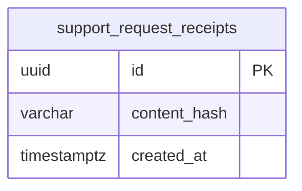

# Soporte e información pública

La presentación de Vinnot, la ayuda con buscador, el formulario de contacto y las
pantallas de error y de servicio. Todo se usa sin iniciar sesión. El formulario guarda
la consulta, avisa al equipo por correo y le da a la persona una referencia para el
seguimiento.

- Código del módulo: `SUP`.
- Backend: paquete [`support`](../../../../backend/src/main/java/com/vinnot/support/).
- [Casos de uso](use-cases/README.md) · [Requisitos](requirements.md) ·
  [Arquitectura](architecture.md) · [Pruebas](testing.md)

## Actores

| Actor | Qué hace en este módulo |
|---|---|
| Visitante o usuario autenticado | Lee la presentación y la ayuda, escribe al equipo y ve los estados de error |
| Equipo de Vinnot | Recibe las consultas en el buzón configurado y responde por correo |

## Reglas de negocio

| Regla | Detalle | Dónde |
|---|---|---|
| Sin cuenta | Cualquiera puede enviar una consulta; con sesión, el correo es el de la cuenta | [`SupportController.java`](../../../../backend/src/main/java/com/vinnot/support/infrastructure/web/SupportController.java) |
| Datos válidos | Nombre hasta 100 caracteres sin saltos de línea, correo válido hasta 254, mensaje hasta 4000 y un motivo conocido | [`SupportRequest.java`](../../../../backend/src/main/java/com/vinnot/support/domain/model/SupportRequest.java) |
| Sin duplicados | Reintentar con el mismo ID y contenido no crea otra consulta; el mismo ID con otro contenido da 400 | [`JdbcSupportRequestAdapter.java`](../../../../backend/src/main/java/com/vinnot/support/infrastructure/JdbcSupportRequestAdapter.java) |
| Acuse | Un correo de acuse por dirección y día, solo con la referencia y el motivo | [`JdbcSupportRequestAdapter.java`](../../../../backend/src/main/java/com/vinnot/support/infrastructure/JdbcSupportRequestAdapter.java) |
| Destino configurado | Sin buzón del equipo configurado no se aceptan consultas (503) | [`JdbcSupportRequestAdapter.java`](../../../../backend/src/main/java/com/vinnot/support/infrastructure/JdbcSupportRequestAdapter.java) |
| Límite de envíos | 5 por hora | [`RateLimitPolicyResolver.java`](../../../../backend/src/main/java/com/vinnot/shared/infrastructure/security/RateLimitPolicyResolver.java) |
| Referencia | `VIN-` y los últimos 12 caracteres del ID | [`support.ts`](../../../../frontend-react/src/domain/public/support.ts) |
| Contenido público | Presentación y ayuda salen de un archivo compartido por la web y la app, en español e inglés | [`public-content.ts`](../../../../frontend-react/src/domain/public/public-content.ts) |
| Estados de error | Cada error se muestra con su estado (sin permiso, no encontrado, demasiados pedidos, sin servicio, demora, sin conexión), nunca como una lista vacía | [`illustratedState.ts`](../../../../frontend-react/src/presentation/feedback/illustratedState.ts) |

## Dónde vive

| Parte | Ubicación |
|---|---|
| API | [`SupportController`](../../../../backend/src/main/java/com/vinnot/support/infrastructure/web/SupportController.java) en `POST /support/requests` |
| Web | `/about`, `/help` y `/contact` en [`pages/public`](../../../../frontend-react/src/presentation/pages/public/), y las páginas `/403`, `/404`, `/500`, `/503`, `/429`, `/offline` y `/timeout` |
| App | `frontend-mobile/app/about.tsx`, `help.tsx` y `contact.tsx`, con las pantallas en [`features/public`](../../../../frontend-mobile/src/presentation/features/public/), y las rutas de estado equivalentes |

## Datos

[Ver diagrama de «Soporte e información pública · Datos» completo](https://images.vinnot.com/docs/diagrams/v1/es/modules-support-readme-bf790d422337.svg)

`support_request_receipts` guarda solo el ID y una huella SHA-256 del contenido, nunca el
nombre, el correo ni el mensaje; también guarda la marca diaria del acuse de cada
dirección, como un digest. Se borra a los 30 días. El mensaje viaja en la cola de
[Notificaciones](../notifications/README.md) y se descarta a los 7 días si no se entregó.
