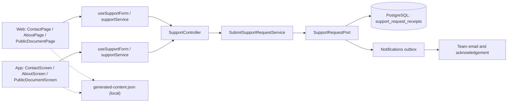
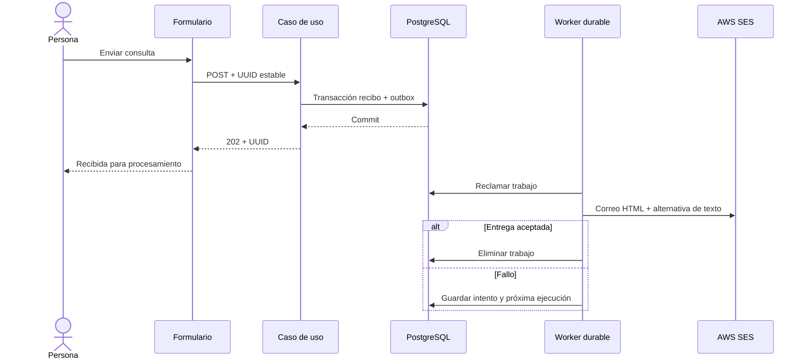

# Arquitectura

Cómo está construido el módulo en cada capa. El backend sigue el flujo hexagonal
`controller → puerto de entrada → servicio → puerto de salida → adaptador`; la web y la app
siguen `pantalla → hook → servicio → cliente API → transporte HTTP`. La presentación y la
ayuda viajan con cada cliente; los documentos legales están en [Legal](../legal/README.md).



[Ver diagrama de «Arquitectura» completo](https://images.vinnot.com/docs/diagrams/v1/es/modules-support-architecture-cf5e23053c18.svg)

## Backend

### Alcance y actores

El módulo `support` recibe consultas de soporte, privacidad, reportes, revisión
de decisiones y colaboración desde web y mobile. No requiere una cuenta: un
usuario que perdió acceso debe poder contactar al titular. No constituye un
sistema de emergencias ni un panel de tickets; el equipo atiende el buzón
configurado. El contenido público describe este canal sin prometer un plazo de
respuesta ni una decisión automática de moderación.

### Arquitectura

`SupportController → SubmitSupportRequestUseCase → SubmitSupportRequestService
→ SupportRequestPort → JdbcSupportRequestAdapter`.

`SupportRequest` es un record de dominio independiente de Spring, HTTP y SQL.
Valida la identidad UUID, nombre, correo, categoría y mensaje. El adaptador
implementa recepción transaccional y encola un `SUPPORT_REQUEST` mediante el
[módulo de notificaciones](../notifications/architecture.md) en la misma
transacción. `SupportRequestTemplate` arma el mensaje y el adaptador SES
compartido lo entrega con Reply-To al solicitante; el caso de uso no conoce AWS
ni la estructura de la cola.

### Contrato HTTP

`POST /api/support/requests` recibe JSON:

```json
{
  "requestId": "22e1e57c-23cc-4d10-aeb4-3c3e8bb3a310",
  "name": "Persona de prueba",
  "email": "persona@example.org",
  "subject": "support",
  "message": "Consulta sobre una función de Vinnot",
  "language": "es"
}
```

| Campo | Regla |
|---|---|
| requestId | UUID aleatorio (versión 4) generado por el cliente para una operación lógica; otras versiones se rechazan con `INVALID_SUPPORT_REQUEST` |
| name | Obligatorio; hasta 100 caracteres; sin CR/LF ni NUL |
| email | Dirección válida; hasta 254 caracteres; sin NUL |
| subject | general, support, privacy, report, appeal, partnership, feedback u other |
| message | Obligatorio; hasta 4000 caracteres; sin NUL; admite saltos de línea |
| language | Idioma opcional de la interfaz: `en`; cualquier otro valor, o ninguno, es español. No forma parte de la huella |

La respuesta `202` contiene `{"requestId":"…"}`: confirma recepción durable,
no entrega del correo ni resolución de la consulta. Una validación HTTP produce
`400`; reglas de dominio se traducen mediante el handler global. Un identificador
reutilizado con otro contenido produce `400` `SUPPORT_REQUEST_CONFLICT`. Si no hay
proveedor SES o destinatario válido, `SUPPORT_UNAVAILABLE` devuelve `503`, sin
guardar una consulta que sólo se registraría en logs. GET de este recurso no es
público ni expone consultas.

El rate limiter utiliza un bucket `support` independiente del registro, con
la capacidad/período configurados para registration (por defecto 5 por hora).
Las denuncias de comunidad usan su propia política `report`, así que no consumen
ese cupo.
La política mantiene el mecanismo de identificación y proxy confiable del
filtro existente. No es un CAPTCHA ni una garantía de eliminación de spam.

### Transacción, idempotencia y retención

La migración `V20__support_request_receipts.sql` crea
`support_request_receipts(id, content_hash, created_at)`. El hash SHA-256 se
calcula sobre el mensaje normalizado, incluyendo su identificador. No se
guarda el correo ni el texto en esa tabla.

1. Verificar configuración de entrega.
2. Insertar recibo con `ON CONFLICT DO NOTHING`.
3. Si existe, comparar huella: igual devuelve el mismo recibo sin otro trabajo;
   diferente rechaza la reutilización.
4. Para una recepción nueva, encolar `SUPPORT_REQUEST` con clave
   `support:<UUID>`, destinatario y contenido, y `SUPPORT_REQUEST_RECEIVED` con
   clave `support-received:<UUID>` a la dirección de la persona: la referencia y
   el asunto en su idioma, con un saludo genérico, nunca el nombre escrito ni el
   mensaje. Cualquiera puede escribir cualquier dirección, así que cada dirección
   recibe como máximo un acuse por día UTC: primero se reclama una fila marcadora
   en `support_request_receipts`, identificada por un digest de la dirección sin
   espacios y en minúsculas (nunca la dirección), y las demás solicitudes de ese
   día igual se guardan y llegan a soporte, sin otro acuse.
5. Confirmar ambas escrituras en la misma transacción.

El índice primario serializa reintentos concurrentes del mismo UUID. La
persistencia del recibo después del envío evita nuevos correos por reintentos
del cliente durante 30 días. Una vez vencido ese plazo, el UUID no conserva
protección histórica. El worker existente reanuda trabajos tras reinicios,
reintenta fallos y elimina los entregados. La entrega externa es **al menos
una vez**: una caída entre la aceptación de SES y la confirmación local puede
duplicar un correo; no se afirma exactamente una entrega.

Los correos de soporte no entregados se descartan a los 7 días por la retención de
notificaciones, y una limpieza horaria borra los recibos de más de 30 días. La copia del
buzón y las copias de seguridad tienen ciclos separados de la cola.

### Entrega y operación

`SUPPORT_RECIPIENT` configura el destino; el valor inicial es el contacto
confirmado del producto. `app.auth.email.provider=ses`,
`app.auth.email.from` y `app.auth.email.ses-region` usan la configuración de
correo existente. Credenciales e IAM son responsabilidades de infraestructura.

El asunto y remitente son de configuración, no de texto libre. Nombre, correo
de respuesta, referencia y mensaje se conservan en texto plano y se escapan en
la versión HTML con `BrandedEmailTemplate`; no se interpreta HTML ni se inyectan
cabeceras aportadas por el usuario. No se registra el cuerpo
en los logs normales. La UI no debe afirmar que el mensaje llegó al buzón sólo
porque recibió un 202. El contacto directo por correo sigue disponible.

### Secuencia



[Ver diagrama de «Secuencia» completo](https://images.vinnot.com/docs/diagrams/v1/es/modules-support-architecture-f329a2710750.svg)

### Verificación

Los tests de dominio cubren límites, NUL, categorías y cabeceras; los del
servicio verifican que no haya recibo exitoso ante excepción. MVC comprueba
POST anónimo, contrato y validación. PostgreSQL comprueba V20, concurrencia,
reintento posterior a entrega, rollback conjunto y expiración selectiva.
El adaptador SES se prueba con cliente controlado: ambos cuerpos, escape HTML, destinatario,
asunto fijo y propagación del fallo. No se envían correos reales en estos tests.

### Cambio del contacto público

Para cambiar el buzón, actualizar `SUPPORT_RECIPIENT` en el entorno backend y
`contact.email` en `content/public-pages.json`, regenerando las copias de ambos
clientes con `node scripts/sync-public-content.mjs --write`. Revisar también las
menciones editoriales al correo dentro de los documentos ES/EN. El destino de
una consulta ya encolada queda capturado en su payload; cambiar la configuración
no redirige silenciosamente consultas anteriores.

La recepción comprueba proveedor SES, destino válido y remitente no vacío ni
con saltos de línea. Credenciales, permisos y verificación SES se comprueban en
la integración desplegada; la recepción durable no certifica entrega externa.

### Referencia de presentación

Los clientes muestran `VIN-` y los últimos 12 hexadecimales del UUID en mayúsculas.
`SupportRequestTemplate` incluye ese código y el UUID íntegro en texto y HTML;
HTTP, persistencia, outbox e idempotencia mantienen la identidad completa. Para
atender un código comunicado por un usuario, buscar la referencia en el aviso de
soporte y resolver al UUID de ese aviso. Si hay coincidencias de sufijo, desambiguar
con el contexto de la consulta; nunca ejecutar una acción usando sólo el sufijo
como identidad única. No hay migración ni nuevo sistema de tickets.

## Web

### Funciones y acceso

Vinnot ofrece un centro de información independiente del catálogo y de la
sesión. Las políticas y FAQs se leen sin cuenta. Sus textos son contenido de
producto versionado, no respuestas generadas por IA. About presenta el alcance
real del producto, sin estadísticas o historia de equipo codificadas sin datos.

| Destino | Función |
|---|---|
| /legal | Índice por uso del servicio, comunidad y privacidad |
| /terms | Términos de uso del servicio actual |
| /privacy | Datos, proveedores, conservación y solicitudes |
| /cookies | Almacenamiento y controles de la plataforma |
| /content-policy | Normas de aportes y comunidad |
| /legal/trust-safety | Seguridad, autenticidad y reportes |
| /legal/moderation | Criterios de moderación y revisión |
| /legal/ranking | Búsqueda, puntuaciones, cercanía y coincidencias |
| /legal/payments | Página legal de pagos: inscripción, pagos y cancelación de eventos |
| /about | Propósito y capacidades de Vinnot |
| /help | FAQs con índice y búsqueda local |
| /contact | Consulta durable y contacto directo por correo |

Venta de botellas y suscripciones premium no son servicios activos de estas
páginas. Cancelar una inscripción no implica devolver dinero automáticamente.
Las pantallas de inscripción enlazan condiciones de eventos antes de confirmar.
No se exige aceptar publicidad ni se registra una aceptación de términos por
abrir un documento.

La sección `/privacy#account-deletion` identifica a Vinnot y permite solicitar el borrado sin instalar la app: correo de soporte o Contacto → Privacidad. Distingue solicitud, comprobación de titularidad, eliminación y desactivación; enlaza conceptualmente las retenciones publicadas. Usa el flujo de soporte existente y no ejecuta borrados al abrir el enlace. El ancla HTML corresponde a web; mobile muestra la misma sección en su índice local.

### Fuente editorial y localización

`content/public-pages.json` contiene versión, contacto y páginas con slug,
categoría, título, resumen y secciones ES/EN. Los identificadores de sección son
estables entre idiomas. `scripts/sync-public-content.mjs --write` genera copias
idénticas en `src/domain/public/generated-content.json` de ambos frontends.
La verificación de arquitectura comprueba paridad y rechaza copias divergentes;
no se editan los archivos generados a mano.

`public-content.ts` expone búsquedas y rutas sin depender de React, HTTP o
router. La búsqueda de FAQ normaliza acentos y mayúsculas, no consulta el
backend ni modifica el documento. Un slug desconocido usa el estado 404, no
una página vacía. El texto se renderiza como texto, no como HTML arbitrario.
La versión identifica el contenido que se está leyendo; no acredita aceptación
contractual de una persona.

### Flujo de contacto

El formulario usa `useSupportForm → supportService → supportClient`. El dominio
valida nombre, correo, categoría y mensaje; la infraestructura crea el UUID y
transporta la solicitud. El servicio comprueba que el recibo corresponda a ese
UUID. La UI no accede al cliente HTTP directamente.

- Antes de enviar, se validan los campos y límites compartidos con el backend.
- Durante el envío se bloquean campos y botón. Un ref evita doble ejecución
  incluso antes del siguiente render.
- El mismo contenido conserva UUID al reintentar después de un fallo.
- Editar el mensaje produce otra operación, con otro UUID.
- Un fallo conserva todo el formulario y no muestra confirmación.
- Un 202 con referencia coincidente vacía el formulario y confirma recepción
  **para procesamiento**, no entrega ni resolución.
- El correo directo es una alternativa; abrir mailto no muestra éxito.

Las categorías incluyen soporte, privacidad, reporte, revisión, colaboración y
consulta general. No se piden adjuntos ni contraseñas. Detalles de idempotencia,
retención y entrega: [Backend](#backend).

### Estados y recursos visuales

`IllustratedState` presenta ilustración, título, explicación y acciones del
consumidor. `resolveIllustratedState` diferencia 401, 403, 404, 429, 500,
502/503, timeout y error de red; no expone mensajes internos. El componente no
hace peticiones ni cambia la sesión.

`QueryErrorState` permite reintentar lecturas. Si existe metadata válida
`Retry-After`, el transporte la convierte una vez en `retryAt`; el hook
bloquea el botón hasta ese instante y limpia el timer al desmontarse. No
inventa segundos de espera cuando el servidor no los informa. No reintenta
automáticamente mutaciones, pagos o generación IA.

Listas de eventos, rutas y vinos mantienen filtros al fallar. El fallo no se
muestra como ausencia de resultados; un contenido anterior puede seguir visible.
La cava distingue vacío real, filtros sin coincidencias y fallo. Las pantallas
403/404/500/503/429/offline/timeout incluyen salida a navegación pública.

Los WebP optimizados conservan el canal alfa de los PNG originales; las fotografías
válidas del recurso tienen prioridad. Eventos, rutas y bodegas usan su
ilustración semántica cuando la URL falta o falla. Si también falla el fallback,
se conserva un contenedor estable con texto/acciones, sin bucle de descargas.
Una ilustración de error es decorativa: no debe repetir al lector el título.

### Verificación por comportamiento

- Todas las páginas y secciones conservan equivalencia ES/EN.
- Búsqueda FAQ con y sin coincidencias, acentos y cambio de idioma.
- Contacto válido/inválido, 503, recibo erróneo, doble clic y reintento.
- Conservación de texto ante fallo; ningún éxito simulado.
- Ilustración ausente/fallida, cambio de recurso y fallback terminal.
- Error de lectura distinto de vacío; clasificación y espera 429.
- Enlaces públicos sin sesión y navegación de regreso.

Los tests unitarios verifican dominio, servicios y hooks; las pruebas de
componentes verifican acciones visibles. Las pruebas de proveedor real son
distintas de usar respuestas controladas y no se deducen de un test de UI.

### Particularidades web

Las páginas utilizan contenido editorial local, términos publicados por el backend y anclas HTML por sección. El índice lateral
se adapta a una columna en pantallas pequeñas; cada documento actualiza el título
del navegador. Footer, registro y contacto enlazan destinos reales. El centro
legal permanece accesible durante onboarding incompleto. `RouteErrorBoundary`
captura errores de render dentro del shell y permite reintentar o salir; no
reemplaza los errores de consultas.

`/cookies` ofrece un control real de mapas integrados. La preferencia local
`vinnot.external-maps.v1` empieza desactivada. El servicio de aplicación y
`useExternalMapsPreference` coordinan persistencia y notificación entre
consumidores/pestañas. `ExternalMapGate` evita montar Google Maps/iframe antes
de permitirlos; revocar desmonta los mapas. No elimina retroactivamente datos
ya enviados. Si el navegador bloquea almacenamiento, se informa que la elección
es sólo de esa sesión. El acceso social de Google se monta después de elegirlo;
no depende de habilitar mapas. No hay toggles ficticios de marketing/analítica.

Playwright valida páginas, anclas ES/EN, búsqueda, contacto con fallo/reintento,
elección persistida, imágenes fallidas y ancho de teléfono. La configuración
de preview usa el mismo puerto 5174 en URL y servidor.

### Recuperación y publicación

El formulario conserva el borrador y bloquea reintentos hasta el `retryAt`
indicado por el servicio; no reenvía automáticamente una consulta. En mobile,
`PublicHeader` vuelve al historial o a la raíz cuando el documento se abrió por
deep link sin historial. El formulario contempla el teclado y cada campo
expone su etiqueta accesible.

La invitación web al escáner muestra las insignias oficiales de App Store y
Google Play (`public/share-assets/`) enlazadas a las fichas publicadas de la
app. `VITE_IOS_APP_URL` y `VITE_ANDROID_APP_URL` pueden reemplazarlas por otra
ficha concreta HTTPS; si faltan o no son válidas se usan las fichas publicadas
(`PUBLISHED_APP_LISTINGS` en `frontend-react/src/shared/config/appDownloads.ts`).
No se habilita una cámara web.

### Acuerdo contractual y presentación editorial

`PublicHero` comparte ilustración, jerarquía tipográfica, acento vino y
separadores finos. Ranking usa ilustración legal aun si su definición no tiene
imagen explícita. About dispone de composición propia con capacidades y accesos
a rutas/contacto; no incorpora estadísticas o afirmaciones empresariales ficticias.
Contacto separa introducción y formulario, completando nombre/correo desde la
sesión. El correo autenticado es de sólo lectura. El formulario se reinicia al
cambiar de cuenta para no transferir un borrador privado a otra identidad; una
actualización de datos de la misma cuenta conserva el mensaje.

Los términos son la excepción al contenido local: `usePublicDocument` consulta
el mismo snapshot publicado que utiliza la aceptación. Si no se puede confirmar,
la copia incluida se identifica como informativa y permite actualizar. Nunca se
acepta desde esa copia sin confirmación del servidor. Las demás páginas y FAQs
permanecen locales, sin consultas IA.

`TermsReview` presenta el texto íntegro y una casilla desmarcada; no observa
scroll ni lo interpreta como lectura. El registro conserva sus campos al
revisar o recargar términos. Tras login social o de una cuenta sin aceptación,
`TermsGate` se interpone antes del onboarding y del contenido de la sesión.
La persona puede aceptar o cerrar sesión; legal, privacidad, ayuda y contacto
siguen accesibles.

Flujo de capas: UI → `useLegalAgreement` → `legalService` → `legalClient` →
API. La infraestructura transporta DTOs; la aplicación verifica que documento
y estado estén completos. El estado del hook no se persiste como prueba. Una
nueva entrada a la superficie consulta el backend. Cambiar idioma no exige una
nueva aceptación de la misma revisión; cambiar de documento/idioma mientras
se decide reinicia la casilla. Generaciones de solicitudes descartan respuestas
de una cuenta anterior. Doble submit se bloquea localmente y se deduplica en BD.

Un fallo mantiene la pantalla con reintento y salida; no habilita contenido
por defecto. La UI espera confirmación del POST para continuar y no reintenta
consentimiento automáticamente. Privacidad es información separada: la casilla
no activa cookies, mapas, marketing ni permisos del dispositivo.

[Versionado, contrato HTTP, conservación y rollout](../legal/architecture.md).

### Referencia amigable de soporte

La confirmación muestra `VIN-` seguido por los últimos 12 hexadecimales del UUID
en mayúsculas. Copiar referencia pasa por el hook/servicio y el adaptador del
portapapeles; si el navegador lo rechaza se mantiene el texto seleccionable y se
comunica el fallo. Requests y recibos conservan el UUID íntegro. El índice legal
distingue su encabezado oscuro de enlaces de marca subrayados y accesibles.

## App

### Funciones y acceso

Vinnot ofrece un centro de información independiente del catálogo y de la
sesión. Las políticas y FAQs se leen sin cuenta. Sus textos son contenido de
producto versionado, no respuestas generadas por IA. About presenta el alcance
real del producto, sin estadísticas o historia de equipo codificadas sin datos.

| Destino | Función |
|---|---|
| /legal | Índice por uso del servicio, comunidad y privacidad |
| /terms | Términos de uso del servicio actual |
| /privacy | Datos, proveedores, conservación y solicitudes |
| /cookies | Almacenamiento y controles de la plataforma |
| /content-policy | Normas de aportes y comunidad |
| /legal/trust-safety | Seguridad, autenticidad y reportes |
| /legal/moderation | Criterios de moderación y revisión |
| /legal/ranking | Búsqueda, puntuaciones, cercanía y coincidencias |
| /legal/payments | Inscripción, pago informado y cancelación de eventos |
| /about | Propósito y capacidades de Vinnot |
| /help | FAQs con índice y búsqueda local |
| /contact | Consulta durable y contacto directo por correo |

Venta de botellas y suscripciones premium no son servicios activos de estas
páginas. Cancelar una inscripción no implica devolver dinero automáticamente.
Las pantallas de inscripción enlazan condiciones de eventos antes de confirmar.
No se exige aceptar publicidad ni se registra una aceptación de términos por
abrir un documento.

La sección `/privacy#account-deletion` identifica a Vinnot y permite solicitar el borrado sin instalar la app: correo de soporte o Contacto → Privacidad. Distingue solicitud, comprobación de titularidad, eliminación y desactivación; enlaza conceptualmente las retenciones publicadas. Usa el flujo de soporte existente y no ejecuta borrados al abrir el enlace. El ancla HTML corresponde a web; mobile muestra la misma sección en su índice local.

### Fuente editorial y localización

`content/public-pages.json` contiene versión, contacto y páginas con slug,
categoría, título, resumen y secciones ES/EN. Los identificadores de sección son
estables entre idiomas. `scripts/sync-public-content.mjs --write` genera copias
idénticas en `src/domain/public/generated-content.json` de ambos frontends.
La verificación de arquitectura comprueba paridad y rechaza copias divergentes;
no se editan los archivos generados a mano.

`public-content.ts` expone búsquedas y rutas sin depender de React, HTTP o
router. La búsqueda de FAQ normaliza acentos y mayúsculas, no consulta el
backend ni modifica el documento. Un slug desconocido usa el estado 404, no
una página vacía. El texto se renderiza como texto, no como HTML arbitrario.
La versión identifica el contenido que se está leyendo; no acredita aceptación
contractual de una persona.

### Flujo de contacto

El formulario usa `useSupportForm → supportService → supportClient`. El dominio
valida nombre, correo, categoría y mensaje; la infraestructura crea el UUID y
transporta la solicitud. El servicio comprueba que el recibo corresponda a ese
UUID. La UI no accede al cliente HTTP directamente.

- Antes de enviar, se validan los campos y límites compartidos con el backend.
- Durante el envío se bloquean campos y botón. Un ref evita doble ejecución
  incluso antes del siguiente render.
- El mismo contenido conserva UUID al reintentar después de un fallo.
- Editar el mensaje produce otra operación, con otro UUID.
- Un fallo conserva todo el formulario y no muestra confirmación.
- Un 202 con referencia coincidente vacía el formulario y confirma recepción
  **para procesamiento**, no entrega ni resolución.
- El correo directo es una alternativa; abrir mailto no muestra éxito.

Las categorías incluyen soporte, privacidad, reporte, revisión, colaboración y
consulta general. No se piden adjuntos ni contraseñas. Detalles de idempotencia,
retención y entrega: [Backend](#backend).

### Estados y recursos visuales

`IllustratedState` presenta ilustración, título, explicación y acciones del
consumidor. `resolveIllustratedState` diferencia 401, 403, 404, 429, 500,
502/503, timeout y error de red; no expone mensajes internos. El componente no
hace peticiones ni cambia la sesión.

`QueryErrorState` permite reintentar lecturas. Si existe metadata válida
`Retry-After`, el transporte la convierte una vez en `retryAt`; el hook
bloquea el botón hasta ese instante y limpia el timer al desmontarse. No
inventa segundos de espera cuando el servidor no los informa. No reintenta
automáticamente mutaciones, pagos o generación IA.

Listas de eventos, rutas y vinos mantienen filtros al fallar. El fallo no se
muestra como ausencia de resultados; un contenido anterior puede seguir visible.
La cava distingue vacío real, filtros sin coincidencias y fallo. Las pantallas
403/404/500/503/429/offline/timeout incluyen salida a navegación pública.

Los WebP optimizados conservan el canal alfa de los PNG originales; las fotografías
válidas del recurso tienen prioridad. Eventos, rutas y bodegas usan su
ilustración semántica cuando la URL falta o falla. Si también falla el fallback,
se conserva un contenedor estable con texto/acciones, sin bucle de descargas.
Una ilustración de error es decorativa: no debe repetir al lector el título.

### Verificación por comportamiento

- Todas las páginas y secciones conservan equivalencia ES/EN.
- Búsqueda FAQ con y sin coincidencias, acentos y cambio de idioma.
- Contacto válido/inválido, 503, recibo erróneo, doble clic y reintento.
- Conservación de texto ante fallo; ningún éxito simulado.
- Ilustración ausente/fallida, cambio de recurso y fallback terminal.
- Error de lectura distinto de vacío; clasificación y espera 429.
- Enlaces públicos sin sesión y navegación de regreso.

Los tests unitarios verifican dominio, servicios y hooks; las pruebas de
componentes verifican acciones visibles. Las pruebas de proveedor real son
distintas de usar respuestas controladas y no se deducen de un test de UI.

### Particularidades native

Las rutas públicas están fuera de `(app)` y delegan en
`presentation/features/public`. Las páginas editoriales, FAQs e ilustraciones
están incluidas en el bundle y pueden leerse sin sesión o red. Los términos
vigentes son la excepción: se consultan al backend, con una copia informativa
local que no permite registrar aceptación. Actualizar el resto del contenido
incluido requiere una actualización mobile compatible; el deploy del backend no lo reemplaza.

El índice desplaza el ScrollView a la sección medida por layout. Ayuda filtra
sin hacer requests. Perfil enlaza Privacidad y Ayuda, y registro enlaza términos
y privacidad. El header mantiene regreso de la navegación. `ErrorBoundary`
del layout raíz delega a un fallback mínimo independiente de los providers de
negocio; muestra recuperación sin filtrar el error técnico.

`/cookies` explica almacenamiento/permisos del teléfono y distingue la
configuración del navegador. No presenta un interruptor que pretenda cambiar
permisos del sistema. Cámara, fotos y ubicación siguen los flujos nativos
existentes. Los mapas nativos no dependen de la preferencia web de Google Maps.

Jest prueba la lógica con adaptadores controlados. La verificación de safe area,
teclado, tamaño de fuente y navegación en iOS/Android es diferente de TypeScript
o tests de componentes; no equivale a certificar dispositivos físicos.

### Recuperación y publicación

El formulario conserva el borrador y bloquea reintentos hasta el `retryAt`
indicado por el servicio; no reenvía automáticamente una consulta. En mobile,
`PublicHeader` vuelve al historial o a la raíz cuando el documento se abrió por
deep link sin historial. El formulario contempla el teclado y cada campo
expone su etiqueta accesible.

La invitación web al escáner muestra las insignias oficiales de App Store y
Google Play (`public/share-assets/`) enlazadas a las fichas publicadas de la
app. `VITE_IOS_APP_URL` y `VITE_ANDROID_APP_URL` pueden reemplazarlas por otra
ficha concreta HTTPS; si faltan o no son válidas se usan las fichas publicadas
(`PUBLISHED_APP_LISTINGS` en `frontend-react/src/shared/config/appDownloads.ts`).
No se habilita una cámara web.

### Acuerdo contractual y presentación editorial

`PublicHero` comparte ilustración, jerarquía tipográfica, acento vino y
separadores finos. Ranking usa ilustración legal aun si su definición no tiene
imagen explícita. About dispone de composición propia con capacidades y accesos
a rutas/contacto; no incorpora estadísticas o afirmaciones empresariales ficticias.
Contacto separa introducción y formulario, completando nombre/correo desde la
sesión. El correo autenticado es de sólo lectura. El formulario se reinicia al
cambiar de cuenta para no transferir un borrador privado a otra identidad; una
actualización de datos de la misma cuenta conserva el mensaje.

Los términos son la excepción al contenido local: `usePublicDocument` consulta
el mismo snapshot publicado que utiliza la aceptación. Si no se puede confirmar,
la copia incluida se identifica como informativa y permite actualizar. Nunca se
acepta desde esa copia sin confirmación del servidor. Las demás páginas y FAQs
permanecen locales, sin consultas IA.

`TermsReview` presenta el texto íntegro y una casilla desmarcada; no observa
scroll ni lo interpreta como lectura. El registro conserva sus campos al
revisar o recargar términos. Tras login social o de una cuenta sin aceptación,
`TermsGate` se interpone antes del onboarding y del contenido de la sesión.
La persona puede aceptar o cerrar sesión; legal, privacidad, ayuda y contacto
siguen accesibles.

Flujo de capas: UI → `useLegalAgreement` → `legalService` → `legalClient` →
API. La infraestructura transporta DTOs; la aplicación verifica que documento
y estado estén completos. El estado del hook no se persiste como prueba. Una
nueva entrada a la superficie consulta el backend. Cambiar idioma no exige una
nueva aceptación de la misma revisión; cambiar de documento/idioma mientras
se decide reinicia la casilla. Generaciones de solicitudes descartan respuestas
de una cuenta anterior. Doble submit se bloquea localmente y se deduplica en BD.

Un fallo mantiene la pantalla con reintento y salida; no habilita contenido
por defecto. La UI espera confirmación del POST para continuar y no reintenta
consentimiento automáticamente. Privacidad es información separada: la casilla
no activa cookies, mapas, marketing ni permisos del dispositivo.

[Versionado, contrato HTTP, conservación y rollout](../legal/architecture.md).

### Referencia visible e índice

El recibo de soporte muestra `VIN-` y los últimos 12 hexadecimales del UUID en
mayúsculas. `useSupportReference → supportService → clipboard` copia ese texto;
un fallo del portapapeles ofrece selección manual sin afirmar éxito. El request,
recibo e idempotencia conservan el UUID completo. El formato es presentación, no
una identidad única. El email operativo incluye ambas referencias.

El índice legal usa un encabezado propio de mayor jerarquía y enlaces subrayados
con área táctil mínima de 48 puntos. No cambia contenido, versiones ni anchors.
La dependencia nativa `expo-clipboard` requiere un build nuevo compatible; no
publicar este lote sólo por OTA a binarios que no incluyan el módulo.
