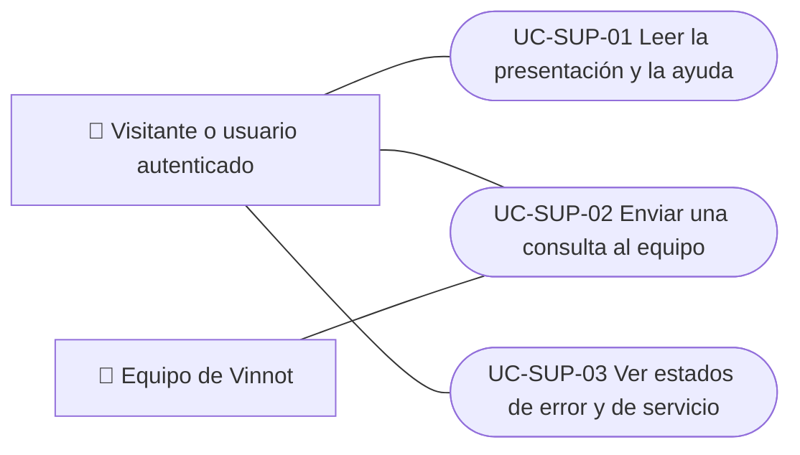

# Casos de uso

Casos de uso de soporte e información pública: leer la presentación de Vinnot y buscar en la ayuda, enviar una consulta al equipo y ver los estados de error y de servicio. Los documentos legales y las cookies están en Legal. Cada caso vale para las plataformas indicadas.

| ID | Caso de uso | Plataformas | Actores |
|---|---|---|---|
| `UC-SUP-01` | [Leer la presentación y la ayuda](uc-sup-01-read-public-information.md) | Web, APK | Visitante o usuario autenticado |
| `UC-SUP-02` | [Enviar una consulta al equipo](uc-sup-02-contact-support.md) | Web, APK | Visitante o usuario autenticado, Equipo de Vinnot |
| `UC-SUP-03` | [Ver estados de error y de servicio](uc-sup-03-service-states.md) | Web, APK | Visitante o usuario autenticado |

## Diagrama de casos de uso

[Ver diagrama de «Casos de uso · Diagrama de casos de uso» completo](https://images.vinnot.com/docs/diagrams/v1/es/modules-support-use-cases-readme-d9ddcc80a035.svg)

## Equivalencia con Lucidchart

| ID | IDs en Lucidchart |
|---|---|
| `UC-SUP-01` | [WEB UC-PUB-01](https://lucid.app/lucidchart/9f11a16b-bb5a-42fc-a9e8-0852b17bd241/edit), [WEB UC-PUB-02](https://lucid.app/lucidchart/9f11a16b-bb5a-42fc-a9e8-0852b17bd241/edit), [APK UC-PUB-01](https://lucid.app/lucidchart/e095dd25-e8ac-41ba-bf5b-396e1055f217/edit) |
| `UC-SUP-02` | [WEB UC-PUB-04](https://lucid.app/lucidchart/9f11a16b-bb5a-42fc-a9e8-0852b17bd241/edit), [WEB UC-PUB-05](https://lucid.app/lucidchart/9f11a16b-bb5a-42fc-a9e8-0852b17bd241/edit), [APK UC-PUB-03](https://lucid.app/lucidchart/e095dd25-e8ac-41ba-bf5b-396e1055f217/edit) |
| `UC-SUP-03` | [WEB UC-PUB-07](https://lucid.app/lucidchart/9f11a16b-bb5a-42fc-a9e8-0852b17bd241/edit), [APK UC-PUB-04](https://lucid.app/lucidchart/e095dd25-e8ac-41ba-bf5b-396e1055f217/edit) |
