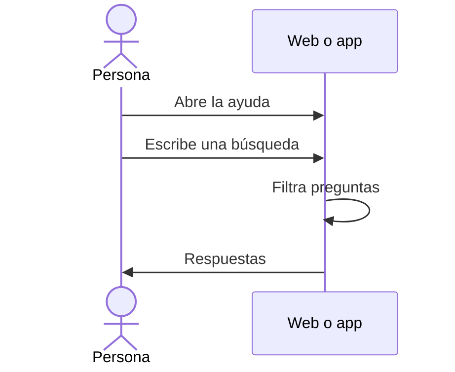

# UC-SUP-01 · Leer la presentación y la ayuda

| Campo | Valor |
|---|---|
| ID | `UC-SUP-01` |
| Módulo | [Soporte e información pública](../README.md) |
| Plataformas | Web, APK |
| Actores | Visitante o usuario autenticado |
| IDs en Lucidchart | [WEB UC-PUB-01](https://lucid.app/lucidchart/9f11a16b-bb5a-42fc-a9e8-0852b17bd241/edit), [WEB UC-PUB-02](https://lucid.app/lucidchart/9f11a16b-bb5a-42fc-a9e8-0852b17bd241/edit), [APK UC-PUB-01](https://lucid.app/lucidchart/e095dd25-e8ac-41ba-bf5b-396e1055f217/edit) |
| Requisitos | [`RF-WEB-SUP-01`](../requirements.md), [`RF-APK-SUP-01`](../requirements.md) |
| Casos de prueba | [`CP-SUP-01`](../testing.md), [`CP-SUP-02`](../testing.md) |

## Precondiciones

- No hace falta iniciar sesión.

## Postcondiciones

- La persona leyó la presentación o encontró una respuesta en la ayuda.

## Flujo principal

1. La persona abre «Acerca de Vinnot» o «Ayuda».
2. El cliente muestra el contenido en su idioma, que viaja con la app y no se pide a la API.
3. En la ayuda, la persona escribe en el buscador.
4. El cliente filtra las preguntas por título y texto, sin distinguir mayúsculas ni acentos.
5. La persona abre una respuesta o sigue a contacto o a los documentos legales.

## Flujos alternativos

- 4a. Ninguna pregunta coincide: se sugiere probar otra búsqueda o escribir al equipo.

## Reglas de negocio

- El contenido público sale de un único archivo compartido por la web y la app.
- Estas páginas no piden aceptar los términos.

## Diagrama

[Ver diagrama de «UC-SUP-01 · Leer la presentación y la ayuda» completo](https://images.vinnot.com/docs/diagrams/v1/es/modules-support-use-cases-uc-sup-01-read-public-information-64fda8f4c289.svg)

Diagrama de componentes en Lucidchart: [WEB UC-PUB-01](https://lucid.app/lucidchart/9f11a16b-bb5a-42fc-a9e8-0852b17bd241/edit), [WEB UC-PUB-02](https://lucid.app/lucidchart/9f11a16b-bb5a-42fc-a9e8-0852b17bd241/edit), [APK UC-PUB-01](https://lucid.app/lucidchart/e095dd25-e8ac-41ba-bf5b-396e1055f217/edit).

## Código

| Capa | Ubicación |
|---|---|
| Web | [`AboutPage.tsx`](../../../../../frontend-react/src/presentation/pages/public/AboutPage.tsx), [`PublicDocumentPage.tsx`](../../../../../frontend-react/src/presentation/pages/public/PublicDocumentPage.tsx), [`public-content.ts`](../../../../../frontend-react/src/domain/public/public-content.ts) |
| App | [`AboutScreen.tsx`](../../../../../frontend-mobile/src/presentation/features/public/AboutScreen.tsx), [`PublicDocumentScreen.tsx`](../../../../../frontend-mobile/src/presentation/features/public/PublicDocumentScreen.tsx), [`public-content.ts`](../../../../../frontend-mobile/src/domain/public/public-content.ts) |

## Tests automáticos

- Backend: Ninguno
- Web: [`public-content.test.ts`](../../../../../frontend-react/src/domain/public/public-content.test.ts), [`public-information.spec.ts`](../../../../../frontend-react/tests/e2e/public-information.spec.ts)
- App: [`public-content.test.ts`](../../../../../frontend-mobile/src/domain/public/public-content.test.ts)
