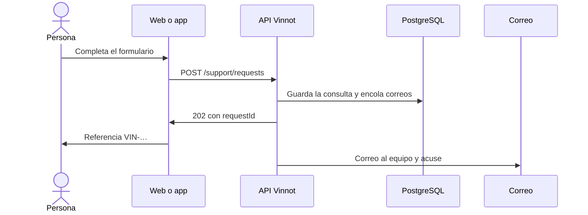

# UC-SUP-02 · Enviar una consulta al equipo

| Campo | Valor |
|---|---|
| ID | `UC-SUP-02` |
| Módulo | [Soporte e información pública](../README.md) |
| Plataformas | Web, APK |
| Actores | Visitante o usuario autenticado, Equipo de Vinnot |
| IDs en Lucidchart | [WEB UC-PUB-04](https://lucid.app/lucidchart/9f11a16b-bb5a-42fc-a9e8-0852b17bd241/edit), [WEB UC-PUB-05](https://lucid.app/lucidchart/9f11a16b-bb5a-42fc-a9e8-0852b17bd241/edit), [APK UC-PUB-03](https://lucid.app/lucidchart/e095dd25-e8ac-41ba-bf5b-396e1055f217/edit) |
| Requisitos | [`RF-WEB-SUP-02`](../requirements.md), [`RF-WEB-SUP-03`](../requirements.md), [`RF-WEB-SUP-04`](../requirements.md), [`RF-APK-SUP-02`](../requirements.md), [`RF-APK-SUP-03`](../requirements.md), [`RF-APK-SUP-04`](../requirements.md) |
| Casos de prueba | [`CP-SUP-03`](../testing.md), [`CP-SUP-04`](../testing.md), [`CP-SUP-05`](../testing.md), [`CP-SUP-06`](../testing.md), [`CP-SUP-07`](../testing.md), [`CP-SUP-08`](../testing.md) |

## Precondiciones

- No hace falta iniciar sesión; con sesión, el correo es el de la cuenta y no se puede cambiar.

## Postcondiciones

- La consulta quedó registrada, el equipo recibe un correo y la persona tiene una referencia.

## Flujo principal

1. La persona abre Contacto.
2. Completa nombre, correo, motivo y mensaje; los motivos son soporte, privacidad, denuncia, revisión de una decisión, colaboración y consulta general.
3. El cliente genera un ID de solicitud y envía `POST /support/requests`.
4. La API valida los datos, guarda la consulta y deja en la cola un correo en inglés para el equipo, con respuesta directa a quien escribió.
5. Deja en la cola un acuse para el correo escrito, en el idioma del formulario, solo con la referencia y el motivo.
6. La API responde 202 con el ID; el cliente muestra la referencia `VIN-…` y permite copiarla.

## Flujos alternativos

- 3a. Falla el envío: el formulario conserva lo escrito y reintentar el mismo contenido reutiliza el ID, sin duplicar la consulta.
- 4a. Llega el mismo ID con otro contenido: la API responde 400.
- 4b. El correo del equipo no está configurado: la API responde 503.
- 3b. Se superó el límite de envíos: la API responde 429 y el cliente indica cuándo reintentar.
- 5a. Esa dirección ya recibió un acuse hoy: no se envía otro.

## Reglas de negocio

- Límites: nombre 100 caracteres, correo 254, mensaje 4000.
- A lo sumo un acuse por dirección y día, para que el formulario no sirva para enviar correos a terceros.
- El formulario pide no escribir contraseñas ni datos de tarjeta.
- Los mensajes no entregados se descartan a los 7 días.

## Diagrama

[Ver diagrama de «UC-SUP-02 · Enviar una consulta al equipo» completo](https://images.vinnot.com/docs/diagrams/v1/es/modules-support-use-cases-uc-sup-02-contact-support-a13a67587a7d.svg)

Diagrama de componentes en Lucidchart: [WEB UC-PUB-04](https://lucid.app/lucidchart/9f11a16b-bb5a-42fc-a9e8-0852b17bd241/edit), [WEB UC-PUB-05](https://lucid.app/lucidchart/9f11a16b-bb5a-42fc-a9e8-0852b17bd241/edit), [APK UC-PUB-03](https://lucid.app/lucidchart/e095dd25-e8ac-41ba-bf5b-396e1055f217/edit).

## Código

| Capa | Ubicación |
|---|---|
| Endpoints | `POST /support/requests` |
| Backend | [`SupportController.java`](../../../../../backend/src/main/java/com/vinnot/support/infrastructure/web/SupportController.java), [`SubmitSupportRequestService.java`](../../../../../backend/src/main/java/com/vinnot/support/application/service/SubmitSupportRequestService.java), [`SupportRequest.java`](../../../../../backend/src/main/java/com/vinnot/support/domain/model/SupportRequest.java), [`JdbcSupportRequestAdapter.java`](../../../../../backend/src/main/java/com/vinnot/support/infrastructure/JdbcSupportRequestAdapter.java) |
| Web | [`ContactPage.tsx`](../../../../../frontend-react/src/presentation/pages/public/ContactPage.tsx), [`useSupportForm.ts`](../../../../../frontend-react/src/presentation/hooks/useSupportForm.ts), [`useSupportReference.ts`](../../../../../frontend-react/src/presentation/hooks/useSupportReference.ts), [`support.service.ts`](../../../../../frontend-react/src/application/services/support.service.ts), [`support.client.ts`](../../../../../frontend-react/src/infrastructure/api/clients/support.client.ts), [`requestId.ts`](../../../../../frontend-react/src/infrastructure/support/requestId.ts), [`support.ts`](../../../../../frontend-react/src/domain/public/support.ts) |
| App | [`ContactScreen.tsx`](../../../../../frontend-mobile/src/presentation/features/public/ContactScreen.tsx), [`useSupportForm.ts`](../../../../../frontend-mobile/src/presentation/hooks/useSupportForm.ts), [`useSupportReference.ts`](../../../../../frontend-mobile/src/presentation/hooks/useSupportReference.ts), [`support.service.ts`](../../../../../frontend-mobile/src/application/services/support.service.ts), [`support.client.ts`](../../../../../frontend-mobile/src/infrastructure/api/clients/support.client.ts) |

## Tests automáticos

- Backend: [`SupportRequestTest.java`](../../../../../backend/src/test/java/com/vinnot/support/domain/model/SupportRequestTest.java), [`SubmitSupportRequestServiceTest.java`](../../../../../backend/src/test/java/com/vinnot/support/application/service/SubmitSupportRequestServiceTest.java), [`SupportControllerTest.java`](../../../../../backend/src/test/java/com/vinnot/support/infrastructure/web/SupportControllerTest.java), [`SupportPostgresIntegrationTest.java`](../../../../../backend/src/test/java/com/vinnot/support/infrastructure/SupportPostgresIntegrationTest.java), [`SupportRequestTemplateTest.java`](../../../../../backend/src/test/java/com/vinnot/notification/infrastructure/template/SupportRequestTemplateTest.java), [`SupportRequestReceivedTemplateTest.java`](../../../../../backend/src/test/java/com/vinnot/notification/infrastructure/template/SupportRequestReceivedTemplateTest.java)
- Web: [`useSupportForm.test.ts`](../../../../../frontend-react/src/presentation/hooks/useSupportForm.test.ts), [`useSupportReference.test.ts`](../../../../../frontend-react/src/presentation/hooks/useSupportReference.test.ts), [`support.service.test.ts`](../../../../../frontend-react/src/application/services/support.service.test.ts), [`support-reference.test.ts`](../../../../../frontend-react/src/domain/public/support-reference.test.ts), [`clipboard.test.ts`](../../../../../frontend-react/src/infrastructure/support/clipboard.test.ts)
- App: [`useSupportForm.test.ts`](../../../../../frontend-mobile/src/presentation/hooks/useSupportForm.test.ts), [`useSupportReference.test.ts`](../../../../../frontend-mobile/src/presentation/hooks/useSupportReference.test.ts), [`support.service.test.ts`](../../../../../frontend-mobile/src/application/services/support.service.test.ts), [`support-reference.test.ts`](../../../../../frontend-mobile/src/domain/public/support-reference.test.ts), [`clipboard.test.ts`](../../../../../frontend-mobile/src/infrastructure/support/clipboard.test.ts)
