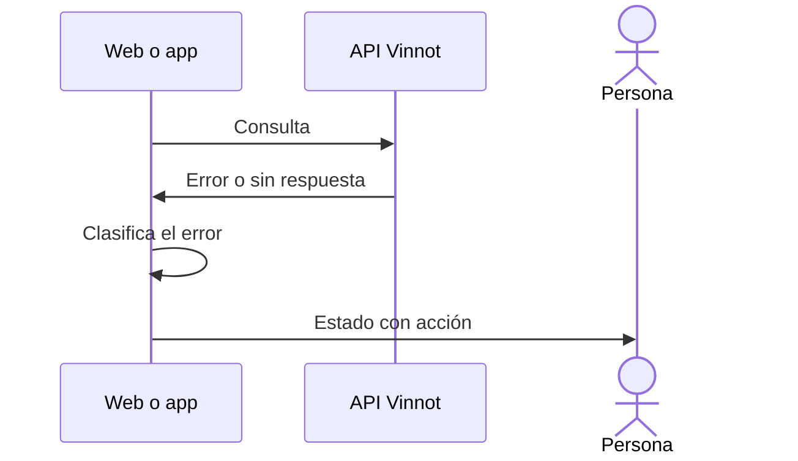

# UC-SUP-03 · Ver estados de error y de servicio

| Campo | Valor |
|---|---|
| ID | `UC-SUP-03` |
| Módulo | [Soporte e información pública](../README.md) |
| Plataformas | Web, APK |
| Actores | Visitante o usuario autenticado |
| IDs en Lucidchart | [WEB UC-PUB-07](https://lucid.app/lucidchart/9f11a16b-bb5a-42fc-a9e8-0852b17bd241/edit), [APK UC-PUB-04](https://lucid.app/lucidchart/e095dd25-e8ac-41ba-bf5b-396e1055f217/edit) |
| Requisitos | [`RF-WEB-SUP-05`](../requirements.md), [`RF-APK-SUP-05`](../requirements.md) |
| Casos de prueba | [`CP-SUP-09`](../testing.md), [`CP-SUP-10`](../testing.md) |

## Precondiciones

- Una pantalla no puede mostrar su contenido por un error o un estado del servicio.

## Postcondiciones

- La persona entiende qué pasó y qué puede hacer.

## Flujo principal

1. Una consulta falla o la persona llega a una dirección que no existe.
2. El cliente clasifica el error: sesión vencida (401), sin permiso (403), no encontrado (404), demasiados pedidos (429), servicio no disponible (502 o 503), demora (504 o tiempo agotado), sin conexión o error del servidor.
3. Muestra una ilustración con un mensaje y la acción que corresponde, como reintentar o volver al inicio.

## Flujos alternativos

- 1a. La dirección no existe: se muestra «no encontrado».

## Reglas de negocio

- Un error nunca se muestra como una lista vacía.
- Cada estado también tiene su propia dirección: `/403`, `/500`, `/503`, `/429`, `/offline` y `/timeout`.

## Diagrama

[Ver diagrama de «UC-SUP-03 · Ver estados de error y de servicio» completo](https://images.vinnot.com/docs/diagrams/v1/es/modules-support-use-cases-uc-sup-03-service-states-b70914553cd6.svg)

Diagrama de componentes en Lucidchart: [WEB UC-PUB-07](https://lucid.app/lucidchart/9f11a16b-bb5a-42fc-a9e8-0852b17bd241/edit), [APK UC-PUB-04](https://lucid.app/lucidchart/e095dd25-e8ac-41ba-bf5b-396e1055f217/edit).

## Código

| Capa | Ubicación |
|---|---|
| Web | [`ServiceStatePage.tsx`](../../../../../frontend-react/src/presentation/pages/public/ServiceStatePage.tsx), [`NotFoundPage.tsx`](../../../../../frontend-react/src/presentation/pages/public/NotFoundPage.tsx), [`ForbiddenPage.tsx`](../../../../../frontend-react/src/presentation/pages/public/ForbiddenPage.tsx), [`ErrorPage.tsx`](../../../../../frontend-react/src/presentation/pages/public/ErrorPage.tsx), [`illustratedState.ts`](../../../../../frontend-react/src/presentation/feedback/illustratedState.ts), [`QueryErrorState.tsx`](../../../../../frontend-react/src/presentation/components/ui/QueryErrorState.tsx) |
| App | [`illustratedState.ts`](../../../../../frontend-mobile/src/presentation/feedback/illustratedState.ts), [`IllustratedState.tsx`](../../../../../frontend-mobile/src/presentation/components/ui/IllustratedState.tsx) |

## Tests automáticos

- Backend: Ninguno
- Web: [`illustratedState.test.ts`](../../../../../frontend-react/src/presentation/feedback/illustratedState.test.ts)
- App: [`illustratedState.test.ts`](../../../../../frontend-mobile/src/presentation/feedback/illustratedState.test.ts)
