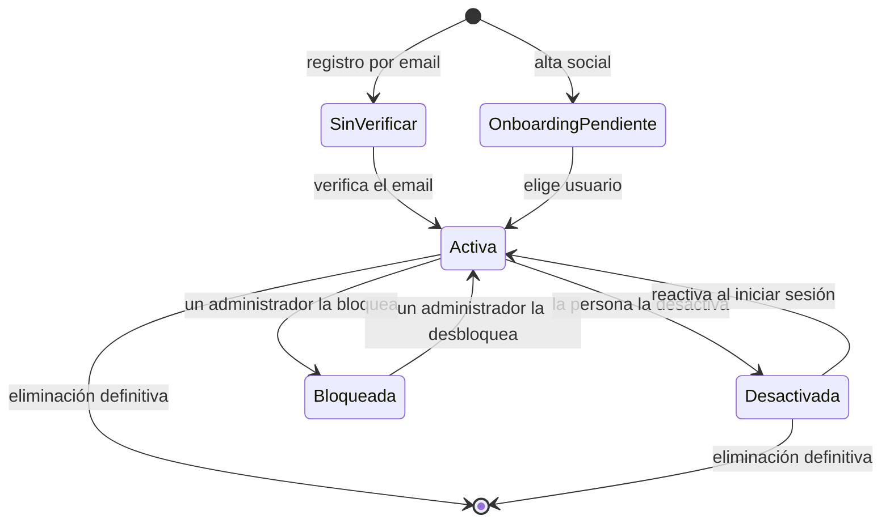
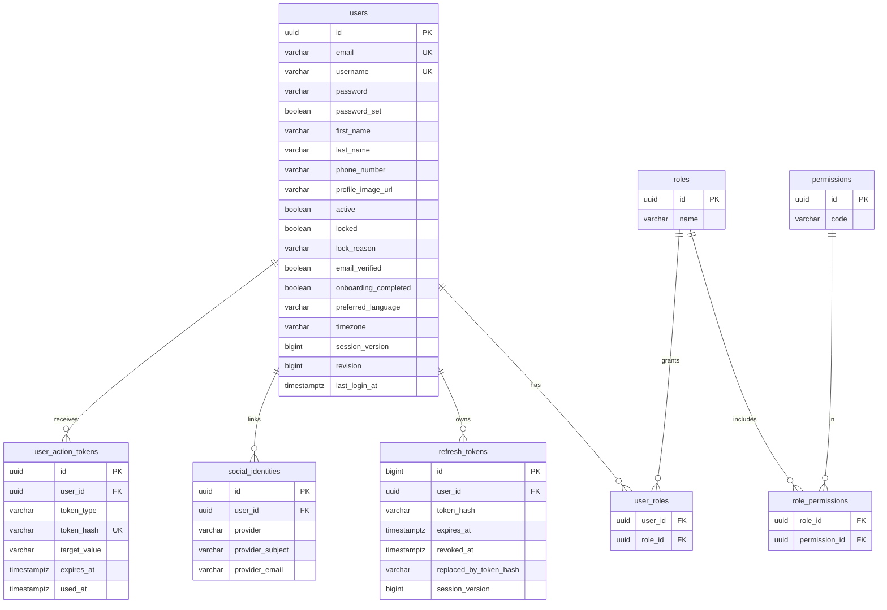

# Usuarios y cuenta

Todo lo que una persona hace con su cuenta: registrarse, verificar el email,
iniciar sesión con contraseña o con Google o Apple, mantener la sesión, editar su
perfil, cambiar contraseña, email o idioma, y desactivar o eliminar la cuenta. En
la app también incluye la bienvenida, el inicio y la navegación por pestañas.

- Código del módulo: `USR`.
- Backend: paquete [`user`](../../../../backend/src/main/java/com/vinnot/user/).
- [Casos de uso](use-cases/README.md) · [Requisitos](requirements.md) ·
  [Arquitectura](architecture.md) · [Pruebas](testing.md)

## Actores

| Actor | Qué hace en este módulo |
|---|---|
| Visitante | Se registra, verifica el email, inicia sesión y recupera la contraseña |
| Usuario autenticado | Mantiene su sesión, edita su perfil y gestiona su cuenta |
| Proveedor de identidad | Google o Apple entregan una credencial que la API valida |
| Servicio de email | Entrega los enlaces de verificación, recuperación y cambio de email, y los avisos de seguridad |

Los roles (`USER`, `MODERATOR`, `PARTNER`, `ADMIN`) están en
[`Role.java`](../../../../backend/src/main/java/com/vinnot/user/domain/valueobject/Role.java). Toda cuenta nueva empieza con
`USER`; los demás roles los asigna un administrador.

## Reglas de negocio

| Regla | Detalle | Dónde |
|---|---|---|
| Nombre de usuario | Se recorta y pasa a minúsculas; 3 a 40 caracteres; letras, números, punto, guion y guion bajo; empieza y termina con letra o número; único | [`Username.java`](../../../../backend/src/main/java/com/vinnot/user/domain/valueobject/Username.java) |
| Contraseña | Al menos 8 caracteres con mayúscula, minúscula y número | [`Password.java`](../../../../backend/src/main/java/com/vinnot/user/domain/valueobject/Password.java) |
| Email | Único; se verifica con un enlace de un solo uso | [`User.java`](../../../../backend/src/main/java/com/vinnot/user/domain/model/User.java) |
| Teléfono | Opcional y privado; formato E.164 (`+` y código de país) | [`User.java`](../../../../backend/src/main/java/com/vinnot/user/domain/model/User.java) |
| Idioma y zona horaria | `es` o `en` e identificador IANA; por defecto `es` y `America/Argentina/Buenos_Aires` | [`PreferredLanguage.java`](../../../../backend/src/main/java/com/vinnot/user/domain/valueobject/PreferredLanguage.java) |
| Sesión | Token de acceso de 15 minutos y de renovación de 7 días, rotado en cada uso | `backend/src/main/resources/application.yml` |
| Revocación | Cambiar contraseña, email o roles, desactivar o bloquear incrementa `sessionVersion` y anula los tokens emitidos antes | [`User.java`](../../../../backend/src/main/java/com/vinnot/user/domain/model/User.java) |
| Enlaces por email | Verificación: 1440 minutos; restablecimiento y cambio de email: 60 minutos; un solo uso | [`AccountActionTokenConfiguration.java`](../../../../backend/src/main/java/com/vinnot/user/infrastructure/config/AccountActionTokenConfiguration.java) |
| Último administrador | El último administrador activo no puede desactivarse ni eliminarse | [`AdminUserSafety.java`](../../../../backend/src/main/java/com/vinnot/user/application/service/AdminUserSafety.java) |
| Alta social | Crea la cuenta con un usuario generado (`vinnoter-…`) y el onboarding pendiente | [`User.java`](../../../../backend/src/main/java/com/vinnot/user/domain/model/User.java) |
| Contraseña propia | `hasPassword` indica si la cuenta tiene una contraseña elegida por su titular (registro, cambio o restablecimiento). Las cuentas creadas con Google o Apple no la tienen hasta usar el enlace de restablecimiento; una cuenta local que después vincula un proveedor la conserva | [`User.java`](../../../../backend/src/main/java/com/vinnot/user/domain/model/User.java) |
| Puntos y sello | Completar el perfil (foto, nombre, apellido y teléfono) suma 5 puntos una sola vez; el encabezado del perfil muestra el sello, los puntos y el progreso (`GET /users/me/points`); una cuenta bloqueada o inactiva oculta el sello y la eliminación definitiva borra los puntos | [Puntos y sellos](../gamification/README.md) |

## Estados de la cuenta

[Ver diagrama de «Estados de la cuenta» completo](https://images.vinnot.com/docs/diagrams/v1/es/modules-users-readme-e19dff35e7f8.svg)

`active`, `locked`, `email_verified` y `onboarding_completed` son columnas
independientes de `users`; el diagrama muestra los recorridos que habilita el
código. Bloquear y desbloquear pertenecen al módulo de administración.

## Dónde vive

| Parte | Ubicación |
|---|---|
| API | Controladores [`AuthController`](../../../../backend/src/main/java/com/vinnot/user/infrastructure/web/controller/AuthController.java), [`BrowserAuthController`](../../../../backend/src/main/java/com/vinnot/user/infrastructure/web/controller/BrowserAuthController.java) (web, con cookie), [`UserController`](../../../../backend/src/main/java/com/vinnot/user/infrastructure/web/controller/UserController.java) y [`ReauthenticationController`](../../../../backend/src/main/java/com/vinnot/user/infrastructure/web/controller/ReauthenticationController.java) |
| Web | Páginas en [`pages/public`](../../../../frontend-react/src/presentation/pages/public/) y [`pages/user`](../../../../frontend-react/src/presentation/pages/user/); sesión en [`AuthProvider`](../../../../frontend-react/src/app/providers/AuthProvider.tsx) |
| App | Pantallas en `frontend-mobile/app/(auth)`, `frontend-mobile/app/(onboarding)` y `frontend-mobile/app/(app)/(tabs)`; sesión en [`AuthProvider`](../../../../frontend-mobile/src/presentation/providers/AuthProvider.tsx) |

El perfil también muestra datos de otros módulos: preferencias de
notificaciones y dispositivos push ([Notificaciones](../notifications/README.md))
y la zona de eventos cercanos ([Eventos y entradas](../events/README.md)). La
aceptación de los términos no aparece en el perfil: se pide antes de entrar a la
aplicación ([Legal](../legal/README.md)).

## Datos

Tablas del módulo, creadas en `V1__baseline_schema.sql` y `V5` y ampliadas en
`V6`, `V7`, `V15`, `V17`, `V28`, `V39`, `V57` y `V62`. Las solicitudes de recuperación
no tienen tabla propia: usan el outbox compartido de efectos externos.

[Ver diagrama de «Usuarios y cuenta · Datos» completo](https://images.vinnot.com/docs/diagrams/v1/es/modules-users-readme-67bb728fdda2.svg)

Todas las claves foráneas hacia `users` usan `ON DELETE CASCADE`. El modelo
completo está en el [DER del backend](../../backend/data/database-model.md).
