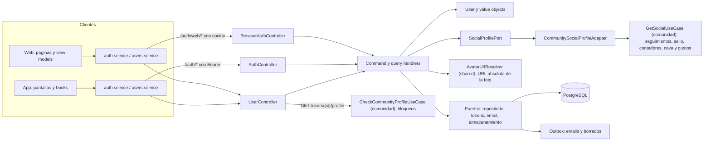
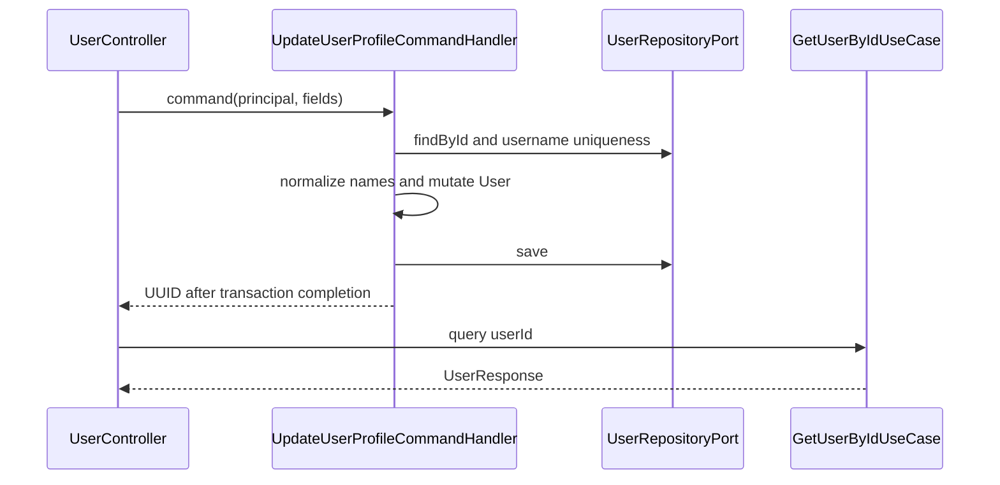

# Arquitectura

Cómo está construido el módulo en cada capa. El backend sigue el flujo hexagonal
`controller → puerto de entrada → handler → dominio → puerto de salida → adaptador`;
la web y la app siguen `pantalla → hook → servicio → cliente API → transporte HTTP`.



[Ver diagrama de «Arquitectura» completo](https://images.vinnot.com/docs/diagrams/v1/es/modules-users-architecture-08b84074b600.svg)

La web usa los endpoints `/auth/web/*`, que guardan el token de renovación en una
cookie HttpOnly; la app usa `/auth/*` con Bearer y guarda los tokens en
SecureStore. Ambas comparten `UserController` para el perfil y la cuenta.

El perfil público se compone entre dos módulos: antes de consultar,
`UserController` le pide a `CheckCommunityProfileUseCase` que rechace con 404 un
perfil con bloqueo en cualquier sentido; después, `GetPublicUserProfileQueryHandler`
carga la cuenta y pide la parte social a `SocialProfilePort`, cuyo adaptador
`CommunitySocialProfileAdapter` llama al puerto de entrada `GetSocialUseCase` de
comunidad y traduce su respuesta. El módulo de usuarios no usa tipos de dominio ni
repositorios de comunidad. Las reseñas y la cava del perfil (`GET /users/{id}/reviews`
y `/cellar`) las sirve `MemberActivityController`, de comunidad.

## Backend

### Alcance

El módulo `user` administra identidad, perfil, onboarding, seguridad de cuenta y
borrado. Sus queries proyectan datos propios y estadísticas de otros módulos a
través de puertos. `UserResponse` incluye el idioma y la zona horaria guardados
en la cuenta (ver [Idioma y zona horaria](#idioma-y-zona-horaria)).

### Consultas

| Endpoint | Acceso | Resultado |
|---|---|---|
| `GET /users` | ADMIN | `PageResult<UserResponse>` |
| `GET /users/{id}` | ADMIN | wrapper de `UserResponse` |
| `GET /users/{id}/profile` | autenticado | wrapper de `PublicUserProfileResponse`; 404 para una cuenta inexistente o inactiva o con un bloqueo en cualquier sentido |
| `GET /users/{id}/reviews` | autenticado | las reseñas aprobadas del miembro (módulo de comunidad) |
| `GET /users/{id}/cellar` | autenticado | la cava visible del miembro (módulo de comunidad) |
| `GET /users/{id}/stats` | ADMIN | wrapper de `UserStatsResponse` |
| `GET /users/me/stats` | autenticado | estadísticas del principal |
| `GET /auth/me` | autenticado | sesión/perfil actual |

El perfil público incluye `id`, `username`, `fullName`, `avatarUrl`, `roles` y
`createdAt`, seguidos de los campos sociales de #541: `bio`, `tier` (la clave del
sello), `followersCount`, `followingCount`, `reviewsCount`, `cellarCount` (`null`
cuando la cava no es visible para quien consulta), `cellarVisible`, `following`
(quien consulta sigue al miembro), `followsYou`, `affinityPercent` (`null` para
uno mismo o cuando alguno valoró menos de cinco vinos), `tasteWheel` (`null` con
menos de cinco vinos valorados; si no, filas `{kind, value, label, score, tone,
ratedWines}`: hasta ocho de cada `GRAPE`, `TYPE` y `REGION`, mejor puntaje
primero, donde `tone` es un código de tipo de vino, `null` para regiones; ver la
[arquitectura de Comunidad](../community/architecture.md)) y `tasteTraits` (`null` con el
mismo umbral salvo que el miembro haya completado el test de gustos o ajustado
un rasgo; si no, `{structure, families, fromQuiz}`: `structure` con filas
`{trait, score, wines, adjusted}` para `ACIDITY`, `BODY`, `TANNIN` y
`SWEETNESS`, puntaje 0–100, donde `adjusted` es verdadero cuando el puntaje es el
valor manual del miembro, `families` con filas `{family, percent}` para `FRUIT`,
`FLORAL`, `HERBAL`, `SPICE`, `OAK` y `MINERAL`, de mayor a menor, y `fromQuiz`
verdadero cuando algún valor mostrado vino del test de gustos porque faltaba el
dato real; los puntajes del test informan `wines: 0`; ver
[Comunidad](../community/architecture.md#test-de-gustos) y
[Paladar ajustable](../community/architecture.md#paladar-ajustable)). No
incluye email, teléfono, flags de cuenta, la configuración de la cava, las
respuestas del test de gustos ni tokens. `GetPublicUserProfileQueryHandler`
carga la cuenta (404 si no existe o está inactiva) y lee los campos sociales a
través de `SocialProfilePort`, que implementa `CommunitySocialProfileAdapter`
sobre el módulo de comunidad; antes, el controller aplica el control de bloqueo
de `CheckCommunityProfileUseCase`. `UserResponse`, usado en perfil propio y
administración, también contiene email, nombres, estado, onboarding,
`preferredLanguage`, `timezone`, proveedores sociales, `hasPassword`, `bio` y
`cellarVisibility`; nunca incluye contraseñas ni hashes.
Los nombres de roles se proyectan con prefijo `ROLE_`.

### Actualización de perfil

`PATCH /users/me` toma el UUID del principal. `UpdateUserProfileCommandHandler`
carga al usuario, normaliza un username presente mediante `Username`, consulta
su unicidad si cambia, aplica nombres y guarda. Devuelve UUID; el controller
consulta `GetUserByIdUseCase` y devuelve la proyección dentro del wrapper.

Campos del perfil social (#541), ambos opcionales (ausente o `null` conserva el
valor):

- `bio` se recorta; un texto en blanco la borra; más de 160 caracteres responde
  400 `BIO_TOO_LONG` (lo valida `User.updateBio`, se guarda en `users.bio`).
- `cellarVisibility` es `PUBLIC` (por defecto), `FOLLOWERS` o `PRIVATE`; cualquier
  otro valor responde 400 `INVALID_CELLAR_VISIBILITY` (`CellarVisibility`, se
  guarda en `users.cellar_visibility`, V87).

Reglas de nombres:

- Si se envía `firstName` o `lastName`, se conservan los campos ausentes y se
  recortan los presentes.
- En ausencia de ambos, `name` mantiene compatibilidad con clientes anteriores.
  Si coincide con el nombre actual o termina en el apellido actual, conserva
  ese apellido; en otro caso usa el texto completo como nombre y apellido vacío.
- `username=null` conserva el existente; un username presente pasa por el value
  object y la comprobación de unicidad.



[Ver diagrama de «Actualización de perfil» completo](https://images.vinnot.com/docs/diagrams/v1/es/modules-users-architecture-5e29bc76872d.svg)

### Avatar

`POST /users/me/avatar` recibe multipart `file` y responde un wrapper con
`avatarUrl`. El controller entrega stream, nombre, MIME y tamaño al caso de uso.
`UploadUserAvatarCommandHandler` carga al usuario y delega el almacenamiento en
`FileStoragePort`, que valida tamaño, firma y formato y genera el nombre.

Después modifica la URL y guarda al usuario. Si la mutación/persistencia falla,
solicita retirar el objeto nuevo y propaga el error; tras guardar solicita retirar
el anterior. La composición concreta usa `TransactionalFileStorageAdapter`: los
borrados se encolan y el worker revalida referencias, no se borra físicamente
desde el handler. La reconciliación previa conserva cleanup si falla el request.
El handler no tiene `@Transactional`; los límites están en repositorio/outbox.
R2 convierte a WebP y conserva inventario durable.
[Storage y compensación](../../backend/use-cases/uploads-and-reference-data.md).

#### Valor guardado y URL que recibe el cliente

`users.profile_image_url` guarda la foto tal como la deja cada origen. Toda
respuesta que lleva una foto la pasa por `AvatarUrlResolver` (puerto de
aplicación en `shared`, implementado por `PublicAvatarUrlResolver`), así el
cliente siempre recibe una URL absoluta (#541):

| Origen | Valor guardado | URL en la respuesta |
| --- | --- | --- |
| Subida con almacenamiento `local` o `s3` | `/api/uploads/avatars/<archivo>` | `app.public-api-base-url` + ruta, sin repetir `/api` (`https://api.vinnot.com/api/uploads/avatars/<archivo>`) |
| Subida con almacenamiento `r2` | `https://images.vinnot.com/...` | sin cambios |
| Inicio con Google o Facebook | enlace del proveedor | sin cambios |
| Sin foto | `null` o vacío | `null` |

`app.public-api-base-url` toma `APP_PUBLIC_API_BASE_URL` (por defecto
`http://localhost:8080/api`). Usan el resolver `GET /auth/me`, la sesión de
login, `GET /users`, `GET /users/{id}`, `PATCH /users/me`, el perfil público,
`POST /users/me/avatar`, las reseñas y comentarios de vinos, las listas de
seguidores y seguidos, sugerencias, feed y reseñas del perfil, y en admin
`GET /admin/users` (con el campo `avatarUrl`) y `GET /admin/reviews`.

#### Foto del inicio social

La regla vive en `User.enrichFromIdentityProvider` y `ProviderPhoto` (dominio):

| Caso | Resultado |
| --- | --- |
| Google entrega `picture` con sufijo de tamaño (`=s96-c`, `=s<n>` o `=s<n>-c` al final) | se guarda con `=s256-c` |
| La cuenta no tiene foto | se guarda la del proveedor |
| La foto guardada es un enlace de proveedor (`googleusercontent.com`, `facebook.com`, `fbcdn.net`, `fbsbx.com`) | se reemplaza en cada inicio social, así un cambio de foto en Google se ve |
| La foto guardada es una subida a Vinnot (`/api/uploads/...` o R2) u otro enlace | nunca se reemplaza |
| El proveedor no entrega foto (Apple) | no cambia nada |

### Password y email

`POST /users/me/change-password` siempre exige `currentPassword` y
`newPassword`: ambos son `@NotBlank`, la nueva contraseña debe medir entre 8 y
100 caracteres y `ChangePasswordCommandHandler` compara la actual contra el hash
persistido antes de validar y guardar la nueva. El cambio incrementa sessionVersion: invalida access y refresh emitidos con la generación anterior. Cambio de
email exige confirmación reciente de identidad (`X-Admin-Reauthentication`, ver
[reautenticación](../../backend/architecture/authentication-and-identity.md#admin-reauthentication))
e inicia un token de acción y no reemplaza inmediatamente la identidad
verificada. La confirmación consume un token single-use con expiración y vuelve
a comprobar unicidad.

`hasPassword` (en `UserResponse` y en el usuario de las respuestas de sesión) refleja
`users.password_set`: es verdadero cuando la contraseña guardada la eligió su titular
(registro, cambio o restablecimiento). Una cuenta creada por un inicio social, o una
cuenta local sin verificar cuya contraseña se revoca cuando un proveedor prueba el email,
guarda el hash de un secreto aleatorio y queda en falso; restablecer la contraseña
lo vuelve verdadero. Vincular un proveedor a una cuenta local verificada no lo cambia.
Los clientes muestran el formulario de cambio cuando es verdadero y el enlace para
definir la contraseña cuando es falso.

### Solicitudes de recuperación

`POST /auth/forgot-password` y `POST /auth/resend-verification` realizan el
mismo trabajo para toda dirección con formato válido, pertenezca o no a una
cuenta: el handler normaliza la dirección y `OutboxAccountRecoveryAdapter`
guarda una fila `ACCOUNT_RECOVERY_REQUESTED` en `external_effects` (payload: la
acción y la dirección; clave: `account-recovery:<UUID aleatorio>`). En la
solicitud no se busca la cuenta ni se envía nada, así la respuesta, su tiempo y
los errores del proveedor de email no revelan si la cuenta existe. El status
HTTP, el cuerpo y los límites de tasa no cambian.

`AccountRecoveryEffectHandler` procesa la fila en la transacción del job del
worker del outbox. `IssueAccountRecoveryService` busca la cuenta y aplica
`AccountRecoveryAction`: el restablecimiento de clave exige una cuenta activa y
no bloqueada, y el reenvío de verificación una cuenta activa y sin verificar.
Una cuenta elegible recibe un token nuevo y su correo igual que antes
(`AccountActionTokenService`); una dirección desconocida o no elegible no
produce efecto. El token, su correo encolado y la eliminación del job se
confirman juntos, así un reintento nunca emite un segundo enlace después de una
ejecución exitosa. Un fallo revierte todo el job, token y correo incluidos, y
el worker registra el intento en una transacción aparte para su backoff. Cada
solicitud emite su propio enlace, como antes. Como las filas contienen una
dirección de email, `AccountRecoveryRetention` elimina las de más de un día,
procesadas o no, y la dirección nunca se registra en logs.

### Diagrama de actividad: registro, verificación e ingreso

Muestra en notación de actividad UML el alta de una cuenta local con aceptación de términos, la verificación del email, el inicio de sesión y la recuperación de la contraseña.

```mermaid
flowchart TD
    start((" ")) --> a1("Completar email, usuario, contraseña y aceptar los términos")
    a1 --> b1("POST /auth/register: validar términos vigentes, email y usuario")
    b1 --> d1{" "}
    d1 -->|"[términos sin aceptar o email/usuario existentes]"| e1("Responder el error de dominio")
    d1 -->|"[válido]"| b2("Crear User y registrar la aceptación legal")
    b2 --> b3("Enviar el email de verificación con token de un solo uso")
    b3 --> u1("Abrir el enlace del email")
    u1 --> b4("POST /auth/verify-email: consumir token; bienvenida la primera vez")
    b4 --> d4{" "}
    d4 -->|"[recuerda la contraseña]"| b6("POST /auth/login: validar credenciales")
    d4 -->|"[la olvidó]"| r1("POST /auth/forgot-password: encolar en el outbox")
    r1 --> r2("Restablecer con el enlace: POST /auth/reset-password")
    r2 --> d4
    b6 --> d3{" "}
    d3 -->|"[credenciales inválidas o cuenta bloqueada]"| e3("AUTH_FAILED o ACCOUNT_LOCKED")
    d3 -->|"[email sin verificar]"| e4("EMAIL_NOT_VERIFIED: reenviar la verificación")
    e4 --> b3
    d3 -->|"[válidas]"| b7("Emitir la sesión")
    e1 & e3 & b7 --> stop(((" ")))
    classDef bar fill:#30262c,stroke:#30262c,color:#30262c
    style start fill:#30262c,stroke:#30262c
    style stop fill:#30262c,stroke:#30262c
```



[Ver diagrama de «Diagrama de actividad: registro, verificación e ingreso» completo](https://images.vinnot.com/docs/diagrams/v1/es/modules-users-architecture-beb4b5df0851.svg)

### Onboarding

`POST /users/me/onboarding` admite un username opcional. Si está presente y no
vacío, lo normaliza y comprueba unicidad; luego ejecuta `completeOnboarding()` y
guarda. Omitir username permite marcar completado sin cambiarlo. Repetir sin
cambios conserva el flag; no crea un segundo recurso. La respuesta se obtiene
con una query posterior de usuario.

### Idioma y zona horaria

`PATCH /users/me/preferences` admite `preferredLanguage` y `timezone`
opcionales; un campo omitido o `null` conserva el valor guardado. El value
object `PreferredLanguage` solo acepta `es` o `en` (sin distinguir mayúsculas)
y `UserTimezone` solo identificadores IANA conocidos por `java.time.ZoneId`
(por ejemplo `Europe/Madrid`; offsets como `+03:00` se rechazan). Los valores
inválidos devuelven `400` con `INVALID_PREFERRED_LANGUAGE` o `INVALID_TIMEZONE`
y no modifican nada. Si los valores no cambian no se escribe, así los clientes
pueden sincronizar en cada login sin incrementar la revisión de la fila. La
respuesta es el wrapper de `UserResponse` actualizado. Los usuarios sin
elección guardada leen `es` y `America/Argentina/Buenos_Aires` (defaults de
V39). Web y mobile envían el idioma activo de la interfaz y la zona horaria del
dispositivo después de cada login o restauración de sesión y cuando el usuario
cambia de idioma; una sincronización fallida nunca bloquea esos flujos. Estos
valores son el idioma y la zona horaria del destinatario de notificaciones.

### Preferencias de notificaciones

`GET /users/me/notification-preferences` devuelve el consentimiento de marketing
(`granted`, `decidedAt`, `source`) y una fila por categoría listada con su
`kind`, los valores `email` y `push` que se entregarían ahora, y `editable`
(falso en las categorías transaccionales). `PUT` recibe
`{marketingConsent?, source: WEB|MOBILE, categories: [{category, email?, push?}]}`
y devuelve la misma forma. Web lo muestra como la pestaña Notificaciones del
perfil y mobile como una hoja que se abre desde el perfil; los interruptores
promocionales quedan deshabilitados mientras el consentimiento está retirado. La página
web pública `/unsubscribe?token=` llama a `POST /notifications/unsubscribe` solo
después de que el usuario hace clic. Las reglas y la entrega están en
[Notificaciones](../notifications/architecture.md).

### Eliminación

`DELETE /users/me` es desactivación reversible: ejecuta `user.deactivate()`,
persiste `active=false` y elimina los refresh tokens y los dispositivos push del usuario. Igual que el
borrado permanente, invoca `AdminUserSafety.requireAnotherActiveAdministrator`:
el último administrador activo y desbloqueado recibe 422 `LAST_ADMIN`.

`DELETE /users/me/permanent` es borrado físico y exige confirmación reciente de
identidad (403 `REAUTHENTICATION_REQUIRED` sin comprobante). Corre en una sola
transacción y, antes de cualquier revocación de Apple, rechaza al último administrador activo
y a quien organiza un evento no cancelado ni terminado con inscripciones pagas o en pago
(422 `ORGANIZER_HAS_UPCOMING_PAID_EVENTS`, vía `UpcomingPaidEventsPort`): borrarlo eliminaría
el evento y la cuenta de cobro que necesitan los reintegros. Si existe una identidad Apple,
el handler exige `appleAuthorizationCode` y `appleClientId`, valida/revoca la
identidad mediante `AppleAuthorizationRevocationPort` y recién después elimina
el usuario. Sin identidad Apple, el body puede omitirse. Las relaciones se
resuelven con las foreign keys CASCADE/SET NULL de Flyway. AccountDeletionIntegrity recalcula ratings, likes y cupos bajo locks en la misma transacción; encola limpieza de avatares y etiquetas administradas. El worker verifica referencias antes de borrar. Los vínculos de denuncias usan SET NULL; la evidencia privada de moderación
conserva el plazo de 90 días desde el cierre descrito en [comunidad](../community/architecture.md).
No se implementa un archivo adicional de cuentas borradas.

### Estadísticas

`GetUserStatsQueryHandler` combina tres puertos en una transacción read-only:

| Fuente | Proyección |
|---|---|
| `ReviewQueryPort.getUserReviewStats` | cantidad de reseñas y promedio de rating |
| `CellarQueryPort.countByUserId` | número de entradas de cava |
| `EventQueryPort.countRegistrationsByUserId` | número de inscripciones |

`eventsAttended` representa el conteo de inscripciones que entrega el puerto,
no una confirmación de presencia física. `UserStatsResponse` conserva aliases
`totalReviews/reviewsCount`, `totalCellarWines/cellarCount` y campos snake_case.
`total_routes_completed` es `0` en esta proyección. Ninguno de estos contadores
es fuente de permisos ni modifica los agregados consultados.

### Seguridad y concurrencia

- sólo `me` modifica perfil propio;
- admin usa controllers/use cases administrativos;
- unicidad de email se respalda con constraint;
- tokens de acción se consumen transaccionalmente;
- `User` transporta la revisión persistida y `UserJpaEntity` usa `@Version`;
  una escritura con revisión obsoleta devuelve `409 CONCURRENT_UPDATE` sin sobrescribir cambios concurrentes;
- respuestas y logs omiten PII no necesaria.

### Eventos de seguridad

`security_events` (V73) registra lo que le pasó a una cuenta: `LOGIN_SUCCEEDED`,
`LOGIN_FAILED`, `LOGIN_LOCKED`, `REFRESH_REUSE_DETECTED`, `PASSWORD_CHANGED`,
`PASSWORD_RESET`, `EMAIL_CHANGED`, `ROLE_CHANGED`, `ACCOUNT_BANNED`,
`ACCOUNT_UNBANNED`, `ACCOUNT_DELETED` y `ACCOUNT_AUTO_SUSPENDED`.

- Los handlers llaman a `SecurityEventRecorder`, que agrega la dirección del
  cliente y el user agent desde `RequestOriginPort`. Su adaptador HTTP lee el
  request actual con la misma regla de dirección del rate limiter, así que la
  capa de aplicación nunca toca HTTP. El user agent se corta a 256 caracteres.
- `JdbcSecurityEventAdapter` escribe la fila después de que confirma la
  transacción de la acción, en una transacción propia. Una acción revertida no
  deja evento, y un insert fallido se registra en el log y nunca hace fallar la
  acción.
- `user_id` es `ON DELETE SET NULL`: eliminar una cuenta quita en el acto el
  vínculo con la persona y conserva las filas desvinculadas como evidencia hasta
  la purga.
- `PurgeExpiredSecurityEventsCommandHandler` borra una vez por día, en lotes,
  las filas más antiguas que `app.security.events.retention` (`P180D`).
- Las acciones de administración registran la cuenta afectada; la fila no tiene
  columna de actor.

### Pruebas

Cubrir ownership, patch parcial, unicidad concurrente, avatar inválido y
compensación, password incorrecto, token expirado/consumido, onboarding repetido,
soft/permanent delete y revocación de sesión.

### Endpoints relacionados

`GET /users`, `GET /users/{id}`, `GET /users/{id}/profile`, stats,
`PATCH /users/me`, onboarding, avatar, change-password, email-change, preferencias de
notificaciones y las dos variantes de delete. El catálogo completo está en [API](../../backend/architecture/api.md).

### Trazabilidad de implementación

- `user/infrastructure/web/controller/UserController.java`.
- `user/application/command/handler/UpdateUserProfileCommandHandler.java`.
- `user/application/command/handler/CompleteUserOnboardingCommandHandler.java`.
- `user/application/command/handler/UploadUserAvatarCommandHandler.java`.
- `user/application/query/handler/GetUserStatsQueryHandler.java`.
- `user/infrastructure/persistence/adapter/AccountDeletionIntegrity.java`.

Rutas relativas a `backend/src/main/java/com/vinnot`. Ver [identidad](../../backend/architecture/authentication-and-identity.md), [uploads](../../backend/use-cases/uploads-and-reference-data.md) y [DER](../../backend/diagrams/relational-model.md).

La limpieza física es durable y posterior al commit; consultar [sesiones y efectos externos](../../backend/architecture/session-and-data-integrity.md).

### Presentación de correos transaccionales

Verificación, recuperación de contraseña, confirmación de nuevo correo y aviso al
correo anterior son tipos del [módulo de notificaciones](../notifications/architecture.md).
`AccountActionTokenService` y `ConfirmEmailChangeCommandHandler` los encolan en
la transacción de la cuenta (para reenvío de verificación y olvido de clave, en
el job de recuperación descrito arriba); el worker del outbox los entrega, así una caída del
proveedor de email no hace fallar registro, reenvío de verificación, olvido de
clave ni cambio de correo. Sus textos viven en `email/account_es.properties` y
`email/account_en.properties`, y todos los correos usan `BrandedEmailTemplate` y `email/branded-message.html`, en
`shared/infrastructure` y recursos del backend. El shell común fija banner,
logo, ilustración, título, contenido y footer con enlaces a portada, contacto y
privacidad. HTML usa tablas, estilos inline, fuentes de sistema y ajustes para
pantallas pequeñas/modo oscuro; cada mensaje conserva una alternativa de texto.
Los correos de acción incluyen botón y enlace visible con el mismo token.

Los correos de cuenta se escriben en el `preferredLanguage` del usuario (`es` o
`en`), leído al encolar el correo; el aviso al correo anterior después de un
cambio de correo usa el idioma del mismo usuario. El aviso interno de soporte
sigue en inglés, con footer en ese idioma; el idioma de los demás tipos figura en
el [módulo de notificaciones](../notifications/architecture.md#tipos-de-notificación-actuales).
El HTML escapa nombres, correos, vino, estado y motivo antes de insertarlos; los
asuntos/destinatarios/tokens y las reglas de entrega no cambian. Los valores con
aspecto de placeholder no se vuelven a interpretar como plantilla.

Assets y enlaces informativos usan `app.auth.frontend-base-url`, el mismo destino
de los flujos de cuenta. Se reutilizan PNG del logo y la ilustración de viñedo
servidos por web; no se adjuntan imágenes, scripts ni píxeles de tracking. Una
imagen bloqueada no contiene el contenido funcional ni el CTA. El proveedor
`log` sigue sin enviar correos. Los cambios quedan en adaptadores; dominio,
puertos y casos de uso no dependen de HTML ni SES.

Para exportar todas las notificaciones renderizadas con destinatarios y tokens ficticios:

```sh
mvn -q -f backend/pom.xml -Dtest=NotificationEmailPreviewTest \
  -Dvinnot.email.preview.directory=backend/target/email-previews test
```

Requiere Java/Maven del backend; el test renderiza las plantillas reales y
guarda HTML/texto en el directorio indicado. No llama AWS ni envía correos. Revisar HTML en navegador no certifica Gmail,
Apple Mail ni Outlook reales; su aceptación se registra por separado.

### Teléfono privado reutilizable

`PATCH /users/me` acepta `phoneNumber` opcional: ausente o `null` conserva el valor; texto vacío lo elimina. Un valor no vacío debe incluir `+` y el código de país. El caso de uso invoca el puerto `PhoneNumberNormalizer`; el adapter de libphonenumber valida el plan de numeración y devuelve E.164. No se infiere país por GPS ni se considera el teléfono verificado por SMS.

La migración aditiva `V28__add_private_user_phone.sql` agrega `users.phone_number` nullable y una restricción de formato. `User` admite sólo valor canónico o null. Se incluye en las respuestas privadas de sesión/perfil y administración; `PublicUserProfileResponse` no lo expone. Los clientes anteriores que omiten el campo no lo borran.

En una inscripción, `contactPhone` es una copia independiente. `saveContactPhone=true` actualiza el perfil en la misma transacción que crea la reserva y actualiza el cupo; por defecto es false. Cambiar o borrar el teléfono del perfil no reescribe reservas anteriores. La UI explica qué contacto recibe el organizador y ofrece guardar para próximas reservas sin preseleccionar esa opción.

## Web

### Confirmación escrita de eliminación permanente

Antes de solicitar la eliminación, el popup exige escribir `acepto borrar cuenta`
en español o `I agree to delete my account` en inglés, según el idioma de la interfaz.
Sólo se ignoran espacios al principio y al final; no se admiten frases incompletas.
Cancelar o cerrar y volver a abrir reinicia el texto. La desactivación conserva su
confirmación simple y no elimina la cuenta.

Si la cuenta tiene Apple en `socialProviders`, su autorización adicional ocurre después de la
confirmación escrita. Los envíos repetidos se bloquean durante la autorización y
la solicitud. Un error no elimina la sesión ni simula éxito. En mobile, el diálogo
usa safe areas, desplazamiento y ajuste de teclado; no contiene llamadas HTTP:
`usePermanentAccountDeletion` orquesta los hooks de cuenta existentes. En web,
`ConfirmDialog` admite `typedConfirmation` y el view model conserva el flujo de
eliminación y limpieza de sesión. El contrato y las reglas del backend no cambian.


### Alcance y actores

El visitante se registra, verifica su email, inicia sesión o recupera acceso.
El usuario autenticado completa onboarding y administra su cuenta.
El proveedor social entrega una credencial; el backend valida esa credencial y
emite la sesión de Vinnot. Un token Google/Apple/Facebook no sustituye el Bearer
de Vinnot en las consultas de producto.

### Entradas y precondiciones

| Operación | Entrada | Resultado para el cliente |
|---|---|---|
| Registro | Usuario, email, contraseña y nombre | Resultado de registro y circuito de verificación |
| Login | Usuario/email y contraseña | Usuario + access en memoria; refresh en cookie HttpOnly |
| Social | Proveedor y credencial obtenida por adapter | Usuario + sesión, con onboarding si falta |
| Recuperación | Email; luego token y contraseña nueva | Confirmación de solicitud o de cambio |
| Verificación/email | Token del enlace de acción | Confirmación o error de token |
| Perfil | Campos editables del usuario actual | Usuario actualizado |
| Contraseña | Contraseña actual y nueva | Confirmación; backend valida credenciales |
| Baja/eliminación | Confirmación del titular | Operación de cuenta; luego cierre de sesión |

Los formularios usan los validadores del módulo `domain/user`. El backend sigue
siendo autoridad sobre unicidad, expiración de enlaces, propiedad de cuenta y
revocación. No se deduce el éxito de registro como una sesión autenticada.

### Login y autenticación social

1. Presentación obtiene y valida la entrada.
2. Login usa `authService`; social obtiene primero una credencial mediante
   `socialAuthService` y su adapter de plataforma.
3. `/auth/web/login` o `/auth/web/social` devuelve usuario y access; el navegador recibe el refresh mediante Set-Cookie, no JSON.
   Si la API responde `ACCOUNT_DEACTIVATED`, `useLoginViewModel` pide confirmar la
   reactivación y repite el mismo acceso (contraseña o proveedor) con `reactivate: true`.
4. El store publica la identidad en memoria; la cookie conserva la capacidad de restaurar la sesión.
5. Un perfil incompleto conduce a `complete-profile`; completar onboarding
   actualiza al usuario, incluyendo el username elegido o generado.

La fachada `auth.store.ts` despacha acciones Redux sin persistir credenciales.
`AuthProvider` observa cambios de identidad y limpia QueryClient. Login recibe
intención de retorno desde query/state y la valida con `internalReturnPath`:
sólo rutas internas, sin doble slash, esquemas, controles ni barras inversas,
incluidas variantes codificadas. Un retorno inválido usa el destino por defecto.

### Disponibilidad de proveedores

`VITE_FEATURE_SOCIAL_LOGIN=false` oculta el bloque social completo. Facebook se
oculta en `VITE_APP_ENV=production`; fuera de producción puede desactivarse con
`VITE_FEATURE_FACEBOOK_LOGIN=false`. La misma política se aplica en el gateway,
antes de cargar el SDK, y el layout distribuye los proveedores restantes en dos
columnas. No se modifica el login por contraseña, Google ni Apple. El backend
productivo también mantiene las credenciales de Facebook vacías; ocultar un botón
no sustituye la validación del servidor.

### Restauración y renovación

Sin access en memoria, `initSession` llama `/auth/web/refresh` con credenciales
de navegador y luego `/auth/me`. La cookie `__Host-vinnot-refresh` es HttpOnly,
Secure, SameSite=Strict, host-only y Path=/. El backend exige Origin autorizado
y `X-Vinnot-Web-Session: 1`. En local HTTP se usa `vinnot-refresh` sin Secure.
Los contratos nativos no cambian. `isInitializing` evita redirecciones prematuras.

El registro antiguo de localStorage se elimina al leerlo; sólo su refresh se
retiene temporalmente en memoria para migrarlo por rotación. No se restaura el
usuario ni el access legacy. Si esa migración se interrumpe y se recarga la página,
puede requerirse iniciar sesión nuevamente. Los fallos transitorios no se tratan
como credenciales incorrectas.

El transporte comparte la renovación entre requests elegibles concurrentes.
Excluye `/auth/*` y requests ya reintentadas para no formar un ciclo de 401.

### Perfil, enlaces y seguridad de cuenta

Cambio de email es solicitud más confirmación de enlace; no se interpreta
actualizar un input como email verificado. Recuperación valida el token antes
de completar el cambio. El avatar tiene una operación de upload separada del
formulario de datos y solo se cambia subiendo un archivo; el perfil no tiene campo
de URL. Las estadísticas se consultan como recurso remoto. La pestaña de seguridad
muestra el formulario de cambio de contraseña cuando `user.hasPassword` es verdadero y,
si no, el botón que envía el enlace para definirla.

Desactivar y eliminar son operaciones distintas. El servicio de eliminación
admite información de autorización Apple para el circuito de revocación del
proveedor. La UI no debe registrar contraseñas ni tokens de enlaces en mensajes
de diagnóstico.

### Acceso y salida

`ProtectedRoute` conserva pathname/search/hash en `returnUrl` al redirigir a
login. Admin y partner agregan roles mediante layouts. Un guard de presentación
no concede autorización sobre un recurso backend.

Logout solicita cierre backend y limpia identidad local. El comportamiento de
caché y persistencia pertenece a los componentes de sesión y
[estado remoto](../../frontend-web/architecture/remote-state-and-transport.md), no a los
formularios. La UI separa error de campo, rechazo de credenciales y fallo de red.

### Diagrama y verificación

Consultar [secuencias funcionales](../../frontend-web/diagrams/product-processes.md) para login
social y recuperación de datos. Los tests de auth service validan mapping y
errores; los de presentación comprueban redirección y transición de estado
donde existen. La [estrategia de pruebas](../../frontend-web/testing/strategy.md) define alcance
y comandos sin confundir un test mockeado con validación del proveedor real.

### Evidencia

- [src/presentation/stores/auth.store.ts](../../../../frontend-react/src/presentation/stores/auth.store.ts)
- [src/application/services/auth.service.ts](../../../../frontend-react/src/application/services/auth.service.ts)
- [src/application/services/socialAuth.service.ts](../../../../frontend-react/src/application/services/socialAuth.service.ts)
- [src/presentation/pages/public/useAccountActionViewModels.ts](../../../../frontend-react/src/presentation/pages/public/useAccountActionViewModels.ts)
- [src/presentation/pages/user/useUserProfileViewModel.ts](../../../../frontend-react/src/presentation/pages/user/useUserProfileViewModel.ts)

### Aislamiento de sesión y respuestas tardías

Cada inicio/cierre cambia sessionGeneration. Respuestas de login, bootstrap y refresh de una generación anterior no pueden restaurar identidad ni sobrescribir la actual. Logout limpia estado y caché privados sin esperar la respuesta remota. Fallos de persistencia no impiden limpiar la memoria.

Login, refresh y logout se serializan; Web Locks coordina pestañas cuando está
disponible. Los eventos entre pestañas no contienen credenciales. Un logout sin
red deja una marca no secreta de revocación pendiente y bloquea restauración
automática hasta reintentar el cierre o iniciar una sesión explícitamente.
Si storage está bloqueado, la coordinación local sigue en memoria; no se promete
persistencia del marcador ni comunicación entre pestañas bajo esa restricción.

### Confirmación de operaciones administrativas

`REAUTHENTICATION_REQUIRED` (403) abre un diálogo de contraseña antes de cambiar
usuarios/roles/bloqueos o eliminar recursos como ADMIN. Se renueva primero el access
y se pide `/auth/reauthenticate`; el comprobante dura cinco minutos, está ligado
al usuario y al access actual y sólo vive en memoria. La operación se reintenta
una vez con `X-Admin-Reauthentication`. Cancelar, salir o cambiar de cuenta
descarta el comprobante y no ejecuta la operación pendiente. Si
`user.socialProviders` incluye Google o Apple, el diálogo ofrece esos botones
(reusa `AuthSocialButtons` con `providers` y el gateway Apple del navegador)
sobre el formulario de contraseña: `useReauthentication` →
`reauthenticationService.confirmWithProvider` → `authClient.reauthenticate`
envía `{provider, token, nonce?}` con un token recién obtenido. Un token
rechazado mantiene el diálogo con `reauthentication.providerFailed`. La
contraseña y el enlace a recuperación siguen disponibles.

### Presentación de proveedores

`AuthSocialButtons` comparte símbolos vectoriales con native y mantiene cada
acción en un botón accesible. Estado ocupado o envío de formulario bloquea las
acciones para evitar solicitudes concurrentes. Con un cliente configurado,
Google carga su SDK al entrar a login o registro y prepara el control oficial
`GoogleLogin` en modo icono circular, sin un ancho fijo de 400 px. No abre el login
automáticamente: el primer clic sobre el control listo inicia la autenticación,
sin una selección previa que reemplace el logo. Mientras carga, muestra el símbolo
y un estado accesible; el control permanece bloqueado hasta estar listo. Un
fallo del script ofrece Reintentar; un error de credencial conserva el control
listo y nunca envía tokens vacíos. La credencial se entrega al ViewModel, y el
estado ocupado bloquea acciones sin desmontar el botón. Un estilo limitado al
contenedor del logo oficial restaura su `content-box` bajo el reset CSS: conserva
los 18×18 px y el centrado nativos. Cada proveedor reserva 40×40 px para su
símbolo, alineando también las etiquetas. Apple y Facebook
conservan sus callbacks hacia el servicio social. Native ya inicia Google con
el primer toque, sin esta etapa de selección. Las pruebas controladas no sustituyen
la configuración de clientes y orígenes autorizados de los proveedores.

## App

### Confirmación escrita de eliminación permanente

Antes de solicitar la eliminación, el popup exige escribir `acepto borrar cuenta`
en español o `I agree to delete my account` en inglés, según el idioma de la interfaz.
Sólo se ignoran espacios al principio y al final; no se admiten frases incompletas.
Cancelar o cerrar y volver a abrir reinicia el texto. La desactivación conserva su
confirmación simple y no elimina la cuenta.

Si la cuenta tiene Apple en `socialProviders`, su autorización adicional ocurre después de la
confirmación escrita. Los envíos repetidos se bloquean durante la autorización y
la solicitud. Un error no elimina la sesión ni simula éxito. En mobile, el diálogo
usa safe areas, desplazamiento y ajuste de teclado; no contiene llamadas HTTP:
`usePermanentAccountDeletion` orquesta los hooks de cuenta existentes. En web,
`ConfirmDialog` admite `typedConfirmation` y el view model conserva el flujo de
eliminación y limpieza de sesión. El contrato y las reglas del backend no cambian.


### Confirmación sensible y enlaces entrantes

Native conserva Bearer y SecureStore; no utiliza el contrato de cookies web.
El transporte descarta respuestas de una generación anterior de sesión.

El diálogo compartido de reautenticación aparece ante
`REAUTHENTICATION_REQUIRED` para cambios sensibles ADMIN. Renueva access,
solicita contraseña Vinnot y obtiene un comprobante de cinco minutos ligado a
esa credencial. Sólo vive en memoria. Cancelar o cambiar de cuenta impide el
reintento de la acción pendiente; un error de contraseña mantiene el diálogo.
Si `user.socialProviders` incluye Google (o Apple en iOS), el diálogo ofrece
esos botones (`AuthSocialButtons` con `providers`) junto a la contraseña:
`useReauthentication.confirmWithProvider` obtiene un token nuevo con
`socialAuthService.acquire` y lo envía con
`reauthenticationService.confirmWithProvider`. Un rechazo mantiene el diálogo
con `reauthentication.providerFailed`; también se ofrece recuperación. La protección del
servidor también se aplica a clientes anteriores: éstos deben actualizarse para
completar las acciones sensibles con el nuevo diálogo.

`useSingleAction` (`presentation/hooks/useSingleAction.ts`) mantiene una única
intención del usuario pendiente durante la reautenticación y su reintento
automático, e ignora toques repetidos mientras está en curso. Lo usan
`app/(app)/admin/{events,wines,wineries,routes}.tsx` y
`app/(app)/partner/index.tsx`.

`ReauthenticationProvider` mantiene un único controlador de la confirmación.
Si está abierto un `AdminDetailSheet`, `ReauthenticationHost` muestra el formulario
dentro de ese modal nativo; evita presentar un segundo modal que iOS podría
ocultar y dejar esperando el cambio de rol. El contenido del panel queda
inactivo y fuera del árbol accesible mientras se confirma. Cancelar (también
con el botón atrás de Android) libera la operación y conserva la selección;
recuperar contraseña cierra primero el panel. Sin panel activo se usa el modal
global. No cambia el comprobante ni la autorización del backend.

`app/+native-intent.tsx` delega la validación a
`domain/navigation/nativeIntent.ts` antes del parser de Expo Router. Acepta
hasta 4096 caracteres, exige percent-encoding UTF-8 válido y rechaza controles.
Conserva enlaces válidos y sus tokens sin reescribirlos; ante entrada inválida
retorna a /. Se aplica tanto con la app cerrada como abierta. No sustituye
verificación de tokens, guards ni autorización backend.

Referencia de integración:
[Expo Router native intent](https://docs.expo.dev/router/advanced/native-intent/).


### Alcance y actores

El visitante se registra, verifica su email, inicia sesión o recupera acceso.
El usuario autenticado completa onboarding y administra su cuenta.
El proveedor social entrega una credencial; el backend valida esa credencial y
emite la sesión de Vinnot. Un token Google/Apple/Facebook no sustituye el Bearer
de Vinnot en las consultas de producto.

### Entradas y precondiciones

| Operación | Entrada | Resultado para el cliente |
|---|---|---|
| Registro | Usuario, email, contraseña y nombre | Resultado de registro y circuito de verificación |
| Login | Usuario/email y contraseña | Usuario + access/refresh token |
| Social | Proveedor y credencial obtenida por adapter | Usuario + sesión, con onboarding si falta |
| Recuperación | Email; luego token y contraseña nueva | Confirmación de solicitud o de cambio |
| Verificación/email | Token del enlace de acción | Confirmación o error de token |
| Perfil | Campos editables del usuario actual | Usuario actualizado |
| Contraseña | Contraseña actual y nueva | Confirmación; backend valida credenciales |
| Baja/eliminación | Confirmación del titular | Operación de cuenta; luego cierre de sesión |

Los formularios usan los validadores del módulo `domain/user`. El backend sigue
siendo autoridad sobre unicidad, expiración de enlaces, propiedad de cuenta y
revocación. No se deduce el éxito de registro como una sesión autenticada.

### Login y autenticación social

1. Presentación obtiene y valida la entrada.
2. Login usa `authService`; social obtiene primero una credencial mediante
   `socialAuthService` y su adapter de plataforma.
3. La respuesta de Vinnot se mapea a usuario y tokens.
4. El store publica la nueva identidad y la persistencia conserva la sesión.
5. Un perfil incompleto conduce a `complete-profile`; completar onboarding
   actualiza al usuario, incluyendo el username elegido o generado.

El thunk de login reinicia `appApi` y persiste mediante `authSessionService`.
La persistencia es best-effort: un fallo de almacenamiento no convierte una
respuesta de login válida en credenciales incorrectas.

### Restauración y renovación

Al iniciar, `initSession` lee usuario y tokens persistidos. Sin tokens devuelve
sesión anónima. Si sólo hay refresh, renueva antes de consultar `/auth/me`.
Si `/auth/me` rechaza el access y existe refresh, renueva y vuelve a consultar.
Un error transitorio normalizado de red, 429 o 5xx puede conservar usuario y
access previamente almacenados; eso no sustituye la autorización del backend.

La persistencia se encapsula en `authSessionService` y su adapter SecureStore.
El estado `isInitializing` diferencia bootstrap de una sesión anónima resuelta.

El transporte comparte la renovación entre requests elegibles concurrentes.
Excluye `/auth/*` y requests ya reintentadas para no formar un ciclo de 401.

### Perfil, enlaces y seguridad de cuenta

Cambio de email es solicitud más confirmación de enlace; no se interpreta
actualizar un input como email verificado. Recuperación valida el enlace con
`POST /auth/reset-password/validate` antes de mostrar el formulario
(`usePasswordResetLink`): mientras lo comprueba muestra «Estamos revisando el enlace…»
y, si está usado, vencido o es inválido, explica el motivo y ofrece «Pedir un enlace
nuevo». El avatar tiene una operación de upload separada del
formulario de datos. Las estadísticas se consultan como recurso remoto.
La acción de contraseña de Perfil abre el formulario de cambio cuando
`user.hasPassword` es verdadero y, si no, envía el enlace para definirla.
La tarjeta «Vinos en bodega» abre la cava autenticada, incluso con conteo cero.
`StatsRow` recibe un callback de presentación y no conoce router ni HTTP.
Perfil muestra Bodega y Reseñas para todas las cuentas; Eventos y Rutas sólo
cuando `hasRole` incluye PARTNER o ADMIN. MODERATOR por sí solo no habilita esas
estadísticas. Cambiar de rol reevalúa la visibilidad sin fabricar métricas:
los conteos conservan la semántica del contrato de estadísticas actual.

Desactivar y eliminar son operaciones distintas. El servicio de eliminación
admite información de autorización Apple para el circuito de revocación del
proveedor. La UI no debe registrar contraseñas ni tokens de enlaces en mensajes
de diagnóstico.

### Acceso y salida

`AuthGuard` protege el shell `(app)` y sus pantallas funcionales.
`RoleGuard` añade roles en admin/partner. Las rutas raíz de información pública
quedan fuera de estos guards.

Logout solicita cierre backend y limpia identidad local. El comportamiento de
caché y persistencia pertenece a los componentes de sesión y
[estado remoto](../../frontend-mobile/architecture/remote-state-and-transport.md), no a los
formularios. La UI separa error de campo, rechazo de credenciales y fallo de red.

### Diagrama y verificación

Consultar [secuencias funcionales](../../frontend-mobile/diagrams/product-processes.md) para login
social y recuperación de datos. Los tests de auth service validan mapping y
errores; los de presentación comprueban redirección y transición de estado
donde existen. La [estrategia de pruebas](../../frontend-mobile/testing/strategy.md) define alcance
y comandos sin confundir un test mockeado con validación del proveedor real.

### Evidencia

- [src/presentation/store/authSlice.ts](../../../../frontend-mobile/src/presentation/store/authSlice.ts)
- [src/application/services/auth.service.ts](../../../../frontend-mobile/src/application/services/auth.service.ts)
- [src/application/services/authSession.service.ts](../../../../frontend-mobile/src/application/services/authSession.service.ts)
- [src/application/services/users.service.ts](../../../../frontend-mobile/src/application/services/users.service.ts)
- [src/presentation/navigation/guards.tsx](../../../../frontend-mobile/src/presentation/navigation/guards.tsx)

### Aislamiento de sesión y respuestas tardías

Cada inicio/cierre cambia sessionGeneration. Respuestas de login, bootstrap y refresh de una generación anterior no pueden restaurar identidad ni sobrescribir la actual. Logout limpia estado y caché privados sin esperar la respuesta remota. Fallos de persistencia no impiden limpiar la memoria.

SecureStore conserva un snapshot JSON atómico bajo vinnot.auth.session.v3. Las operaciones completas se serializan. La lectura admite las claves legacy sólo cuando no existe snapshot; un tombstone anónimo impide resucitar credenciales legacy si falla su eliminación. No se mezclan access/refresh/usuario de diferentes escrituras.


#### Renovación móvil recuperable

`sessionRenewalService` comparte una renovación por store/generación de sesión.
Antes de llamar a `/auth/refresh`, SecureStore guarda un `rotationId` aleatorio
junto al refresh token anterior. Este ID opcional permite recuperar únicamente
el mismo sucesor directo, todavía válido, si se perdió la respuesta. No extiende
su vencimiento ni omite logout, estado de cuenta o versión de sesión. Los
clientes anteriores y las cookies web conservan su contrato.

La clave v3 usa `AFTER_FIRST_UNLOCK_THIS_DEVICE_ONLY` y migra leyendo v2/claves
legacy. Si falla guardar la intención, no se envía la petición; si falla guardar
el resultado, se conserva la intención para reintentar incluso tras reiniciar.
Actualizar el perfil preserva tokens y operaciones pendientes. Se respeta el
Bearer explícito del bootstrap y remontar el provider no reinicia un bootstrap
en curso o completado. Las credenciales no pasan a AsyncStorage ni a logs.

Los consumidores tardíos que aún tienen el token padre reutilizan el resultado ya persistido; logout descarta este resultado en memoria. Las renovaciones fallidas permiten reintentar.

### Presentación de registro y cuenta

Registro presenta proveedores habilitados antes del formulario, con el separador
«O registrate con tu correo». Apple mantiene su disponibilidad en iOS; mover los
botones no modifica consentimiento, validación ni adquisición de credenciales.
Los paneles de perfil, cuenta/correo, contraseña, avatar e idioma comparten safe
areas, teclado y retorno explícito; las acciones siguen en sus hooks existentes.
