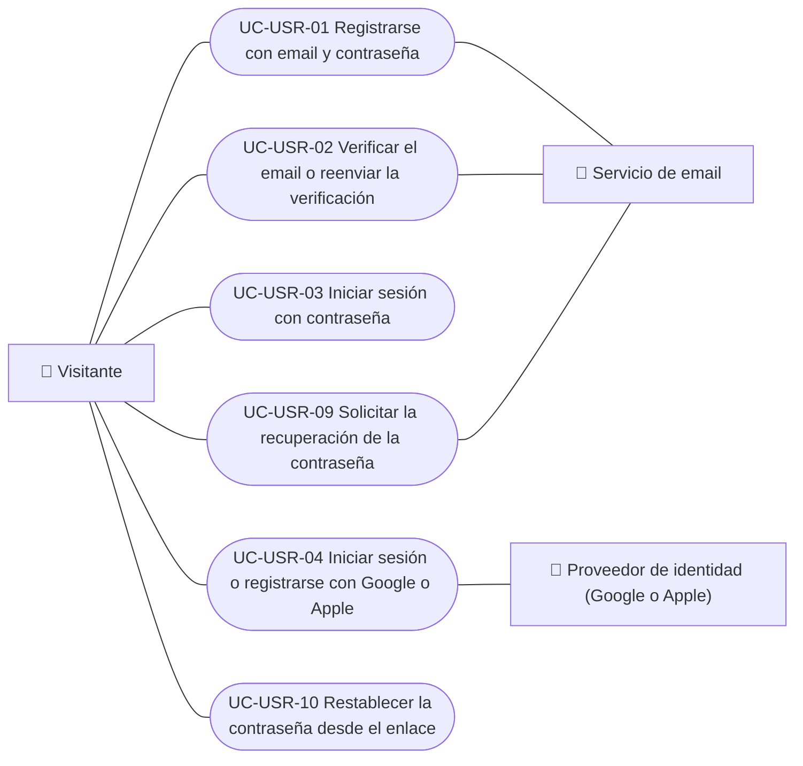
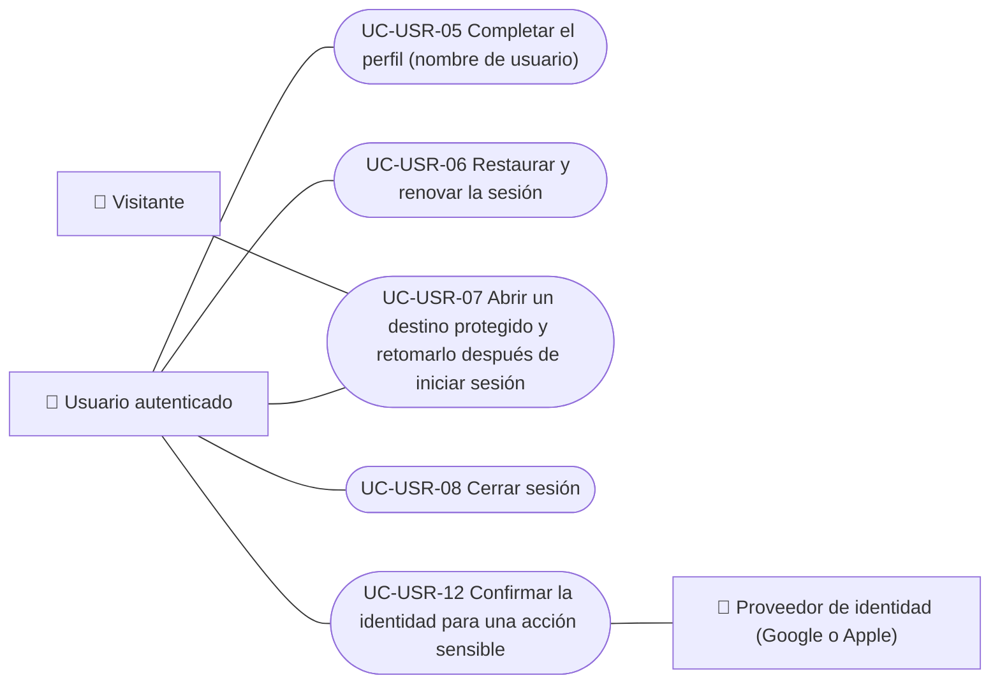
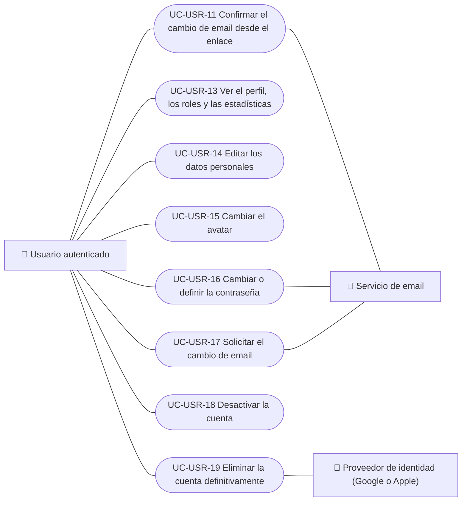
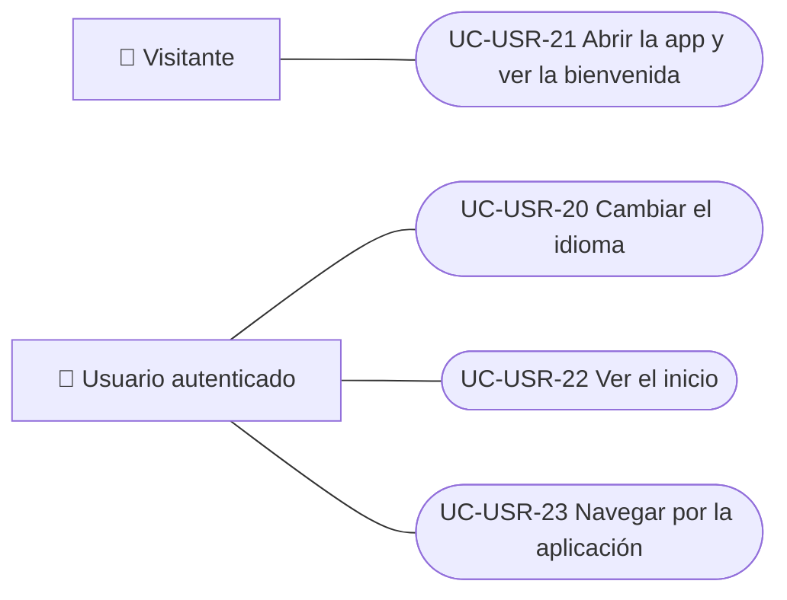

# Casos de uso

Casos de uso del módulo de usuarios y cuenta. Cada caso vale para las plataformas indicadas.

| ID | Caso de uso | Plataformas | Actores |
|---|---|---|---|
| `UC-USR-01` | [Registrarse con email y contraseña](uc-usr-01-sign-up.md) | Web, APK | Visitante, Servicio de email |
| `UC-USR-02` | [Verificar el email o reenviar la verificación](uc-usr-02-verify-email.md) | Web, APK | Visitante, Servicio de email |
| `UC-USR-03` | [Iniciar sesión con contraseña](uc-usr-03-sign-in.md) | Web, APK | Visitante |
| `UC-USR-04` | [Iniciar sesión o registrarse con Google o Apple](uc-usr-04-social-sign-in.md) | Web, APK | Visitante, Proveedor de identidad (Google o Apple) |
| `UC-USR-05` | [Completar el perfil (nombre de usuario)](uc-usr-05-complete-profile.md) | Web, APK | Usuario autenticado |
| `UC-USR-06` | [Restaurar y renovar la sesión](uc-usr-06-restore-session.md) | Web, APK | Usuario autenticado |
| `UC-USR-07` | [Abrir un destino protegido y retomarlo después de iniciar sesión](uc-usr-07-resume-protected-destination.md) | Web, APK | Visitante, Usuario autenticado |
| `UC-USR-08` | [Cerrar sesión](uc-usr-08-sign-out.md) | Web, APK | Usuario autenticado |
| `UC-USR-09` | [Solicitar la recuperación de la contraseña](uc-usr-09-request-password-recovery.md) | Web, APK | Visitante, Servicio de email |
| `UC-USR-10` | [Restablecer la contraseña desde el enlace](uc-usr-10-reset-password.md) | Web, APK | Visitante |
| `UC-USR-11` | [Confirmar el cambio de email desde el enlace](uc-usr-11-confirm-email-change.md) | Web | Usuario autenticado, Servicio de email |
| `UC-USR-12` | [Confirmar la identidad para una acción sensible](uc-usr-12-reauthenticate.md) | Web, APK | Usuario autenticado, Proveedor de identidad (Google o Apple) |
| `UC-USR-13` | [Ver el perfil, los roles y las estadísticas](uc-usr-13-view-profile.md) | Web, APK | Usuario autenticado |
| `UC-USR-14` | [Editar los datos personales](uc-usr-14-edit-profile.md) | Web, APK | Usuario autenticado |
| `UC-USR-15` | [Cambiar el avatar](uc-usr-15-change-avatar.md) | Web, APK | Usuario autenticado |
| `UC-USR-16` | [Cambiar o definir la contraseña](uc-usr-16-change-password.md) | Web, APK | Usuario autenticado, Servicio de email |
| `UC-USR-17` | [Solicitar el cambio de email](uc-usr-17-request-email-change.md) | Web, APK | Usuario autenticado, Servicio de email |
| `UC-USR-18` | [Desactivar la cuenta](uc-usr-18-deactivate-account.md) | Web, APK | Usuario autenticado |
| `UC-USR-19` | [Eliminar la cuenta definitivamente](uc-usr-19-delete-account.md) | Web, APK | Usuario autenticado, Proveedor de identidad (Google o Apple) |
| `UC-USR-20` | [Cambiar el idioma](uc-usr-20-change-language.md) | Web, APK | Usuario autenticado |
| `UC-USR-21` | [Abrir la app y ver la bienvenida](uc-usr-21-welcome.md) | APK | Visitante |
| `UC-USR-22` | [Ver el inicio](uc-usr-22-home.md) | Web, APK | Usuario autenticado |
| `UC-USR-23` | [Navegar por la aplicación](uc-usr-23-navigate.md) | Web, APK | Usuario autenticado |

## Diagrama de casos de uso

### Registro e ingreso

[Ver diagrama de «Registro e ingreso» completo](https://images.vinnot.com/docs/diagrams/v1/es/modules-users-use-cases-readme-8caabe9ca9fd.svg)

### Sesión

[Ver diagrama de «Sesión» completo](https://images.vinnot.com/docs/diagrams/v1/es/modules-users-use-cases-readme-e03825593cd2.svg)

### Perfil y cuenta

[Ver diagrama de «Perfil y cuenta» completo](https://images.vinnot.com/docs/diagrams/v1/es/modules-users-use-cases-readme-995173b630f7.svg)

### Navegación

[Ver diagrama de «Navegación» completo](https://images.vinnot.com/docs/diagrams/v1/es/modules-users-use-cases-readme-82d2ce5fb9af.svg)

## Equivalencia con Lucidchart

| ID | IDs en Lucidchart |
|---|---|
| `UC-USR-01` | [WEB UC-AUTH-01](https://lucid.app/lucidchart/9f11a16b-bb5a-42fc-a9e8-0852b17bd241/edit), [APK UC-AUTH-02](https://lucid.app/lucidchart/e095dd25-e8ac-41ba-bf5b-396e1055f217/edit) |
| `UC-USR-02` | [WEB UC-AUTH-02](https://lucid.app/lucidchart/9f11a16b-bb5a-42fc-a9e8-0852b17bd241/edit), [APK UC-AUTH-03](https://lucid.app/lucidchart/e095dd25-e8ac-41ba-bf5b-396e1055f217/edit) |
| `UC-USR-03` | [WEB UC-AUTH-03](https://lucid.app/lucidchart/9f11a16b-bb5a-42fc-a9e8-0852b17bd241/edit), [APK UC-AUTH-04](https://lucid.app/lucidchart/e095dd25-e8ac-41ba-bf5b-396e1055f217/edit) |
| `UC-USR-04` | [WEB UC-AUTH-04](https://lucid.app/lucidchart/9f11a16b-bb5a-42fc-a9e8-0852b17bd241/edit), [APK UC-AUTH-05](https://lucid.app/lucidchart/e095dd25-e8ac-41ba-bf5b-396e1055f217/edit) |
| `UC-USR-05` | [WEB UC-AUTH-05](https://lucid.app/lucidchart/9f11a16b-bb5a-42fc-a9e8-0852b17bd241/edit), [APK UC-AUTH-06](https://lucid.app/lucidchart/e095dd25-e8ac-41ba-bf5b-396e1055f217/edit) |
| `UC-USR-06` | [WEB UC-AUTH-06](https://lucid.app/lucidchart/9f11a16b-bb5a-42fc-a9e8-0852b17bd241/edit), [APK UC-AUTH-07](https://lucid.app/lucidchart/e095dd25-e8ac-41ba-bf5b-396e1055f217/edit) |
| `UC-USR-07` | [WEB UC-AUTH-07](https://lucid.app/lucidchart/9f11a16b-bb5a-42fc-a9e8-0852b17bd241/edit), [APK UC-AUTH-08](https://lucid.app/lucidchart/e095dd25-e8ac-41ba-bf5b-396e1055f217/edit) |
| `UC-USR-08` | [WEB UC-AUTH-08](https://lucid.app/lucidchart/9f11a16b-bb5a-42fc-a9e8-0852b17bd241/edit), [APK UC-AUTH-11](https://lucid.app/lucidchart/e095dd25-e8ac-41ba-bf5b-396e1055f217/edit) |
| `UC-USR-09` | [WEB UC-AUTH-09](https://lucid.app/lucidchart/9f11a16b-bb5a-42fc-a9e8-0852b17bd241/edit), [APK UC-AUTH-09](https://lucid.app/lucidchart/e095dd25-e8ac-41ba-bf5b-396e1055f217/edit) |
| `UC-USR-10` | [WEB UC-AUTH-10](https://lucid.app/lucidchart/9f11a16b-bb5a-42fc-a9e8-0852b17bd241/edit), [APK UC-AUTH-10](https://lucid.app/lucidchart/e095dd25-e8ac-41ba-bf5b-396e1055f217/edit) |
| `UC-USR-11` | [WEB UC-AUTH-11](https://lucid.app/lucidchart/9f11a16b-bb5a-42fc-a9e8-0852b17bd241/edit) |
| `UC-USR-12` | [WEB UC-AUTH-12](https://lucid.app/lucidchart/9f11a16b-bb5a-42fc-a9e8-0852b17bd241/edit) |
| `UC-USR-13` | [WEB UC-ACC-01](https://lucid.app/lucidchart/9f11a16b-bb5a-42fc-a9e8-0852b17bd241/edit), [APK UC-ACC-01](https://lucid.app/lucidchart/e095dd25-e8ac-41ba-bf5b-396e1055f217/edit) |
| `UC-USR-14` | [WEB UC-ACC-02](https://lucid.app/lucidchart/9f11a16b-bb5a-42fc-a9e8-0852b17bd241/edit), [APK UC-ACC-02](https://lucid.app/lucidchart/e095dd25-e8ac-41ba-bf5b-396e1055f217/edit) |
| `UC-USR-15` | [WEB UC-ACC-03](https://lucid.app/lucidchart/9f11a16b-bb5a-42fc-a9e8-0852b17bd241/edit), [APK UC-ACC-03](https://lucid.app/lucidchart/e095dd25-e8ac-41ba-bf5b-396e1055f217/edit) |
| `UC-USR-16` | [WEB UC-ACC-04](https://lucid.app/lucidchart/9f11a16b-bb5a-42fc-a9e8-0852b17bd241/edit), [APK UC-ACC-04](https://lucid.app/lucidchart/e095dd25-e8ac-41ba-bf5b-396e1055f217/edit) |
| `UC-USR-17` | [WEB UC-ACC-05](https://lucid.app/lucidchart/9f11a16b-bb5a-42fc-a9e8-0852b17bd241/edit), [APK UC-ACC-05](https://lucid.app/lucidchart/e095dd25-e8ac-41ba-bf5b-396e1055f217/edit) |
| `UC-USR-18` | [WEB UC-ACC-06](https://lucid.app/lucidchart/9f11a16b-bb5a-42fc-a9e8-0852b17bd241/edit), [APK UC-ACC-06](https://lucid.app/lucidchart/e095dd25-e8ac-41ba-bf5b-396e1055f217/edit) |
| `UC-USR-19` | [WEB UC-ACC-07](https://lucid.app/lucidchart/9f11a16b-bb5a-42fc-a9e8-0852b17bd241/edit), [APK UC-ACC-07](https://lucid.app/lucidchart/e095dd25-e8ac-41ba-bf5b-396e1055f217/edit) |
| `UC-USR-20` | [WEB UC-ACC-08](https://lucid.app/lucidchart/9f11a16b-bb5a-42fc-a9e8-0852b17bd241/edit), [APK UC-ACC-08](https://lucid.app/lucidchart/e095dd25-e8ac-41ba-bf5b-396e1055f217/edit) |
| `UC-USR-21` | [APK UC-AUTH-01](https://lucid.app/lucidchart/e095dd25-e8ac-41ba-bf5b-396e1055f217/edit) |
| `UC-USR-22` | [APK UC-HOME-01](https://lucid.app/lucidchart/e095dd25-e8ac-41ba-bf5b-396e1055f217/edit) |
| `UC-USR-23` | [APK UC-HOME-02](https://lucid.app/lucidchart/e095dd25-e8ac-41ba-bf5b-396e1055f217/edit) |
