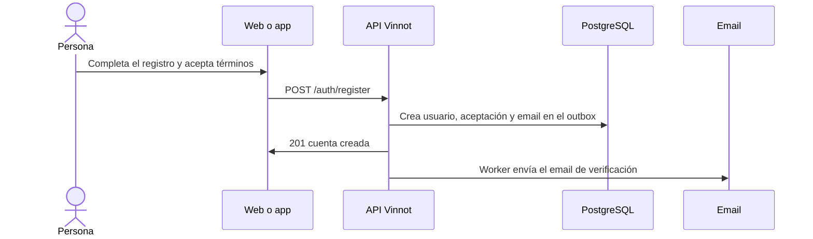

# UC-USR-01 · Registrarse con email y contraseña

| Campo | Valor |
|---|---|
| ID | `UC-USR-01` |
| Módulo | [Usuarios y cuenta](../README.md) |
| Plataformas | Web, APK |
| Actores | Visitante, Servicio de email |
| IDs en Lucidchart | [WEB UC-AUTH-01](https://lucid.app/lucidchart/9f11a16b-bb5a-42fc-a9e8-0852b17bd241/edit), [APK UC-AUTH-02](https://lucid.app/lucidchart/e095dd25-e8ac-41ba-bf5b-396e1055f217/edit) |
| Requisitos | [`RF-WEB-USR-01`](../requirements.md), [`RF-WEB-USR-02`](../requirements.md), [`RF-WEB-USR-03`](../requirements.md), [`RF-APK-USR-01`](../requirements.md), [`RF-APK-USR-02`](../requirements.md), [`RF-APK-USR-03`](../requirements.md) |
| Casos de prueba | [`CP-USR-01`](../testing.md), [`CP-USR-02`](../testing.md), [`CP-USR-03`](../testing.md), [`CP-USR-04`](../testing.md) |

## Precondiciones

- La persona no tiene sesión iniciada.
- Los términos vigentes están publicados.

## Postcondiciones

- Existe una cuenta activa con rol USER, sin email verificado.
- La aceptación de los términos queda registrada con su versión.
- Se encola el email de verificación.

## Flujo principal

1. La persona abre el registro.
2. Completa usuario, email, nombre, apellido, contraseña y su confirmación, y acepta los términos.
3. El cliente valida el formato y envía la solicitud.
4. La API normaliza el usuario, comprueba que usuario y email estén libres, crea la cuenta, registra la aceptación y encola el email de verificación en la misma transacción.
5. El cliente muestra que hay que verificar el email.

## Flujos alternativos

- 4a. Usuario o email ya registrados: la cuenta no se crea y se informa el campo.
- 3a. Datos inválidos o términos sin aceptar: el formulario no se envía.
- 4b. El proveedor de email falla: el registro igual se confirma; el email se reintenta desde el outbox.

## Reglas de negocio

- Usuario: se recorta y pasa a minúsculas; 3 a 40 caracteres; letras, números, punto, guion y guion bajo; empieza y termina con letra o número (`Username`).
- Contraseña: al menos 8 caracteres con mayúscula, minúscula y número (`Password`).
- El alta por email elige el usuario en el registro, así que no pasa por el onboarding.
- Registrarse no inicia sesión: primero hay que verificar el email.

## Diagrama

[Ver diagrama de «UC-USR-01 · Registrarse con email y contraseña» completo](https://images.vinnot.com/docs/diagrams/v1/es/modules-users-use-cases-uc-usr-01-sign-up-bd4a6574bc43.svg)

Diagrama de componentes en Lucidchart: [WEB UC-AUTH-01](https://lucid.app/lucidchart/9f11a16b-bb5a-42fc-a9e8-0852b17bd241/edit), [APK UC-AUTH-02](https://lucid.app/lucidchart/e095dd25-e8ac-41ba-bf5b-396e1055f217/edit).

## Código

| Capa | Ubicación |
|---|---|
| Endpoints | `POST /auth/register` |
| Backend | [`AuthController.java`](../../../../../backend/src/main/java/com/vinnot/user/infrastructure/web/controller/AuthController.java), [`RegisterUserCommandHandler.java`](../../../../../backend/src/main/java/com/vinnot/user/application/command/handler/RegisterUserCommandHandler.java) |
| Web | [`RegisterPage.tsx`](../../../../../frontend-react/src/presentation/pages/public/RegisterPage.tsx), [`useRegisterViewModel.ts`](../../../../../frontend-react/src/presentation/pages/public/useRegisterViewModel.ts), [`auth.store.ts`](../../../../../frontend-react/src/presentation/stores/auth.store.ts), [`auth.service.ts`](../../../../../frontend-react/src/application/services/auth.service.ts), [`auth.client.ts`](../../../../../frontend-react/src/infrastructure/api/clients/auth.client.ts) |
| App | `frontend-mobile/app/(auth)/register.tsx`, [`RegisterScreenView.tsx`](../../../../../frontend-mobile/src/presentation/features/auth/RegisterScreenView.tsx), [`authSlice.ts`](../../../../../frontend-mobile/src/presentation/store/authSlice.ts), [`auth.service.ts`](../../../../../frontend-mobile/src/application/services/auth.service.ts) |

## Tests automáticos

- Backend: [`AccountActionCommandHandlersTest.java`](../../../../../backend/src/test/java/com/vinnot/user/application/command/handler/AccountActionCommandHandlersTest.java), [`AccountEmailOutagePostgresIntegrationTest.java`](../../../../../backend/src/test/java/com/vinnot/user/application/AccountEmailOutagePostgresIntegrationTest.java), [`UsernameTest.java`](../../../../../backend/src/test/java/com/vinnot/user/domain/valueobject/UsernameTest.java), [`PasswordTest.java`](../../../../../backend/src/test/java/com/vinnot/user/domain/valueobject/PasswordTest.java), [`EmailTest.java`](../../../../../backend/src/test/java/com/vinnot/user/domain/valueobject/EmailTest.java)
- Web: [`authErrorViewModels.test.tsx`](../../../../../frontend-react/src/presentation/pages/public/authErrorViewModels.test.tsx), [`auth.service.test.ts`](../../../../../frontend-react/src/application/services/auth.service.test.ts), [`user.validators.test.ts`](../../../../../frontend-react/src/domain/user/user.validators.test.ts)
- App: [`registerRoute.test.tsx`](../../../../../frontend-mobile/src/presentation/features/auth/__tests__/registerRoute.test.tsx), [`auth.service.test.ts`](../../../../../frontend-mobile/src/application/services/auth.service.test.ts)
