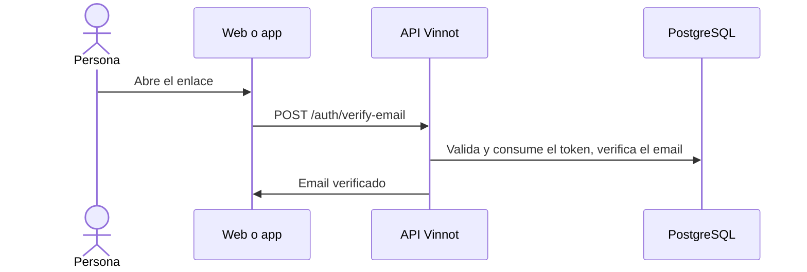

# UC-USR-02 · Verificar el email o reenviar la verificación

| Campo | Valor |
|---|---|
| ID | `UC-USR-02` |
| Módulo | [Usuarios y cuenta](../README.md) |
| Plataformas | Web, APK |
| Actores | Visitante, Servicio de email |
| IDs en Lucidchart | [WEB UC-AUTH-02](https://lucid.app/lucidchart/9f11a16b-bb5a-42fc-a9e8-0852b17bd241/edit), [APK UC-AUTH-03](https://lucid.app/lucidchart/e095dd25-e8ac-41ba-bf5b-396e1055f217/edit) |
| Requisitos | [`RF-WEB-USR-04`](../requirements.md), [`RF-APK-USR-04`](../requirements.md) |
| Casos de prueba | [`CP-USR-05`](../testing.md), [`CP-USR-06`](../testing.md), [`CP-USR-07`](../testing.md) |

## Precondiciones

- La cuenta existe y su email no está verificado.

## Postcondiciones

- El email queda verificado y el token se consume.
- Al reenviar, se emite un enlace nuevo si la cuenta es elegible.

## Flujo principal

1. La persona abre el enlace del email.
2. El cliente envía el token a la API.
3. La API valida el token (tipo, vencimiento y uso), marca el email como verificado y consume el token.
4. El cliente informa el resultado y ofrece iniciar sesión.

## Flujos alternativos

- 3a. Token ausente, inválido, usado o vencido: se informa y se ofrece reenviar la verificación.
- R1. La persona pide reenviar: la API responde igual exista o no la cuenta y encola la solicitud; el worker emite el enlace solo si la cuenta está activa y sin verificar.

## Reglas de negocio

- El token de verificación dura 1440 minutos y es de un solo uso.
- La respuesta al reenvío no revela si el email tiene cuenta.
- Las filas de recuperación se borran después de un día.

## Diagrama

[Ver diagrama de «UC-USR-02 · Verificar el email o reenviar la verificación» completo](https://images.vinnot.com/docs/diagrams/v1/es/modules-users-use-cases-uc-usr-02-verify-email-557729ed779f.svg)

Diagrama de componentes en Lucidchart: [WEB UC-AUTH-02](https://lucid.app/lucidchart/9f11a16b-bb5a-42fc-a9e8-0852b17bd241/edit), [APK UC-AUTH-03](https://lucid.app/lucidchart/e095dd25-e8ac-41ba-bf5b-396e1055f217/edit).

## Código

| Capa | Ubicación |
|---|---|
| Endpoints | `POST /auth/verify-email`, `POST /auth/resend-verification` |
| Backend | [`AuthController.java`](../../../../../backend/src/main/java/com/vinnot/user/infrastructure/web/controller/AuthController.java), [`VerifyEmailCommandHandler.java`](../../../../../backend/src/main/java/com/vinnot/user/application/command/handler/VerifyEmailCommandHandler.java), [`ResendVerificationCommandHandler.java`](../../../../../backend/src/main/java/com/vinnot/user/application/command/handler/ResendVerificationCommandHandler.java), [`IssueAccountRecoveryService.java`](../../../../../backend/src/main/java/com/vinnot/user/application/service/IssueAccountRecoveryService.java) |
| Web | [`VerifyEmailPage.tsx`](../../../../../frontend-react/src/presentation/pages/public/VerifyEmailPage.tsx), [`RegistrationPendingPage.tsx`](../../../../../frontend-react/src/presentation/pages/public/RegistrationPendingPage.tsx), [`useAccountActionViewModels.ts`](../../../../../frontend-react/src/presentation/pages/public/useAccountActionViewModels.ts) |
| App | `frontend-mobile/app/(auth)/verify-email.tsx`, `frontend-mobile/app/(auth)/register-success.tsx`, [`useAccountActions.ts`](../../../../../frontend-mobile/src/presentation/hooks/useAccountActions.ts), [`AccountActionViews.tsx`](../../../../../frontend-mobile/src/presentation/features/auth/AccountActionViews.tsx) |

## Tests automáticos

- Backend: [`AccountActionCommandHandlersTest.java`](../../../../../backend/src/test/java/com/vinnot/user/application/command/handler/AccountActionCommandHandlersTest.java), [`AccountRecoveryPostgresIntegrationTest.java`](../../../../../backend/src/test/java/com/vinnot/user/application/AccountRecoveryPostgresIntegrationTest.java), [`IssueAccountRecoveryServiceTest.java`](../../../../../backend/src/test/java/com/vinnot/user/application/service/IssueAccountRecoveryServiceTest.java), [`AccountActionTokenServiceTest.java`](../../../../../backend/src/test/java/com/vinnot/user/application/service/AccountActionTokenServiceTest.java), [`UserActionTokenTest.java`](../../../../../backend/src/test/java/com/vinnot/user/domain/model/UserActionTokenTest.java)
- Web: Ninguno
- App: [`auth.service.test.ts`](../../../../../frontend-mobile/src/application/services/auth.service.test.ts)
