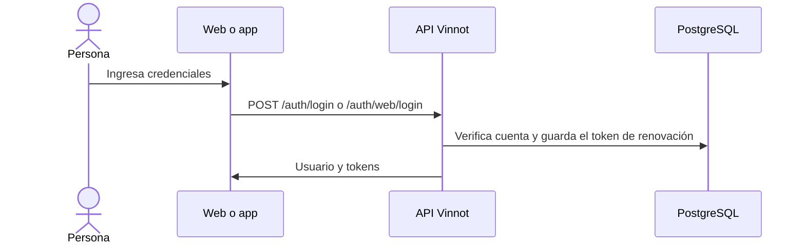

# UC-USR-03 · Iniciar sesión con contraseña

| Campo | Valor |
|---|---|
| ID | `UC-USR-03` |
| Módulo | [Usuarios y cuenta](../README.md) |
| Plataformas | Web, APK |
| Actores | Visitante |
| IDs en Lucidchart | [WEB UC-AUTH-03](https://lucid.app/lucidchart/9f11a16b-bb5a-42fc-a9e8-0852b17bd241/edit), [APK UC-AUTH-04](https://lucid.app/lucidchart/e095dd25-e8ac-41ba-bf5b-396e1055f217/edit) |
| Requisitos | [`RF-WEB-USR-05`](../requirements.md), [`RF-WEB-USR-06`](../requirements.md), [`RF-APK-USR-05`](../requirements.md), [`RF-APK-USR-06`](../requirements.md) |
| Casos de prueba | [`CP-USR-08`](../testing.md), [`CP-USR-09`](../testing.md), [`CP-USR-10`](../testing.md), [`CP-USR-11`](../testing.md), [`CP-USR-12`](../testing.md), [`CP-USR-67`](../testing.md) |

## Precondiciones

- La cuenta existe.

## Postcondiciones

- Hay una sesión: token de acceso de 15 minutos y token de renovación de 7 días.
- En la web la renovación viaja en una cookie HttpOnly; en la app se guarda en SecureStore.

## Flujo principal

1. La persona ingresa su identificador y contraseña. La app acepta usuario o email; la web pide email.
2. El cliente envía las credenciales.
3. La API comprueba credenciales, bloqueo, reactivación y verificación del email, en ese orden.
4. La API emite la sesión y registra el último acceso.
5. El cliente guarda la identidad y navega al destino.

## Flujos alternativos

- 3a. Credenciales incorrectas: no se crea sesión.
- 3b. Cuenta bloqueada: `ACCOUNT_LOCKED`.
- 3c. Cuenta desactivada: el cliente pregunta si se quiere reactivar la cuenta; al confirmar, reintenta con `reactivate` y la cuenta vuelve a estar activa.
- 3d. Email sin verificar: `EMAIL_NOT_VERIFIED` y se ofrece reenviar.
- 3e. La persona no confirma la reactivación: no se crea sesión y la cuenta sigue desactivada.
- 3f. Cinco contraseñas incorrectas seguidas: el inicio de sesión con contraseña se bloquea 15 minutos; cada intento, incluso con la contraseña correcta, recibe HTTP 423 `ACCOUNT_TEMPORARILY_LOCKED` con `Retry-After`, y el titular recibe un correo de seguridad. Varios intentos en paralelo abren un solo bloqueo y mandan un solo correo; los intentos durante el bloqueo no se cuentan.

## Reglas de negocio

- El login está limitado por tasa.
- Un email o username inexistente y una contraseña incorrecta reciben la misma respuesta `AUTH_FAILED`, en un tiempo similar.
- Cada acceso correcto, fallo y bloqueo temporal queda registrado como evento de seguridad (se conserva 180 días).
- Mientras un acceso está en curso no se admite otro envío.

## Diagrama

[Ver diagrama de «UC-USR-03 · Iniciar sesión con contraseña» completo](https://images.vinnot.com/docs/diagrams/v1/es/modules-users-use-cases-uc-usr-03-sign-in-0a54078550bb.svg)

Diagrama de componentes en Lucidchart: [WEB UC-AUTH-03](https://lucid.app/lucidchart/9f11a16b-bb5a-42fc-a9e8-0852b17bd241/edit), [APK UC-AUTH-04](https://lucid.app/lucidchart/e095dd25-e8ac-41ba-bf5b-396e1055f217/edit).

## Código

| Capa | Ubicación |
|---|---|
| Endpoints | `POST /auth/login (app)`, `POST /auth/web/login (web)` |
| Backend | [`AuthController.java`](../../../../../backend/src/main/java/com/vinnot/user/infrastructure/web/controller/AuthController.java), [`BrowserAuthController.java`](../../../../../backend/src/main/java/com/vinnot/user/infrastructure/web/controller/BrowserAuthController.java), [`LoginCommandHandler.java`](../../../../../backend/src/main/java/com/vinnot/user/application/command/handler/LoginCommandHandler.java) |
| Web | [`LoginPage.tsx`](../../../../../frontend-react/src/presentation/pages/public/LoginPage.tsx), [`useLoginViewModel.ts`](../../../../../frontend-react/src/presentation/pages/public/useLoginViewModel.ts), [`auth.store.ts`](../../../../../frontend-react/src/presentation/stores/auth.store.ts), [`auth.service.ts`](../../../../../frontend-react/src/application/services/auth.service.ts) |
| App | `frontend-mobile/app/(auth)/login.tsx`, [`LoginScreenView.tsx`](../../../../../frontend-mobile/src/presentation/features/auth/LoginScreenView.tsx), [`authSlice.ts`](../../../../../frontend-mobile/src/presentation/store/authSlice.ts) |

## Tests automáticos

- Backend: [`AccountActionCommandHandlersTest.java`](../../../../../backend/src/test/java/com/vinnot/user/application/command/handler/AccountActionCommandHandlersTest.java), [`BrowserAuthControllerTest.java`](../../../../../backend/src/test/java/com/vinnot/user/infrastructure/web/controller/BrowserAuthControllerTest.java), [`AuthSessionIssuerTest.java`](../../../../../backend/src/test/java/com/vinnot/user/application/service/AuthSessionIssuerTest.java), [`BrowserSessionPolicyTest.java`](../../../../../backend/src/test/java/com/vinnot/user/infrastructure/web/session/BrowserSessionPolicyTest.java), [`RateLimitPolicyResolverTest.java`](../../../../../backend/src/test/java/com/vinnot/shared/infrastructure/security/RateLimitPolicyResolverTest.java)
- Web: [`auth.service.test.ts`](../../../../../frontend-react/src/application/services/auth.service.test.ts), [`auth.client.test.ts`](../../../../../frontend-react/src/infrastructure/api/clients/auth.client.test.ts), [`auth.store.test.ts`](../../../../../frontend-react/src/presentation/stores/auth.store.test.ts), [`authErrorMessage.test.ts`](../../../../../frontend-react/src/presentation/feedback/authErrorMessage.test.ts), [`useLoginViewModel.test.tsx`](../../../../../frontend-react/src/presentation/pages/public/useLoginViewModel.test.tsx)
- App: [`loginRoute.test.tsx`](../../../../../frontend-mobile/src/presentation/features/auth/__tests__/loginRoute.test.tsx), [`auth.service.test.ts`](../../../../../frontend-mobile/src/application/services/auth.service.test.ts), [`authSlice.test.ts`](../../../../../frontend-mobile/src/presentation/store/authSlice.test.ts)
