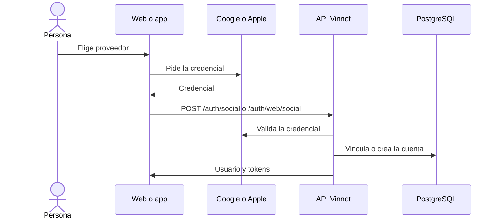

# UC-USR-04 · Iniciar sesión o registrarse con Google o Apple

| Campo | Valor |
|---|---|
| ID | `UC-USR-04` |
| Módulo | [Usuarios y cuenta](../README.md) |
| Plataformas | Web, APK |
| Actores | Visitante, Proveedor de identidad (Google o Apple) |
| IDs en Lucidchart | [WEB UC-AUTH-04](https://lucid.app/lucidchart/9f11a16b-bb5a-42fc-a9e8-0852b17bd241/edit), [APK UC-AUTH-05](https://lucid.app/lucidchart/e095dd25-e8ac-41ba-bf5b-396e1055f217/edit) |
| Requisitos | [`RF-WEB-USR-07`](../requirements.md), [`RF-WEB-USR-08`](../requirements.md), [`RF-APK-USR-07`](../requirements.md), [`RF-APK-USR-08`](../requirements.md), [`RF-APK-USR-09`](../requirements.md), [`RF-APK-USR-10`](../requirements.md) |
| Casos de prueba | [`CP-USR-13`](../testing.md), [`CP-USR-14`](../testing.md), [`CP-USR-15`](../testing.md), [`CP-USR-16`](../testing.md) |

## Precondiciones

- El proveedor está habilitado y configurado en el cliente y en la API.

## Postcondiciones

- Hay una sesión de Vinnot. Si la cuenta es nueva, queda con el onboarding pendiente.
- La identidad social queda vinculada a la cuenta.

## Flujo principal

1. La persona elige Google o Apple.
2. El SDK del proveedor devuelve una credencial.
3. El cliente envía la credencial a la API.
4. La API valida la credencial con el proveedor; si el email ya tiene cuenta la vincula, si no crea una cuenta nueva con usuario generado `vinnoter-xxxxxxxx`.
5. La API emite la sesión de Vinnot.

## Flujos alternativos

- 2a. La persona cancela o el SDK falla: no se crea sesión.
- 4a. Credencial rechazada: no se crea sesión.
- 5a. Cuenta nueva: el cliente lleva a completar el perfil (UC-USR-05).

## Reglas de negocio

- En la app, Apple solo aparece en iOS; en Android hay Google.
- Facebook existe en el código pero está deshabilitado en producción.
- La credencial del proveedor nunca reemplaza al token de Vinnot.

## Diagrama

[Ver diagrama de «UC-USR-04 · Iniciar sesión o registrarse con Google o Apple» completo](https://images.vinnot.com/docs/diagrams/v1/es/modules-users-use-cases-uc-usr-04-social-sign-in-fd6c0e256069.svg)

Diagrama de componentes en Lucidchart: [WEB UC-AUTH-04](https://lucid.app/lucidchart/9f11a16b-bb5a-42fc-a9e8-0852b17bd241/edit), [APK UC-AUTH-05](https://lucid.app/lucidchart/e095dd25-e8ac-41ba-bf5b-396e1055f217/edit).

## Código

| Capa | Ubicación |
|---|---|
| Endpoints | `POST /auth/social (app)`, `POST /auth/web/social (web)` |
| Backend | [`AuthController.java`](../../../../../backend/src/main/java/com/vinnot/user/infrastructure/web/controller/AuthController.java), [`BrowserAuthController.java`](../../../../../backend/src/main/java/com/vinnot/user/infrastructure/web/controller/BrowserAuthController.java), [`SocialLoginCommandHandler.java`](../../../../../backend/src/main/java/com/vinnot/user/application/command/handler/SocialLoginCommandHandler.java) |
| Web | [`AuthSocialButtons.tsx`](../../../../../frontend-react/src/presentation/components/auth/AuthSocialButtons.tsx), [`socialAuth.service.ts`](../../../../../frontend-react/src/application/services/socialAuth.service.ts), [`socialIdentity.gateway.ts`](../../../../../frontend-react/src/infrastructure/identity/socialIdentity.gateway.ts) |
| App | [`AuthSocialButtons.tsx`](../../../../../frontend-mobile/src/presentation/features/auth/AuthSocialButtons.tsx), [`socialIdentity.gateway.ts`](../../../../../frontend-mobile/src/infrastructure/identity/socialIdentity.gateway.ts), [`socialAuth.service.ts`](../../../../../frontend-mobile/src/application/services/socialAuth.service.ts) |

## Tests automáticos

- Backend: [`SocialLoginCommandHandlerTest.java`](../../../../../backend/src/test/java/com/vinnot/user/application/command/handler/SocialLoginCommandHandlerTest.java), [`SocialIdentityTest.java`](../../../../../backend/src/test/java/com/vinnot/user/domain/model/SocialIdentityTest.java), [`SocialIdentityVerifierAdapterTest.java`](../../../../../backend/src/test/java/com/vinnot/user/infrastructure/identity/SocialIdentityVerifierAdapterTest.java), [`SocialIdTokenVerificationTest.java`](../../../../../backend/src/test/java/com/vinnot/user/infrastructure/identity/SocialIdTokenVerificationTest.java)
- Web: [`AuthSocialButtons.test.tsx`](../../../../../frontend-react/src/presentation/components/auth/AuthSocialButtons.test.tsx), [`socialAuth.service.test.ts`](../../../../../frontend-react/src/application/services/socialAuth.service.test.ts)
- App: [`AuthSocialButtons.test.tsx`](../../../../../frontend-mobile/src/presentation/features/auth/AuthSocialButtons.test.tsx), [`socialIdentity.gateway.test.ts`](../../../../../frontend-mobile/src/infrastructure/identity/socialIdentity.gateway.test.ts), [`socialAuth.service.test.ts`](../../../../../frontend-mobile/src/application/services/socialAuth.service.test.ts)
