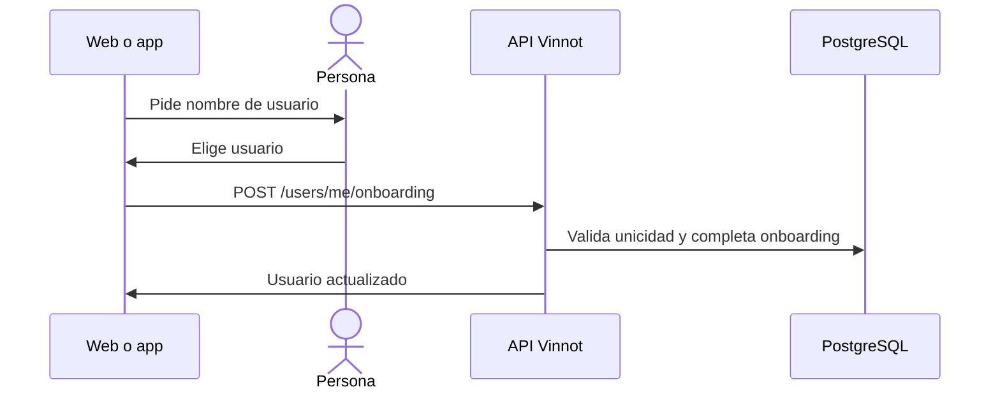

# UC-USR-05 · Completar el perfil (nombre de usuario)

| Campo | Valor |
|---|---|
| ID | `UC-USR-05` |
| Módulo | [Usuarios y cuenta](../README.md) |
| Plataformas | Web, APK |
| Actores | Usuario autenticado |
| IDs en Lucidchart | [WEB UC-AUTH-05](https://lucid.app/lucidchart/9f11a16b-bb5a-42fc-a9e8-0852b17bd241/edit), [APK UC-AUTH-06](https://lucid.app/lucidchart/e095dd25-e8ac-41ba-bf5b-396e1055f217/edit) |
| Requisitos | [`RF-WEB-USR-09`](../requirements.md), [`RF-APK-USR-11`](../requirements.md) |
| Casos de prueba | [`CP-USR-17`](../testing.md), [`CP-USR-18`](../testing.md) |

## Precondiciones

- La cuenta tiene el onboarding pendiente (alta social).

## Postcondiciones

- El onboarding queda completo, con el usuario elegido o el generado.

## Flujo principal

1. Al entrar, el cliente detecta el onboarding pendiente y abre «Completar perfil».
2. La persona elige un nombre de usuario.
3. La API normaliza el usuario, comprueba que esté libre, completa el onboarding y guarda.
4. El cliente continúa al destino original.

## Flujos alternativos

- 3a. Usuario ocupado o inválido: se informa y se mantiene la pantalla.

## Reglas de negocio

- La API también acepta completar el onboarding sin usuario y conserva el generado.
- Repetir la operación no crea nada nuevo; el flag queda en completo.

## Diagrama

[Ver diagrama de «UC-USR-05 · Completar el perfil (nombre de usuario)» completo](https://images.vinnot.com/docs/diagrams/v1/es/modules-users-use-cases-uc-usr-05-complete-profile-455af4798fb2.svg)

Diagrama de componentes en Lucidchart: [WEB UC-AUTH-05](https://lucid.app/lucidchart/9f11a16b-bb5a-42fc-a9e8-0852b17bd241/edit), [APK UC-AUTH-06](https://lucid.app/lucidchart/e095dd25-e8ac-41ba-bf5b-396e1055f217/edit).

## Código

| Capa | Ubicación |
|---|---|
| Endpoints | `POST /users/me/onboarding` |
| Backend | [`UserController.java`](../../../../../backend/src/main/java/com/vinnot/user/infrastructure/web/controller/UserController.java), [`CompleteUserOnboardingCommandHandler.java`](../../../../../backend/src/main/java/com/vinnot/user/application/command/handler/CompleteUserOnboardingCommandHandler.java) |
| Web | [`CompleteProfilePage.tsx`](../../../../../frontend-react/src/presentation/pages/user/CompleteProfilePage.tsx), [`useCompleteOnboarding.ts`](../../../../../frontend-react/src/presentation/hooks/queries/user/useCompleteOnboarding.ts), [`App.tsx`](../../../../../frontend-react/src/app/App.tsx) |
| App | `frontend-mobile/app/(app)/complete-profile.tsx`, `frontend-mobile/app/(app)/_layout.tsx` |

## Tests automáticos

- Backend: [`CompleteUserOnboardingCommandHandlerTest.java`](../../../../../backend/src/test/java/com/vinnot/user/application/command/handler/CompleteUserOnboardingCommandHandlerTest.java)
- Web: Ninguno
- App: [`loginRoute.test.tsx`](../../../../../frontend-mobile/src/presentation/features/auth/__tests__/loginRoute.test.tsx), [`authSession.service.test.ts`](../../../../../frontend-mobile/src/application/services/authSession.service.test.ts)
