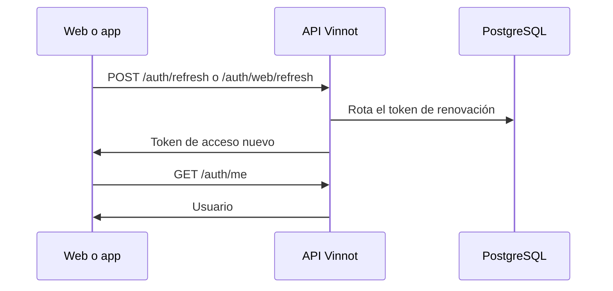

# UC-USR-06 · Restaurar y renovar la sesión

| Campo | Valor |
|---|---|
| ID | `UC-USR-06` |
| Módulo | [Usuarios y cuenta](../README.md) |
| Plataformas | Web, APK |
| Actores | Usuario autenticado |
| IDs en Lucidchart | [WEB UC-AUTH-06](https://lucid.app/lucidchart/9f11a16b-bb5a-42fc-a9e8-0852b17bd241/edit), [APK UC-AUTH-07](https://lucid.app/lucidchart/e095dd25-e8ac-41ba-bf5b-396e1055f217/edit) |
| Requisitos | [`RF-WEB-USR-10`](../requirements.md), [`RF-WEB-USR-11`](../requirements.md), [`RF-APK-USR-12`](../requirements.md), [`RF-APK-USR-13`](../requirements.md) |
| Casos de prueba | [`CP-USR-19`](../testing.md), [`CP-USR-20`](../testing.md), [`CP-USR-21`](../testing.md), [`CP-USR-22`](../testing.md) |

## Precondiciones

- Hubo una sesión previa en el dispositivo o navegador.

## Postcondiciones

- La sesión queda restaurada con tokens nuevos, o el cliente queda anónimo.

## Flujo principal

1. Al abrir el cliente, se marca la sesión como inicializando y no se redirige todavía.
2. El cliente pide un token nuevo: la web con la cookie, la app con el token guardado en SecureStore.
3. La API rota el token de renovación y devuelve un token de acceso.
4. El cliente consulta `GET /auth/me` y publica la identidad.
5. Durante el uso, un 401 dispara una única renovación compartida y el request se reintenta una vez.

## Flujos alternativos

- 2a. No hay sesión guardada: el cliente queda anónimo.
- 3a. Renovación rechazada (vencida, revocada o cuenta bloqueada): se limpia la sesión.
- 3b. Error de red, 429 o 5xx en la app: se conserva la identidad guardada y se reintenta después.

## Reglas de negocio

- En la web, login, renovación y logout se serializan entre pestañas con Web Locks cuando el navegador lo permite.
- Una respuesta de una sesión anterior no puede restaurar ni pisar la sesión actual.
- La app guarda la intención de rotación antes de renovar, así puede recuperar el mismo sucesor si se pierde la respuesta.

## Diagrama

[Ver diagrama de «UC-USR-06 · Restaurar y renovar la sesión» completo](https://images.vinnot.com/docs/diagrams/v1/es/modules-users-use-cases-uc-usr-06-restore-session-debf786bf52e.svg)

Diagrama de componentes en Lucidchart: [WEB UC-AUTH-06](https://lucid.app/lucidchart/9f11a16b-bb5a-42fc-a9e8-0852b17bd241/edit), [APK UC-AUTH-07](https://lucid.app/lucidchart/e095dd25-e8ac-41ba-bf5b-396e1055f217/edit).

## Código

| Capa | Ubicación |
|---|---|
| Endpoints | `POST /auth/refresh (app)`, `POST /auth/web/refresh (web)`, `GET /auth/me` |
| Backend | [`AuthController.java`](../../../../../backend/src/main/java/com/vinnot/user/infrastructure/web/controller/AuthController.java), [`BrowserAuthController.java`](../../../../../backend/src/main/java/com/vinnot/user/infrastructure/web/controller/BrowserAuthController.java), [`RefreshTokenCommandHandler.java`](../../../../../backend/src/main/java/com/vinnot/user/application/command/handler/RefreshTokenCommandHandler.java) |
| Web | [`AuthProvider.tsx`](../../../../../frontend-react/src/app/providers/AuthProvider.tsx), [`http.ts`](../../../../../frontend-react/src/infrastructure/http/http.ts), [`browserSession.ts`](../../../../../frontend-react/src/infrastructure/http/browserSession.ts) |
| App | [`AuthProvider.tsx`](../../../../../frontend-mobile/src/presentation/providers/AuthProvider.tsx), [`authSession.service.ts`](../../../../../frontend-mobile/src/application/services/authSession.service.ts), [`sessionRenewal.service.ts`](../../../../../frontend-mobile/src/application/services/sessionRenewal.service.ts), [`authSession.storage.ts`](../../../../../frontend-mobile/src/infrastructure/storage/authSession.storage.ts) |

## Tests automáticos

- Backend: [`SessionCommandHandlersTest.java`](../../../../../backend/src/test/java/com/vinnot/user/application/command/handler/SessionCommandHandlersTest.java), [`BrowserAuthControllerTest.java`](../../../../../backend/src/test/java/com/vinnot/user/infrastructure/web/controller/BrowserAuthControllerTest.java), [`RefreshTokenHasherTest.java`](../../../../../backend/src/test/java/com/vinnot/user/application/service/RefreshTokenHasherTest.java), [`JwtAuthenticationFilterTest.java`](../../../../../backend/src/test/java/com/vinnot/shared/infrastructure/security/JwtAuthenticationFilterTest.java), [`SessionAccessHttpPostgresIntegrationTest.java`](../../../../../backend/src/test/java/com/vinnot/shared/infrastructure/SessionAccessHttpPostgresIntegrationTest.java)
- Web: [`AuthProvider.test.tsx`](../../../../../frontend-react/src/app/providers/AuthProvider.test.tsx), [`auth.store.test.ts`](../../../../../frontend-react/src/presentation/stores/auth.store.test.ts), [`browserSession.test.ts`](../../../../../frontend-react/src/infrastructure/http/browserSession.test.ts), [`http.session.test.ts`](../../../../../frontend-react/src/infrastructure/http/http.session.test.ts)
- App: [`authSlice.test.ts`](../../../../../frontend-mobile/src/presentation/store/authSlice.test.ts), [`authSession.service.test.ts`](../../../../../frontend-mobile/src/application/services/authSession.service.test.ts), [`authSession.storage.test.ts`](../../../../../frontend-mobile/src/infrastructure/storage/authSession.storage.test.ts), [`sessionRenewal.service.test.ts`](../../../../../frontend-mobile/src/application/services/sessionRenewal.service.test.ts), [`startupRoutes.test.tsx`](../../../../../frontend-mobile/src/presentation/features/auth/__tests__/startupRoutes.test.tsx)
