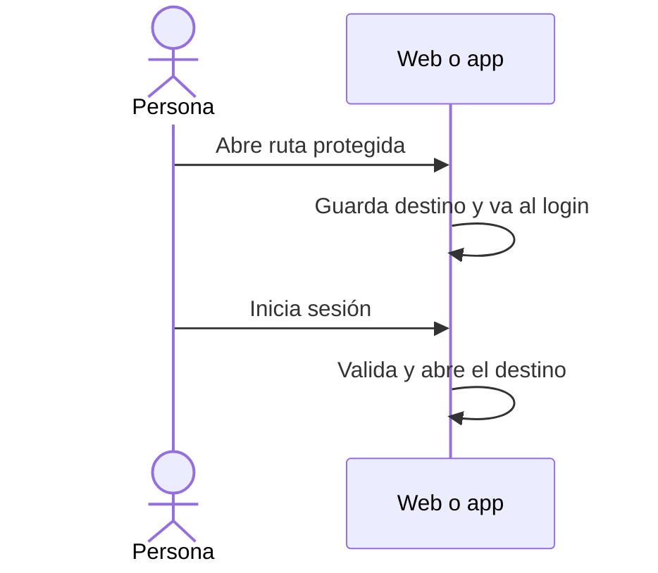

# UC-USR-07 · Abrir un destino protegido y retomarlo después de iniciar sesión

| Campo | Valor |
|---|---|
| ID | `UC-USR-07` |
| Módulo | [Usuarios y cuenta](../README.md) |
| Plataformas | Web, APK |
| Actores | Visitante, Usuario autenticado |
| IDs en Lucidchart | [WEB UC-AUTH-07](https://lucid.app/lucidchart/9f11a16b-bb5a-42fc-a9e8-0852b17bd241/edit), [APK UC-AUTH-08](https://lucid.app/lucidchart/e095dd25-e8ac-41ba-bf5b-396e1055f217/edit) |
| Requisitos | [`RF-WEB-USR-12`](../requirements.md), [`RF-APK-USR-14`](../requirements.md) |
| Casos de prueba | [`CP-USR-23`](../testing.md), [`CP-USR-24`](../testing.md) |

## Precondiciones

- La persona abre una ruta que exige sesión (por enlace, deep link o navegación).

## Postcondiciones

- Después de iniciar sesión, términos y onboarding, el cliente abre el destino pedido.

## Flujo principal

1. El guard detecta que no hay sesión.
2. El cliente guarda el destino y lleva al login (en la web, con `returnUrl`).
3. La persona inicia sesión (UC-USR-03 o UC-USR-04).
4. Si faltan términos u onboarding, se completan primero.
5. El cliente valida el destino y lo abre.

## Flujos alternativos

- 5a. Destino inválido (externo, con esquema, doble barra o caracteres de control): se usa el destino por defecto.

## Reglas de negocio

- El guard de la interfaz no autoriza: la API vuelve a controlar cada recurso.
- La app valida los enlaces entrantes antes de pasarlos al router (hasta 4096 caracteres, UTF-8 válido).

## Diagrama

[Ver diagrama de «UC-USR-07 · Abrir un destino protegido y retomarlo después de iniciar sesión» completo](https://images.vinnot.com/docs/diagrams/v1/es/modules-users-use-cases-uc-usr-07-resume-protected-destination-e40e86bdcc03.svg)

Diagrama de componentes en Lucidchart: [WEB UC-AUTH-07](https://lucid.app/lucidchart/9f11a16b-bb5a-42fc-a9e8-0852b17bd241/edit), [APK UC-AUTH-08](https://lucid.app/lucidchart/e095dd25-e8ac-41ba-bf5b-396e1055f217/edit).

## Código

| Capa | Ubicación |
|---|---|
| Endpoints | (solo cliente; la API responde 401) |
| Backend | [`SecurityConfig.java`](../../../../../backend/src/main/java/com/vinnot/shared/infrastructure/config/SecurityConfig.java) |
| Web | [`ProtectedRoute.tsx`](../../../../../frontend-react/src/presentation/components/auth/ProtectedRoute.tsx), [`useAuthReturnPath.ts`](../../../../../frontend-react/src/presentation/hooks/useAuthReturnPath.ts), [`returnPath.ts`](../../../../../frontend-react/src/domain/user/returnPath.ts) |
| App | [`guards.tsx`](../../../../../frontend-mobile/src/presentation/navigation/guards.tsx), [`returnPath.ts`](../../../../../frontend-mobile/src/domain/navigation/returnPath.ts), [`+native-intent.tsx`](../../../../../frontend-mobile/app/+native-intent.tsx), [`nativeIntent.ts`](../../../../../frontend-mobile/src/domain/navigation/nativeIntent.ts) |

## Tests automáticos

- Backend: [`SecurityConfigAccessTest.java`](../../../../../backend/src/test/java/com/vinnot/shared/infrastructure/config/SecurityConfigAccessTest.java)
- Web: [`useAuthReturnPath.test.tsx`](../../../../../frontend-react/src/presentation/hooks/useAuthReturnPath.test.tsx), [`returnPath.test.ts`](../../../../../frontend-react/src/domain/user/returnPath.test.ts)
- App: [`guards.test.tsx`](../../../../../frontend-mobile/src/presentation/navigation/guards.test.tsx), [`returnPath.test.ts`](../../../../../frontend-mobile/src/domain/navigation/returnPath.test.ts), [`nativeIntent.test.ts`](../../../../../frontend-mobile/src/domain/navigation/nativeIntent.test.ts), [`loginRoute.test.tsx`](../../../../../frontend-mobile/src/presentation/features/auth/__tests__/loginRoute.test.tsx)
