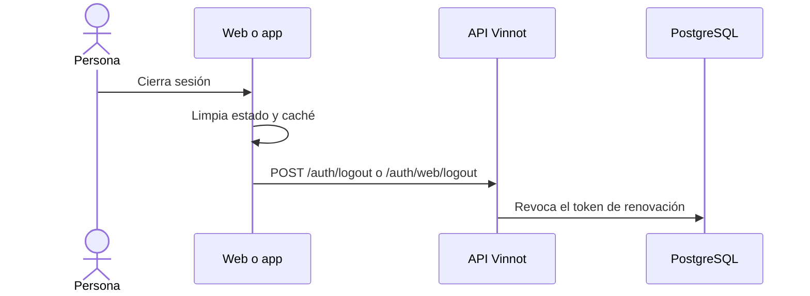

# UC-USR-08 · Cerrar sesión

| Campo | Valor |
|---|---|
| ID | `UC-USR-08` |
| Módulo | [Usuarios y cuenta](../README.md) |
| Plataformas | Web, APK |
| Actores | Usuario autenticado |
| IDs en Lucidchart | [WEB UC-AUTH-08](https://lucid.app/lucidchart/9f11a16b-bb5a-42fc-a9e8-0852b17bd241/edit), [APK UC-AUTH-11](https://lucid.app/lucidchart/e095dd25-e8ac-41ba-bf5b-396e1055f217/edit) |
| Requisitos | [`RF-WEB-USR-13`](../requirements.md), [`RF-APK-USR-15`](../requirements.md) |
| Casos de prueba | [`CP-USR-25`](../testing.md), [`CP-USR-26`](../testing.md) |

## Precondiciones

- Hay una sesión iniciada.

## Postcondiciones

- La sesión queda revocada en la API y el cliente borra identidad y caché privada.

## Flujo principal

1. La persona elige cerrar sesión.
2. El cliente limpia estado y caché privados sin esperar la respuesta.
3. El cliente pide a la API revocar la sesión (la app también envía su token push para darlo de baja).
4. La API revoca el token de renovación.

## Flujos alternativos

- 3a. Sin red en la web: queda una marca de revocación pendiente que bloquea la restauración automática hasta reintentar.

## Reglas de negocio

- Un cierre fallido no se presenta como revocación confirmada.

## Diagrama

[Ver diagrama de «UC-USR-08 · Cerrar sesión» completo](https://images.vinnot.com/docs/diagrams/v1/es/modules-users-use-cases-uc-usr-08-sign-out-104fa4593bda.svg)

Diagrama de componentes en Lucidchart: [WEB UC-AUTH-08](https://lucid.app/lucidchart/9f11a16b-bb5a-42fc-a9e8-0852b17bd241/edit), [APK UC-AUTH-11](https://lucid.app/lucidchart/e095dd25-e8ac-41ba-bf5b-396e1055f217/edit).

## Código

| Capa | Ubicación |
|---|---|
| Endpoints | `POST /auth/logout (app)`, `POST /auth/web/logout (web)` |
| Backend | [`AuthController.java`](../../../../../backend/src/main/java/com/vinnot/user/infrastructure/web/controller/AuthController.java), [`BrowserAuthController.java`](../../../../../backend/src/main/java/com/vinnot/user/infrastructure/web/controller/BrowserAuthController.java), [`LogoutCommandHandler.java`](../../../../../backend/src/main/java/com/vinnot/user/application/command/handler/LogoutCommandHandler.java) |
| Web | [`AppHeader.tsx`](../../../../../frontend-react/src/presentation/components/layout/AppHeader.tsx), [`auth.store.ts`](../../../../../frontend-react/src/presentation/stores/auth.store.ts) |
| App | [`ProfileScreen.tsx`](../../../../../frontend-mobile/src/presentation/features/profile/ProfileScreen.tsx), [`authSlice.ts`](../../../../../frontend-mobile/src/presentation/store/authSlice.ts) |

## Tests automáticos

- Backend: [`SessionCommandHandlersTest.java`](../../../../../backend/src/test/java/com/vinnot/user/application/command/handler/SessionCommandHandlersTest.java), [`BrowserAuthControllerTest.java`](../../../../../backend/src/test/java/com/vinnot/user/infrastructure/web/controller/BrowserAuthControllerTest.java)
- Web: [`auth.store.test.ts`](../../../../../frontend-react/src/presentation/stores/auth.store.test.ts), [`auth.client.test.ts`](../../../../../frontend-react/src/infrastructure/api/clients/auth.client.test.ts)
- App: [`profileRoute.test.tsx`](../../../../../frontend-mobile/src/presentation/features/profile/__tests__/profileRoute.test.tsx), [`auth.service.test.ts`](../../../../../frontend-mobile/src/application/services/auth.service.test.ts)
